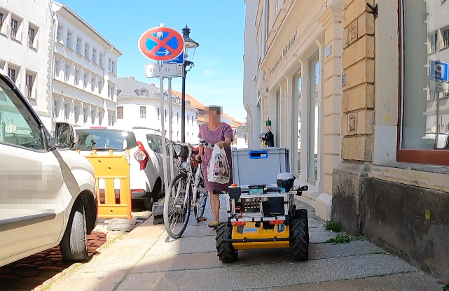
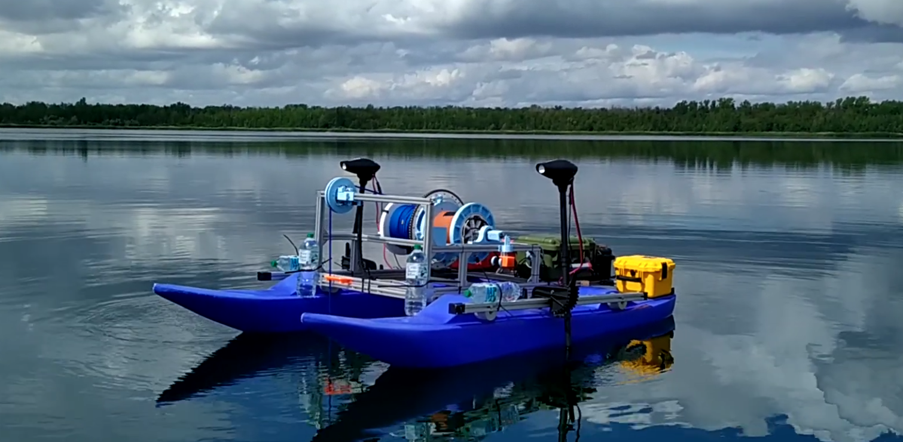
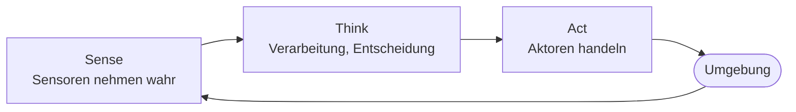
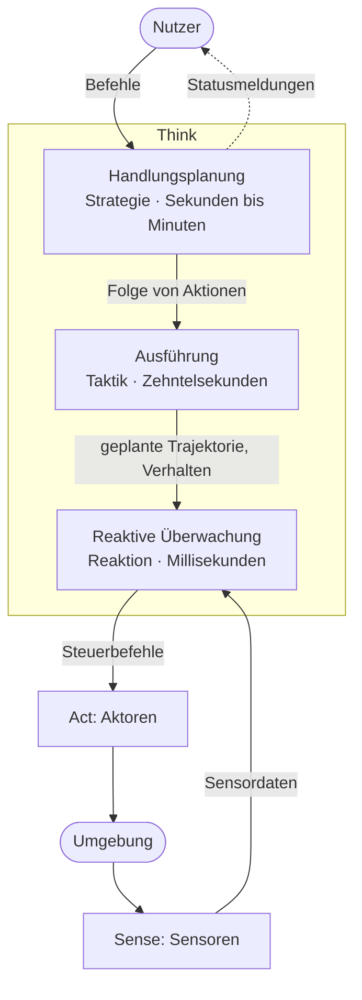
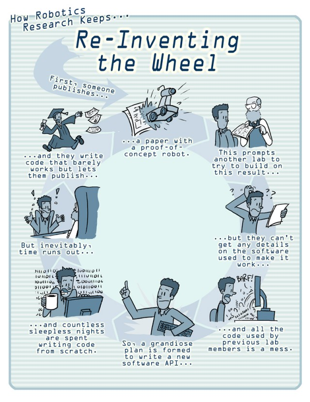
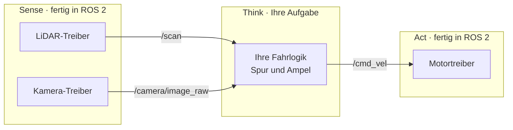

<!--

author:   Sebastian Zug & Georg Jäger & Copilot & Claude Code (Opus 5.5) mit LiaScript Teaching-Agent
email:    sebastian.zug@informatik.tu-freiberg.de & Georg.Jaeger@informatik.tu-freiberg.de
version:  0.3.0
language: de
narrator: Deutsch Female

import:   https://raw.githubusercontent.com/TUBAF-IfI-LiaScript/VL_SoftwareprojektRobotik/refs/heads/master/config.md
          https://raw.githubusercontent.com/liaTemplates/mermaid_template/master/README.md
  
-->

# Einführung

<!-- data-type="none" -->
| Parameter            | Kursinformationen                                                                                             |
| -------------------- | ------------------------------------------------------------------------------------------------------------- |
| **Veranstaltung:**   | @config.lecture                                                                                               |
| **Semester**         | @config.semester                                                                                              |
| **Hochschule:**      | `Technische Universität Freiberg`                                                                             |
| **Inhalte:**         | `Einführung in die mobile Robotik`                                                                            |
| **Link auf GitHub:** | https://github.com/TUBAF-IfI-LiaScript/VL_SoftwareprojektRobotik/blob/master/00_Einfuehrung/00_Einfuehrung.md |
| **Autoren**          | @author                                                                                                       |

--------------------------------------------------------------------------------

**Zielstellung der heutigen Veranstaltung**

Nach dieser Vorlesung können Sie

+ die Projektaufgabe und den Ablauf der Veranstaltung (VL, Ü, P, Prüfungsleistung) beschreiben,
+ entscheiden, ob ein System nach unserer Arbeitsdefinition ein Roboter ist, und es nach Autonomie, Mobilität und Sensorik einordnen,
+ für ein Einsatzszenario die wichtigsten Herausforderungen benennen,
+ Aufgaben des TurtleBots den Schritten Sense, Think und Act zuordnen,
+ begründen, warum wir ein Framework wie ROS 2 einsetzen.

--------------------------------------------------------------------------------

<!-- kurslandkarte:wo-start -->

## Wo stehen wir?

    --{{0}}--
Kurz zur Orientierung. Wir sind in Block 1, Termin 1 von 32. Sie lernen die Projektaufgabe kennen: Ein TurtleBot soll autonom durch die Verkehrswelt fahren. Neu sind heute: Projektaufgabe Verkehrswelt, Roboter, Sense-Think-Act, TurtleBot 3 Burger, Warum ROS?.

**Ziel im Projekt:** Sie lernen die Projektaufgabe kennen: Ein TurtleBot soll autonom durch die Verkehrswelt fahren.

**Block 1 · ROS-Grundlagen** – Termin 1 von 32, heute markiert mit ▶

<!-- data-type="none" -->
| Woche ab | Vorlesung | Übung | Praktikum |
| :-- | :-- | :-- | :-- |
| **19.10.2026** | **▶ [VL 1 Einführung](https://liascript.github.io/course/?https://raw.githubusercontent.com/TUBAF-IfI-LiaScript/VL_SoftwareprojektRobotik/master/00_Einfuehrung/00_Einfuehrung.md)** |  |  |
| 26.10.2026 | [VL 2 ROS 2 Grundlagen](https://liascript.github.io/course/?https://raw.githubusercontent.com/TUBAF-IfI-LiaScript/VL_SoftwareprojektRobotik/master/03_ROS_Grundlagen_I/03_EinfuehrungROS.md) | [Ü 1 Linux Shell](https://liascript.github.io/course/?https://raw.githubusercontent.com/TUBAF-IfI-LiaScript/VL_SoftwareprojektRobotik/master/exercises/exercise_00_linux_shell/README.md) |  |
| 2.11.2026 | [VL 3 ROS 2 Pakete](https://liascript.github.io/course/?https://raw.githubusercontent.com/TUBAF-IfI-LiaScript/VL_SoftwareprojektRobotik/master/04_ROS_Pakete_Tools/04_ROS_Pakete.md) |  |  |
| 9.11.2026 | [VL 4 Koordinaten + QoS](https://liascript.github.io/course/?https://raw.githubusercontent.com/TUBAF-IfI-LiaScript/VL_SoftwareprojektRobotik/master/02_Koordinatensysteme/02_Koordinatentransformation.md) | [Ü 2 ROS 2 Werkzeuge](https://liascript.github.io/course/?https://raw.githubusercontent.com/TUBAF-IfI-LiaScript/VL_SoftwareprojektRobotik/master/exercises/exercise_00b_ros2_werkzeuge/README.md) |  |
| 23.11.2026 |  |  | [P 1 TurtleBot + Bags](https://liascript.github.io/course/?https://raw.githubusercontent.com/TUBAF-IfI-LiaScript/VL_SoftwareprojektRobotik/master/exercises/praktikum_01_turtlebot/README.md) |

- **Sie brauchen:** nichts – wir fangen an
- **Heute neu:** [Projektaufgabe Verkehrswelt](https://tubaf-ifi-liascript.github.io/VL_SoftwareprojektRobotik/kurslandkarte/#begriff=verkehrswelt) · [Roboter](https://tubaf-ifi-liascript.github.io/VL_SoftwareprojektRobotik/kurslandkarte/#begriff=roboter) · [Sense-Think-Act](https://tubaf-ifi-liascript.github.io/VL_SoftwareprojektRobotik/kurslandkarte/#begriff=sta) · [TurtleBot 3 Burger](https://tubaf-ifi-liascript.github.io/VL_SoftwareprojektRobotik/kurslandkarte/#begriff=turtlebot) · [Warum ROS?](https://tubaf-ifi-liascript.github.io/VL_SoftwareprojektRobotik/kurslandkarte/#begriff=rosmotivation)

[🗺️ Ganze Kurslandkarte öffnen](https://tubaf-ifi-liascript.github.io/VL_SoftwareprojektRobotik/kurslandkarte/#termin=00) – dort finden Sie jeden Begriff mit Erklärung, typischer Stolperfalle, Link auf die passende Folie und die roten Fäden durch die Veranstaltung.

<!-- kurslandkarte:wo-ende -->

## Unser Ziel: Autonomes Fahren im Miniaturformat

    --{{0}}--
Bevor wir über Definitionen sprechen, schauen wir auf das Ziel dieser Veranstaltung. Am Ende des Sommersemesters soll Ihr TurtleBot selbstständig durch eine kleine Verkehrswelt fahren: Er folgt der Straße, hält an der roten Ampel, beachtet Verkehrszeichen, lässt Fußgänger passieren und parkt am Ende ein. Alles, was Sie in Vorlesung und Übung lernen, ist ein Baustein für dieses Gesamtsystem.

!?[TurtleBot in der Verkehrswelt](https://github.com/user-attachments/assets/9ccb6e25-ef94-4707-b858-812347618593 "TurtleBot 3 im Praktikum: Fahrspur, Parkbuchten und Verkehrszeichen")

**Die Projektaufgabe**

Ein TurtleBot 3 Burger bewegt sich autonom in einer Miniatur-Verkehrswelt auf schwarzem Untergrund und muss dabei

+ **Straßen und Fahrspuren** erkennen und ihnen folgen,
+ **Ampelanlagen** und **Verkehrszeichen** erkennen und befolgen,
+ **Fußgängern** und Hindernissen ausweichen bzw. vor ihnen anhalten,
+ **einparken** und weitere Fahrmanöver ausführen.

    --{{1}}--
Diese Aufgabe lösen Sie nicht an einem Stück, sondern Block für Block. Jeder Block der Veranstaltung liefert eine Teilfähigkeit, die Sie im Praktikum direkt auf dem Roboter umsetzen.

                   {{1}}
*******************************************************************************

<!-- data-type="none" -->
| Block | Thema                              | Beitrag zur Projektaufgabe                          | Semester |
| ----- | ---------------------------------- | --------------------------------------------------- | -------- |
| 1     | ROS Einführung und Grundlagen      | Roboter ansteuern, Daten aufzeichnen und auswerten  | WiSe     |
| 2     | Sensorgrundlagen                   | Kamerabild korrigieren, Straße/Fahrspur erkennen    | WiSe     |
| 3     | Objekterkennung                    | Ampeln, Schilder, Fußgänger und Hindernisse erkennen | WiSe     |
| 4     | Sensorfusion                       | Position und Umgebung robust schätzen               | SoSe     |
| 5     | Regelung und Navigation            | Bahnfolge, Karte, Einparken                         | SoSe     |
| 6     | Praktikum + X                      | Integration zum Gesamtsystem                        | SoSe     |

*******************************************************************************

## Wie läuft die Veranstaltung ab?

    --{{0}}--
Anders als in den vergangenen Jahren trennen wir Vorlesung und Projekt nicht mehr auf zwei Semester. Vorlesung, Übung und Praktikum greifen von Anfang an ineinander. Jeder Termin dauert 90 Minuten. In manchen Wochen findet keine Vorlesung statt; diese Zeit gehört dann ganz der Arbeit am Roboter.

<!-- data-type="none" -->
| Format             | Wo?                           | Was passiert?                                                        |
| ------------------ | ----------------------------- | -------------------------------------------------------------------- |
| **Vorlesung (VL)** | Hörsaal                       | Konzepte und Methoden, Beispiele aus realen Robotersystemen          |
| **Übung (Ü)**      | eigener Rechner / Pool        | angeleitete Aufgaben, z. B. mit aufgezeichneten Sensordaten (Bags)   |
| **Praktikum (P)**  | Labor, TurtleBot              | Gruppenarbeit (2–3 Personen pro Roboter) an der Projektaufgabe      |

    --{{1}}--
Für die Arbeit benötigen Sie ein Linux-System. Wir arbeiten mit Ubuntu 24.04 und ROS 2 Jazzy. Wie Sie das auf Ihrem Rechner einrichten, klären wir in den ersten Übungen.

     {{1}}
*******************************************************************************

**Werkzeuge**

+ Ubuntu 24.04 (nativ, alternativ WSL2 unter Windows)
+ ROS 2 Jazzy
+ Python und C++
+ Git / GitHub für die Gruppenarbeit — ich möchte in dieser Veranstaltung eine intensive Nutzung der Versionsverwaltung sehen!

*******************************************************************************

**Organisatorisches**

<!-- data-type="none" -->
| Thema                 | Regelung                                                                                                  |
| --------------------- | --------------------------------------------------------------------------------------------------------- |
| **Prüfungsleistung**  | Ihre Arbeit in den **Praktika**: Dort wenden Sie das Gelernte am TurtleBot an und bauen Schritt für Schritt die Projektaufgabe auf. |
| **Vorlesung, Übung**  | vermitteln und üben, was Sie im Praktikum brauchen — die Selbsttests zeigen Ihnen, ob Sie bereit sind     |
| **Gruppen**           | 2–3 Personen pro TurtleBot, gebildet bis zum ersten Praktikum P 1                                        |
| **Versionsverwaltung**| jede Gruppe arbeitet in einem eigenen Git-Repository                                                      |

    --{{2}}--
Wichtig für Ihre Planung: Die Prüfungsleistung erbringen Sie in den Praktika. Vorlesung und Übung bereiten Sie darauf vor — wer die Übungen auslässt, steht im Praktikum vor dem Roboter und weiß nicht weiter.

**Wo stehen Sie?** Ihre Antworten helfen uns, die Übungen und die Gruppen passend zu planen.

Wie sicher sind Sie im Umgang mit dem Linux-Terminal?

[(sicher)] sehr sicher
[(grundlagen)] grundlegende Erfahrung
[(keine)] kaum / keine Erfahrung

Mit welchen Themen haben Sie schon gearbeitet?

[[python]] Python
[[cpp]] C++
[[git]] Git
[[ros]] ROS / ROS 2
[[opencv]] OpenCV / Bildverarbeitung
[[embedded]] Mikrocontroller / Embedded

## Was ist ein Roboter?

    --{{0}}--
Bevor wir Definitionen lesen: Was halten Sie selbst für einen Roboter? Stimmen Sie ab — Sie werden sehen, dass wir uns im Saal nicht einig sind. Genau so geht es auch den Fachverbänden.

**Roboter oder nicht?** Wählen Sie alle Systeme, die Sie als Roboter bezeichnen würden.

[[saug]] Saugroboter
[[spuel]] Geschirrspüler
[[auto]] Auto mit Spurhalteassistent
[[drohne]] ferngesteuerte Drohne
[[arm]] Schweißroboter in der Autofabrik
[[turtle]] TurtleBot in der Verkehrswelt

    --{{1}}--
Das Wort wurde 1920 vom Schriftsteller Karel Čapek geprägt. Seine Bedeutung hat sich seitdem gewandelt — und die offiziellen Definitionen gehen bis heute weit auseinander.

         {{1}}
*******************************************************************************

 von 1921")<!-- width="60%" -->

> **Definition nach VDI-Richtlinie 2860**: „Industrieroboter sind universell einsetzbare Bewegungsautomaten mit mehreren Achsen, deren Bewegungen hinsichtlich Bewegungsfolge und Wegen bzw. Winkeln frei (d. h. ohne mechanischen bzw. menschlichen Eingriff) programmierbar und gegebenenfalls sensorgeführt sind. Sie sind mit Greifern, Werkzeugen oder anderen Fertigungsmitteln ausrüstbar und können Handhabungs- und/oder Fertigungsaufgaben ausführen.“

> **Definition nach Robotic Industries Association (RIA)**: „A robot is a reprogrammable, multifunctional manipulator designed to move material, parts, tools or specialized devices through variable programmed motions for the performance of a variety of tasks“

Klassifikation der Japan Robot Association (JRA) anzeigen

- Manual Manipulator: Handhabungsgerät, das kein Programm hat, sondern direkt vom Bediener geführt wird,
- Fixed Sequence Robot: Handhabungsgerät, das wiederholt nach einem konstanten Bewegungsmuster arbeitet,
- Variable Sequence Robot: wie vorher, jedoch mit der Möglichkeit, den Bewegungsablauf schnell zu ändern,
- Playback Robot: Der Bewegungsablauf wird einmal vorgeführt, gespeichert und beliebig wiederholt,
- Numerical Control Robot: arbeitet ähnlich wie eine NC-gesteuerte Maschine,
- Intelligent Robot: verfügt über Sensoren und passt den Programmablauf selbsttätig an Veränderungen der Umwelt an.

Beide Definitionen stammen aus der Industrie und beschreiben Roboterarme. Für mobile Roboter wie den TurtleBot passen sie schlecht.

*******************************************************************************

    --{{2}}--
Für diese Veranstaltung arbeiten wir deshalb mit einer einfachen, funktionalen Definition. Sie hat den Vorteil, dass sie direkt zum Aufbau eines Roboters führt — darum geht es gleich.

{{2}}
****

> [!IMPORTANT]
> **Merke – Arbeitsdefinition:** Ein Roboter ist eine Maschine, die ihre Umgebung über **Sensoren wahrnimmt**, daraus **Entscheidungen ableitet** und über **Aktoren auf die Umgebung einwirkt** — und das wiederholt, ohne dass ein Mensch jeden Schritt vorgibt.

Prüfen Sie Ihre Abstimmung: Der Geschirrspüler misst zwar Wassertemperatur, entscheidet aber nichts über seine Umgebung; die ferngesteuerte Drohne nimmt wahr und handelt, aber ein Mensch entscheidet. Saugroboter, Spurhalteassistent und TurtleBot erfüllen die Definition.

****

## Klassifikation von Robotersystemen

    --{{0}}--
Roboter lassen sich anhand verschiedener Kriterien klassifizieren. Diese Unterscheidungsmerkmale helfen uns, die Vielfalt der Robotersysteme zu verstehen und ihre spezifischen Anforderungen zu erkennen. In dieser Veranstaltung konzentrieren wir uns vor allem auf autonome, mobile Roboter mit komplexer Sensorik.

<!-- data-type="none" -->
| **Kriterium**                | **Optionen**                                                  |
| ---------------------------- | ------------------------------------------------------------- |
| **Art der Steuerung**        | autonom, teleoperiert, hybrid |
| **Bewegungsfähigkeit**       | stationär, mobil              |
| **Anwendungsbereich**        | Industrie, Verkehr, Medizin ...                               |
| **Erscheinung**              | Humanoid, Nicht-humanoid                                      |
| **Energieversorgung**        | Autark, Batterien, Kabelgebunden                              |
| **Interaktionsfähigkeit**    | Kooperativ, Isoliert                                          |
| **Komplexität der Umgebung** | Niedrig, Hoch                                                 |
| **Sensorik und Wahrnehmung** | Einfach, Komplex               |
| **Größe**                    | Mikroroboter, Makroroboter                                    |
| ...                          | ...                                                           |

    --{{0}}--
In dieser Veranstaltung konzentrieren wir uns primär auf autonome, mobile Roboter, die in komplexen Umgebungen agieren müssen. Diese Systeme stellen besondere Anforderungen an Sensorik, Datenverarbeitung und Entscheidungsfindung.

**Selbsttest:** Ordnen Sie die Systeme zu. Welche Eigenschaften treffen zu?

[ [autonom] [mobil] [komplexe Sensorik] ]
[    [X]      [X]          [ ]       ] Mähroboter, der sich an einem Begrenzungsdraht orientiert
[    [ ]      [ ]          [ ]       ] Schweißroboter an einer Fertigungsstraße mit festem Programm
[    [ ]      [X]          [X]       ] ferngesteuerter Inspektionsroboter mit Kamera und LiDAR
[    [X]      [X]          [X]       ] unser TurtleBot in der Verkehrswelt
***
Autonomie und Mobilität sind voneinander unabhängig: Der ferngesteuerte Inspektionsroboter ist mobil und reich an Sensoren, trifft aber keine eigenen Entscheidungen. Der Mähroboter entscheidet selbst, kommt aber mit sehr einfacher Sensorik aus. Unser TurtleBot muss alle drei Eigenschaften vereinen.
***

## Relevanz und Bedeutung mobiler Roboter

    --{{0}}--
Die Bedeutung mobiler Roboter hat in den letzten Jahrzehnten massiv zugenommen. Dies lässt sich anhand der Häufigkeit von Begriffen in wissenschaftlichen Publikationen nachvollziehen. Die folgende Grafik zeigt die Entwicklung der Begriffe "Autonomous Vehicle" und "Autonomous Robot". 

??[IFrame](https://books.google.com/ngrams/graph?content=Autonomous+Vehicle%2CAutonomous+Robot&year_start=1900&year_end=2022&corpus=en&smoothing=3 "Ngram Analyse der Begriffe Autonomous Vehicle und Autonomous Robot")

    --{{0}}--
Besonders auffällig ist der exponentielle Anstieg ab den 2010er Jahren, der mit Fortschritten im Machine Learning und Deep Learning zusammenfällt. Diese Technologien sind heute unverzichtbare Werkzeuge für autonome Robotersysteme.

## Herausforderungen bei der Entwicklung mobiler Roboter

    --{{0}}--
Die Entwicklung autonomer mobiler Roboter ist eine hochkomplexe Aufgabe, die Herausforderungen auf mehreren Ebenen mit sich bringt. Schauen wir uns diese systematisch an. 

**Welche technologischen Herausforderungen müssen wir bei mobilen Robotersystemen meistern?**

    --{{0}}--
Auf der technologischen Ebene stehen wir vor fundamentalen Problemen: Wie kann ein Roboter seine Position präzise bestimmen? Wie erstellt er eine Karte seiner Umgebung? Wie erkennt und umfährt er Hindernisse? All diese Fragen werden wir im Verlauf dieser Veranstaltung adressieren.

                  {{0-4}}
*******************************************************************************

**Technologische Herausforderungen**

+ Robuste, hinreichend präzise **Positionierung**
+ **Umgebungskartierung** (SLAM - Simultaneous Localization and Mapping)
+ **Hindernisidentifikation** und -umgehung
+ **Echtzeit-Umsetzung** von Teilverhalten
+ **Energieeffizienz** für längere Betriebszeiten
+ Umgang mit **veränderlichen Kommunikationsbedingungen**

*******************************************************************************

    --{{1}}--
Neben der technischen Realisierbarkeit müssen Robotersysteme auch wirtschaftlich sinnvoll sein. Die Entwicklungskosten müssen sich durch den Nutzen rechtfertigen lassen, und die Systeme müssen marktreif sein.

                  {{1-4}}
*******************************************************************************

**Wirtschaftliche Herausforderungen**

+ **Wirtschaftlichkeit**: Kosten-Nutzen-Verhältnis
+ **Marktreife**: Zuverlässigkeit für den produktiven Einsatz
+ **Skalierbarkeit**: Vom Prototyp zur Serie

*******************************************************************************

    --{{2}}--
Schließlich dürfen wir die gesellschaftlichen Aspekte nicht vergessen. Autonome Systeme müssen sicher sein, rechtlichen Vorgaben entsprechen und von der Gesellschaft akzeptiert werden. Ethische Fragen wie der Umgang mit Datenschutz oder potenzielle Arbeitsplatzverdrängung sind hochrelevant.

                  {{2-4}}
*******************************************************************************

**Soziale und rechtliche Herausforderungen**

+ **Sicherheitsanforderungen**: Schutz von Menschen und Infrastruktur
+ **Regulatorische Rahmenbedingungen**: Gesetze und Normen
+ **Ethik und Datenschutz**: Verantwortungsvoller Umgang mit Daten
+ **Gesellschaftliche Akzeptanz**: Arbeitsplatzverdrängung, Vertrauen

*******************************************************************************

    --{{3}}--
Betrachten wir zwei konkrete Beispiele aus der Praxis: einen Lieferroboter für städtische Umgebungen und einen aquatischen Roboter für Gewässerüberwachung. Welche der genannten Herausforderungen sind jeweils besonders relevant?

                  {{3-4}}
*******************************************************************************

**Diskussion:** Welche dieser Herausforderungen sehen Sie als besonders relevant für folgende Szenarien?

1. **Lieferroboter** in einer Fußgängerzone
2. **Aquatischer Roboter** zur Gewässerüberwachung 

Diskutieren Sie 3 Minuten mit Ihrem Nachbarn und notieren Sie für jedes Szenario die zwei wichtigsten Herausforderungen.

Mögliche Antworten anzeigen

+ **Lieferroboter:** Personen als bewegte Hindernisse, Sicherheit von Passanten, ungenaue Positionierung zwischen Häusern (GNSS-Abschattung), gesellschaftliche Akzeptanz und rechtliche Zulassung im öffentlichen Raum.
+ **Schwimmroboter:** Positionierung auf offenem Wasser ohne Landmarken, Energieversorgung für lange Einsätze, Kommunikationsabriss bei großer Entfernung, Wellen und Strömung als Störgrößen.

*******************************************************************************

## Systemarchitektur: Das Sense-Think-Act-Paradigma

    --{{0}}--
Unsere Arbeitsdefinition beschreibt bereits den Aufbau jedes Roboters: wahrnehmen, entscheiden, handeln. Diesen Kreislauf nennt man das Sense-Think-Act-Paradigma. Er läuft ständig: Jede Handlung verändert die Umgebung, und die Sensoren nehmen die Veränderung im nächsten Durchlauf wieder wahr.

    --{{1}}--
Der Schritt Think ist bei einem autonomen Roboter selbst wieder komplex. Er zerfällt in drei Schichten mit unterschiedlichen Zeithorizonten: Ganz unten reagiert die reaktive Überwachung in Millisekunden auf Sensordaten, etwa mit einem Notstopp. Darüber setzt die Ausführung Pläne in Fahrbewegungen um. Ganz oben plant die Handlungsplanung, welches Ziel als Nächstes angesteuert wird. Diese Drei-Schichten-Architektur ist also keine Alternative zu Sense-Think-Act, sondern eine Verfeinerung des Think-Kastens.

                   {{1-2}}
*************************************************

**„Think“ genauer: die Drei-Schichten-Architektur**

*************************************************

    --{{2}}--
In der erweiterten Darstellung sehen Sie, welche Aufgaben auf den einzelnen Schichten anfallen — von Hardwaretreibern über Regelung und Weltmodell bis zur Verhaltensplanung. Und genau hier stellt sich die entscheidende Frage: Wer soll das alles implementieren?

                   {{2}}
*************************************************

<!-- data-type="none" -->
| Schicht                | Typische Aufgaben                                   |
| :--------------------- | :-------------------------------------------------- |
| Handlungsplanung       | Verhaltensmodell, Kommunikation, Nutzerschnittstellen |
| Ausführung             | Weltmodell, Handlungsmuster, Kontexterkennung       |
| Reaktive Überwachung   | Regelung, Energiemanagement, Notaus-Erkennung       |
| Sensoren und Aktoren   | Hardwaretreiber                                     |

**Zentrale Frage:** Wer soll das denn alles implementieren?

*************************************************

### Sense-Think-Act am TurtleBot

    --{{0}}--
Übertragen wir das Schema auf unseren eigenen Roboter. Der TurtleBot 3 Burger ist klein, aber er bringt alle drei Schritte mit: Sensoren zur Wahrnehmung, einen Rechner für die Entscheidungen und Motoren für die Bewegung.

<!-- data-type="none" -->
| Komponente           | Spezifikation                              |
| -------------------- | ------------------------------------------ |
| LiDAR                | RPLIDAR C1 (360°, 12 m Reichweite, 10 Hz)  |
| Kamera               | Raspberry Pi Camera v2                     |
| Antrieb              | Differentialantrieb (DYNAMIXEL)            |
| Max. Geschwindigkeit | 0,22 m/s                                   |
| Rechner              | Raspberry Pi 3 Model B+                    |

**Selbsttest 1:** Zu welchem Schritt des Kreislaufs gehört die jeweilige Aufgabe in unserer Verkehrswelt?

[ [Sense] [Think] [Act] ]
[  ( )     (X)     ( )  ] Entscheiden, ob bei Gelb noch gefahren wird
[  (X)     ( )     ( )  ] Kamerabild der Fahrbahn erfassen
[  ( )     ( )     (X)  ] Radgeschwindigkeiten über die Motoren einstellen
[  (X)     ( )     ( )  ] Abstand zu einem Fußgänger mit dem LiDAR messen
[  ( )     (X)     ( )  ] Einen Pfad in die Parklücke planen
***
Sense liefert Messwerte (Kamerabild, Abstand), Think wertet sie aus und entscheidet (Gelb: fahren oder halten? Welcher Pfad?), Act setzt die Entscheidung in Bewegung um. Beachten Sie: Das Kamerabild allein sagt noch nichts über die Fahrbahn — die Spur darin zu *erkennen* gehört bereits zu Think.
***

**Selbsttest 2:** Welche Schicht innerhalb von Think ist zuständig?

[ [Handlungsplanung] [Ausführung] [Reaktive Überwachung] ]
[        (X)              ( )              ( )            ] Entscheiden, als Nächstes die Parklücke anzusteuern
[        ( )              (X)              ( )            ] Der geplanten Spur durch eine Kurve folgen
[        ( )              ( )              (X)            ] Sofort stoppen, wenn der LiDAR einen Fußgänger direkt vor dem Roboter misst
***
Die Schichten unterscheiden sich vor allem in ihrer Reaktionszeit: Der Notstopp darf nicht warten, bis ein Plan neu berechnet ist — er gehört deshalb in die unterste, schnellste Schicht.
***

## Warum ROS? Das "Rad nicht neu erfinden"

    --{{0}}--
Genau an diesem Punkt kommt das Robot Operating System ins Spiel. ROS ist nicht wirklich ein Betriebssystem im klassischen Sinne, sondern ein Framework, das Standardlösungen für wiederkehrende Robotik-Probleme bereitstellt. Statt alles von Grund auf neu zu entwickeln, können Entwickler auf eine riesige Bibliothek von Werkzeugen und Algorithmen zurückgreifen.
Dieser Comic von Willow Garage, dem ursprünglichen Entwickler von ROS, bringt das Problem auf den Punkt: Ohne ein gemeinsames Framework entwickelt jeder sein eigenes System, seine eigenen Treiber, seine eigenen Algorithmen. Das ist ineffizient, fehleranfällig und behindert den wissenschaftlichen Fortschritt.

<!-- width="50%" -->

    --{{1}}--
Übertragen auf unseren TurtleBot heißt das: Die Treiber für LiDAR, Kamera und Motoren bekommen Sie fertig. Ihre Arbeit im Projekt ist der Teil in der Mitte — die Entscheidungen.

                        {{1}}
******************************************************

So sieht Sense-Think-Act am TurtleBot mit ROS 2 aus. Jeder Kasten ist ein eigenständiges Programm, die Pfeile sind Datenkanäle mit festem Namen:

**ROS 2 liefert:**

+ fertige **Treiber** für Sensoren und Motoren — die Kästen links und rechts,
+ einen **einheitlichen Datenaustausch** zwischen allen Programmen,
+ **Werkzeuge**, um Daten anzuzeigen, aufzuzeichnen und abzuspielen.

Ihre Arbeit im Projekt ist der Kasten in der Mitte. Wie der Datenaustausch genau funktioniert, ist Thema von VL 2.

******************************************************

## Ausblick: Die nächsten Schritte

    --{{0}}--
Bevor wir mit ROS 2 arbeiten können, brauchen wir ein solides Fundament: den sicheren Umgang mit dem Linux-Terminal. Genau darum geht es in der ersten Übung. Danach steigen wir in der Vorlesung in die Konzepte von ROS 2 ein. ROS 2 installieren Sie selbstständig nach einer Anleitung, bevor die zweite Übung beginnt.

**Was kommt als Nächstes?**

<!-- data-type="none" -->
| Termin                                | Inhalt                                                                  |
| ------------------------------------- | ----------------------------------------------------------------------- |
| **Ü 1** OS + Linux Shell              | Terminal, Dateisystem, Rechte, Prozesse, Umgebungsvariablen             |
| **VL 2** Grundlagen ROS 2             | Architektur, Knoten, Topics, Nachrichten                                |
| **VL 3** ROS 2 Pakete                 | Pakete, Build-System, Launch-Files                                      |
| **Ü 2** Werkzeuge von ROS 2           | Services, Parameter, Actions, Daten aufzeichnen (Installation vorab)    |
| **VL 4** Koordinaten + QoS            | Transformationen, tf2, Quality of Service                               |
| **P 1** TurtleBot in Betrieb nehmen   | erste Fahrt mit dem TurtleBot, Daten aufzeichnen und auswerten          |

    --{{1}}--
Wenn Sie noch kein Linux-System haben, nutzen Sie die Zeit bis zur Übung. Unter Windows ist das Linux-Subsystem WSL2 eine gute Alternative zu einer nativen Installation.

      {{1}}
> [!NOTE]
> **Hinweis – bis zur Übung:** Stellen Sie sicher, dass Sie Zugriff auf ein Ubuntu-24.04-System haben — nativ, als WSL2 unter Windows oder im Rechnerpool.

## Zusammenfassung

    --{{0}}--
Fassen wir die wichtigsten Punkte dieser Einführungsvorlesung zusammen:

**Was haben wir gelernt?**

+ Ziel der Veranstaltung ist ein TurtleBot, der **autonom durch eine Miniatur-Verkehrswelt** fährt — aufgebaut Block für Block in VL, Ü und P
+ Ein Roboter **nimmt wahr, entscheidet und handelt** — wiederholt und ohne dass ein Mensch jeden Schritt vorgibt (unsere Arbeitsdefinition)
+ Robotersysteme lassen sich anhand **vieler Kriterien klassifizieren** (Autonomie, Mobilität, Sensorik, etc.)
+ Die Entwicklung mobiler Roboter bringt **technologische, wirtschaftliche und soziale Herausforderungen** mit sich
+ Die **Systemarchitektur** folgt dem **Sense-Think-Act-Kreislauf**; der Schritt Think gliedert sich in **drei Schichten** (Planung, Ausführung, reaktive Überwachung)
+ **ROS 2** ermöglicht es uns, **auf vorhandenen Lösungen aufzubauen** statt alles neu zu entwickeln

    --{{1}}--
Damit kennen Sie das Ziel und den Weg dorthin. In der nächsten Übung legen wir mit dem Linux-Terminal das Fundament. Ich freue mich auf die gemeinsame Reise durch die faszinierende Welt der mobilen Robotik!

      {{1}}
**Zum Nachdenken:** Welche Fähigkeiten braucht ein menschlicher Fahrer, um durch unsere Verkehrswelt zu kommen — und welcher Sensor des TurtleBots könnte jeweils die Augen und Ohren ersetzen? Notieren Sie Ihre Antwort: Wir greifen sie zu Beginn von Block 2 (Sensorgrundlagen) wieder auf.

**Abschluss-Check**

Ein Rasenmäher fährt ein fest programmiertes Muster ab, ohne Sensoren. Ist er nach unserer Arbeitsdefinition ein Roboter?

[( )] Ja, weil er sich selbstständig bewegt.
[(X)] Nein, weil er seine Umgebung nicht wahrnimmt und nichts entscheidet.
***
Ohne Sensoren fehlt der Schritt Sense — und damit die Grundlage für Entscheidungen. Er ist ein Automat, kein Roboter im Sinne unserer Definition.
***

Der TurtleBot misst mit dem LiDAR ein Hindernis und bremst sofort ab. Welche Schicht von Think ist beteiligt? [[ Handlungsplanung | Ausführung | (reaktive Überwachung) ]]

Welche Herausforderung ist für den TurtleBot in **unserer** Verkehrswelt am wenigsten relevant? [[ Hindernisidentifikation | Positionierung | (Kommunikationsabriss über große Entfernungen) ]]

Was übernimmt ROS 2 für Sie im Projekt? [[ Die Fahrlogik für Spur und Ampel | (Treiber und Datenaustausch zwischen den Programmen) | Die Bewertung im Praktikum ]]

## Weiterführende Ressourcen

    --{{0}}--
Für Interessierte hier noch einige Ressourcen zur Vertiefung:

**Literatur und Links:**

+ [ROS 2 Documentation](https://docs.ros.org/) - Offizielle ROS 2 Dokumentation
+ [The Robotics Back-End](https://roboticsbackend.com/) - Tutorials und Praxisbeispiele
+ [RoboCup](https://robocup.de/) - RoboCup-Wettbewerbe und -Teams
+ [TurtleBot 3 e-Manual](https://emanual.robotis.com/docs/en/platform/turtlebot3/overview/) - Dokumentation des Herstellers ROBOTIS

<!-- kurslandkarte:ausblick-start -->

--------------------------------------------------------------------------------

**🗺️ Nächster Halt:** Ü 1 · Linux Shell (Woche ab 26.10.2026) – Ihr Rechner wird zur Werkbank: Ohne sicheren Umgang mit der Shell erreichen Sie weder ROS 2 noch den TurtleBot. [Auf der Kurslandkarte ansehen](https://tubaf-ifi-liascript.github.io/VL_SoftwareprojektRobotik/kurslandkarte/#termin=ue1)

<!-- kurslandkarte:ausblick-ende -->
