<!--

author:   Sebastian Zug & Georg Jäger & Claude Code (Opus 5.5) mit LiaScript Teaching-Agent
email:    sebastian.zug@informatik.tu-freiberg.de & Georg.Jaeger@informatik.tu-freiberg.de
version:  0.4.30
language: de
narrator: Deutsch Female

import:   https://raw.githubusercontent.com/TUBAF-IfI-LiaScript/VL_SoftwareprojektRobotik/refs/heads/master/config.md
          https://raw.githubusercontent.com/liaTemplates/mermaid_template/master/README.md
  
-->

[](https://liascript.github.io/course/?https://raw.githubusercontent.com/TUBAF-IfI-LiaScript/VL_SoftwareprojektRobotik/refs/heads/master/01_ROS_Grundlagen/01_ROS_Grundlagen.md)


# Einführung in ROS 2

| Parameter            | Kursinformationen                                                                                                                                                                                   |
|----------------------|-----------------------------------------------------------------------------------------------------------------------------------------------------------------------------------------------------|
| **Veranstaltung:**   | @config.lecture                                                                                               |
| **Semester**         | @config.semester                                                                                              |
| **Hochschule:**      | `Technische Universität Freiberg`                                                                                                                                                                   |
| **Inhalte:**         | `Motivation für ROS 2, Architektur, Knoten, Topics und Nachrichten, erste Schritte mit der Kommandozeile`                                                                                           |
| **Link auf GitHub:** | https://github.com/TUBAF-IfI-LiaScript/VL_SoftwareprojektRobotik/blob/master/01_ROS_Grundlagen/01_ROS_Grundlagen.md |
| **Autoren**          | @author                                                                                                       |


--------------------------------------------------------------------------------

**Zielstellung der heutigen Veranstaltung** — nach dieser Vorlesung können Sie

+ an einem TurtleBot-Beispiel begründen, welche Probleme ein Framework wie ROS 2 löst,
+ für eine Aufgabe das passende Kommunikationsmuster (Topic, Service, Action) wählen und einen ROS-Graphen aus Knoten und Topics skizzieren,
+ im Code eines Knotens Topic, Nachrichtentyp, Callback und `spin()` benennen,
+ die Bedingungen einer Verbindung nennen (Domäne, Middleware, Name, Typ, QoS) und Verbindungsfehler mit `ros2 topic` eingrenzen,
+ ROS 2 als **verteiltes System** einordnen: erklären, was daraus folgt (Ausfälle, verspätete Daten, stille Fehler), und ableiten, wie ein Knoten damit umgehen muss.

<!-- kurslandkarte:knopf-start -->

<a href="https://tubaf-ifi-liascript.github.io/VL_SoftwareprojektRobotik/kurslandkarte/#termin=03" style="display: inline-block; padding: 0.5em 1.1em; background-color: #00718A; color: #ffffff; text-decoration: none; font-family: 'IBM Plex Sans', 'Segoe UI', system-ui, sans-serif; font-weight: 600;">🗺️ Diese Vorlesung in der Kurslandkarte →</a>

<!-- kurslandkarte:knopf-ende -->

--------------------------------------------------------------------------------

<!-- kurslandkarte:wo-start -->

## Wo stehen wir?

    --{{0}}--
Kurz zur Orientierung. Wir sind in Block 1, Termin 2 von 32. Sie verstehen, wie die Software des TurtleBots aus Knoten und Topics zusammengesetzt ist. Neu sind heute: ROS als Middleware, DDS / rmw-Schicht, Knoten (Node), Topic, Nachricht (Message), Topics des TurtleBot, ros2-Kommandozeile, Verteiltes System.

**Ziel im Projekt:** Sie verstehen, wie die Software des TurtleBots aus Knoten und Topics zusammengesetzt ist.

**Block 1 · ROS-Grundlagen** – Termin 2 von 32, heute farbig markiert

<!-- data-type="none" -->
| Woche | Vorlesung | Übung | Praktikum |
| :-- | :-- | :-- | :-- |
| KW 43 · 19.–23.10. | [VL 00 Einführung](https://liascript.github.io/course/?https://raw.githubusercontent.com/TUBAF-IfI-LiaScript/VL_SoftwareprojektRobotik/master/00_Einfuehrung/00_Einfuehrung.md) · Mi 21.10. |  |  |
| **KW 44 · 26.–30.10.**<!-- style="background-color: rgba(255, 166, 0, 0.35); padding: 2px 6px; border-radius: 4px;" --> | **[VL 01 ROS 2 Grundlagen](https://liascript.github.io/course/?https://raw.githubusercontent.com/TUBAF-IfI-LiaScript/VL_SoftwareprojektRobotik/master/01_ROS_Grundlagen/01_ROS_Grundlagen.md)**<!-- style="background-color: rgba(255, 166, 0, 0.35); padding: 2px 6px; border-radius: 4px;" --> · Mi 28.10. | [Ü 1 Linux Shell](https://liascript.github.io/course/?https://raw.githubusercontent.com/TUBAF-IfI-LiaScript/VL_SoftwareprojektRobotik/master/exercises/uebung_01_linux_shell/README.md) · Do 29.10. |  |
| KW 45 · 2.–6.11. | [VL 02 ROS 2 Pakete](https://liascript.github.io/course/?https://raw.githubusercontent.com/TUBAF-IfI-LiaScript/VL_SoftwareprojektRobotik/master/02_ROS_Pakete/02_ROS_Pakete.md) · Mi 4.11. |  |  |
| KW 46 · 9.–13.11. | [VL 03 Koordinaten + QoS](https://liascript.github.io/course/?https://raw.githubusercontent.com/TUBAF-IfI-LiaScript/VL_SoftwareprojektRobotik/master/03_Koordinaten_QoS/03_Koordinaten_QoS.md) · Mi 11.11. | [Ü 2 Erster Workspace](https://liascript.github.io/course/?https://raw.githubusercontent.com/TUBAF-IfI-LiaScript/VL_SoftwareprojektRobotik/master/exercises/uebung_02_workspace/README.md) · Do 12.11. |  |
| KW 48 · 23.–27.11. |  |  | [P 1 TurtleBot + Bags](https://liascript.github.io/course/?https://raw.githubusercontent.com/TUBAF-IfI-LiaScript/VL_SoftwareprojektRobotik/master/exercises/praktikum_01_turtlebot/README.md) · Mi 25.11. + Do 26.11. |

- **Sie brauchen:** [Warum ROS?](https://tubaf-ifi-liascript.github.io/VL_SoftwareprojektRobotik/kurslandkarte/#begriff=rosmotivation) (VL 00)
- **Heute neu:** [ROS als Middleware](https://tubaf-ifi-liascript.github.io/VL_SoftwareprojektRobotik/kurslandkarte/#begriff=middleware) · [DDS / rmw-Schicht](https://tubaf-ifi-liascript.github.io/VL_SoftwareprojektRobotik/kurslandkarte/#begriff=dds) · [Knoten (Node)](https://tubaf-ifi-liascript.github.io/VL_SoftwareprojektRobotik/kurslandkarte/#begriff=node) · [Topic](https://tubaf-ifi-liascript.github.io/VL_SoftwareprojektRobotik/kurslandkarte/#begriff=topic) · [Nachricht (Message)](https://tubaf-ifi-liascript.github.io/VL_SoftwareprojektRobotik/kurslandkarte/#begriff=message) · [Topics des TurtleBot](https://tubaf-ifi-liascript.github.io/VL_SoftwareprojektRobotik/kurslandkarte/#begriff=tbtopics) · [ros2-Kommandozeile](https://tubaf-ifi-liascript.github.io/VL_SoftwareprojektRobotik/kurslandkarte/#begriff=ros2cli) · [Verteiltes System](https://tubaf-ifi-liascript.github.io/VL_SoftwareprojektRobotik/kurslandkarte/#begriff=verteilt)

> [!TIP]
> **Tipp – Kurslandkarte:** [Ganze Kurslandkarte öffnen](https://tubaf-ifi-liascript.github.io/VL_SoftwareprojektRobotik/kurslandkarte/#termin=03) – dort finden Sie jeden Begriff mit Erklärung, typischer Stolperfalle, Link auf die passende Folie und die roten Fäden durch die Veranstaltung.

<!-- kurslandkarte:wo-ende -->

## Warum ein Framework?

                                   {{0-1}}
********************************************************************************

**Aus VL 00:** Sense, Think, Act sind getrennte Programme → heute: **wie sie Daten austauschen**

**Welche Herausforderungen stecken in der Programmierung eines Roboters?**

<!-- width="100%" -->
*Roboter des RoboCupTeams aus Nürnberg* [^1]

[^1]: TDP des Teams AutonOhm, 2019

********************************************************************************

    --{{0}}--
Aus der Einführung kennen Sie den Sense-Think-Act-Kreislauf: Wahrnehmung, Planung und Ansteuerung sind beim TurtleBot getrennte Programme, die ständig Daten austauschen müssen. Wie sie das tun, ist das Thema heute. Stellen Sie sich vor, Sie sollen diesen Roboter ganz ohne Hilfsmittel programmieren. Kamera, Rechner, Antriebe und Akku brauchen jeweils eigene Treiber, die Programme müssen miteinander reden, und für die Fehlersuche bräuchten Sie eigene Werkzeuge.

                                  {{1-2}}
********************************************************************************

<!-- width="80%" -->
Comic der Firma Willow Garage: Jede Gruppe erfindet das Rad neu. [^2]

[^2]: Willow Garage, [Reinventing the Wheel](https://web.archive.org/web/20110102044511/http://www.willowgarage.com/blog/2010/04/27/reinventing-wheel) (Archivfassung), 2010

********************************************************************************

    --{{1}}--
Genau dieses Problem hatten Forschungsgruppen über Jahre. Jede Gruppe hat Treiber, Kommunikation und Visualisierung von Grund auf neu gebaut, und kaum etwas davon ließ sich zwischen Gruppen austauschen.

                                  {{2}}
********************************************************************************

**Was muss ein Framework für den TurtleBot leisten?**

<!-- data-type="none" -->
| Anforderung          | In der Verkehrswelt                                         |
| :------------------- | :---------------------------------------------------------- |
| **Treiber**          | LiDAR, Kamera und Motoren liefern sofort Daten              |
| **Kommunikation**    | getrennte Programme auf Roboter und Laptop tauschen Daten   |
| **Zeitverhalten**    | Fahrbefehl zu spät → Roboter fährt über die Haltelinie      |
| **Wiederverwendung** | Lokalisierung, Kartierung, Navigation fertig nutzen         |
| **Werkzeuge**        | Daten anzeigen, aufzeichnen, im Simulator testen            |
| **Sprachen**         | C++ für Bildverarbeitung, Python für Experimente            |

→ Genau diese Aufgaben übernimmt **ROS 2**.

********************************************************************************

    --{{2}}--
Am Zeitverhalten sieht man, warum das mehr ist als Bequemlichkeit: Fährt der TurtleBot mit zwanzig Zentimetern pro Sekunde und kommt der Haltebefehl eine halbe Sekunde zu spät, steht er zehn Zentimeter hinter der Haltelinie. Und bei den Sprachen gilt: Rechenintensive Bildverarbeitung schreibt man gern in C++, schnelle Versuche in Python. Beides muss im selben System zusammenarbeiten.

### ROS, was ist das?

   {{0-1}}
***************************************

**Robot Operating System** ist eine ...

+ **Middleware**, kein Betriebssystem: Datenaustausch zwischen Programmen
+ Sammlung von **Tausenden Paketen**: Treiber, Algorithmen, Werkzeuge
+ **Werkzeugkette** für die Entwicklung, Inspektion, Simulation und Visualisierung

+ seit 2007 (Stanford, Willow Garage), heute getragen von der Open Source Robotics Foundation ([ros.org](https://www.ros.org/))
+ Standard in der Forschungsrobotik ([golem.de](https://www.golem.de/news/robot-operating-system-was-bratwurst-bot-und-autonome-autos-gemeinsam-haben-1612-124079-4.html))
+ Grundlagenartikel: [Quigley et al. 2009](https://web.archive.org/web/20191127025238/http://www.robotics.stanford.edu/~ang/papers/icraoss09-ROS.pdf)

***************************************

    --{{0}}--
ROS steht für Robot Operating System, ist aber trotz des Namens kein Betriebssystem. Eine Middleware ist eine Softwareschicht zwischen Betriebssystem und Anwendung, die den Datenaustausch zwischen Programmen übernimmt, auch über Rechnergrenzen hinweg. ROS entstand 2007 in Stanford. Heute nutzen nahezu alle Forschungsgruppen in der Robotik zumindest Teile davon, viele haben gar kein eigenes Framework mehr, und auch beim autonomen Fahren wird ROS eingesetzt.


   {{1-2}}
***************************************

**Distributionen:** jedes Jahr im Mai, gerade Jahre mit 5 Jahren Pflege (_Long Term Support_, LTS)

<!-- data-type="none" -->
| ROS 2 Distribution  | Erschienen  | Gepflegt bis | Bemerkung                                       |
| :------------------ | :---------- | :----------- | :---------------------------------------------- |
| _Humble Hawksbill_  | Mai 2022    | Mai 2027     | LTS, Ubuntu 22.04                               |
| **_Jazzy Jalisco_** | Mai 2024    | Mai 2029     | LTS, Ubuntu 24.04 — **in dieser Veranstaltung** |
| _Kilted Kaiju_      | Mai 2025    | Nov. 2026    | kurzer Support                                  |
| _Lyrical Luth_      | Mai 2026    | Mai 2031     | LTS, aktuellste Version                         |
| _Rolling Ridley_    | fortlaufend | —            | Entwicklungsstand, für Experimente              |

***************************************

    --{{2}}--
Die Namen der Distributionen folgen dem Alphabet und benennen jeweils eine Schildkröte. Warum nehmen wir nicht die neueste Version? Für die TurtleBots, ihre Treiber und viele Pakete, die wir nutzen, ist Jazzy erprobt. Eine Version, die über beide Semester stabil bleibt, ist für ein Projekt wichtiger als die neuesten Funktionen.

### Gab es ROS 1?


**ROS 1 ≠ ROS 2**

+ nicht kompatibel; ROS 1 (_Noetic_) wird seit Mai 2025 nicht mehr gepflegt
+ ROS 1 erkennen Sie an `roscore`, `rosrun`, `catkin`

    --{{0}}--
Seit 2017 gibt es mit ROS 2 eine grundlegend neu entworfene Generation. Neue Projekte setzen ausschließlich darauf. Für Sie ist das vor allem bei der Suche im Netz wichtig: Viele Antworten und Anleitungen stammen noch aus ROS 1 und funktionieren bei uns nicht.

<!-- data-type="none" -->
| Merkmal                    | ROS 2                                                          |
| :------------------------- | :------------------------------------------------------------- |
| Kein zentraler Master      | Programme finden sich selbst (_Discovery_), kein zentraler Rechner kann ausfallen |
| Austauschbare Middleware   | abstrakte Schnittstelle `rmw`, standardmäßig DDS               |
| Plattformen und Sprachen   | Linux, Windows, macOS; C++ (`rclcpp`) und Python (`rclpy`) mit gleichem Konzept |

+ Quality of Service, Launch-Dateien, `colcon`: VL 02 und VL 03
+ Hintergrund: [Changes between ROS 1 and ROS 2](http://design.ros2.org/articles/changes.html)

    --{{1}}--
ROS 1 war für einzelne Forschungsroboter im Labor gedacht. Für Roboterflotten, eingebettete Systeme, unzuverlässige Funknetze und industrielle Anwendungen fehlten wesentliche Eigenschaften, deshalb wurde ROS 2 neu entworfen. In ROS 1 musste zum Beispiel immer ein zentrales Programm laufen, über das sich alle anderen fanden. 

## Architektur von ROS 2

                                  {{0-1}}
********************************************************************************

<section style="display: flex; flex-wrap: wrap; gap: 20px; align-items: center;">

<div style="flex: 1; min-width: 260px;">

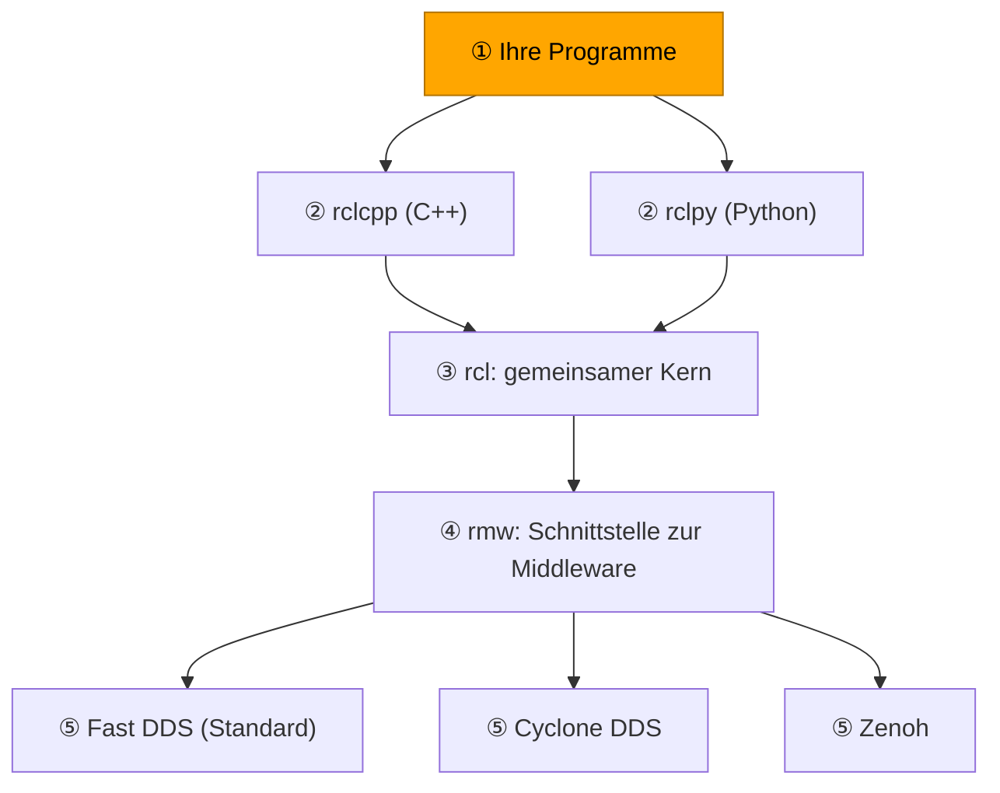

</div>

<div style="flex: 1; min-width: 260px;">

**① Ihre Programme**

+ ein Knoten = eine Aufgabe, z. B. Spurerkennung
+ enthält nur Ihre Logik: Kamerabild rein, Spurlage raus
+ legt fest, **was** gesendet und empfangen wird
+ kein Netzwerkcode: keine IP-Adressen, keine Sockets
+ läuft auf Laptop oder Roboter — der Code bleibt gleich

</div>

</section>

********************************************************************************

    --{{0}}--
Wir gehen die Architektur jetzt Schicht für Schicht von oben nach unten durch. Ganz oben stehen Ihre eigenen Programme, also die Knoten, die Sie im Projekt schreiben: die Spurerkennung, das Fahrverhalten, später die Ampelerkennung. In diesen Programmen steht nur das, was Ihren Roboter ausmacht. Wie die Daten über das WLAN zum Laptop kommen, steht dort nicht. Das ist die Idee aller Schichten darunter: Sie nehmen Ihnen diese Arbeit ab.

                                  {{1-2}}
********************************************************************************

<section style="display: flex; flex-wrap: wrap; gap: 20px; align-items: center;">

<div style="flex: 1; min-width: 260px;">

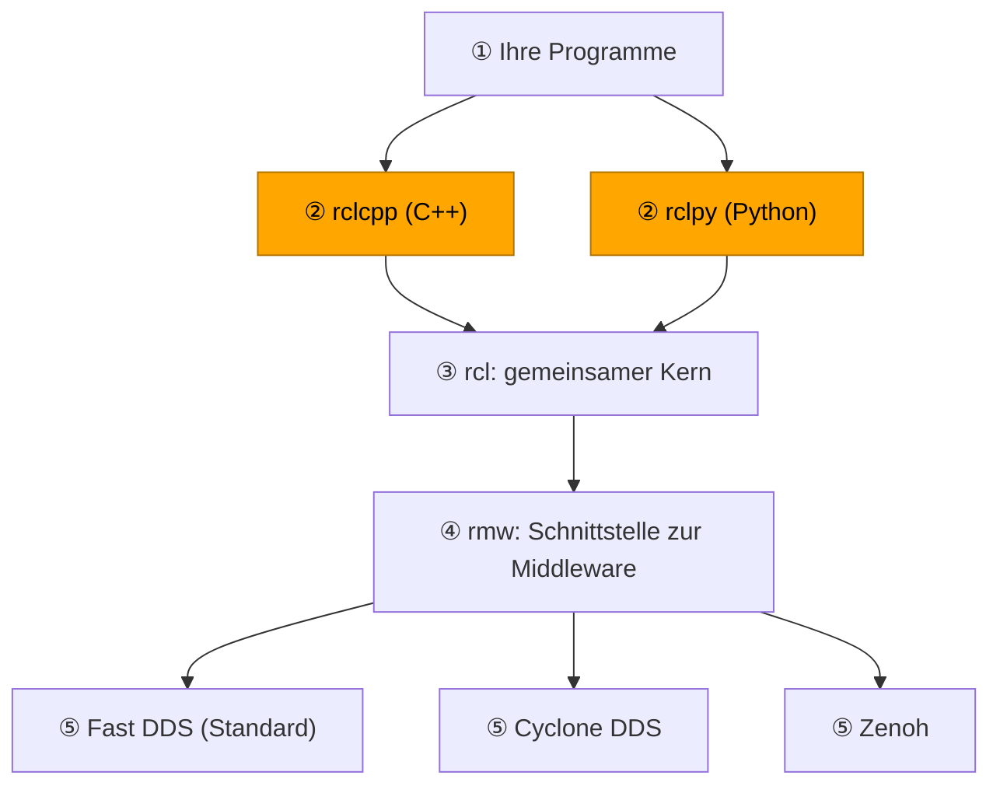

</div>

<div style="flex: 1; min-width: 260px;">

**② Client-Bibliotheken `rclcpp` und `rclpy`**

+ Ihre Schnittstelle zu ROS 2 — alles, was Sie im Code sehen
+ gleiche Bausteine: Node, Publisher, Subscriber, Timer
+ Stil der jeweiligen Sprache: Klassen, Callbacks, Lambdas
+ `spin()` wartet auf Nachrichten und ruft Ihre Callbacks auf

```python
pub = node.create_publisher(Twist, '/cmd_vel', 10)
pub.publish(msg)
```

+ weitere Sprachen aus der Community: Rust, Java, C#

</div>

</section>

********************************************************************************

    --{{1}}--
Die Client-Bibliotheken sind das, was Sie im Code tatsächlich sehen. In Python importieren Sie rclpy, in C++ rclcpp. Beide bieten dieselben Bausteine an, also Knoten, Publisher, Subscriber und Timer, jeweils so, wie es in der Sprache üblich ist. Die Aufrufe create_publisher und spin begegnen Ihnen gleich im Hello-World-Beispiel wieder. Die Abkürzung rcl steht übrigens für ROS Client Library.

                                  {{2-3}}
********************************************************************************

<section style="display: flex; flex-wrap: wrap; gap: 20px; align-items: center;">

<div style="flex: 1; min-width: 260px;">

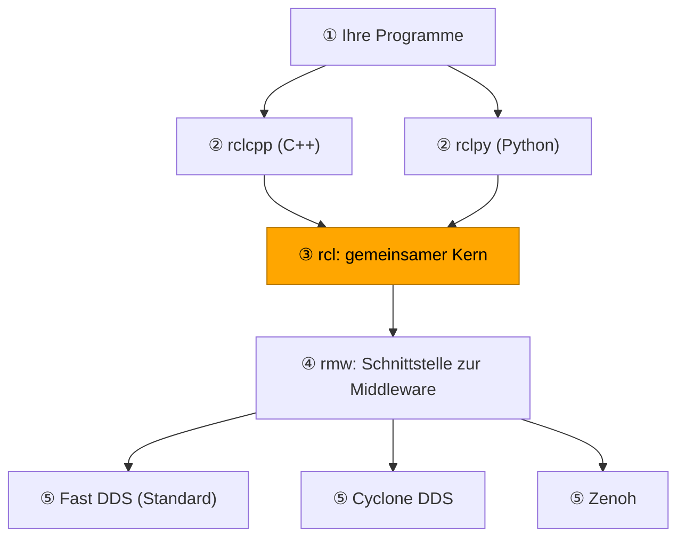

</div>

<div style="flex: 1; min-width: 260px;">

**③ `rcl` — gemeinsamer Kern in C**

+ in C geschrieben → aus jeder Sprache aufrufbar
+ **Namen:** `cmd_vel` im Namensraum `/tb1` → `/tb1/cmd_vel`
+ **Parameter:** Einstellungen eines Knotens lesen und setzen
+ **Zeit:** Systemuhr oder Simulationszeit (`use_sim_time`)
+ **Logging:** einheitlich, z. B. `[INFO] [fahrverhalten]: Start`
+ einmal implementiert → Knoten verhalten sich in C++ und Python **gleich**

</div>

</section>

********************************************************************************

    --{{2}}--
Unter beiden Client-Bibliotheken liegt derselbe Kern, die Bibliothek rcl, geschrieben in C. Hier steckt die Logik, die für alle Sprachen gleich sein muss: wie aus einem Topic-Namen ein vollständiger Name wird, wie Parameter verwaltet werden, welche Uhrzeit ein Knoten sieht, zum Beispiel die Simulationszeit im Simulator. Weil diese Logik nur einmal existiert, verhält sich ein Python-Knoten genauso wie ein C++-Knoten. Deshalb können der Publisher in Python und der Subscriber in C++ nachher problemlos zusammenarbeiten.

                                  {{3-4}}
********************************************************************************

<section style="display: flex; flex-wrap: wrap; gap: 20px; align-items: center;">

<div style="flex: 1; min-width: 260px;">

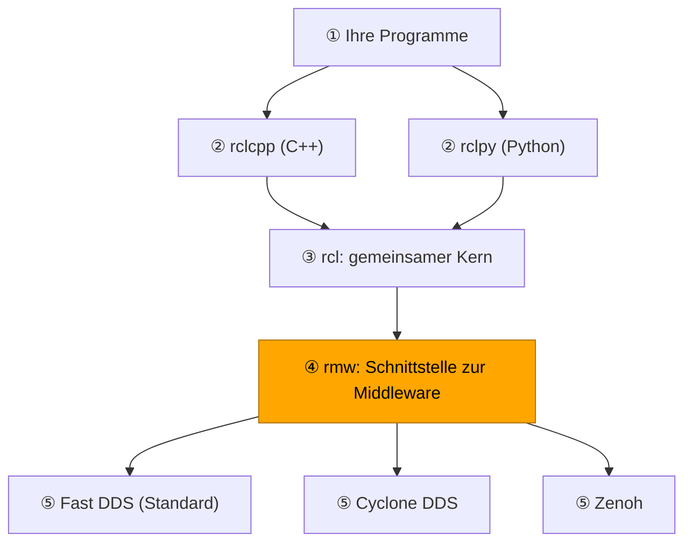

</div>

<div style="flex: 1; min-width: 260px;">

**④ `rmw` — ROS Middleware Interface**

+ abstrakte Schnittstelle: legt Funktionen fest, transportiert selbst nichts
+ übersetzt Publisher, Subscriber, Services in Begriffe der Middleware
+ **Discovery:** Welche Knoten und Topics gibt es gerade?
+ **QoS** (_Quality of Service_): zuverlässig zustellen oder nur das Neueste? (VL 03)
+ **Serialisierung:** Nachricht → Bytes, z. B. `Twist` = 6 × `float64` ≈ 48 Byte
+ jede Middleware liefert ein eigenes Paket `rmw_<name>`

</div>

</section>

********************************************************************************

    --{{3}}--
Die rmw-Schicht ist eine reine Schnittstelle. Sie beschreibt, welche Funktionen eine Middleware anbieten muss, damit ROS 2 darauf laufen kann: Nachrichten veröffentlichen und empfangen, Services aufrufen, andere Knoten finden und die Regeln zur Zuverlässigkeit einhalten, die Quality of Service, die wir in VL 03 genauer ansehen. Außerdem wird hier aus Ihrer Nachricht, etwa einem Fahrbefehl, eine Folge von Bytes, die sich über das Netzwerk schicken lässt. Selbst transportiert die rmw-Schicht aber nichts, das übernimmt die Schicht darunter.

                                  {{4-5}}
********************************************************************************

<section style="display: flex; flex-wrap: wrap; gap: 20px; align-items: center;">

<div style="flex: 1; min-width: 260px;">

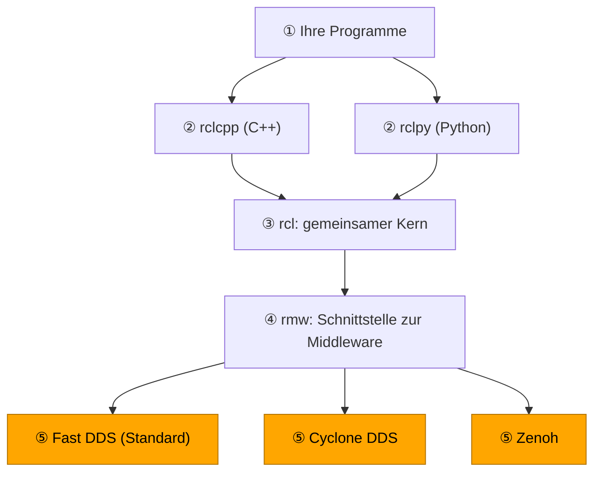

</div>

<div style="flex: 1; min-width: 260px;">

**⑤ Middleware-Implementierungen**

+ verschicken die Bytes: im Netzwerk per UDP, lokal auch über Shared Memory
+ kündigen Knoten im Netz an (Discovery, bei DDS per Multicast)
+ Standard in Jazzy: **Fast DDS** (eProsima) — Paket `rmw_fastrtps_cpp`
+ Alternativen: **Cyclone DDS** (Eclipse, `rmw_cyclonedds_cpp`), **Zenoh** (ohne DDS, robust im WLAN, `rmw_zenoh_cpp`)
+ Wahl per **Umgebungsvariable** = benannter Wert, den ein Terminal an seine Programme weitergibt:

```bash
export RMW_IMPLEMENTATION=rmw_cyclonedds_cpp
```

+ gilt nur für dieses Terminal · `source datei` lädt eine ganze Datei solcher Werte (Ü 1)
+ alle Knoten nutzen **dieselbe** Middleware — DDS ↔ Zenoh verbinden sich nie, verschiedene DDS-Anbieter nicht garantiert

</div>

</section>

********************************************************************************

    --{{4}}--
Ganz unten arbeitet die eigentliche Middleware. Sie verschickt die Bytes über das Netzwerk und sorgt dafür, dass sich Knoten finden. Standard in Jazzy ist Fast DDS der Firma eProsima. DDS steht für Data Distribution Service, einen Industriestandard für verteilte Systeme. Alternativen sind Cyclone DDS von Eclipse und Zenoh, das ohne DDS auskommt und in WLAN-Netzen mit vielen Robotern oft robuster ist. Welche Middleware ein Knoten nutzt, legt die Umgebungsvariable RMW_IMPLEMENTATION fest. Eine Umgebungsvariable ist ein benannter Wert, den ein Terminal an alle Programme weitergibt, die darin gestartet werden. Sie gilt also nur für das Terminal, in dem Sie sie setzen. Das ist die häufigste Fehlerquelle bei ROS 2, am Donnerstag in Ü 1 probieren Sie es selbst aus. Der Code Ihrer Knoten bleibt dabei derselbe. Wichtig für das Praktikum: Stellen Sie auf allen Rechnern dieselbe Middleware ein. Zenoh und DDS verbinden sich gar nicht, und ob zwei verschiedene DDS-Implementierungen zusammenarbeiten, ist nicht garantiert.

                                  {{5}}
********************************************************************************

<section style="display: flex; flex-wrap: wrap; gap: 20px; align-items: center;">

<div style="flex: 1; min-width: 260px;">

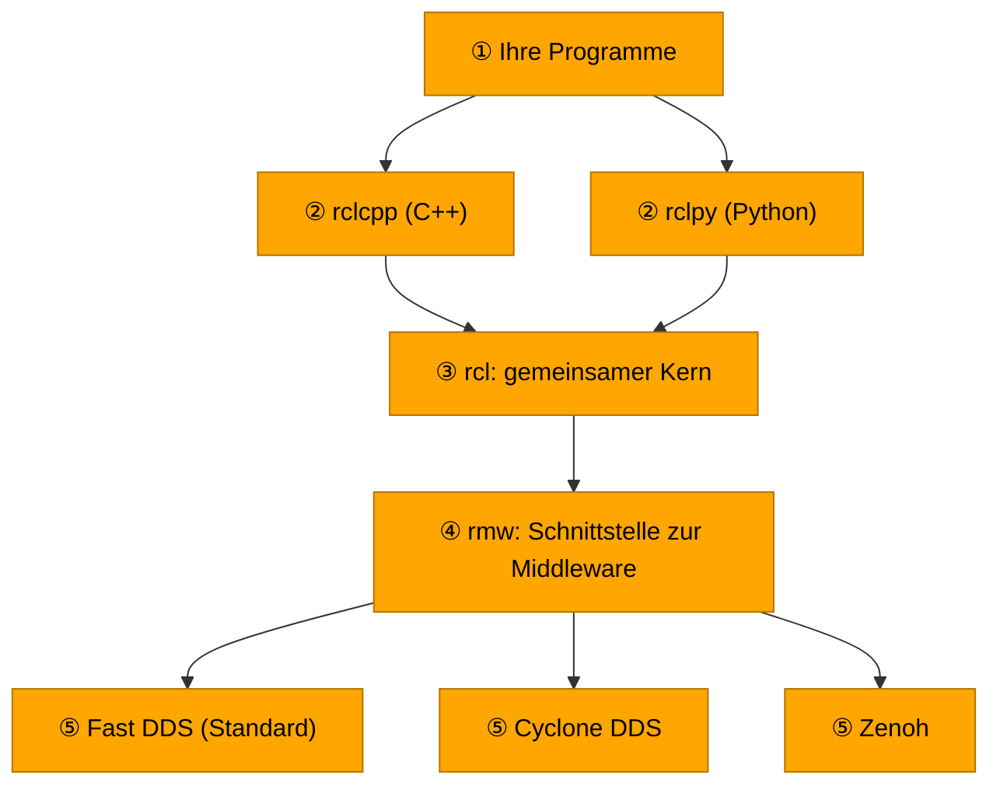

</div>

<div style="flex: 1; min-width: 260px;">

**Weg eines Fahrbefehls**

1. **Laptop:** Fahrverhalten (Python) ruft `pub.publish(msg)` auf
2. `rclpy` → `rcl`: vollständiger Topic-Name `/cmd_vel`
3. `rmw`: `Twist` wird zu Bytes serialisiert
4. Fast DDS sendet die Bytes per UDP über das WLAN
5. **Roboter:** Fast DDS → `rmw`: Bytes werden wieder zur Nachricht
6. `rcl` → `rclcpp`: Motorsteuerung (C++) erhält `msg` im Callback

→ Sie schreiben nur Schritt 1 und 6

</div>

</section>

********************************************************************************

    --{{5}}--
Zum Schluss setzen wir die Schichten zusammen und verfolgen einen Fahrbefehl. Das Fahrverhalten läuft in Python auf dem Laptop und ruft publish auf. Die Nachricht wandert durch rclpy, rcl und rmw nach unten und wird dabei in Bytes verwandelt. Fast DDS schickt sie über das WLAN zum Roboter. Dort läuft derselbe Weg rückwärts nach oben, bis die Motorsteuerung in C++ die Nachricht in ihrem Callback erhält. Sie selbst haben dafür nur zwei Zeilen geschrieben, einen Publisher und einen Subscriber.

                                  {{5}}
********************************************************************************

> [!IMPORTANT]
> **Merke:** Sie programmieren gegen `rclcpp` oder `rclpy`. Die Schichten darunter bemerken Sie erst, wenn sich zwei Knoten nicht finden.

+ vgl. [ROS 2 Jazzy: Different ROS 2 middleware vendors](https://docs.ros.org/en/jazzy/Concepts/Intermediate/About-Different-Middleware-Vendors.html)

********************************************************************************

## Basiskonzepte

**Knoten (_Node_)** — ein Programm im ROS-System, z. B. Kameratreiber oder Spurerkennung

+ nutzt `rclcpp` oder `rclpy`
+ veröffentlicht oder abonniert Topics
+ läuft auf demselben oder einem anderen Rechner

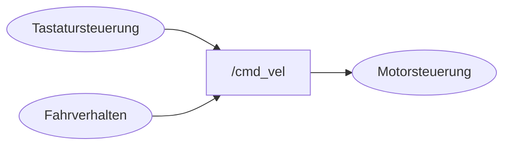

*ROS-Graph, dargestellt wie in `rqt_graph`: Ellipse = Knoten, Rechteck = Topic, Pfeil = Richtung des Datenflusses*

    --{{0}}--
Jetzt kommen die drei Begriffe, die Sie heute mitnehmen müssen: Knoten, Topics und Nachrichten. Jeder Knoten erledigt genau eine Aufgabe. Das hat einen praktischen Grund: Stürzt Ihre Spurerkennung ab, läuft der Kameratreiber weiter, und Sie können die Spurerkennung neu starten, ohne den Roboter anzuhalten. Im Bild senden zwei Knoten auf dasselbe Topic: die Tastatursteuerung, mit der Sie den Roboter von Hand fahren, und Ihr Fahrverhalten. Die Motorsteuerung empfängt beides. So zeichnet auch das Werkzeug rqt_graph einen ROS-Graphen, das sehen Sie später selbst: Knoten als Ellipsen, Topics als Rechtecke.

### Topics

**Topic** — benannter Kanal, Muster _Publish-Subscribe_

+ Sender **veröffentlichen** (_publish_), Empfänger **abonnieren** (_subscribe_)
+ Sender und Empfänger kennen sich nicht — der **Name** verbindet sie
+ fortlaufender Datenstrom in eine Richtung, ohne Antwort

    --{{0}}--
Ein Topic funktioniert wie ein Radiosender. Der Sender strahlt sein Programm aus, egal ob jemand zuhört, und jeder, der die Frequenz einstellt, empfängt es. Die Frequenz ist hier der Name des Topics. Eine Antwort an den Sender ist nicht vorgesehen.

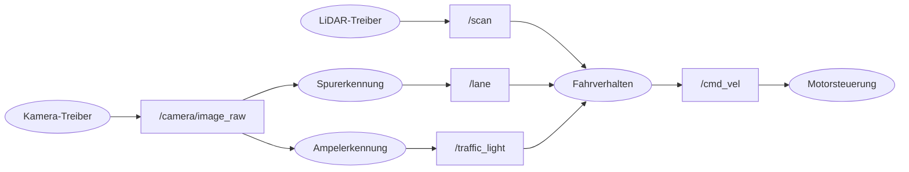

*Ausschnitt aus einem möglichen Projektsystem, dargestellt wie in `rqt_graph`: Ellipse = Knoten, Rechteck = Topic, Pfeil = Richtung des Datenflusses*

    --{{1}}--
So oder so ähnlich wird Ihr eigenes System aussehen. Das Kamerabild geht an zwei Empfänger, die Spurerkennung und die Ampelerkennung. Weil der Kameratreiber nicht weiß, wer seine Bilder liest, lässt sich die Ampelerkennung später ergänzen, ohne einen der anderen Knoten zu ändern.

### Discovery

> [!IMPORTANT]
> Moment! Dynamische Knoten und Topics? Woher weiß der Kameratreiber, dass die Spurerkennung seine Bilder lesen will? Und wie findet die Ampelerkennung den Kameratreiber?

**Discovery** — Knoten finden sich selbst, ohne Adressliste und ohne Zentrale

                                  {{0-1}}
********************************************************************************

<section style="display: flex; flex-wrap: wrap; gap: 20px; align-items: flex-start;">

<div style="flex: 3; min-width: 320px;">

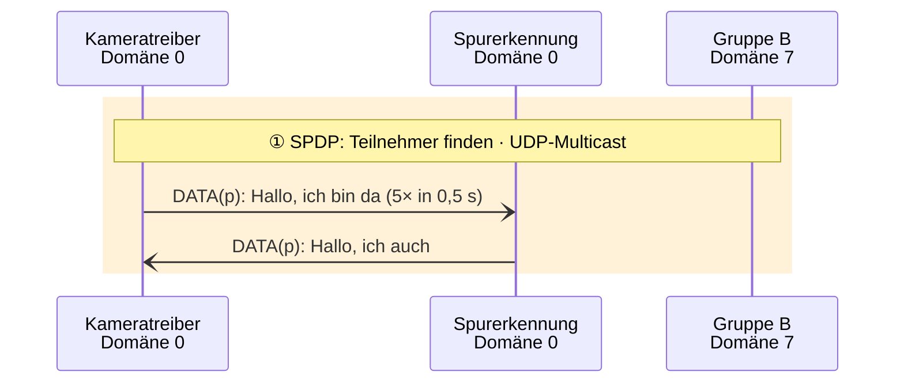

</div>

<div style="flex: 2; min-width: 260px;">

**① Teilnehmer finden**

**SPDP** = _Simple Participant Discovery Protocol_, Teil des DDS-Standards

+ Teilnehmer (_Participant_) = ein ROS-Prozess
+ `DATA(p)` = Ankündigung eines Teilnehmers
+ beim Start: Rundnachricht an alle im lokalen Netz (Multicast)
+ gleich 5× in 0,5 s → in Bruchteilen einer Sekunde gefunden
+ die anderen antworten mit ihrer Adresse
+ **Domäne** `ROS_DOMAIN_ID`: andere Nummer → anderer Port → unsichtbar

</div>

</section>

********************************************************************************

    --{{0}}--
Die Antwort auf die Frage oben liefert die Middleware in drei Schritten. Der erste Schritt heißt SPDP, Simple Participant Discovery Protocol. Ein Teilnehmer ist dabei ein ROS-Prozess, seine Ankündigung heißt DATA p, p für Participant. Zuerst kündigt sich jeder Prozess beim Start mit einer Rundnachricht an alle Rechner im lokalen Netz an, gleich mehrfach kurz hintereinander, damit ihn die anderen schnell finden. Die anderen antworten und teilen dabei mit, unter welcher Adresse sie direkt erreichbar sind. Die Domäne ist dabei einfach ein anderer Netzwerk-Port. Deshalb bekommt Gruppe B mit Domäne sieben von all dem nichts mit, und umgekehrt.

                                  {{1-2}}
********************************************************************************

<section style="display: flex; flex-wrap: wrap; gap: 20px; align-items: flex-start;">

<div style="flex: 3; min-width: 320px;">

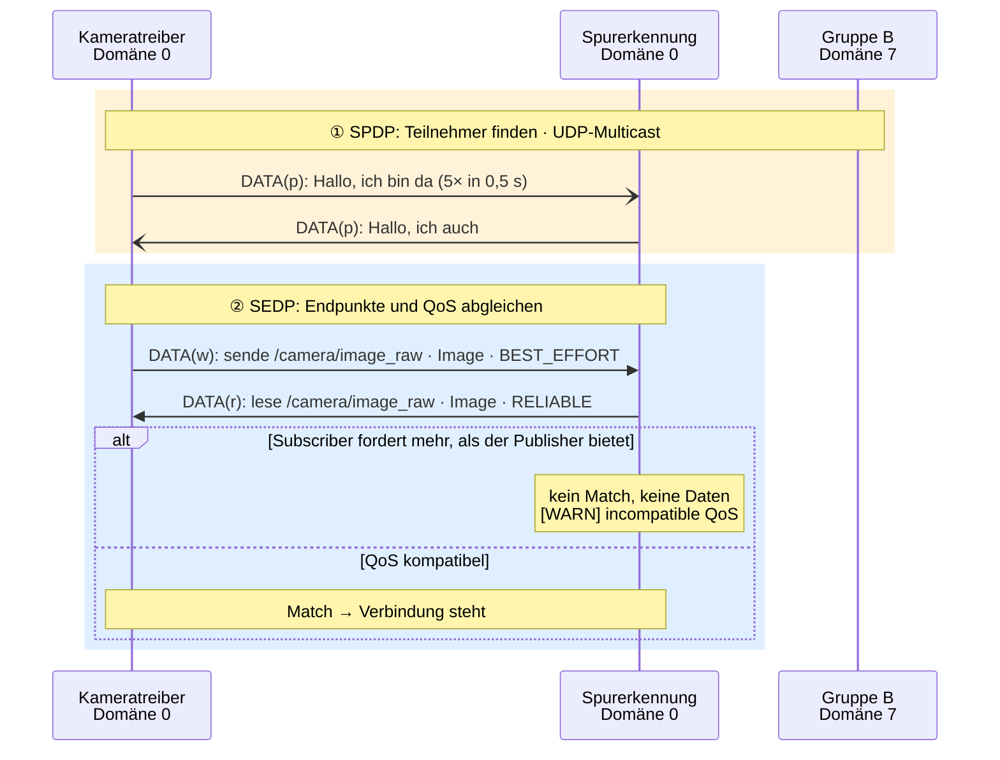

</div>

<div style="flex: 2; min-width: 260px;">

**② Endpunkte und QoS abgleichen**

**SEDP** = _Simple Endpoint Discovery Protocol_, Teil des DDS-Standards

+ Endpunkt = ein Publisher oder Subscriber
+ `DATA(w)` beschreibt einen Publisher (DDS: _Writer_), `DATA(r)` einen Subscriber (_Reader_)
+ Verbindung nur, wenn **Name, Typ und QoS** passen
+ QoS-Regel: Publisher bietet **mindestens**, was der Subscriber fordert
+ Beispiel: Kamera `BEST_EFFORT`, Spurerkennung fordert `RELIABLE` → kein Match
+ `BEST_EFFORT` = einmal senden · `RELIABLE` = Verlorenes wiederholen (mehr in VL 03)
+ kein Absturz, nur eine Warnung im Log

</div>

</section>

********************************************************************************

    --{{1}}--
Der zweite Schritt heißt SEDP, Simple Endpoint Discovery Protocol. Endpunkte sind die Publisher und Subscriber eines Prozesses, in der Sprache von DDS heißen sie Writer und Reader, daher DATA w und DATA r. Die Prozesse beschreiben darin, was sie vorhaben: Ich sende auf diesem Topic Nachrichten dieses Typs mit diesen Quality-of-Service-Regeln, oder ich möchte sie lesen. Beide Seiten prüfen, ob das zusammenpasst. Hier liegt ein Klassiker. Kameratreiber senden oft im Modus Best Effort, weil ein verlorenes Bild bei dreißig Bildern pro Sekunde egal ist. Verlangt Ihre Spurerkennung zuverlässige Zustellung, fordert sie mehr, als der Publisher bietet, und es entsteht keine Verbindung. Kein Programm stürzt ab, im Log erscheint nur eine Warnung. Woher weiß also der Kameratreiber von der Spurerkennung? Er weiß es gar nicht, die Middleware gleicht die Angaben für ihn ab.

                                  {{2}}
********************************************************************************

<section style="display: flex; flex-wrap: wrap; gap: 20px; align-items: flex-start;">

<div style="flex: 3; min-width: 320px;">

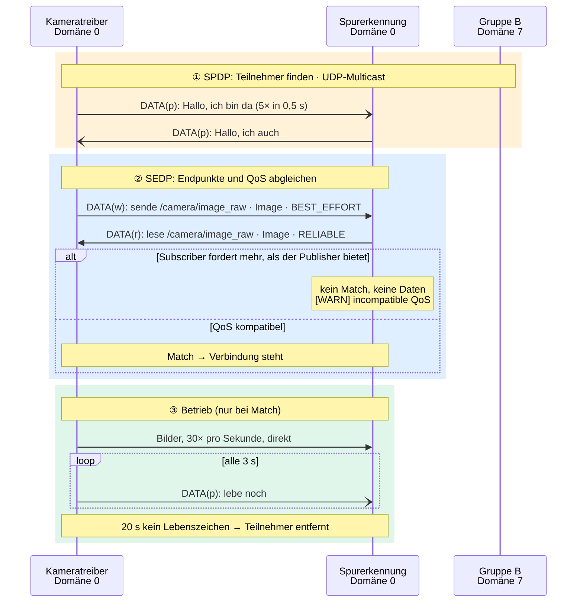

</div>

<div style="flex: 2; min-width: 260px;">

**③ Betrieb**

+ Daten fließen **direkt** von Prozess zu Prozess (≠ `roscore`)
+ **Wie oft wird geprüft?** Gar nicht aktiv:
  + jeder hört dauerhaft zu und kündigt sich alle 3 s an
  + 20 s kein Lebenszeichen → Teilnehmer entfernt
  + sauber beendet (Strg+C) → sofort abgemeldet
+ Werte: Fast DDS, Standardeinstellungen

</div>

</section>

********************************************************************************

    --{{2}}--
Passt alles, fließen die Daten im dritten Schritt direkt vom Kameratreiber zur Spurerkennung, ohne Umweg über einen zentralen Rechner wie den roscore in ROS 1. Und wie oft wird nach neuen Knoten gesucht? Gar nicht aktiv. Jeder Prozess hört dauerhaft zu und meldet sich alle drei Sekunden mit einem Lebenszeichen. Ein neu gestarteter Knoten durchläuft einfach dieselben Schritte. Beendet sich ein Knoten sauber, meldet er sich sofort ab. Stürzt er ab, gilt er erst nach zwanzig Sekunden ohne Lebenszeichen als verschwunden. Deshalb taucht ein abgestürzter Knoten noch eine Weile in ros2 node list auf.

<details>
<summary>🧩 <b>Zwischenfrage</b> zum Selbststudium (zum Aufklappen)</summary>

Die Spurerkennung stürzt ab, ohne sich abzumelden. Was zeigt `ros2 node list` auf dem Laptop fünf Sekunden später?

[( )] Die Spurerkennung fehlt sofort in der Liste.
[(X)] Die Spurerkennung steht noch in der Liste.
[( )] Eine Fehlermeldung, dass ein Knoten abgestürzt ist.
***
Niemand fragt aktiv nach, ob ein Knoten noch lebt. Erst wenn 20 s lang kein Lebenszeichen kommt, wird er entfernt (Fast DDS, Standardwerte). Nur wer sich sauber beendet, meldet sich sofort ab.
***

</details>

### Basiskommunikationsmuster

**Grundmuster:** alles in ROS 2 baut auf **Topic** und **Service** auf

<!-- data-type="none" -->
| Muster        | Ablauf                                      | Beispiel am TurtleBot                   | Typ (Jazzy-Doku)  |
| :------------ | :------------------------------------------ | :-------------------------------------- | :---------------- |
| [**Topic**](https://docs.ros.org/en/jazzy/Concepts/Basic/About-Topics.html)     | fortlaufender Datenstrom, 1:n, ohne Antwort | LiDAR-Scans, Kamerabilder, Fahrbefehle  | [`sensor_msgs/msg/LaserScan`](https://docs.ros.org/en/jazzy/p/sensor_msgs/msg/LaserScan.html), [`sensor_msgs/msg/Image`](https://docs.ros.org/en/jazzy/p/sensor_msgs/msg/Image.html), [`geometry_msgs/msg/TwistStamped`](https://docs.ros.org/en/jazzy/p/geometry_msgs/msg/TwistStamped.html) |
| [**Service**](https://docs.ros.org/en/jazzy/Concepts/Basic/About-Services.html) | Anfrage → eine Antwort, kurz                | Karte speichern, Odometrie zurücksetzen | [`nav2_msgs/srv/SaveMap`](https://docs.ros.org/en/jazzy/p/nav2_msgs/srv/SaveMap.html), allgemein [`std_srvs/srv/Trigger`](https://docs.ros.org/en/jazzy/p/std_srvs/srv/Trigger.html) |

**Topic oder Service?**

<!-- data-type="none" -->
| Merkmal                     | Topic                                               | Service                                                |
| :-------------------------- | :-------------------------------------------------- | :----------------------------------------------------- |
| Modell                      | **Publish/Subscribe**, datenzentriert (DDS)         | **Anfrage/Antwort**, entfernter Aufruf (RPC)           |
| Wer bestimmt den Zeitpunkt? | Sender (**Push**)                                   | Aufrufer (**Pull**)                                    |
| Kopplung                    | **zeitlich entkoppelt**: Sender wartet nie          | **gekoppelt**: Aufrufer braucht die Antwort, Server muss laufen |
| Richtung, Empfänger         | eine Richtung, 1:n                                  | hin und zurück, 1:1                                    |
| Alltagsbild                 | Radiosender                                         | Anruf mit Rückfrage                                    |

→ Ein Topic **verteilt Daten**, ein Service **erteilt einen Auftrag**.

    --{{0}}--
ROS 2 kennt genau zwei Grundmuster der Kommunikation, Topics und Services. Alles andere, was Ihnen noch begegnen wird, ist aus diesen beiden zusammengesetzt. Den Unterschied zwischen beiden sehen Sie am besten an der Frage, wer den Zeitpunkt bestimmt. Beim Topic entscheidet der Sender, wann er Daten verschickt, und macht danach sofort weiter, ob jemand zuhört oder nicht. Die Empfänger reagieren in ihren Callbacks. Beim Service entscheidet der Aufrufer, wann er etwas braucht, und sein weiterer Ablauf hängt von der Antwort ab. Läuft der Server nicht, bekommt er keine. Merken Sie sich den kurzen Satz: Ein Topic verteilt Daten, ein Service erteilt einen Auftrag.

### Darauf aufgebaut: Action und Parameter

<!-- data-type="none" -->
| Mechanismus   | Ablauf                                         | gebaut aus                                | Beispiel am TurtleBot                         | Typ (Jazzy-Doku)  |
| :------------ | :--------------------------------------------- | :---------------------------------------- | :-------------------------------------------- | :---------------- |
| [**Action**](https://docs.ros.org/en/jazzy/Concepts/Basic/About-Actions.html)       | langer Auftrag mit Zwischenständen und Abbruch | 3 Services (Ziel, Ergebnis, Abbruch) + 2 Topics (Rückmeldung, Status) | „Fahre zur Parklücke“ mit Fortschrittsmeldung | [`nav2_msgs/action/NavigateToPose`](https://docs.ros.org/en/jazzy/p/nav2_msgs/action/NavigateToPose.html) |
| [**Parameter**](https://docs.ros.org/en/jazzy/Concepts/Basic/About-Parameters.html) | Einstellung eines Knotens, zur Laufzeit änderbar — **kein** Kommunikationsmuster | Services je Knoten + Topic `/parameter_events` | Schwellwert der Spurerkennung, Höchstgeschwindigkeit | intern: [`rcl_interfaces/srv/SetParameters`](https://docs.ros.org/en/jazzy/p/rcl_interfaces/srv/SetParameters.html) |

+ selbst nachsehen: `ros2 service list` zeigt die Parameter-Services jedes Knotens
+ `ros2 topic list --include-hidden-topics` zeigt z. B. `…/_action/feedback`

Heute: **Topics** · Ü 2: Parameter · später im Projekt: Services und Actions

    --{{0}}--
Auf den beiden Grundmustern baut ROS 2 weitere Mechanismen auf. Eine Action ist ein Auftrag, der Minuten dauern kann. Ziel, Ergebnis und Abbruch laufen über drei Services, die Zwischenstände und der Status über zwei Topics. Deshalb kann eine Action Fortschritt melden und sich abbrechen lassen. Parameter sind dagegen gar kein Kommunikationsmuster, sondern Einstellungen eines Knotens. Damit man sie von außen lesen und ändern kann, bietet jeder Knoten automatisch einige Services an, und Änderungen werden über ein Topic gemeldet. Sie können das selbst nachprüfen: Die Kommandozeile zeigt Ihnen diese Services und die sonst versteckten Topics an. Es steckt also keine Magie dahinter, sondern dieselben zwei Bausteine.

<details>
<summary>🧩 <b>Zwischenfrage</b> zum Selbststudium (zum Aufklappen)</summary>

Welches Muster passt?

[ [Topic] [Service] [Action] ]
[ ( )     (X)       ( )      ] Die Spurerkennung soll auf Anfrage ihre Kalibrierung neu laden und melden, ob es geklappt hat.
[ (X)     ( )       ( )      ] Das Fahrverhalten muss jederzeit wissen, welche Farbe die Ampel gerade zeigt.
[ ( )     ( )       (X)      ] Der Roboter soll eine Runde auf dem Parcours fahren und dabei die gefahrene Strecke melden.
***
Einmaliger Auftrag mit kurzer Antwort → Service. Fortlaufend benötigter Zustand → Topic. Langer Auftrag mit Zwischenständen → Action.
***

</details>

### Nachrichten

**Nachrichtentyp (_Message_)** — legt Felder und Datentypen fest

+ Doku: [About interfaces](https://docs.ros.org/en/jazzy/Concepts/Basic/About-Interfaces.html) · Standardpakete [`std_msgs`](https://docs.ros.org/en/jazzy/p/std_msgs/), [`geometry_msgs`](https://docs.ros.org/en/jazzy/p/geometry_msgs/), [`sensor_msgs`](https://docs.ros.org/en/jazzy/p/sensor_msgs/)

```text
> ros2 interface show --no-comments geometry_msgs/msg/Twist
Vector3  linear
	float64 x
	float64 y
	float64 z
Vector3  angular
	float64 x
	float64 y
	float64 z
```

+ [`Twist`](https://docs.ros.org/en/jazzy/p/geometry_msgs/msg/Twist.html) = Fahrbefehl auf `/cmd_vel`: `linear.x` [m/s], `angular.z` [rad/s]
+ verschachtelt: `Twist` besteht aus zwei [`Vector3`](https://docs.ros.org/en/jazzy/p/geometry_msgs/msg/Vector3.html)
+ TurtleBot3 unter Jazzy erwartet [`TwistStamped`](https://docs.ros.org/en/jazzy/p/geometry_msgs/msg/TwistStamped.html) = `Header` + `Twist`

> [!CAUTION]
> **Einheiten sind Konvention, keine Prüfung:** ROS-Nachrichten nutzen nach [REP 103](https://www.ros.org/reps/rep-0103.html) **SI-Einheiten** — Meter, Sekunde, Radiant, Kilogramm (Ausnahme: Temperatur in °C). Die Felder selbst sind nackte Zahlen: `angular.z = 90` bedeutet 90 rad/s, nicht 90 °/s.
>
> Achsen am Roboter: **x vorwärts, y links, z oben** → positives `angular.z` = Drehung nach links.

    --{{0}}--
Damit Sender und Empfänger dieselbe Sprache sprechen, legt ein Nachrichtentyp fest, welche Felder übertragen werden. Für fast alle Sensoren und Aktoren gibt es Standardtypen. Der Fahrbefehl Twist enthält sechs Werte, unser TurtleBot braucht davon nur zwei: die Geschwindigkeit nach vorne und die Drehung um die Hochachse. Die übrigen Felder braucht ein Roboter, der fliegen oder seitwärts fahren kann.

```text
> ros2 interface show --no-comments sensor_msgs/msg/LaserScan
std_msgs/Header header
	builtin_interfaces/Time stamp
		int32 sec
		uint32 nanosec
	string frame_id
float32 angle_min
float32 angle_max
float32 angle_increment
float32 time_increment
float32 scan_time
float32 range_min
float32 range_max
float32[] ranges
float32[] intensities
```

+ Doku: [`sensor_msgs/msg/LaserScan`](https://docs.ros.org/en/jazzy/p/sensor_msgs/msg/LaserScan.html)
+ [**Header**](https://docs.ros.org/en/jazzy/p/std_msgs/msg/Header.html): Zeitstempel und Bezugssystem `frame_id` (VL 03)
+ `ranges`: eine Entfernung pro Winkelschritt
+ Basistypen `bool`, `int32`, `float64`, `string`
+ Arrays: `[]` beliebig lang, `[5]` feste Länge

    --{{1}}--
Ein LiDAR-Scan beginnt mit einem Header. Er sagt, wann gemessen wurde und in welchem Bezugssystem, also von welchem Punkt am Roboter aus. Es folgen die Winkelangaben des Scans und die eigentlichen Messwerte, eine Entfernung pro Winkelschritt. Den Header finden Sie in fast allen Sensornachrichten wieder. Eigene Nachrichtentypen definieren Sie in VL 02.

## Einführungsbeispiele

**Arbeit auf der Konsole:** `ros2 <bereich> <befehl>` · Hilfe mit `-h`, z. B. `ros2 topic -h`

<!-- data-type="none" -->
| Befehl                   | Wofür?                                                     |
| :----------------------- | :--------------------------------------------------------- |
| `ros2 run`               | einen Knoten aus einem Paket starten                       |
| `ros2 node list / info`  | welche Knoten laufen, was veröffentlichen sie?             |
| `ros2 topic list / echo / hz / pub` | Topics anzeigen, mitlesen, Takt messen, selbst senden |
| `ros2 interface show`    | den Aufbau eines Nachrichtentyps anzeigen                  |
| `ros2 service`, `ros2 param`, `ros2 action` | die übrigen Kommunikationsmuster (Parameter in Ü 2) |
| `ros2 bag`               | Daten aufzeichnen und abspielen (Ü 2)                      |
| `ros2 doctor`            | Installation und Netzwerk auf typische Probleme prüfen     |

    --{{0}}--
Ein laufendes ROS-2-System untersuchen Sie mit dem Kommandozeilenwerkzeug ros2. Die Bereiche entsprechen den Konzepten von eben: node für Knoten, topic für Topics, interface für Nachrichtentypen. Die Tabelle ist Ihr Spickzettel für die nächsten Wochen.

### Hello-World Implementierung

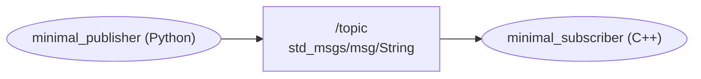

Ausführlich kommentiert: [Writing a simple publisher and subscriber (Python)](https://docs.ros.org/en/jazzy/Tutorials/Beginner-Client-Libraries/Writing-A-Simple-Py-Publisher-And-Subscriber.html)

    --{{0}}--
Wir lesen jetzt Code, und zwar das Hello-World-Beispiel der ROS-Community: einen Publisher in Python und einen Subscriber in C++. Ziel ist nicht, jede Zeile selbst schreiben zu können. Sie sollen die Struktur erkennen, die in jedem ROS-2-Programm wiederkehrt, auch in Ihrer späteren Spurerkennung.

```python    Publisher.py
import rclpy
from rclpy.node import Node

from std_msgs.msg import String


class MinimalPublisher(Node):

    def __init__(self):
        super().__init__('minimal_publisher')
        self.publisher_ = self.create_publisher(String, 'topic', 10)
        timer_period = 0.5  # seconds
        self.timer = self.create_timer(timer_period, self.timer_callback)
        self.i = 0

    def timer_callback(self):
        msg = String()
        msg.data = 'Hello World: %d' % self.i
        self.publisher_.publish(msg)
        self.get_logger().info('Publishing: "%s"' % msg.data)
        self.i += 1


def main(args=None):
    rclpy.init(args=args)

    minimal_publisher = MinimalPublisher()

    rclpy.spin(minimal_publisher)

    # Destroy the node explicitly
    # (optional - otherwise it will be done automatically
    # when the garbage collector destroys the node object)
    minimal_publisher.destroy_node()
    rclpy.shutdown()


if __name__ == '__main__':
    main()
```

+ **Knotenklasse** erbt von `Node`, Name `minimal_publisher`
+ `create_publisher(String, 'topic', 10)`: Nachrichtentyp, Topic, Puffergröße
+ `create_timer(0.5, …)`: ruft alle 0,5 s den **Callback** auf
+ **Callback** = Funktion, die ROS bei einem Ereignis aufruft
+ `rclpy.spin()`: wartet auf Ereignisse und ruft Callbacks auf

    --{{1}}--
Die Knotenklasse erbt von der Basisklasse Node und gibt dem Knoten seinen Namen. Im Konstruktor entstehen zwei Dinge: ein Publisher für Textnachrichten auf dem Topic mit dem Namen topic, und ein Timer. Die Zahl zehn ist die Puffergröße, also wie viele Nachrichten zwischengespeichert werden, dazu mehr in VL 03. Der Timer ruft alle halbe Sekunde die Methode timer_callback auf. Eine solche Funktion, die nicht wir selbst aufrufen, sondern ROS für uns, wenn ein Ereignis eintritt, heißt Callback. Hier füllt sie die Nachricht, versendet sie und schreibt eine Logzeile.

    --{{2}}--
In der Funktion main startet init die ROS-2-Schnittstelle, dann wird der Knoten erzeugt. Entscheidend ist spin: Diese Funktion übergibt die Kontrolle an ROS. Sie wartet auf Ereignisse wie den Timer und ruft die passenden Callbacks auf, bis der Knoten zum Beispiel mit Strg und C beendet wird.

<details>
<summary>🧩 <b>Zwischenfrage</b> zum Selbststudium (zum Aufklappen)</summary>

Was passiert, wenn Sie in `main()` die Zeile `rclpy.spin(minimal_publisher)` weglassen?

[( )] Der Knoten sendet weiter, nur ohne Logausgaben.
[(X)] Das Programm endet sofort, der Timer-Callback wird nie aufgerufen.
[( )] Python bricht beim Start mit einer Fehlermeldung ab.
***
Den Callback rufen nicht Sie auf, sondern ROS — und zwar nur, solange `spin()` läuft. Ohne `spin()` läuft `main()` direkt zu `shutdown()`. Eine Fehlermeldung gibt es nicht.
***

</details>

### Subscriber und Start

```cpp    Subscriber.cpp
#include <functional>
#include <memory>

#include "rclcpp/rclcpp.hpp"
#include "std_msgs/msg/string.hpp"

using std::placeholders::_1;

class MinimalSubscriber : public rclcpp::Node
{
public:
  MinimalSubscriber()
  : Node("minimal_subscriber")
  {
    subscription_ = this->create_subscription<std_msgs::msg::String>(
      "topic", 10, std::bind(&MinimalSubscriber::topic_callback, this, _1));
  }

private:
  void topic_callback(const std_msgs::msg::String & msg) const
  {
    RCLCPP_INFO(this->get_logger(), "I heard: '%s'", msg.data.c_str());
  }
  rclcpp::Subscription<std_msgs::msg::String>::SharedPtr subscription_;
};

int main(int argc, char * argv[])
{
  rclcpp::init(argc, argv);
  rclcpp::spin(std::make_shared<MinimalSubscriber>());
  rclcpp::shutdown();
  return 0;
}
```

+ gleiche Struktur in C++: Knotenklasse · `create_subscription` · Callback · `spin()`
+ Nachrichtentyp in spitzen Klammern: `<std_msgs::msg::String>`
+ `std::bind(…, this, _1)` = „Methode dieses Objekts als Callback, mit der Nachricht als Argument“
+ `RCLCPP_INFO` = Logausgabe, ähnlich `printf`

    --{{0}}--
Den Subscriber lesen wir in C++. Sie erkennen dieselben Bausteine wieder: die Knotenklasse, einen create-Aufruf, einen Callback und spin. Statt eines Timers löst hier jede eintreffende Nachricht den Callback aus. C++ verlangt etwas mehr Schreibarbeit. Der Nachrichtentyp steht in spitzen Klammern, und std bind verpackt die Methode des Objekts so, dass ROS sie mit der empfangenen Nachricht aufrufen kann. make shared erzeugt den Knoten und verwaltet seinen Speicher selbst.

> [!CAUTION]
> Die Umsetzung der Implementierungen ist wegen der Paketstruktur und der Buildsysteme (CMake, colcon) nicht trivial. Sie müssen die Beispiele nicht selbst bauen, sie sind bereits installiert. Sie können sie aber als Vorlage für eigene Knoten verwenden. Wir sprechen in der kommenden Vorlesung darüber.

### Los geht’s

**Start:** `ros2 run <paket> <ausführbare_datei>` — jeder Knoten in einem eigenen Terminal

```bash
# Terminal 1: Subscriber (C++)
source /opt/ros/jazzy/setup.bash
ros2 run examples_rclcpp_minimal_subscriber subscriber_member_function

# Terminal 2: Publisher (Python)
source /opt/ros/jazzy/setup.bash
ros2 run examples_rclpy_minimal_publisher publisher_member_function
```

```text
[INFO] [minimal_subscriber]: I heard: 'Hello World: 0'
[INFO] [minimal_subscriber]: I heard: 'Hello World: 1'
```

    --{{1}}--
Beide Beispiele werden mit ROS 2 bereits installiert. In jedem Terminal muss zuerst die ROS-2-Umgebung mit source geladen werden, das üben Sie in Ü 1. Heute schauen Sie nur zu, ab Donnerstag läuft das auch bei Ihnen. Achten Sie auf die Ausgabe: Ein Python-Programm sendet, ein C++-Programm empfängt, und keines der beiden weiß, in welcher Sprache das andere geschrieben ist.

### Das System untersuchen

**Welche Nachrichten werden ausgetauscht?**

```text
> ros2 topic list
/parameter_events
/rosout
/topic
> ros2 topic info /topic
Type: std_msgs/msg/String
Publisher count: 1
Subscription count: 1
> ros2 topic hz /topic
average rate: 2.000
   min: 0.500s max: 0.500s std dev: 0.00012s window: 4
> ros2 topic echo /topic
data: 'Hello World: 42'
---
```

+ `/parameter_events`, `/rosout`: legt ROS 2 für jeden Knoten an (Parameter, Logausgaben)

    --{{0}}--
Untersuchen wir das kleine System systematisch. Neben unserem Topic gibt es zwei weitere, die ROS 2 für jeden Knoten automatisch anlegt: eines für Parameteränderungen und eines für Logausgaben. Mit info sehen Sie Typ und Teilnehmerzahl, hz misst den Takt, und echo liest mit. Die gemessenen zwei Nachrichten pro Sekunde passen genau zum Timer im Code.

**Kann ich in der Konsole selbst senden?** — ja, wichtig für die Fehlersuche

```bash
ros2 topic pub --rate 1 /topic std_msgs/msg/String "{data: 'Glück Auf'}"
```

+ einzelne Nachricht: `--once` · weitere Optionen: `ros2 topic pub -h`

    --{{1}}--
Einen Publisher kann man auch direkt in der Konsole erzeugen. Das ist bei der Fehlersuche wertvoll: Man schickt einem Knoten gezielt eine Nachricht und beobachtet, wie er reagiert, ohne dass der eigentliche Sender laufen muss.

### Remapping

**Wie starte ich denselben Knoten zweimal?** — Knotennamen müssen eindeutig sein

```bash
ros2 run examples_rclcpp_minimal_subscriber subscriber_member_function --ros-args -r __node:=zweiter_subscriber
```

+ `--ros-args -r alt:=neu` benennt beim Start um (_Remapping_)
+ `__node` steht für den Namen des Knotens selbst

    --{{0}}--
Ein Knotenname muss im System eindeutig sein. Wollen wir einen zweiten Subscriber starten, benennen wir ihn beim Start um, ohne den Code zu ändern. Das nennt man Remapping. Der doppelte Unterstrich kennzeichnet einen reservierten Namen: Hier ist nicht ein Topic gemeint, sondern der Name des Knotens. Überlegen Sie vorher, wie viele Subscriber ros2 topic info danach meldet.

<details>
<summary>🧩 <b>Zwischenfrage</b> zum Selbststudium (zum Aufklappen)</summary>

Wie viele Subscriber meldet `ros2 topic info /topic`, nachdem der zweite Subscriber gestartet ist? [[2]]
***
Beide Subscriber hören auf `/topic`. Der Publisher muss davon nichts wissen, er sendet einfach weiter.
***

</details>


**Was, wenn die Topic-Namen nicht zusammenpassen?**

```bash
ros2 run examples_rclpy_minimal_publisher publisher_member_function --ros-args -r topic:=topic2
```

    --{{1}}--
Auch Topic-Namen lassen sich beim Start umbenennen. Wir beenden den Publisher und starten ihn mit einem anderen Topic-Namen neu. Damit entsteht ein neuer Kanal, der keinen Empfänger hat.

<details>
<summary>🧩 <b>Zwischenfrage</b> zum Selbststudium (zum Aufklappen)</summary>

Was zeigt der laufende Subscriber an, nachdem der Publisher auf `topic2` umgelenkt wurde?

[( )] Er empfängt weiter, weil der Nachrichtentyp gleich bleibt.
[(X)] Er empfängt nichts mehr, weil er auf `/topic` wartet und der Publisher auf `/topic2` sendet.
[( )] Er stürzt mit einer Fehlermeldung ab.
***
Topics verbindet der Name. Passt er nicht, entsteht keine Verbindung — still, ohne Fehlermeldung.
***

</details>


+ später: fremde Pakete anschließen, ohne ihren Code zu ändern

    --{{2}}--
Genau so passen Sie später fremde Pakete an Ihr System an. Sendet ein Kameratreiber sein Bild unter einem anderen Namen, als Ihre Spurerkennung erwartet, lenken Sie das Topic beim Start um, statt den Code des Treibers anzufassen.

### turtlesim: ROS 2 zum Anfassen

**turtlesim** — simulierte Schildkröte, zwei Knoten: Tastatur und Simulation

```bash
# Terminal 1
source /opt/ros/jazzy/setup.bash
ros2 run turtlesim turtlesim_node
```

```bash
# Terminal 2 — die Pfeiltasten wirken nur, solange dieses Terminal den Fokus hat
source /opt/ros/jazzy/setup.bash
ros2 run turtlesim turtle_teleop_key
```

> [!NOTE]
> **Hinweis – WSL2:** Fenster wie turtlesim oder `rqt` erscheinen unter Windows 11 automatisch. Bleibt das Fenster aus: `echo $DISPLAY` prüfen, in Windows `wsl --update` ausführen.

<!-- width="90%" -->
*Screenshot des TurtleSim-Knotens*

    --{{0}}--
Der turtlesim ist der Klassiker für die ersten Schritte. Er ist ein Spielzeug, hat aber dieselbe Schnittstelle wie ein echter Roboter: Ein Knoten liest die Tastatur und schickt Fahrbefehle, der andere simuliert die Schildkröte und zeichnet ihre Spur.

**Untersuchen mit `rqt`** — die Funktionen von `ros2` als Oberfläche, z. B. `rqt_graph`

```bash
rqt
```

<!-- width="90%" -->
*Untersuchung des turtlesim-Systems mit `rqt`*

    --{{1}}--
Zum Untersuchen nutzen wir diesmal das grafische Werkzeug rqt. Es zeigt dasselbe wie die Kommandozeile, etwa den Graphen der Knoten oder den Verlauf von Nachrichten, ist aber übersichtlicher, wenn viele Knoten laufen.

```text
> ros2 topic list
/turtle1/cmd_vel        # Fahrbefehle:  geometry_msgs/msg/Twist
/turtle1/pose           # Position:     turtlesim/msg/Pose
...
```

**Wer sendet, ist egal** — Tastatur, Kommandozeile oder Ihr Regler:

```bash
ros2 topic pub --rate 1 /turtle1/cmd_vel geometry_msgs/msg/Twist "{linear: {x: 2.0}, angular: {z: 1.8}}"
```

    --{{2}}--
Die Topics zeigen das Prinzip, das uns durch die ganze Veranstaltung begleitet: Fahrbefehle kommen über ein Topic herein, die Position geht über ein anderes hinaus. Die Schildkröte bewegt sich, sobald irgendjemand Fahrbefehle veröffentlicht, ob die Tastatur, die Kommandozeile oder später Ihr eigener Regler. Mit dem Befehl hier fährt sie im Kreis.

### Vom turtlesim zum TurtleBot

<!-- data-type="none" -->
| Topic        | Inhalt                                           | Nachrichtentyp                |
| :----------- | :----------------------------------------------- | :---------------------------- |
| `/scan`      | Abstandsmessungen des LiDAR, eine Umdrehung      | `sensor_msgs/msg/LaserScan`   |
| `/odom`      | geschätzte Position aus den Radumdrehungen       | `nav_msgs/msg/Odometry`       |
| `/imu`       | Beschleunigungen und Drehraten                   | `sensor_msgs/msg/Imu`         |
| `/cmd_vel`   | Fahrbefehl: Vorwärts- und Drehgeschwindigkeit    | `Twist` oder `TwistStamped` (mit Zeitstempel) |
| Kamerabild   | je nach Treiber z.B. `/camera/image_raw`         | `sensor_msgs/msg/Image`       |

    --{{0}}--
Was beim turtlesim funktioniert, funktioniert beim echten Roboter genauso. Der TurtleBot 3 stellt seine Sensoren und Antriebe ebenfalls als Topics bereit. Die Nachrichtentypen kennen Sie zum Teil schon: Der LiDAR liefert den LaserScan von vorhin, gefahren wird mit Twist.

**Am Roboter (ab P 1):**

```bash
ros2 topic echo /scan --once                           # eine einzelne LiDAR-Messung ansehen
ros2 run teleop_twist_keyboard teleop_twist_keyboard   # den Roboter per Tastatur fahren — wie turtle_teleop_key
```

+ `Twist` oder `TwistStamped`? → `ros2 topic info /cmd_vel`
+ Verbindung zum eigenen TurtleBot: VL 02, angewendet in P 1

> [!IMPORTANT]
> **Merke:** Wer die Topics eines Systems kennt, kann es untersuchen, aufzeichnen und Teile davon ersetzen.

    --{{1}}--
Welchen der beiden Fahrbefehlstypen Ihr Roboter erwartet, hängt von seiner Konfiguration ab. Prüfen Sie es, bevor Sie senden, sonst wartet der Roboter auf Nachrichten, die nie kommen. Für die Verkehrswelt heißt das: Ihre Spurerkennung wird das Kamerabild abonnieren, Ihr Fahrverhalten wird Fahrbefehle veröffentlichen. Wie Sie sich mit Ihrem TurtleBot verbinden, lernen Sie in VL 02.

## Einordnung

> [!IMPORTANT]
> **Kernbotschaft:** Ein ROS-2-System ist ein **verteiltes System** — viele unabhängige Prozesse, die **nur über Nachrichten** zusammenarbeiten.

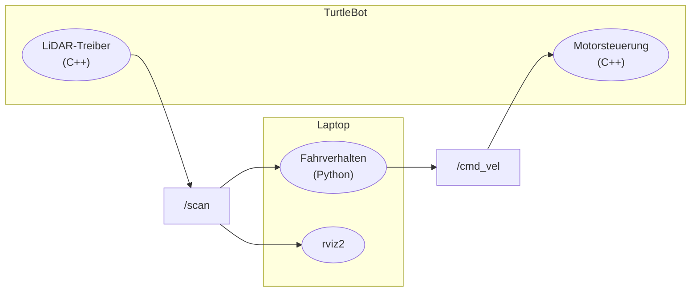

+ kein gemeinsamer Zustand: keine geteilten Variablen zwischen Knoten
+ auch ein Service-Aufruf ist Anfrage + Antwort als Nachricht
+ gleicher Rechner: Shared Memory nur als schneller Transportweg
+ jeder Knoten hat seinen eigenen Takt und seinen eigenen Zustand
+ das Netzwerk ist Teil Ihres Programms

    --{{0}}--
Treten wir einen Schritt zurück. Alles, was wir bisher gesehen haben, läuft auf eine Kernbotschaft hinaus: Ein ROS-2-System ist ein verteiltes System. Ihre Knoten sind getrennte Prozesse, oft auf verschiedenen Rechnern. Kein Knoten kann die Variablen eines anderen lesen oder direkt in dessen Code springen. Das Einzige, was sie verbindet, sind Nachrichten. Das gilt auch für Services: Sie fühlen sich an wie ein Funktionsaufruf, werden aber als Anfrage und Antwort übertragen. Und wenn zwei Knoten auf demselben Rechner laufen, nutzt die Middleware zwar gemeinsamen Speicher, aber nur als schnelleren Transportweg für die Nachrichten. Am Prinzip ändert das nichts. Diese eine Entscheidung erklärt fast alle Stärken von ROS 2, aber auch fast alle Schwierigkeiten, die Ihnen im Projekt begegnen werden.

### Vorteile

<!-- data-type="none" -->
| Vorteil                     | Am TurtleBot                                                        |
| :-------------------------- | :------------------------------------------------------------------ |
| **Austauschbarkeit**        | Simulator statt echtem LiDAR — `/scan` bleibt gleich, Rest unverändert |
| **Freie Sprachwahl**        | Bildverarbeitung in C++, Fahrverhalten in Python                    |
| **Fehlerisolation**         | Spurerkennung stürzt ab → Kameratreiber läuft weiter                |
| **Verteilung der Rechenlast** | Treiber auf dem Roboter, rechenintensive Auswertung auf dem Laptop |
| **Wiederverwendung**        | Treiber, Kartierung, Navigation (Nav2) fertig nutzen                |
| **Werkzeuge von außen**     | `ros2 topic echo`, `rviz2`, `ros2 bag` — ohne den Code zu ändern     |
| **Arbeitsteilung im Team**  | Schnittstelle = Topic + Typ, danach arbeitet jede Gruppe für sich   |

    --{{0}}--
Die Vorteile kennen Sie inzwischen alle aus der Vorlesung. Weil die Knoten nur über Topics verbunden sind, können Sie einen Teil austauschen, ohne die anderen anzufassen: Ob die Scans aus dem echten LiDAR oder aus dem Simulator kommen, merkt Ihr Fahrverhalten nicht. Jeder Knoten kann in der Sprache geschrieben sein, die zu seiner Aufgabe passt. Ein Absturz bleibt auf einen Prozess begrenzt. Und weil jedes Werkzeug einfach ein weiterer Knoten ist, können Sie in ein laufendes System hineinschauen, ohne eine Zeile zu ändern. Für Ihr Projekt besonders wichtig ist der letzte Punkt: Haben Sie sich im Team auf Topic und Typ geeinigt, kann jede Teilgruppe unabhängig weiterarbeiten.

### Nachteile: der Preis der Verteilung

<!-- data-type="none" -->
| Nachteil                       | Am TurtleBot                                                            |
| :----------------------------- | :---------------------------------------------------------------------- |
| **Kommunikation als Grundlage** | WLAN bricht ab → Fahrverhalten bekommt keine Scans, Roboter fährt blind weiter |
| **Asynchronität**              | kein Wissen, **wann** und **ob** die nächste Nachricht kommt              |
| **Veraltete Daten**            | jeder Knoten kennt nur die letzte Nachricht — vielleicht 0,5 s alt       |
| **Kein gemeinsamer Zustand**   | Fahrverhalten und Ampelerkennung können sich „widersprechen“             |
| **Stille Fehler**              | falscher Name, Typ, QoS oder Domäne → keine Verbindung, kein Absturz     |
| **Aufwand pro Nachricht**      | Serialisierung, Kopien, Netzwerk: ein Kamerabild ≈ 1 MB, 30× pro Sekunde |
| **Schwierigere Fehlersuche**   | Ursache liegt oft *zwischen* den Knoten, nicht in einem                  |
| **Verteilte Konfiguration**    | Umgebungsvariablen, Parameter, Launch-Dateien auf mehreren Rechnern      |

    --{{0}}--
Diese Vorteile haben einen Preis, und der hat dieselbe Ursache: die Verteilung. Ohne Kommunikation geht nichts. Bricht das WLAN ab, bekommt Ihr Fahrverhalten keine Scans mehr, und wenn es darauf nicht vorbereitet ist, fährt der Roboter mit dem letzten Fahrbefehl einfach weiter. Die Kommunikation ist außerdem asynchron. Ein Knoten weiß nie, wann die nächste Nachricht kommt, ob sie überhaupt kommt und wie alt die Daten sind, die er gerade verarbeitet. Es gibt keinen gemeinsamen Zustand, auf den alle schauen, jeder Knoten hat sein eigenes Bild der Welt. Dazu kommen die stillen Fehler, die Sie bei der Discovery und eben beim Remapping gesehen haben: Passt etwas nicht zusammen, entsteht einfach keine Verbindung, und niemand meldet einen Fehler. Und die Fehlersuche wird anspruchsvoller, weil die Ursache oft nicht in einem Knoten liegt, sondern zwischen zweien.

### Was heißt das für Ihr Projekt?

+ Schnittstellen früh festlegen: **Topic, Typ, QoS** gemeinsam dokumentieren
+ jeder Knoten rechnet mit **fehlenden** und **verspäteten** Nachrichten
+ Alter der Daten prüfen: Zeitstempel im `header` (VL 03)
+ sicherer Zustand: keine Daten → Roboter anhalten
+ bei Problemen zuerst prüfen, **ob Daten fließen**: `ros2 topic list / info / hz`

    --{{0}}--
Für Ihr Projekt folgen daraus ein paar Regeln, die Sie sich früh angewöhnen sollten. Legen Sie die Schnittstellen zwischen Ihren Knoten gemeinsam fest und schreiben Sie sie auf. Programmieren Sie jeden Knoten so, als könnte jede Nachricht ausbleiben oder zu spät kommen, denn genau das wird passieren. Prüfen Sie über den Zeitstempel, wie alt die Daten sind, statt anzunehmen, dass sie aktuell sind. Wenn nichts mehr ankommt, muss der Roboter in einen sicheren Zustand gehen, im Zweifel also anhalten. Und wenn etwas nicht funktioniert, prüfen Sie zuerst mit den ros2-Werkzeugen, ob überhaupt Daten fließen, bevor Sie Ihren Code verdächtigen.

## Zusammenfassung und Ausblick

+ ROS 2 übernimmt **Treiber, Kommunikation, Werkzeuge**
+ **Knoten** tauschen **Nachrichten** über **Topics**
+ Services und Actions: Anfragen und lange Aufträge
+ Jeder Knoten: Klasse, `create_…`, **Callback**, `spin()` — in Python wie in C++
+ `ros2 topic list/info/echo/hz/pub` macht ein System sichtbar
+ Verbindung nur bei gleicher Domäne und Middleware, gleichem Namen und Typ, passender QoS
+ ROS 2 ist ein **verteiltes System**: Nachrichten können ausbleiben, zu spät kommen oder nie ankommen — Ihr Knoten muss damit rechnen
+ Namen verbinden, Remapping lenkt um

    --{{0}}--
Fassen wir zusammen. ROS 2 verbindet die Programme eines Roboters über benannte Kanäle. Weil sich Sender und Empfänger nicht kennen, lassen sich Teile austauschen, in jeder Sprache schreiben und mit denselben Werkzeugen untersuchen. Den Preis dafür sollten Sie nicht vergessen: ROS 2 ist ein verteiltes System. Nachrichten können ausbleiben oder zu spät kommen, und wenn etwas nicht zusammenpasst, entsteht still keine Verbindung. Diese Sicht wird Sie durch das ganze Projekt begleiten.

**Ausblick**

+ **VL 02:** eigenes Paket, Bauen mit `colcon`, Start per Launch-Datei
+ **Ü 2:** erster Workspace, fremdes Paket, Parameter und Aufzeichnungen

    --{{1}}--
In VL 02 schreiben Sie selbst Pakete und bauen sie mit colcon. Dort begegnet Ihnen der Publisher von heute wieder, diesmal in C++. In Ü 2 legen Sie Ihren ersten eigenen Workspace an, nutzen ein fremdes Paket und arbeiten mit Parametern und Aufzeichnungen.

## Installation

**Gemeinsam in Ü 1:** Donnerstag, 16:15 Uhr, Lessingstraße

**Bis Donnerstag vorbereiten**

+ Laptop mit Ubuntu 24.04 (nativ oder in WSL2), Netzteil, 10 GB frei
+ unter Windows vorher: `wsl --install -d Ubuntu-24.04`
+ zu Hause: `sudo apt update && sudo apt upgrade`
+ noch kein Ubuntu? **Trotzdem kommen** — vor Ort gibt es Rechner mit Ubuntu

**Nicht fertig geworden?** → [Installationsanleitung](https://liascript.github.io/course/?https://raw.githubusercontent.com/TUBAF-IfI-LiaScript/VL_SoftwareprojektRobotik/refs/heads/master/exercises/installation_ros2/README.md), spätestens bis VL 02

    --{{0}}--
ROS 2 installieren wir gemeinsam in der ersten Übung. Die Installation ist dort zugleich das Übungsbeispiel für die Shell. Wir installieren das Paket ros-jazzy-desktop nach der offiziellen Anleitung, es enthält rqt, turtlesim und die Beispiele von heute. Unter Windows zählt ein Ubuntu in WSL2 genauso wie ein natives Ubuntu. Damit in der Übung nur noch ROS 2 geladen werden muss, bringen Sie Ihr Ubuntu vorher zu Hause auf den aktuellen Stand. Bitte kommen Sie auch dann, wenn bis dahin noch kein Ubuntu läuft: In der Lessingstraße stehen Rechner mit vorinstalliertem Ubuntu, an denen Sie genauso vorgehen wie alle anderen.

Offizielle Anleitung: [Ubuntu (deb packages)](https://docs.ros.org/en/jazzy/Installation/Ubuntu-Install-Debs.html)

## Aufgabe der Woche

1. **Installieren** Sie ROS 2 Jazzy in Ü 1 und führen Sie die drei Tests am Ende aus.
2. **Nach Ü 1:** Tutorials [Understanding nodes](https://docs.ros.org/en/jazzy/Tutorials/Beginner-CLI-Tools/Understanding-ROS2-Nodes/Understanding-ROS2-Nodes.html) und [Understanding topics](https://docs.ros.org/en/jazzy/Tutorials/Beginner-CLI-Tools/Understanding-ROS2-Topics/Understanding-ROS2-Topics.html); die übrigen dürfen Sie auslassen.
3. **Skizzieren** Sie den ROS-Graphen für Spurfolgen mit Ampelhalt — wie auf der Folie „Topics“.
4. **Prüfen** Sie sich mit der Selbstkontrolle auf den nächsten beiden Folien.

    --{{0}}--
Die wichtigste Aufgabe dieser Woche ist die Installation. Wer in der Übung nicht fertig wird, holt sie nach der Installationsanleitung bis VL 02 nach. Die Tutorials setzen eine laufende Installation voraus. Die übrigen Tutorials dürfen Sie auslassen, Parameter und Aufzeichnungen folgen in Ü 2. Die dritte Aufgabe ist der beste Test, ob Sie die heutige Vorlesung verstanden haben: Welche Knoten braucht ein TurtleBot, der einer Fahrspur folgt und an einer roten Ampel hält, und über welche Topics reden sie? Bewahren Sie die Skizze auf, in VL 02 ergänzen Sie sie um Pakete. Mit der Selbstkontrolle auf den nächsten beiden Folien prüfen Sie, ob Sie Code und Nachrichten lesen, das passende Kommunikationsmuster wählen und Verbindungsfehler eingrenzen können.

### Selbstkontrolle: Code und Nachrichten

**Lesen Sie diesen Knoten.** Er wird im Namensraum `/tb1` gestartet.

```python
class Antrieb(Node):
    def __init__(self):
        super().__init__('antrieb')
        self.pub = self.create_publisher(Twist, 'cmd_vel', 10)
        self.timer = self.create_timer(0.05, self.step)

    def step(self):
        msg = Twist()
        msg.angular.z = -0.5
        self.pub.publish(msg)
```

Wie viele Nachrichten pro Sekunde sendet der Knoten? [[20]]
[[?]] Der Timer ruft `step` alle `0.05` s auf.
Unter welchem vollständigen Namen erscheint das Topic in `ros2 topic list` (mit führendem `/`)? [[/tb1/cmd_vel]]
[[?]] `cmd_vel` beginnt nicht mit `/` — der Namensraum wird vorangestellt (Architektur, Schicht ③).
***
`1 / 0.05 s = 20` Nachrichten pro Sekunde. Ein relativer Name wie `cmd_vel` wird in den Namensraum des Knotens eingeordnet, ein absoluter wie `/cmd_vel` nicht.
***

Wie bewegt sich ein Roboter, der diese Nachrichten erhält?

[( )] Er fährt mit 0,5 m/s rückwärts.
[( )] Er dreht sich mit 0,5 °/s nach links.
[(X)] Er dreht sich auf der Stelle nach rechts, mit 0,5 rad/s (≈ 29 °/s).
[( )] Er steht, weil `linear.x` nicht gesetzt wurde.
***
Nicht gesetzte Felder sind `0.0`, also keine Vorwärtsbewegung. `angular.z` ist die Drehung um die Hochachse in rad/s, positiv nach links (z oben, REP 103) — ein negativer Wert dreht also nach rechts.
***

`ros2 topic info -v /tb1/cmd_vel` zeigt beim Motorknoten des Roboters den Typ `geometry_msgs/msg/TwistStamped`. Was passiert?

[( )] ROS 2 ergänzt den fehlenden Header automatisch, der Roboter dreht sich.
[(X)] Es entsteht keine Verbindung, der Roboter bewegt sich nicht, kein Programm stürzt ab.
[( )] Der Motorknoten stürzt beim ersten Empfang mit einem Typfehler ab.
***
In der Discovery (Schritt ②) wird der Typ verglichen. `Twist` und `TwistStamped` sind verschiedene Typen, also kein Match — still, ohne Absturz. `ros2 topic info` zeigt dann zwei verschiedene Typen auf demselben Topic.
***

Sie möchten, dass der Roboter mit 0,1 m/s vorwärts fährt und dabei mit 45 °/s nach **links** dreht. Welche Werte setzen Sie?

[( )] `linear.x = 0.1`, `angular.z = 45`
[(X)] `linear.x = 0.1`, `angular.z = 0.785`
[( )] `linear.x = 0.1`, `angular.z = -0.785`
[( )] `linear.y = 0.1`, `angular.z = 0.785`
***
ROS rechnet in SI-Einheiten: 45 ° = π/4 rad ≈ 0,785 rad. Links ist positiv. `linear.y` wäre eine Bewegung seitwärts nach links, die ein TurtleBot nicht kann.
***

    --{{0}}--
Diese Fragen bearbeiten Sie nach der Vorlesung. Sie verbinden mehrere Folien: den Code eines Knotens, die Namensauflösung aus der Architektur, die Felder einer Nachricht mit ihren Einheiten und den Abgleich der Typen bei der Discovery. Rechnen Sie die Werte selbst aus, bevor Sie die Lösung aufdecken.

### Selbstkontrolle: Verbindungen und Systementwurf

**Entsteht eine Verbindung?** Wenn nicht anders angegeben, nutzen Publisher und Subscriber denselben Topic-Namen, denselben Typ und dieselbe Domäne.

[ [Verbindung] [keine Verbindung] ]
[ (X)          ( )                ] Der Publisher startet zehn Sekunden nach dem Subscriber.
[ ( )          (X)                ] Der Publisher wurde mit `--ros-args -r topic:=topic2` gestartet.
[ ( )          (X)                ] `ROS_DOMAIN_ID` 0 beim Publisher, 7 beim Subscriber
[ (X)          ( )                ] Publisher in C++ auf dem TurtleBot, Subscriber in Python auf dem Laptop, gleiche Domäne
[ ( )          (X)                ] Publisher sendet `std_msgs/msg/String`, Subscriber erwartet `geometry_msgs/msg/Twist`
[ ( )          (X)                ] Publisher nutzt `rmw_fastrtps_cpp`, Subscriber `rmw_zenoh_cpp`
***
Verbunden wird nur bei gleicher Domäne, passender Middleware, gleichem Namen, gleichem Typ und kompatibler QoS. Wann ein Knoten startet, ist egal: Später gestartete Knoten durchlaufen dieselbe Discovery. Sprache und Rechner spielen keine Rolle. Welche QoS-Einstellungen zueinander passen, sehen Sie in VL 03.
***

**Welches Muster passt?**

[ [Topic] [Service] [Action] [Parameter] ]
[ (X)     ( )       ( )      ( )         ] Die Kamera liefert 30 Bilder pro Sekunde.
[ ( )     ( )       ( )      (X)         ] Der Schwellwert der Spurerkennung soll im Betrieb angepasst werden.
[ ( )     (X)       ( )      ( )         ] Die aktuelle Karte soll gespeichert und der Erfolg gemeldet werden.
[ ( )     ( )       (X)      ( )         ] Der Roboter soll in eine Parklücke fahren, Fortschritt melden und abbrechbar sein.
[ (X)     ( )       ( )      ( )         ] Die Ampelerkennung meldet ihr Ergebnis an das Fahrverhalten **und** an eine Anzeige.
***
Fortlaufende Daten an beliebig viele Empfänger → Topic. Einmaliger Auftrag mit Antwort → Service. Langer, abbrechbarer Auftrag mit Zwischenständen → Action. Einstellung eines Knotens → Parameter, intern über Services gelöst.
***

Ihre Gruppe schreibt die Spurerkennung von Python nach C++ um. Was muss am Fahrverhalten geändert werden?

[( )] Es muss ebenfalls nach C++ portiert werden.
[( )] Es braucht einen Adapter-Knoten zwischen Python und C++.
[(X)] Nichts, solange Topic-Name, Nachrichtentyp und QoS gleich bleiben.
***
Das ist der Kern der Einordnung: Knoten kennen sich nicht, sie kennen nur die Schnittstelle aus Topic, Typ und QoS. Genau deshalb lohnt es sich, diese Schnittstellen früh im Team festzulegen.
***

Ihr Fahrverhalten hat seit zwei Sekunden keinen `/scan` mehr erhalten, der Roboter fährt mit 0,2 m/s. Was sollte es tun?

[( )] mit dem letzten Scan weiterrechnen — der ist ja noch im Speicher
[( )] die Lease-Zeit von 20 s abwarten — dann meldet ROS 2 den Ausfall
[( )] nichts — ROS 2 meldet ausgefallene Sensoren und hält den Roboter automatisch an
[(X)] einen Stopp-Befehl auf `/cmd_vel` senden und eine Warnung ausgeben
***
Der Scan ist 2 s alt, der Roboter fuhr seither 40 cm. ROS 2 hält nichts automatisch an. Im verteilten System ist „keine Nachricht“ normal – Ihr Knoten braucht selbst einen sicheren Zustand.
***

**Fehlersuche:** Publisher und Subscriber laufen in zwei Terminals, der Subscriber empfängt nichts. `ros2 topic info /topic` meldet im Publisher-Terminal `Subscription count: 0`, im Subscriber-Terminal `Publisher count: 0`. Plausible Ursachen?

[[ ]] Der Subscriber ist in C++ geschrieben, der Publisher in Python.
[[X]] Die beiden Terminals verwenden unterschiedliche Werte für `ROS_DOMAIN_ID`.
[[X]] Ein Terminal nutzt `rmw_fastrtps_cpp`, das andere `rmw_zenoh_cpp`.
[[ ]] Der Subscriber wurde vor dem Publisher gestartet.
***
Zählt jede Seite 0, sehen sich die Knoten gar nicht: andere Domäne oder andere Middleware. Startreihenfolge, Sprache und Rechner spielen keine Rolle. `printenv | grep -E "ROS|RMW"` zeigt die Werte.
***

    --{{0}}--
Die zweite Folie prüft, ob Sie das System als Ganzes verstanden haben. Bei der Frage nach der Verbindung hilft das Discovery-Diagramm: Gehen Sie für jeden Fall die drei Schritte durch. Und achten Sie bei der Fehlersuche genau darauf, was ros2 topic list in welchem Terminal anzeigt. Daran erkennen Sie, in welchem Schritt die Verbindung scheitert.

### Zum Weiterlesen


<!-- data-type="none" -->
| Angebot                                                                                  | Inhalt                                             |
| :--------------------------------------------------------------------------------------- | :------------------------------------------------- |
| [ROS 2 Jazzy Dokumentation](https://docs.ros.org/en/jazzy/)                              | Installation, Konzepte, How-to-Guides              |
| [Tutorials für Einsteiger](https://docs.ros.org/en/jazzy/Tutorials.html)                 | Kommandozeile, erste Pakete, Publisher/Subscriber  |
| [Robotics Stack Exchange](https://robotics.stackexchange.com/questions/tagged/ros2)      | Fragen und Antworten (Nachfolger von ROS Answers)  |
| [TurtleBot 3 e-Manual](https://emanual.robotis.com/docs/en/platform/turtlebot3/overview/) | Hardware und ROS-2-Pakete unseres Roboters         |

> [!WARNING]
> **Stolperfalle – Tutorials und Chatbot-Antworten:** Prüfen Sie immer, für welche ROS-Version ein Beispiel geschrieben ist. In der Dokumentation steht die Distribution in der Adresse (`docs.ros.org/en/jazzy/…`).

<!-- kurslandkarte:ausblick-start -->

--------------------------------------------------------------------------------

**🗺️ Nächster Halt:** VL 02 · ROS 2 Pakete (Mi 4.11. · 11:30–13:00) – Sie bauen eigene Knoten und starten sie gemeinsam mit einer Launch-Datei – das Gerüst für jede spätere Projektfunktion. [Auf der Kurslandkarte ansehen](https://tubaf-ifi-liascript.github.io/VL_SoftwareprojektRobotik/kurslandkarte/#termin=04)

**Außerdem bis dahin:** [Ü 1 · Linux Shell](https://tubaf-ifi-liascript.github.io/VL_SoftwareprojektRobotik/kurslandkarte/#termin=ue1) (Do 29.10. · 16:15–17:45)

<!-- kurslandkarte:ausblick-ende -->
