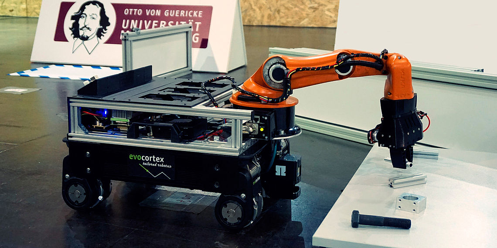
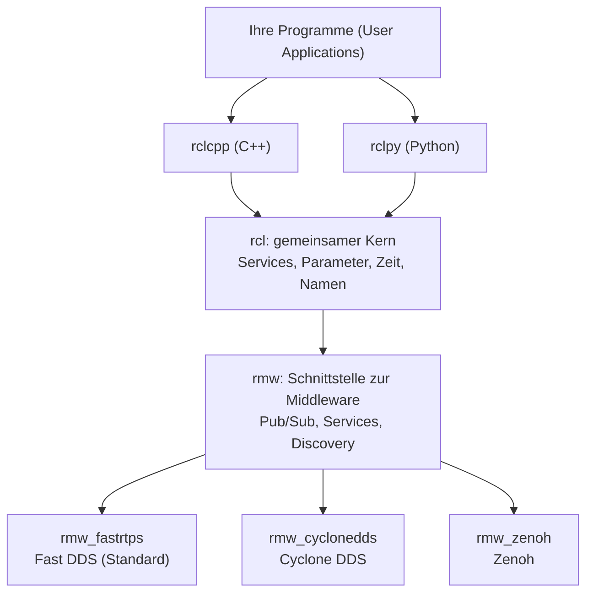
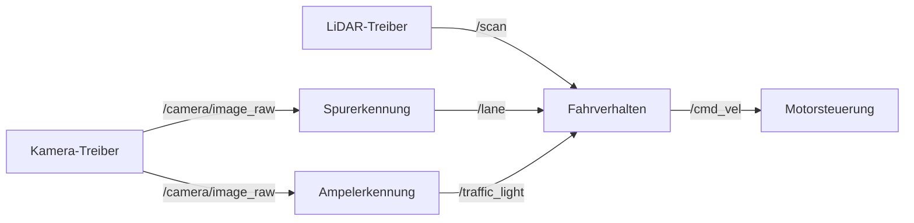
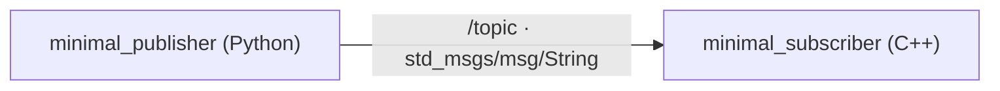
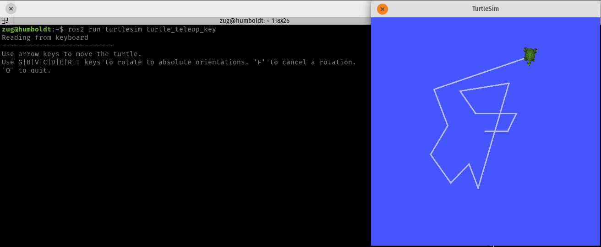
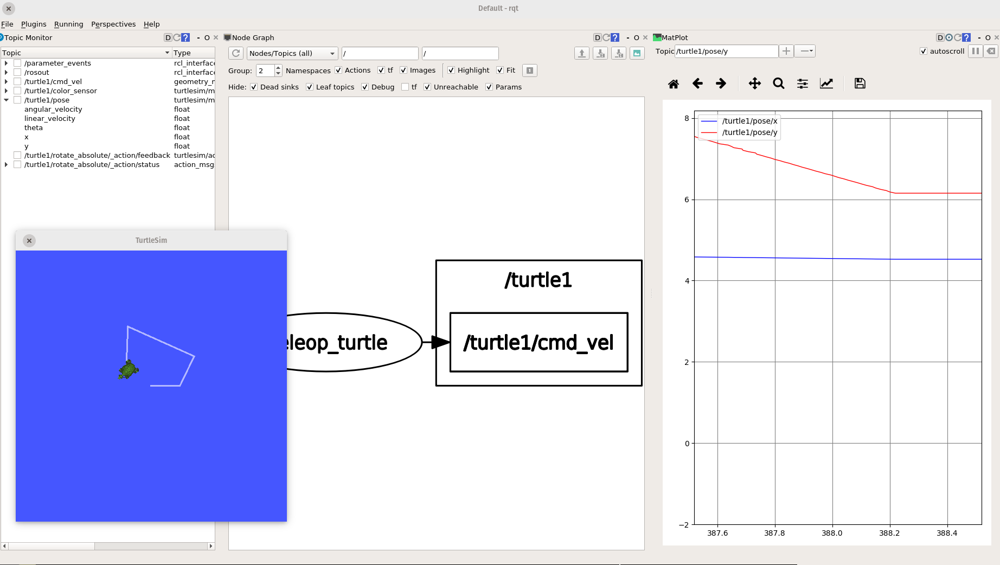

<!--

author:   Sebastian Zug & Georg Jäger & Claude Code (Opus 5.5) mit LiaScript Teaching-Agent
email:    sebastian.zug@informatik.tu-freiberg.de & Georg.Jaeger@informatik.tu-freiberg.de
version:  0.4.0
language: de
narrator: Deutsch Female

import:   https://raw.githubusercontent.com/TUBAF-IfI-LiaScript/VL_SoftwareprojektRobotik/refs/heads/master/config.md
          https://raw.githubusercontent.com/liaTemplates/mermaid_template/master/README.md
  
-->

[](https://liascript.github.io/course/?https://raw.githubusercontent.com/TUBAF-IfI-LiaScript/VL_SoftwareprojektRobotik/refs/heads/master/01_ROS_Grundlagen/01_ROS_Grundlagen.md)


# Einführung in ROS 2

| Parameter            | Kursinformationen                                                                                                                                                                                   |
|----------------------|-----------------------------------------------------------------------------------------------------------------------------------------------------------------------------------------------------|
| **Veranstaltung:**   | @config.lecture                                                                                               |
| **Semester**         | @config.semester                                                                                              |
| **Hochschule:**      | `Technische Universität Freiberg`                                                                                                                                                                   |
| **Inhalte:**         | `Motivation für ROS 2, Architektur, Knoten, Topics und Nachrichten, erste Schritte mit der Kommandozeile`                                                                                           |
| **Link auf GitHub:** | https://github.com/TUBAF-IfI-LiaScript/VL_SoftwareprojektRobotik/blob/master/01_ROS_Grundlagen/01_ROS_Grundlagen.md |
| **Autoren**          | @author                                                                                                       |


--------------------------------------------------------------------------------

**Zielstellung der heutigen Veranstaltung** — nach dieser Vorlesung können Sie

+ an einem TurtleBot-Beispiel begründen, welche Probleme ein Framework wie ROS 2 löst,
+ für eine Aufgabe das passende Kommunikationsmuster (Topic, Service, Action) wählen und einen ROS-Graphen aus Knoten und Topics skizzieren,
+ im Code eines Knotens Topic, Nachrichtentyp, Callback und `spin()` benennen,
+ ein laufendes System mit `ros2 topic` untersuchen und typische Verbindungsfehler erklären.

--------------------------------------------------------------------------------

**Was wir schon wissen — und was am Donnerstag kommt**

+ **VL 00:** Sense, Think, Act sind getrennte Programme → heute: **wie sie Daten austauschen**
+ **Ü 1 am Donnerstag:** ROS 2 installieren, die Shell kennenlernen
+ **Umgebungsvariable** = benannter Wert, den ein Terminal an seine Programme weitergibt
  + setzen: `export NAME=wert` · eine ganze Datei solcher Werte laden: `source datei`

    --{{0}}--
Wir zählen die Vorlesungen ab null, wie in den anderen Veranstaltungen des Instituts: Die Einführung war Vorlesung null, heute ist Vorlesung eins. Aus der Einführung brauchen wir den Sense-Think-Act-Kreislauf. Beim TurtleBot sind Wahrnehmung, Planung und Ansteuerung getrennte Programme, die ständig Daten austauschen müssen. Wie sie das tun, ist das Thema heute. Eine Sache aus Ü 1 greifen wir schon vorab auf, weil sie die häufigste Fehlerquelle ist: Jedes Programm erbt die Umgebungsvariablen des Terminals, in dem es gestartet wird. Geben Sie zur folgenden Frage einfach Ihre Vermutung ab, am Donnerstag probieren Sie es selbst aus.

**Ihre Vermutung:** Terminal 1: `export ROS_DOMAIN_ID=12`. Was zeigt `echo $ROS_DOMAIN_ID` in einem **neuen** Terminal?

[( )] `12`
[(X)] eine leere Zeile
[( )] eine Fehlermeldung
***
Jedes Terminal hat seine eigene Umgebung. Das begegnet uns heute wieder: Zwei ROS-Programme mit unterschiedlicher `ROS_DOMAIN_ID` sehen sich nicht.
***

--------------------------------------------------------------------------------

<!-- kurslandkarte:wo-start -->

## Wo stehen wir?

    --{{0}}--
Kurz zur Orientierung. Wir sind in Block 1, Termin 2 von 32. Sie verstehen, wie die Software des TurtleBots aus Knoten und Topics zusammengesetzt ist. Neu sind heute: ROS als Middleware, DDS / rmw-Schicht, Knoten (Node), Topic, Nachricht (Message), Topics des TurtleBot, ros2-Kommandozeile.

**Ziel im Projekt:** Sie verstehen, wie die Software des TurtleBots aus Knoten und Topics zusammengesetzt ist.

**Block 1 · ROS-Grundlagen** – Termin 2 von 32, heute farbig markiert

<!-- data-type="none" -->
| Woche ab | Vorlesung | Übung | Praktikum |
| :-- | :-- | :-- | :-- |
| 19.10.2026 | [VL 00 Einführung](https://liascript.github.io/course/?https://raw.githubusercontent.com/TUBAF-IfI-LiaScript/VL_SoftwareprojektRobotik/master/00_Einfuehrung/00_Einfuehrung.md) |  |  |
| **26.10.2026**<!-- style="background-color: rgba(255, 166, 0, 0.35); padding: 2px 6px; border-radius: 4px;" --> | **[VL 01 ROS 2 Grundlagen](https://liascript.github.io/course/?https://raw.githubusercontent.com/TUBAF-IfI-LiaScript/VL_SoftwareprojektRobotik/master/01_ROS_Grundlagen/01_ROS_Grundlagen.md)**<!-- style="background-color: rgba(255, 166, 0, 0.35); padding: 2px 6px; border-radius: 4px;" --> | [Ü 1 Linux Shell](https://liascript.github.io/course/?https://raw.githubusercontent.com/TUBAF-IfI-LiaScript/VL_SoftwareprojektRobotik/master/exercises/uebung_01_linux_shell/README.md) |  |
| 2.11.2026 | [VL 02 ROS 2 Pakete](https://liascript.github.io/course/?https://raw.githubusercontent.com/TUBAF-IfI-LiaScript/VL_SoftwareprojektRobotik/master/02_ROS_Pakete/02_ROS_Pakete.md) |  |  |
| 9.11.2026 | [VL 03 Koordinaten + QoS](https://liascript.github.io/course/?https://raw.githubusercontent.com/TUBAF-IfI-LiaScript/VL_SoftwareprojektRobotik/master/03_Koordinaten_QoS/03_Koordinaten_QoS.md) | [Ü 2 Erster Workspace](https://liascript.github.io/course/?https://raw.githubusercontent.com/TUBAF-IfI-LiaScript/VL_SoftwareprojektRobotik/master/exercises/uebung_02_workspace/README.md) |  |
| 23.11.2026 |  |  | [P 1 TurtleBot + Bags](https://liascript.github.io/course/?https://raw.githubusercontent.com/TUBAF-IfI-LiaScript/VL_SoftwareprojektRobotik/master/exercises/praktikum_01_turtlebot/README.md) |

- **Sie brauchen:** [Warum ROS?](https://tubaf-ifi-liascript.github.io/VL_SoftwareprojektRobotik/kurslandkarte/#begriff=rosmotivation) (VL 00)
- **Heute neu:** [ROS als Middleware](https://tubaf-ifi-liascript.github.io/VL_SoftwareprojektRobotik/kurslandkarte/#begriff=middleware) · [DDS / rmw-Schicht](https://tubaf-ifi-liascript.github.io/VL_SoftwareprojektRobotik/kurslandkarte/#begriff=dds) · [Knoten (Node)](https://tubaf-ifi-liascript.github.io/VL_SoftwareprojektRobotik/kurslandkarte/#begriff=node) · [Topic](https://tubaf-ifi-liascript.github.io/VL_SoftwareprojektRobotik/kurslandkarte/#begriff=topic) · [Nachricht (Message)](https://tubaf-ifi-liascript.github.io/VL_SoftwareprojektRobotik/kurslandkarte/#begriff=message) · [Topics des TurtleBot](https://tubaf-ifi-liascript.github.io/VL_SoftwareprojektRobotik/kurslandkarte/#begriff=tbtopics) · [ros2-Kommandozeile](https://tubaf-ifi-liascript.github.io/VL_SoftwareprojektRobotik/kurslandkarte/#begriff=ros2cli)

> [!TIP]
> **Tipp – Kurslandkarte:** [Ganze Kurslandkarte öffnen](https://tubaf-ifi-liascript.github.io/VL_SoftwareprojektRobotik/kurslandkarte/#termin=03) – dort finden Sie jeden Begriff mit Erklärung, typischer Stolperfalle, Link auf die passende Folie und die roten Fäden durch die Veranstaltung.

<!-- kurslandkarte:wo-ende -->

## Warum ein Framework?

                                   {{0-1}}
********************************************************************************

**Welche Herausforderungen stecken in der Programmierung eines Roboters?**

<!-- width="100%" -->
*Roboter des RoboCupTeams aus Nürnberg* [^1]

[^1]: TDP des Teams AutonOhm, 2019

********************************************************************************

    --{{0}}--
Stellen Sie sich vor, Sie sollen diesen Roboter ganz ohne Hilfsmittel programmieren. Kamera, Rechner, Antriebe und Akku brauchen jeweils eigene Treiber, die Programme müssen miteinander reden, und für die Fehlersuche bräuchten Sie eigene Werkzeuge.

                                  {{1-2}}
********************************************************************************

<!-- width="80%" -->
Comic der Firma Willow Garage: Jede Gruppe erfindet das Rad neu. [^2]

[^2]: Willow Garage, http://www.willowgarage.com/blog/2010/04/27/reinventing-wheel, 2010

********************************************************************************

    --{{1}}--
Genau dieses Problem hatten Forschungsgruppen über Jahre. Jede Gruppe hat Treiber, Kommunikation und Visualisierung von Grund auf neu gebaut, und kaum etwas davon ließ sich zwischen Gruppen austauschen.

                                  {{2}}
********************************************************************************

**Was muss ein Framework für den TurtleBot leisten?**

<!-- data-type="none" -->
| Anforderung          | In der Verkehrswelt                                         |
| :------------------- | :---------------------------------------------------------- |
| **Treiber**          | LiDAR, Kamera und Motoren liefern sofort Daten              |
| **Kommunikation**    | getrennte Programme auf Roboter und Laptop tauschen Daten   |
| **Zeitverhalten**    | Fahrbefehl zu spät → Roboter fährt über die Haltelinie      |
| **Wiederverwendung** | Lokalisierung, Kartierung, Navigation fertig nutzen         |
| **Werkzeuge**        | Daten anzeigen, aufzeichnen, im Simulator testen            |
| **Sprachen**         | C++ für Bildverarbeitung, Python für Experimente            |

→ Genau diese Aufgaben übernimmt **ROS 2**.

********************************************************************************

    --{{2}}--
Am Zeitverhalten sieht man, warum das mehr ist als Bequemlichkeit: Fährt der TurtleBot mit zwanzig Zentimetern pro Sekunde und kommt der Haltebefehl eine halbe Sekunde zu spät, steht er zehn Zentimeter hinter der Haltelinie. Und bei den Sprachen gilt: Rechenintensive Bildverarbeitung schreibt man gern in C++, schnelle Versuche in Python. Beides muss im selben System zusammenarbeiten.

## ROS, was ist das?

+ **Middleware**, kein Betriebssystem: Datenaustausch zwischen Programmen
+ dazu **tausende Pakete**: Treiber, Algorithmen, Werkzeuge
+ seit 2007, koordiniert von der Open Source Robotics Foundation ([ros.org](https://www.ros.org/))
+ Standard in der Forschungsrobotik ([golem.de](https://www.golem.de/news/robot-operating-system-was-bratwurst-bot-und-autonome-autos-gemeinsam-haben-1612-124079-4.html))
+ Grundlagenartikel: [Quigley et al. 2009](http://www.robotics.stanford.edu/~ang/papers/icraoss09-ROS.pdf)

    --{{0}}--
ROS steht für Robot Operating System, ist aber trotz des Namens kein Betriebssystem. Eine Middleware ist eine Softwareschicht zwischen Betriebssystem und Anwendung, die den Datenaustausch zwischen Programmen übernimmt, auch über Rechnergrenzen hinweg. ROS entstand 2007 in Stanford. Heute nutzen nahezu alle Forschungsgruppen in der Robotik zumindest Teile davon, viele haben gar kein eigenes Framework mehr, und auch beim autonomen Fahren wird ROS eingesetzt.

**ROS 1 ≠ ROS 2**

+ nicht kompatibel; ROS 1 (_Noetic_) wird seit Mai 2025 nicht mehr gepflegt
+ ROS 1 erkennen Sie an `roscore`, `rosrun`, `catkin`

    --{{1}}--
Seit 2017 gibt es mit ROS 2 eine grundlegend neu entworfene Generation. Neue Projekte setzen ausschließlich darauf. Für Sie ist das vor allem bei der Suche im Netz wichtig: Viele Antworten und Anleitungen stammen noch aus ROS 1 und funktionieren bei uns nicht.

**Distributionen:** jedes Jahr im Mai, gerade Jahre mit 5 Jahren Pflege (_Long Term Support_, LTS)

<!-- data-type="none" -->
| Distribution         | Erschienen | Gepflegt bis | Bemerkung                                       |
| :------------------- | :--------- | :----------- | :---------------------------------------------- |
| _Humble Hawksbill_   | Mai 2022   | Mai 2027     | LTS, Ubuntu 22.04                               |
| **_Jazzy Jalisco_**  | Mai 2024   | Mai 2029     | LTS, Ubuntu 24.04 — **in dieser Veranstaltung** |
| _Kilted Kaiju_       | Mai 2025   | Nov. 2026    | kurzer Support                                  |
| _Lyrical Luth_       | Mai 2026   | Mai 2031     | LTS, aktuellste Version                         |
| _Rolling Ridley_     | fortlaufend | —           | Entwicklungsstand, für Experimente              |

    --{{2}}--
Die Namen der Distributionen folgen dem Alphabet und benennen jeweils eine Schildkröte. Warum nehmen wir nicht die neueste Version? Für die TurtleBots, ihre Treiber und viele Pakete, die wir nutzen, ist Jazzy erprobt. Eine Version, die über beide Semester stabil bleibt, ist für ein Projekt wichtiger als die neuesten Funktionen.

**Kurze Kontrolle:** Sie finden im Netz eine Anleitung, die mit `roscore` beginnt und Pakete mit `catkin_make` baut. Was schließen Sie daraus?

[( )] Die Anleitung passt zu ROS 2 Jazzy, ich muss nur die Befehle in der richtigen Reihenfolge ausführen.
[(X)] Die Anleitung stammt aus ROS 1 und lässt sich nicht direkt auf ROS 2 übertragen.
[( )] Die Anleitung ist für Lyrical Luth geschrieben und funktioniert erst nach einem Update.
***
`roscore` (der zentrale Master) und `catkin` (das Build-System) gibt es nur in ROS 1. ROS 2 kommt ohne Master aus und baut mit `colcon`. Achten Sie bei jeder Anleitung zuerst auf die Version!
***

### Was macht ROS 2 anders?

<!-- data-type="none" -->
| Merkmal                    | ROS 2                                                          |
| :------------------------- | :------------------------------------------------------------- |
| Kein zentraler Master      | Programme finden sich selbst (_Discovery_), kein zentraler Rechner kann ausfallen |
| Austauschbare Middleware   | abstrakte Schnittstelle `rmw`, standardmäßig DDS               |
| Plattformen und Sprachen   | Linux, Windows, macOS; C++ (`rclcpp`) und Python (`rclpy`) mit gleichem Konzept |

+ Quality of Service, Launch-Dateien, `colcon`: VL 02 und VL 03
+ Hintergrund: [Changes between ROS 1 and ROS 2](http://design.ros2.org/articles/changes.html)

    --{{0}}--
ROS 1 war für einzelne Forschungsroboter im Labor gedacht. Für Roboterflotten, eingebettete Systeme, unzuverlässige Funknetze und industrielle Anwendungen fehlten wesentliche Eigenschaften, deshalb wurde ROS 2 neu entworfen. In ROS 1 musste zum Beispiel immer ein zentrales Programm laufen, über das sich alle anderen fanden. Fiel dieser Rechner aus, stand der ganze Roboter. In ROS 2 finden sich die Programme selbst.

## Architektur von ROS 2



*DDS = Data Distribution Service, ein Standard für den Datenaustausch in verteilten Systemen*

> [!IMPORTANT]
> **Merke:** Sie programmieren gegen `rclcpp` oder `rclpy`. Die Schichten darunter bemerken Sie erst, wenn sich zwei Knoten nicht finden.

    --{{0}}--
Wie schafft ROS 2 es, dass ein Python-Programm auf dem Laptop und ein C++-Programm auf dem Roboter miteinander reden? Durch Schichten. Ganz oben stehen die Client-Bibliotheken für C++ und Python. Beide bauen auf demselben Kern auf, deshalb verhalten sich Knoten in beiden Sprachen gleich. Darunter trennt die rmw-Schicht die ROS-Logik von der eigentlichen Kommunikation. Die Middleware ganz unten sorgt dafür, dass sich Programme finden und Nachrichten ankommen. So ist ROS 2 an keinen Anbieter gebunden.

**Welche Middleware?** Standard in Jazzy: Fast DDS — Auswahl per Umgebungsvariable:

```bash
export RMW_IMPLEMENTATION=rmw_cyclonedds_cpp   # gilt nur für dieses Terminal (mehr dazu in Ü 1)
```

+ alle Knoten eines Systems brauchen **dieselbe** Middleware
+ vgl. [ROS 2 Jazzy: Different ROS 2 middleware vendors](https://docs.ros.org/en/jazzy/Concepts/Intermediate/About-Different-Middleware-Vendors.html)

    --{{1}}--
Fast DDS stammt von der Firma eProsima. Alternativen sind Cyclone DDS von Eclipse, RTI Connext und Zenoh, das ohne DDS auskommt und in WLAN-Netzen mit vielen Robotern oft robuster ist. Die Implementierungen unterscheiden sich in unterstützter Hardware, Overhead und Latenz. Der Code Ihrer Knoten bleibt derselbe. Wichtig für das Praktikum: Laufen zwei Knoten mit unterschiedlicher Middleware, sehen sie sich nicht.

## Basiskonzepte

**Knoten (_Node_)** — ein Programm im ROS-System, z. B. Kameratreiber oder Spurerkennung

+ nutzt `rclcpp` oder `rclpy`
+ veröffentlicht oder abonniert Topics
+ läuft auf demselben oder einem anderen Rechner

. Ellipsen sind Knoten, Rechtecke sind Topics, die Pfeile zeigen die Richtung des Datenflusses.")

    --{{0}}--
Jetzt kommen die drei Begriffe, die Sie heute mitnehmen müssen: Knoten, Topics und Nachrichten. Jeder Knoten erledigt genau eine Aufgabe. Das hat einen praktischen Grund: Stürzt Ihre Spurerkennung ab, läuft der Kameratreiber weiter, und Sie können die Spurerkennung neu starten, ohne den Roboter anzuhalten. Im Bild sehen Sie zwei Knoten, die auf dasselbe Topic senden, und einen, der empfängt.

**Discovery** — Knoten finden sich selbst, ohne Adressliste

+ **Domäne** = Gruppennummer `ROS_DOMAIN_ID`; nur gleiche Nummern sehen sich
+ Knoten kündigen sich beim Start an und melden sich regelmäßig
+ verbunden wird nur bei passender **Quality of Service** (Regeln zu Zuverlässigkeit und Puffer, VL 03)

    --{{1}}--
Wie finden sich die Knoten, ohne dass jemand eine Adressliste pflegt? Das erledigt die Middleware. Ein Knoten kündigt sich beim Start allen Knoten seiner Domäne an, die anderen antworten, und die Verbindungen entstehen. Weil sich Knoten regelmäßig melden, finden auch später gestartete Knoten Anschluss. Die Domäne brauchen Sie im Praktikum: Mehrere Gruppen arbeiten im selben WLAN. Mit unterschiedlichen Domänennummern stören sich ihre Roboter nicht gegenseitig.

### Topics

**Topic** — benannter Kanal, Muster _Publish-Subscribe_

+ Sender **veröffentlichen** (_publish_), Empfänger **abonnieren** (_subscribe_)
+ Sender und Empfänger kennen sich nicht — der **Name** verbindet sie
+ fortlaufender Datenstrom in eine Richtung, ohne Antwort

    --{{0}}--
Ein Topic funktioniert wie ein Radiosender. Der Sender strahlt sein Programm aus, egal ob jemand zuhört, und jeder, der die Frequenz einstellt, empfängt es. Die Frequenz ist hier der Name des Topics. Eine Antwort an den Sender ist nicht vorgesehen.



*Ausschnitt aus einem möglichen Projektsystem: Pfeil = Topic, Kasten = Knoten*

    --{{1}}--
So oder so ähnlich wird Ihr eigenes System aussehen. Das Kamerabild geht an zwei Empfänger, die Spurerkennung und die Ampelerkennung. Weil der Kameratreiber nicht weiß, wer seine Bilder liest, lässt sich die Ampelerkennung später ergänzen, ohne einen der anderen Knoten zu ändern.

### Kommunikationsmuster

<!-- data-type="none" -->
| Muster        | Ablauf                                           | Beispiel am TurtleBot                                     |
| :------------ | :----------------------------------------------- | :-------------------------------------------------------- |
| **Topic**     | fortlaufender Datenstrom, 1:n, ohne Antwort      | LiDAR-Scans, Kamerabilder, Fahrbefehle                    |
| **Service**   | Anfrage → eine Antwort, kurz                     | Karte speichern, Odometrie zurücksetzen                   |
| **Parameter** | Konfigurationswert, zur Laufzeit änderbar        | Schwellwert der Spurerkennung, Höchstgeschwindigkeit      |
| **Action**    | langer Auftrag mit Zwischenständen und Abbruch   | „Fahre zur Parklücke“ mit Fortschrittsmeldung             |

Heute: **Topics** · Ü 2: Parameter · später im Projekt: Services und Actions

    --{{0}}--
Neben Topics kennt ROS 2 drei weitere Kommunikationsmuster. Der Unterschied liegt darin, ob eine Antwort erwartet wird und wie lange ein Vorgang dauert. Einen Service rufen Sie auf wie eine Funktion und warten auf das Ergebnis. Eine Action dagegen kann Minuten dauern, deshalb meldet sie Zwischenstände und lässt sich abbrechen. Parameter sind keine Nachrichten, sondern Einstellungen eines Knotens, die man von außen ändern kann.

**Kurze Kontrolle:** Welches Kommunikationsmuster passt jeweils?

[ [Topic] [Service] [Action] ]
[  (X)      ( )       ( )    ] Die Kamera liefert 30 Bilder pro Sekunde.
[  ( )      (X)       ( )    ] Die Spurerkennung soll auf Anfrage einmal ihre Kalibrierung neu laden.
[  ( )      ( )       (X)    ] Der Roboter soll in eine Parklücke fahren und dabei melden, wie weit er ist.
[  (X)      ( )       ( )    ] Die Ampelerkennung meldet laufend den erkannten Zustand der Ampel.
***
Faustregel: fortlaufende Daten → **Topic**; einmalige Anfrage mit kurzer Antwort → **Service**; langer, abbrechbarer Auftrag mit Zwischenständen → **Action**. Der Ampelzustand ändert sich ständig und wird von mehreren Knoten gebraucht — also ein Topic.
***

### Nachrichten

**Nachrichtentyp (_Message_)** — legt Felder und Datentypen fest

```text
> ros2 interface show --no-comments geometry_msgs/msg/Twist
Vector3  linear
	float64 x
	float64 y
	float64 z
Vector3  angular
	float64 x
	float64 y
	float64 z
```

+ `Twist` = Fahrbefehl auf `/cmd_vel`: `linear.x` [m/s], `angular.z` [rad/s]
+ verschachtelt: `Twist` besteht aus zwei `Vector3`

    --{{0}}--
Damit Sender und Empfänger dieselbe Sprache sprechen, legt ein Nachrichtentyp fest, welche Felder übertragen werden. Für fast alle Sensoren und Aktoren gibt es Standardtypen. Der Fahrbefehl Twist enthält sechs Werte, unser TurtleBot braucht davon nur zwei: die Geschwindigkeit nach vorne und die Drehung um die Hochachse. Die übrigen Felder braucht ein Roboter, der fliegen oder seitwärts fahren kann.

```text
> ros2 interface show --no-comments sensor_msgs/msg/LaserScan
std_msgs/Header header
	builtin_interfaces/Time stamp
		int32 sec
		uint32 nanosec
	string frame_id
float32 angle_min
float32 angle_max
float32 angle_increment
float32 time_increment
float32 scan_time
float32 range_min
float32 range_max
float32[] ranges
float32[] intensities
```

+ **Header:** Zeitstempel und Bezugssystem `frame_id` (VL 03)
+ `ranges`: eine Entfernung pro Winkelschritt
+ Basistypen `bool`, `int32`, `float64`, `string`
+ Arrays: `[]` beliebig lang, `[5]` feste Länge

    --{{1}}--
Ein LiDAR-Scan beginnt mit einem Header. Er sagt, wann gemessen wurde und in welchem Bezugssystem, also von welchem Punkt am Roboter aus. Es folgen die Winkelangaben des Scans und die eigentlichen Messwerte, eine Entfernung pro Winkelschritt. Den Header finden Sie in fast allen Sensornachrichten wieder. Eigene Nachrichtentypen definieren Sie in VL 02.

**Kurze Kontrolle:** Ihr Fahrverhalten soll den TurtleBot mit 0,1 m/s geradeaus fahren lassen. Welches Feld der `Twist`-Nachricht setzen Sie auf `0.1`?

[( )] `angular.z`
[(X)] `linear.x`
[( )] `linear.z`
***
`linear.x` ist die Vorwärtsgeschwindigkeit, `angular.z` die Drehung um die Hochachse. `linear.z` wäre eine Bewegung nach oben — für einen Bodenroboter bedeutungslos.
***

## Einführungsbeispiele

**Arbeit auf der Konsole:** `ros2 <bereich> <befehl>` · Hilfe mit `-h`, z. B. `ros2 topic -h`

<!-- data-type="none" -->
| Befehl                   | Wofür?                                                     |
| :----------------------- | :--------------------------------------------------------- |
| `ros2 run`               | einen Knoten aus einem Paket starten                       |
| `ros2 node list / info`  | welche Knoten laufen, was veröffentlichen sie?             |
| `ros2 topic list / echo / hz / pub` | Topics anzeigen, mitlesen, Takt messen, selbst senden |
| `ros2 interface show`    | den Aufbau eines Nachrichtentyps anzeigen                  |
| `ros2 service`, `ros2 param`, `ros2 action` | die übrigen Kommunikationsmuster (Parameter in Ü 2) |
| `ros2 bag`               | Daten aufzeichnen und abspielen (Ü 2)                      |
| `ros2 doctor`            | Installation und Netzwerk auf typische Probleme prüfen     |

    --{{0}}--
Ein laufendes ROS-2-System untersuchen Sie mit dem Kommandozeilenwerkzeug ros2. Die Bereiche entsprechen den Konzepten von eben: node für Knoten, topic für Topics, interface für Nachrichtentypen. Die Tabelle ist Ihr Spickzettel für die nächsten Wochen.

### Hello-World Implementierung



Ausführlich kommentiert: [Writing a simple publisher and subscriber (Python)](https://docs.ros.org/en/jazzy/Tutorials/Beginner-Client-Libraries/Writing-A-Simple-Py-Publisher-And-Subscriber.html)

    --{{0}}--
Wir lesen jetzt Code, und zwar das Hello-World-Beispiel der ROS-Community: einen Publisher in Python und einen Subscriber in C++. Ziel ist nicht, jede Zeile selbst schreiben zu können. Sie sollen die Struktur erkennen, die in jedem ROS-2-Programm wiederkehrt, auch in Ihrer späteren Spurerkennung.

```python    Publisher.py
import rclpy
from rclpy.node import Node

from std_msgs.msg import String


class MinimalPublisher(Node):

    def __init__(self):
        super().__init__('minimal_publisher')
        self.publisher_ = self.create_publisher(String, 'topic', 10)
        timer_period = 0.5  # seconds
        self.timer = self.create_timer(timer_period, self.timer_callback)
        self.i = 0

    def timer_callback(self):
        msg = String()
        msg.data = 'Hello World: %d' % self.i
        self.publisher_.publish(msg)
        self.get_logger().info('Publishing: "%s"' % msg.data)
        self.i += 1


def main(args=None):
    rclpy.init(args=args)

    minimal_publisher = MinimalPublisher()

    rclpy.spin(minimal_publisher)

    # Destroy the node explicitly
    # (optional - otherwise it will be done automatically
    # when the garbage collector destroys the node object)
    minimal_publisher.destroy_node()
    rclpy.shutdown()


if __name__ == '__main__':
    main()
```

+ **Knotenklasse** erbt von `Node`, Name `minimal_publisher`
+ `create_publisher(String, 'topic', 10)`: Nachrichtentyp, Topic, Puffergröße
+ `create_timer(0.5, …)`: ruft alle 0,5 s den **Callback** auf
+ **Callback** = Funktion, die ROS bei einem Ereignis aufruft
+ `rclpy.spin()`: wartet auf Ereignisse und ruft Callbacks auf

    --{{1}}--
Die Knotenklasse erbt von der Basisklasse Node und gibt dem Knoten seinen Namen. Im Konstruktor entstehen zwei Dinge: ein Publisher für Textnachrichten auf dem Topic mit dem Namen topic, und ein Timer. Die Zahl zehn ist die Puffergröße, also wie viele Nachrichten zwischengespeichert werden, dazu mehr in VL 03. Der Timer ruft alle halbe Sekunde die Methode timer_callback auf. Eine solche Funktion, die nicht wir selbst aufrufen, sondern ROS für uns, wenn ein Ereignis eintritt, heißt Callback. Hier füllt sie die Nachricht, versendet sie und schreibt eine Logzeile.

    --{{2}}--
In der Funktion main startet init die ROS-2-Schnittstelle, dann wird der Knoten erzeugt. Entscheidend ist spin: Diese Funktion übergibt die Kontrolle an ROS. Sie wartet auf Ereignisse wie den Timer und ruft die passenden Callbacks auf, bis der Knoten zum Beispiel mit Strg und C beendet wird.

### Kurze Kontrolle

**Lesen Sie den Publisher-Code.**

Wie heißt das Topic im Code? [[topic]]
[[?]] Suchen Sie den Aufruf `create_publisher`.
Wie viele Nachrichten pro Sekunde sendet der Knoten? [[2]]
[[?]] Schauen Sie auf `timer_period`.
***
`create_publisher(String, 'topic', 10)` legt das Topic `topic` fest (`ros2 topic list` zeigt es als `/topic`). Der Timer feuert alle 0,5 s, also zweimal pro Sekunde — genau das misst später `ros2 topic hz`.
***

Was passiert, wenn Sie in `main()` die Zeile `rclpy.spin(minimal_publisher)` weglassen?

[( )] Der Knoten sendet weiter, nur ohne Logausgaben.
[(X)] Das Programm endet sofort, der Timer-Callback wird nie aufgerufen.
[( )] Python bricht beim Start mit einer Fehlermeldung ab.
***
Ohne `spin()` bearbeitet niemand Ereignisse: `main()` läuft direkt zu `shutdown()`. Eine Fehlermeldung gibt es nicht — ein typischer Fehler, den man erst bemerkt, wenn nichts passiert.
***

    --{{0}}--
Zwei kurze Fragen zum Code. Die Antworten finden Sie direkt im Konstruktor und in der Funktion main.

### Subscriber und Start

```cpp    Subscriber.cpp
#include <functional>
#include <memory>

#include "rclcpp/rclcpp.hpp"
#include "std_msgs/msg/string.hpp"

using std::placeholders::_1;

class MinimalSubscriber : public rclcpp::Node
{
public:
  MinimalSubscriber()
  : Node("minimal_subscriber")
  {
    subscription_ = this->create_subscription<std_msgs::msg::String>(
      "topic", 10, std::bind(&MinimalSubscriber::topic_callback, this, _1));
  }

private:
  void topic_callback(const std_msgs::msg::String & msg) const
  {
    RCLCPP_INFO(this->get_logger(), "I heard: '%s'", msg.data.c_str());
  }
  rclcpp::Subscription<std_msgs::msg::String>::SharedPtr subscription_;
};

int main(int argc, char * argv[])
{
  rclcpp::init(argc, argv);
  rclcpp::spin(std::make_shared<MinimalSubscriber>());
  rclcpp::shutdown();
  return 0;
}
```

+ gleiche Struktur in C++: Knotenklasse · `create_subscription` · Callback · `spin()`
+ Nachrichtentyp in spitzen Klammern: `<std_msgs::msg::String>`
+ `std::bind(…, this, _1)` = „Methode dieses Objekts als Callback, mit der Nachricht als Argument“
+ `RCLCPP_INFO` = Logausgabe, ähnlich `printf`

    --{{0}}--
Den Subscriber lesen wir in C++. Sie erkennen dieselben Bausteine wieder: die Knotenklasse, einen create-Aufruf, einen Callback und spin. Statt eines Timers löst hier jede eintreffende Nachricht den Callback aus. C++ verlangt etwas mehr Schreibarbeit. Der Nachrichtentyp steht in spitzen Klammern, und std bind verpackt die Methode des Objekts so, dass ROS sie mit der empfangenen Nachricht aufrufen kann. make shared erzeugt den Knoten und verwaltet seinen Speicher selbst.

**Start:** `ros2 run <paket> <ausführbare_datei>` — jeder Knoten in einem eigenen Terminal

```bash
# Terminal 1: Subscriber (C++)
source /opt/ros/jazzy/setup.bash
ros2 run examples_rclcpp_minimal_subscriber subscriber_member_function

# Terminal 2: Publisher (Python)
source /opt/ros/jazzy/setup.bash
ros2 run examples_rclpy_minimal_publisher publisher_member_function
```

```text
[INFO] [minimal_subscriber]: I heard: 'Hello World: 0'
[INFO] [minimal_subscriber]: I heard: 'Hello World: 1'
```

    --{{1}}--
Beide Beispiele werden mit ROS 2 bereits installiert. In jedem Terminal muss zuerst die ROS-2-Umgebung mit source geladen werden, das üben Sie in Ü 1. Heute schauen Sie nur zu, ab Donnerstag läuft das auch bei Ihnen. Achten Sie auf die Ausgabe: Ein Python-Programm sendet, ein C++-Programm empfängt, und keines der beiden weiß, in welcher Sprache das andere geschrieben ist.

### Das System untersuchen

**1. Welche Nachrichten werden ausgetauscht?**

```text
> ros2 topic list
/parameter_events
/rosout
/topic
> ros2 topic info /topic
Type: std_msgs/msg/String
Publisher count: 1
Subscription count: 1
> ros2 topic hz /topic
average rate: 2.000
   min: 0.500s max: 0.500s std dev: 0.00012s window: 4
> ros2 topic echo /topic
data: 'Hello World: 42'
---
```

+ `/parameter_events`, `/rosout`: legt ROS 2 für jeden Knoten an (Parameter, Logausgaben)

    --{{0}}--
Untersuchen wir das kleine System systematisch. Neben unserem Topic gibt es zwei weitere, die ROS 2 für jeden Knoten automatisch anlegt: eines für Parameteränderungen und eines für Logausgaben. Mit info sehen Sie Typ und Teilnehmerzahl, hz misst den Takt, und echo liest mit. Die gemessenen zwei Nachrichten pro Sekunde passen genau zum Timer im Code.

**2. Kann ich in der Konsole selbst senden?** — ja, wichtig für die Fehlersuche

```bash
ros2 topic pub --rate 1 /topic std_msgs/msg/String "{data: 'Glück Auf'}"
```

+ einzelne Nachricht: `--once` · weitere Optionen: `ros2 topic pub -h`

    --{{1}}--
Einen Publisher kann man auch direkt in der Konsole erzeugen. Das ist bei der Fehlersuche wertvoll: Man schickt einem Knoten gezielt eine Nachricht und beobachtet, wie er reagiert, ohne dass der eigentliche Sender laufen muss.

**Kurze Kontrolle:** Publisher und Subscriber laufen in zwei Terminals, der Subscriber empfängt nichts. `ros2 topic list` zeigt im Publisher-Terminal `/topic`, im Subscriber-Terminal nur `/parameter_events` und `/rosout`. Plausible Ursachen?

[[ ]] Der Subscriber ist in C++ geschrieben, der Publisher in Python.
[[X]] Die beiden Terminals verwenden unterschiedliche Werte für `ROS_DOMAIN_ID`.
[[X]] Die beiden Terminals verwenden unterschiedliche Middleware (`RMW_IMPLEMENTATION`).
[[ ]] Ein Topic kann nur von Knoten auf demselben Rechner gelesen werden.
***
Sprache und Rechner spielen keine Rolle, Domäne und Middleware müssen übereinstimmen. `printenv | grep -E "ROS|RMW"` listet in jedem Terminal die gesetzten ROS-Variablen. (Fehlt das `source`, gibt es gar keinen `ros2`-Befehl.)
***

### Remapping

**3. Wie starte ich denselben Knoten zweimal?** — Knotennamen müssen eindeutig sein

```bash
ros2 run examples_rclcpp_minimal_subscriber subscriber_member_function --ros-args -r __node:=zweiter_subscriber
```

+ `--ros-args -r alt:=neu` benennt beim Start um (_Remapping_)
+ `__node` steht für den Namen des Knotens selbst

    --{{0}}--
Ein Knotenname muss im System eindeutig sein. Wollen wir einen zweiten Subscriber starten, benennen wir ihn beim Start um, ohne den Code zu ändern. Das nennt man Remapping. Der doppelte Unterstrich kennzeichnet einen reservierten Namen: Hier ist nicht ein Topic gemeint, sondern der Name des Knotens. Überlegen Sie vorher, wie viele Subscriber ros2 topic info danach meldet.

**Vorhersage:** Wie viele Subscriber meldet `ros2 topic info /topic` jetzt? [[2]]
***
Anderer Knotenname, dasselbe Topic: Beide erhalten jede Nachricht — ein Topic hat beliebig viele Empfänger.
***


**4. Was, wenn die Topic-Namen nicht zusammenpassen?**

```bash
ros2 run examples_rclpy_minimal_publisher publisher_member_function --ros-args -r topic:=topic2
```

    --{{1}}--
Auch Topic-Namen lassen sich beim Start umbenennen. Wir beenden den Publisher und starten ihn mit einem anderen Topic-Namen neu. Damit entsteht ein neuer Kanal, der keinen Empfänger hat.

**Vorhersage:** Was zeigt der laufende Subscriber jetzt an?

[( )] Er empfängt weiter Nachrichten, weil er denselben Typ verwendet.
[(X)] Er empfängt nichts mehr, weil er auf `/topic` wartet und der Publisher auf `/topic2` sendet.
[( )] Er stürzt mit einer Fehlermeldung ab.
***
Verbunden wird allein über Topic-Name und Typ. Ein falscher Name ist für ROS kein Fehler — beide Knoten laufen weiter, nur aneinander vorbei.
***


+ später: fremde Pakete anschließen, ohne ihren Code zu ändern

    --{{2}}--
Genau so passen Sie später fremde Pakete an Ihr System an. Sendet ein Kameratreiber sein Bild unter einem anderen Namen, als Ihre Spurerkennung erwartet, lenken Sie das Topic beim Start um, statt den Code des Treibers anzufassen.

### turtlesim: ROS 2 zum Anfassen

**turtlesim** — simulierte Schildkröte, zwei Knoten: Tastatur und Simulation

```bash
# Terminal 1
source /opt/ros/jazzy/setup.bash
ros2 run turtlesim turtlesim_node
```

```bash
# Terminal 2 — die Pfeiltasten wirken nur, solange dieses Terminal den Fokus hat
source /opt/ros/jazzy/setup.bash
ros2 run turtlesim turtle_teleop_key
```

> [!NOTE]
> **Hinweis – WSL2:** Fenster wie turtlesim oder `rqt` erscheinen unter Windows 11 automatisch. Bleibt das Fenster aus: `echo $DISPLAY` prüfen, in Windows `wsl --update` ausführen.

<!-- width="90%" -->
*Screenshot des TurtleSim-Knotens*

    --{{0}}--
Der turtlesim ist der Klassiker für die ersten Schritte. Er ist ein Spielzeug, hat aber dieselbe Schnittstelle wie ein echter Roboter: Ein Knoten liest die Tastatur und schickt Fahrbefehle, der andere simuliert die Schildkröte und zeichnet ihre Spur.

**Untersuchen mit `rqt`** — die Funktionen von `ros2` als Oberfläche, z. B. `rqt_graph`

```bash
rqt
```

<!-- width="90%" -->
*Untersuchung des turtlesim-Systems mit `rqt`*

    --{{1}}--
Zum Untersuchen nutzen wir diesmal das grafische Werkzeug rqt. Es zeigt dasselbe wie die Kommandozeile, etwa den Graphen der Knoten oder den Verlauf von Nachrichten, ist aber übersichtlicher, wenn viele Knoten laufen.

```text
> ros2 topic list
/turtle1/cmd_vel        # Fahrbefehle:  geometry_msgs/msg/Twist
/turtle1/pose           # Position:     turtlesim/msg/Pose
...
```

**Wer sendet, ist egal** — Tastatur, Kommandozeile oder Ihr Regler:

```bash
ros2 topic pub --rate 1 /turtle1/cmd_vel geometry_msgs/msg/Twist "{linear: {x: 2.0}, angular: {z: 1.8}}"
```

    --{{2}}--
Die Topics zeigen das Prinzip, das uns durch die ganze Veranstaltung begleitet: Fahrbefehle kommen über ein Topic herein, die Position geht über ein anderes hinaus. Die Schildkröte bewegt sich, sobald irgendjemand Fahrbefehle veröffentlicht, ob die Tastatur, die Kommandozeile oder später Ihr eigener Regler. Mit dem Befehl hier fährt sie im Kreis.

### Vom turtlesim zum TurtleBot

<!-- data-type="none" -->
| Topic        | Inhalt                                           | Nachrichtentyp                |
| :----------- | :----------------------------------------------- | :---------------------------- |
| `/scan`      | Abstandsmessungen des LiDAR, eine Umdrehung      | `sensor_msgs/msg/LaserScan`   |
| `/odom`      | geschätzte Position aus den Radumdrehungen       | `nav_msgs/msg/Odometry`       |
| `/imu`       | Beschleunigungen und Drehraten                   | `sensor_msgs/msg/Imu`         |
| `/cmd_vel`   | Fahrbefehl: Vorwärts- und Drehgeschwindigkeit    | `Twist` oder `TwistStamped` (mit Zeitstempel) |
| Kamerabild   | je nach Treiber z.B. `/camera/image_raw`         | `sensor_msgs/msg/Image`       |

    --{{0}}--
Was beim turtlesim funktioniert, funktioniert beim echten Roboter genauso. Der TurtleBot 3 stellt seine Sensoren und Antriebe ebenfalls als Topics bereit. Die Nachrichtentypen kennen Sie zum Teil schon: Der LiDAR liefert den LaserScan von vorhin, gefahren wird mit Twist.

**Am Roboter (ab P 1):**

```bash
ros2 topic echo /scan --once                           # eine einzelne LiDAR-Messung ansehen
ros2 run teleop_twist_keyboard teleop_twist_keyboard   # den Roboter per Tastatur fahren — wie turtle_teleop_key
```

+ `Twist` oder `TwistStamped`? → `ros2 topic info /cmd_vel`
+ Verbindung zum eigenen TurtleBot: VL 02, angewendet in P 1

> [!IMPORTANT]
> **Merke:** Wer die Topics eines Systems kennt, kann es untersuchen, aufzeichnen und Teile davon ersetzen.

    --{{1}}--
Welchen der beiden Fahrbefehlstypen Ihr Roboter erwartet, hängt von seiner Konfiguration ab. Prüfen Sie es, bevor Sie senden, sonst wartet der Roboter auf Nachrichten, die nie kommen. Für die Verkehrswelt heißt das: Ihre Spurerkennung wird das Kamerabild abonnieren, Ihr Fahrverhalten wird Fahrbefehle veröffentlichen. Wie Sie sich mit Ihrem TurtleBot verbinden, lernen Sie in VL 02.

## Zusammenfassung und Ausblick

+ ROS 2 übernimmt **Treiber, Kommunikation, Werkzeuge**
+ **Knoten** tauschen **Nachrichten** über **Topics**
+ Services und Actions: Anfragen und lange Aufträge
+ Jeder Knoten: Klasse, `create_…`, **Callback**, `spin()` — in Python wie in C++
+ `ros2 topic list/info/echo/hz/pub` macht ein System sichtbar
+ Verbindung nur bei gleicher **`ROS_DOMAIN_ID`** und Middleware
+ Namen verbinden, Remapping lenkt um

    --{{0}}--
Fassen wir zusammen. ROS 2 verbindet die Programme eines Roboters über benannte Kanäle. Weil sich Sender und Empfänger nicht kennen, lassen sich Teile austauschen, in jeder Sprache schreiben und mit denselben Werkzeugen untersuchen.

**Abschluss-Check**

Die Ampelerkennung soll ihr Ergebnis an das Fahrverhalten **und** an eine Anzeige auf dem Laptop schicken. Was brauchen Sie?

[(X)] ein Topic, das beide Knoten abonnieren
[( )] zwei Services, einen pro Empfänger
[( )] eine Action, weil zwei Empfänger beteiligt sind
***
Ein Topic kann beliebig viele Abonnenten haben, der Sender muss sie nicht kennen — genau die Entkopplung aus dem Verkehrswelt-Graphen.
***

In welcher Zeile des Publisher-Codes steht, **wie oft** gesendet wird?

[( )] `self.create_publisher(String, 'topic', 10)`
[(X)] `self.create_timer(timer_period, self.timer_callback)`
[( )] `rclpy.spin(minimal_publisher)`
***
Der Timer ruft den Callback alle `timer_period` = 0,5 s auf. Die `10` bei `create_publisher` ist die Puffergröße, keine Rate.
***

**Ausblick**

+ **VL 02:** eigenes Paket, Bauen mit `colcon`, Start per Launch-Datei
+ **Ü 2:** erster Workspace, fremdes Paket, Parameter und Aufzeichnungen

    --{{1}}--
In VL 02 schreiben Sie selbst Pakete und bauen sie mit colcon. Dort begegnet Ihnen der Publisher von heute wieder, diesmal in C++. In Ü 2 legen Sie Ihren ersten eigenen Workspace an, nutzen ein fremdes Paket und arbeiten mit Parametern und Aufzeichnungen.

## Installation

**Gemeinsam in Ü 1:** Donnerstag, 16:15 Uhr, Lessingstraße

**Bis Donnerstag vorbereiten**

+ Laptop mit Ubuntu 24.04 (nativ oder in WSL2), Netzteil, 10 GB frei
+ unter Windows vorher: `wsl --install -d Ubuntu-24.04`
+ zu Hause: `sudo apt update && sudo apt upgrade`
+ noch kein Ubuntu? **Trotzdem kommen** — zu zweit oder am Pool-Rechner

**Nicht fertig geworden?** → [Installationsanleitung](https://liascript.github.io/course/?https://raw.githubusercontent.com/TUBAF-IfI-LiaScript/VL_SoftwareprojektRobotik/refs/heads/master/exercises/installation_ros2/README.md), spätestens bis VL 02

    --{{0}}--
ROS 2 installieren wir gemeinsam in der ersten Übung. Die Installation ist dort zugleich das Übungsbeispiel für die Shell. Wir installieren das Paket ros-jazzy-desktop nach der offiziellen Anleitung, es enthält rqt, turtlesim und die Beispiele von heute. Unter Windows zählt ein Ubuntu in WSL2 genauso wie ein natives Ubuntu. Damit in der Übung nur noch ROS 2 geladen werden muss, bringen Sie Ihr Ubuntu vorher zu Hause auf den aktuellen Stand. Bitte kommen Sie auch dann, wenn bis dahin noch kein Ubuntu läuft: Niemand bleibt in der Übung ohne Rechner.

Offizielle Anleitung: [Ubuntu (deb packages)](https://docs.ros.org/en/jazzy/Installation/Ubuntu-Install-Debs.html)

## Aufgabe der Woche

1. **Installieren** Sie ROS 2 Jazzy in Ü 1 und führen Sie die drei Tests am Ende aus.
2. **Nach Ü 1:** Tutorials [Understanding nodes](https://docs.ros.org/en/jazzy/Tutorials/Beginner-CLI-Tools/Understanding-ROS2-Nodes/Understanding-ROS2-Nodes.html) und [Understanding topics](https://docs.ros.org/en/jazzy/Tutorials/Beginner-CLI-Tools/Understanding-ROS2-Topics/Understanding-ROS2-Topics.html); die übrigen dürfen Sie auslassen.
3. **Skizzieren** Sie den ROS-Graphen für Spurfolgen mit Ampelhalt — wie auf der Folie „Topics“.

    --{{0}}--
Die wichtigste Aufgabe dieser Woche ist die Installation. Wer in der Übung nicht fertig wird, holt sie nach der Installationsanleitung bis VL 02 nach. Die Tutorials setzen eine laufende Installation voraus. Die übrigen Tutorials dürfen Sie auslassen, Parameter und Aufzeichnungen folgen in Ü 2. Die dritte Aufgabe ist der beste Test, ob Sie die heutige Vorlesung verstanden haben: Welche Knoten braucht ein TurtleBot, der einer Fahrspur folgt und an einer roten Ampel hält, und über welche Topics reden sie? Bewahren Sie die Skizze auf, in VL 02 ergänzen Sie sie um Pakete.

**Zum Weiterlesen**

<!-- data-type="none" -->
| Angebot                                                                                  | Inhalt                                             |
| :--------------------------------------------------------------------------------------- | :------------------------------------------------- |
| [ROS 2 Jazzy Dokumentation](https://docs.ros.org/en/jazzy/)                              | Installation, Konzepte, How-to-Guides              |
| [Tutorials für Einsteiger](https://docs.ros.org/en/jazzy/Tutorials.html)                 | Kommandozeile, erste Pakete, Publisher/Subscriber  |
| [Robotics Stack Exchange](https://robotics.stackexchange.com/questions/tagged/ros2)      | Fragen und Antworten (Nachfolger von ROS Answers)  |
| [TurtleBot 3 e-Manual](https://emanual.robotis.com/docs/en/platform/turtlebot3/overview/) | Hardware und ROS-2-Pakete unseres Roboters         |

> [!WARNING]
> **Stolperfalle – Tutorials und Chatbot-Antworten:** Prüfen Sie immer, für welche ROS-Version ein Beispiel geschrieben ist. In der Dokumentation steht die Distribution in der Adresse (`docs.ros.org/en/jazzy/…`).

<!-- kurslandkarte:ausblick-start -->

--------------------------------------------------------------------------------

**🗺️ Nächster Halt:** VL 02 · ROS 2 Pakete (Woche ab 2.11.2026) – Sie bauen eigene Knoten und starten sie gemeinsam mit einer Launch-Datei – das Gerüst für jede spätere Projektfunktion. [Auf der Kurslandkarte ansehen](https://tubaf-ifi-liascript.github.io/VL_SoftwareprojektRobotik/kurslandkarte/#termin=04)

**Außerdem bis dahin:** [Ü 1 · Linux Shell](https://tubaf-ifi-liascript.github.io/VL_SoftwareprojektRobotik/kurslandkarte/#termin=ue1) (Woche ab 26.10.2026)

<!-- kurslandkarte:ausblick-ende -->
