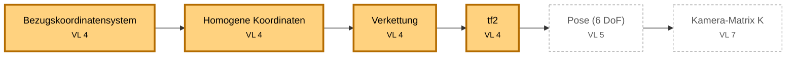
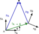
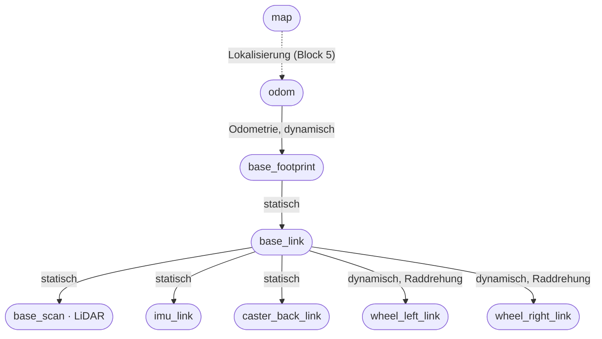
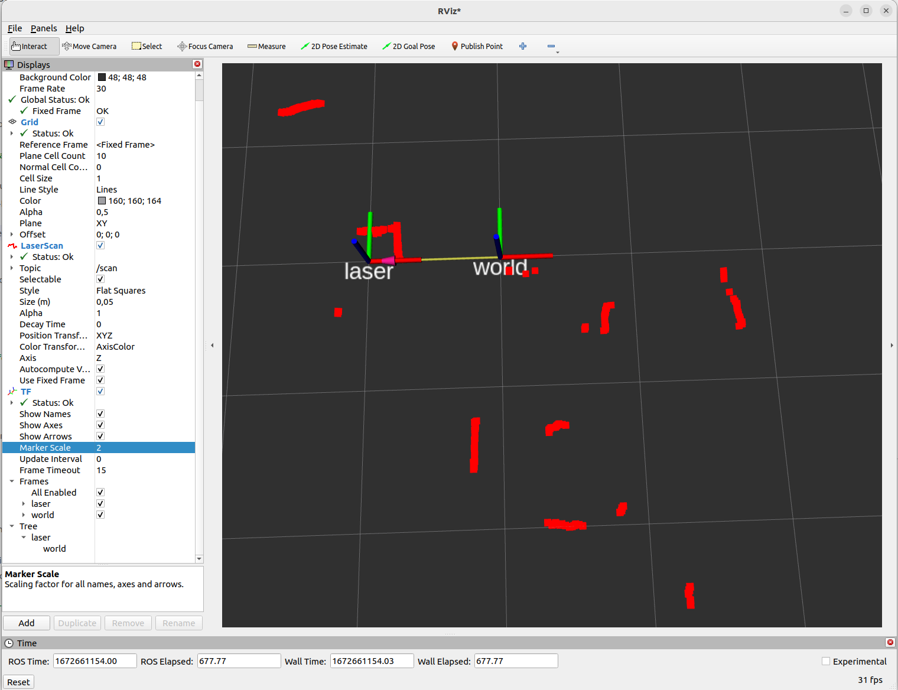

<!--

author:   Sebastian Zug & Georg Jäger & Claude Code (Opus 5.5) mit LiaScript Teaching-Agent
email:    sebastian.zug@informatik.tu-freiberg.de & Georg.Jaeger@informatik.tu-freiberg.de
version:  0.1.0
language: de
narrator: Deutsch Female

import:  https://github.com/liascript/CodeRunner
         https://raw.githubusercontent.com/TUBAF-IfI-LiaScript/VL_SoftwareprojektRobotik/refs/heads/master/config.md
         https://raw.githubusercontent.com/liaTemplates/mermaid_template/master/README.md

@python: @LIA.eval(`["main.py"]`, `none`, `python3 main.py`)

-->

[](https://liascript.github.io/course/?https://raw.githubusercontent.com/TUBAF-IfI-LiaScript/VL_SoftwareprojektRobotik/refs/heads/master/02_Koordinatensysteme/02_Koordinatentransformation.md)

# Koordinaten und Kommunikationsqualität

| Parameter            | Kursinformationen                                                                                                                       |
| -------------------- | --------------------------------------------------------------------------------------------------------------------------------------- |
| **Veranstaltung:**   | @config.lecture                                                                                                                         |
| **Semester**         | @config.semester                                                                                                                        |
| **Hochschule:**      | `Technische Universität Freiberg`                                                                                                       |
| **Inhalte:**         | `Koordinatentransformationen, tf2 und Quality of Service in ROS 2`                                                                      |
| **Link auf GitHub:** | https://github.com/TUBAF-IfI-LiaScript/VL_SoftwareprojektRobotik/blob/master/02_Koordinatensysteme/02_Koordinatentransformation.md       |
| **Autoren**          | @author                                                                                                                                 |

--------------------------------------------------------------------------------

**Zielstellung der heutigen Veranstaltung** — nach dieser Vorlesung können Sie

+ einen Punkt mit einer homogenen Transformationsmatrix von einem Bezugssystem in ein anderes umrechnen und Transformationen verketten,
+ erklären, warum ROS Orientierungen als Quaternion angibt, und ein Quaternion für eine Drehung um die Hochachse aufstellen,
+ den tf-Baum des TurtleBots lesen und Transformationen mit `tf2_echo` abfragen und mit `static_transform_publisher` veröffentlichen,
+ für einen Datenstrom passende QoS-Einstellungen wählen und eine QoS-Unverträglichkeit als Fehlerursache erkennen.

--------------------------------------------------------------------------------

<!-- kurslandkarte:wo-start -->

## Wo stehen wir?

    --{{0}}--
Kurz zur Orientierung. Wir sind in Block 1, Termin 6 von 32. Der TurtleBot weiß, wo seine Sensoren sitzen, und seine Daten kommen beim Empfänger an – sonst bleibt RViz leer. Neu sind heute: Bezugskoordinatensystem, Translation und Rotation, Homogene Koordinaten, Verkettung, Quaternion, tf2, Quality of Service.

**Block 1 · ROS-Grundlagen** · Termin 6 von 32 · VL 4 in der Woche ab 9.11.2026

**Ziel im Projekt:** Der TurtleBot weiß, wo seine Sensoren sitzen, und seine Daten kommen beim Empfänger an – sonst bleibt RViz leer.

- **Sie brauchen:** [Nachricht (Message)](https://tubaf-ifi-liascript.github.io/VL_SoftwareprojektRobotik/kurslandkarte/#begriff=message) (VL 2) · [ros2 topic …](https://tubaf-ifi-liascript.github.io/VL_SoftwareprojektRobotik/kurslandkarte/#begriff=topiccli) (VL 2) · [Discovery](https://tubaf-ifi-liascript.github.io/VL_SoftwareprojektRobotik/kurslandkarte/#begriff=discovery) (VL 2)
- **Heute neu:** [Bezugskoordinatensystem](https://tubaf-ifi-liascript.github.io/VL_SoftwareprojektRobotik/kurslandkarte/#begriff=frame) · [Translation und Rotation](https://tubaf-ifi-liascript.github.io/VL_SoftwareprojektRobotik/kurslandkarte/#begriff=starrtrafo) · [Homogene Koordinaten](https://tubaf-ifi-liascript.github.io/VL_SoftwareprojektRobotik/kurslandkarte/#begriff=homtrafo) · [Verkettung](https://tubaf-ifi-liascript.github.io/VL_SoftwareprojektRobotik/kurslandkarte/#begriff=verkettung) · [Quaternion](https://tubaf-ifi-liascript.github.io/VL_SoftwareprojektRobotik/kurslandkarte/#begriff=quaternion) · [tf2](https://tubaf-ifi-liascript.github.io/VL_SoftwareprojektRobotik/kurslandkarte/#begriff=tf2) · [Quality of Service](https://tubaf-ifi-liascript.github.io/VL_SoftwareprojektRobotik/kurslandkarte/#begriff=qos)
- **Danach:** P 1 · TurtleBot + Bags – Ihr TurtleBot ist verbunden, fährt sicher, und Sie haben eine Testfahrt aufgezeichnet – das Rohmaterial für Block 2.

**Roter Faden „Koordinaten überall“** – Bezugssysteme und Transformationen ziehen sich vom Roboter bis zur Kamera und zum Fahrwerk.



[🗺️ Ganze Kurslandkarte öffnen](https://tubaf-ifi-liascript.github.io/VL_SoftwareprojektRobotik/kurslandkarte/#termin=02) – dort finden Sie jeden Begriff mit Erklärung, typischer Stolperfalle und Link auf die passende Folie.

<!-- kurslandkarte:wo-ende -->

## Leitfrage: Warum zeigt RViz den Scan nicht?

    --{{0}}--
Dieses Bild werden viele von Ihnen im ersten Praktikum sehen: ein schwarzes RViz-Fenster, obwohl der Roboter Daten liefert. Meist steckt eine von zwei Ursachen dahinter. Die erste Hälfte der Vorlesung erklärt die erste Ursache, die zweite Hälfte die zweite. Am Ende können Sie beide selbst prüfen.

Im ersten Praktikum wird Ihnen das passieren: Der TurtleBot läuft, `ros2 topic echo /scan` zeigt Messwerte — aber RViz zeigt keinen einzigen Punkt. Zwei Ursachen sind typisch:

<!-- data-type="none" -->
| Symptom in RViz                                         | Ursache                                         | Thema heute             |
| :------------------------------------------------------ | :---------------------------------------------- | :---------------------- |
| `Frame [base_scan] does not exist` oder `No transform`  | RViz weiß nicht, **wo** der Sensor am Roboter sitzt | Koordinaten und tf2 |
| keine Fehlermeldung, aber auch keine Daten               | Sender und Empfänger stellen **unverträgliche Anforderungen** an die Übertragung | Quality of Service |

Was wir aus VL 2 schon wissen: Jede Sensornachricht trägt einen **Header** mit Zeitstempel und `frame_id`. Diese `frame_id` ist der Schlüssel zum ersten Teil der Vorlesung.

## Bezugssysteme

    --{{0}}--
Eine Koordinatenangabe ist ohne Bezugssystem wertlos. Der LiDAR misst ein Hindernis einen halben Meter vor sich — vor dem Sensor, nicht vor der Mitte des Roboters und schon gar nicht relativ zur Kreuzung in der Verkehrswelt. Jede dieser Sichtweisen ist ein eigenes Koordinatensystem, in ROS Frame genannt.

Ein Punkt hat nur zusammen mit seinem **Bezugssystem** (_Frame_) eine Bedeutung. Wir schreiben das Bezugssystem als Index: $\textbf{p}_A$ ist der Punkt $\textbf{p}$, ausgedrückt im System $A$.

<!-- style="width: 50%;"-->

Beim TurtleBot in der Verkehrswelt gibt es mindestens drei wichtige Bezugssysteme:

<!-- data-type="none" -->
| Frame         | Ursprung                         | Wofür?                                                    |
| :------------ | :------------------------------- | :-------------------------------------------------------- |
| `base_scan`   | Mitte des LiDAR                  | so liefert der Sensor seine Messungen                     |
| `base_link`   | Mitte des Roboters               | so plant das Fahrverhalten: „Hindernis 40 cm voraus“      |
| `map`         | fester Punkt in der Verkehrswelt | so sind Kreuzungen, Parklücken und Ampeln eingetragen     |

**Kurze Kontrolle:** Der LiDAR misst ein Hindernis bei $\textbf{p}_{base\_scan} = (0{,}5;\ 0)$ m, also einen halben Meter geradeaus. Ist das Hindernis damit auch einen halben Meter vor der **Mitte** des Roboters?

[( )] Ja, Koordinaten sind unabhängig vom Bezugssystem.
[(X)] Nicht unbedingt — das hängt davon ab, wo der LiDAR relativ zur Robotermitte sitzt.
***
Beim TurtleBot sitzt der LiDAR 3,2 cm hinter der Mitte. Das Hindernis liegt daher nur 46,8 cm vor der Robotermitte — die Werte dazu sehen Sie gleich im tf-Baum des TurtleBot.
***

## Pose eines Koordinatensystems in 2D

    --{{0}}--
Um Koordinaten zwischen zwei Systemen umzurechnen, müssen wir wissen, wie das eine System im anderen liegt: wo sein Ursprung ist und wie es gedreht ist. Diese Kombination aus Position und Orientierung nennt man Pose. In der Ebene sind das drei Zahlen: x, y und ein Winkel.

Eine Pose kennen Sie schon aus Ü 2: `ros2 topic echo /turtle1/pose` liefert `x`, `y` und `theta` der Schildkröte — Position und Blickrichtung im Fenster des Simulators.

Die Lage eines Systems $A$ im System $O$ beschreibt seine **Pose**: die Position $\textbf{t} = (t_x, t_y)$ seines Ursprungs in $O$ und den Drehwinkel $\varphi$ seiner Achsen.

<!-- style="width: 35%;"-->

Ein Punkt $\textbf{p}_A$ lässt sich dann in $O$ ausdrücken: erst um $\varphi$ drehen, dann um $\textbf{t}$ verschieben. Die Drehmatrix $\textbf{R}(\varphi)$ kennen Sie aus der Linearen Algebra; positive Winkel drehen **gegen den Uhrzeigersinn**.

$$
\textbf{p}_O = \textbf{R}(\varphi) \cdot \textbf{p}_A + \textbf{t}
\qquad \text{mit} \qquad
\textbf{R}(\varphi) =
\begin{bmatrix}
\cos\varphi & -\sin\varphi \\
\sin\varphi & \cos\varphi
\end{bmatrix}
$$

> **Konvention:** Wir beschreiben immer die Pose eines **Kind-Systems** ($A$) in seinem **Eltern-System** ($O$). Genau so speichert ROS seine Transformationen.

### Homogene Koordinaten

    --{{0}}--
Die Formel hat einen Schönheitsfehler: Die Drehung ist eine Multiplikation, die Verschiebung eine Addition. Sobald wir mehrere Transformationen hintereinander ausführen, wird das unübersichtlich. Der Trick: Wir hängen an jeden Punkt eine Eins an. Dann wird auch die Verschiebung zur Matrixmultiplikation.

Problem: Die Drehung ist eine Multiplikation, die Verschiebung eine Addition. Mit einer zusätzlichen Koordinate, die immer $1$ ist, wird beides **eine** Matrixmultiplikation:

$$
\begin{bmatrix} \textbf{p}_O \\ 1 \end{bmatrix}
=
\underbrace{
\begin{bmatrix}
\cos\varphi & -\sin\varphi & t_x \\
\sin\varphi & \cos\varphi  & t_y \\
0 & 0 & 1
\end{bmatrix}}_{\textbf{T}_{OA}}
\cdot
\begin{bmatrix} \textbf{p}_A \\ 1 \end{bmatrix}
$$

Der linke obere Block ist die Drehung, die rechte Spalte die Verschiebung. Diese Form heißt **homogene Transformationsmatrix**. Lesen Sie den Index von rechts nach links: $\textbf{T}_{OA}$ rechnet Koordinaten „von $A$ nach $O$“ um.

**Kurze Kontrolle:** System $A$ ist gegenüber $O$ um $(2;\ 0{,}5)$ verschoben und **nicht** gedreht. Ein Punkt liegt bei $\textbf{p}_A = (2;\ 3)$. Wo liegt er in $O$?

$x_O =$ [[4]] , $y_O =$ [[3.5]]
[[?]] Ohne Drehung ist $\textbf{R}$ die Einheitsmatrix — es bleibt nur die Verschiebung.
***
$\textbf{p}_O = \textbf{p}_A + \textbf{t} = (2 + 2;\ 3 + 0{,}5) = (4;\ 3{,}5)$.
***

### Inverse Transformation

    --{{0}}--
Oft brauchen wir die Gegenrichtung: Wir kennen die Lage eines Hindernisses in der Karte und wollen wissen, wo es aus Sicht des Roboters liegt. Dafür invertieren wir die Matrix — und das geht hier ohne aufwendige Rechnung.

Für die Gegenrichtung $O \rightarrow A$ brauchen wir $\textbf{T}_{AO} = \textbf{T}_{OA}^{-1}$. Eine allgemeine Matrixinversion ist nicht nötig: Drehmatrizen sind orthogonal (Lineare Algebra), also gilt $\textbf{R}^{-1} = \textbf{R}^T$:

$$
\textbf{T}_{OA} =
\begin{bmatrix} \textbf{R} & \textbf{t} \\ \textbf{0} & 1 \end{bmatrix}
\qquad \Rightarrow \qquad
\textbf{T}_{AO} = \textbf{T}_{OA}^{-1} =
\begin{bmatrix} \textbf{R}^T & -\textbf{R}^T\textbf{t} \\ \textbf{0} & 1 \end{bmatrix}
$$

Anschaulich: zurückverschieben, dann zurückdrehen. Die Verschiebung wird dabei mitgedreht ($-\textbf{R}^T\textbf{t}$, nicht einfach $-\textbf{t}$). Im Programm dürfen Sie auch einfach `np.linalg.inv` verwenden — das Ergebnis ist dasselbe.

**Kurze Kontrolle:** $A$ liegt bei $(2;\ 0)$ in $O$, ohne Drehung. Ein Punkt liegt bei $\textbf{p}_O = (3;\ 1)$. Wo liegt er in $A$?

$x_A =$ [[1]] , $y_A =$ [[1]]
***
Ohne Drehung ist $\textbf{R}^T$ die Einheitsmatrix, es bleibt $\textbf{p}_A = \textbf{p}_O - \textbf{t} = (3-2;\ 1-0) = (1;\ 1)$.
***

### Verkettung von Transformationen

    --{{0}}--
Die eigentliche Stärke der homogenen Matrizen zeigt sich beim Verketten. Ein Messpunkt des LiDAR soll in Kartenkoordinaten umgerechnet werden: vom Sensor zum Roboter, vom Roboter zur Karte. Wir multiplizieren einfach die Matrizen entlang der Kette.

Transformationen entlang einer Kette werden multipliziert. Die Indizes „kürzen sich“ dabei von innen heraus:

$$
\textbf{T}_{OC} = \textbf{T}_{OA} \cdot \textbf{T}_{AB} \cdot \textbf{T}_{BC}
\qquad\qquad
\textbf{p}_O = \textbf{T}_{OA} \cdot \textbf{T}_{AB} \cdot \textbf{T}_{BC} \cdot \textbf{p}_C
$$

Für unseren Roboter heißt das zum Beispiel:

$$
\textbf{p}_{map} = \textbf{T}_{map,\ base\_link} \cdot \textbf{T}_{base\_link,\ base\_scan} \cdot \textbf{p}_{base\_scan}
$$

**Die Reihenfolge ist entscheidend**, denn Matrixmultiplikation ist nicht vertauschbar. Merkregel: **Die Matrix direkt am Punkt wirkt zuerst.**

**Kurze Kontrolle:** $\textbf{T}_{trans}$ ist eine reine Verschiebung um 1 in $x$-Richtung, $\textbf{T}_{rot}$ eine reine Drehung um 90° gegen den Uhrzeigersinn (beide als homogene Matrizen). Wohin gelangt der Punkt $(1;\ 0)$?

[ [$(1;\ 1)$] [$(0;\ 2)$] ]
[     (X)          ( )    ] mit $\textbf{T}_{trans} \cdot \textbf{T}_{rot}$ (erst drehen, dann verschieben)
[     ( )          (X)    ] mit $\textbf{T}_{rot} \cdot \textbf{T}_{trans}$ (erst verschieben, dann drehen)
***
$\textbf{T}_{trans}\cdot\textbf{T}_{rot}$: Die Drehung macht aus $(1;0)$ den Punkt $(0;1)$, die Verschiebung dann $(1;1)$. $\textbf{T}_{rot}\cdot\textbf{T}_{trans}$: Die Verschiebung ergibt $(2;0)$, die Drehung dann $(0;2)$. Eine Pose $\textbf{T}_{OA}$ ist übrigens genau $\textbf{T}_{trans} \cdot \textbf{T}_{rot}$: erst drehen, dann verschieben.
***

**Typische Fehlerquellen:**

+ Reihenfolge der Matrizen vertauscht
+ Richtung verwechselt: $\textbf{T}_{OA}$ statt $\textbf{T}_{AO}$ benutzt
+ Winkel in Grad statt im Bogenmaß angegeben

## Beispiel: Ein Hindernis in Weltkoordinaten

    --{{0}}--
Probieren wir das an einem Beispiel aus. Ein Roboter mit dem Koordinatensystem A hat ein Hindernis bei zwei, drei erkannt. Wo liegt es in Weltkoordinaten? Verschieben Sie in der Grafik die Lage von A und beobachten Sie, wie sich die Weltkoordinaten ändern.

Die Grafik zeigt ein System $A$, das im globalen System $O$ liegt. Das Hindernis liegt in $A$ bei $(2;\ 3)$. Mit den Schiebereglern verändern Sie Position und Drehung von $A$ — der grüne Vektor zeigt die Lage des Hindernisses in $O$.

??[Interaktive Darstellung: Koordinatensystem A im globalen System O mit einem Hindernis](https://www.geogebra.org/classic/htug5qmn?embed)

Dieselbe Rechnung in Python. Verändern Sie den Winkel `phi_deg` und starten Sie neu:

```python  main.py
import numpy as np

def T(phi_deg, t):
    """Homogene 2D-Transformation: Pose (Drehung phi, Verschiebung t) eines Systems"""
    phi = np.radians(phi_deg)
    c, s = np.cos(phi), np.sin(phi)
    return np.array([[c, -s, t[0]],
                     [s,  c, t[1]],
                     [0,  0, 1   ]])

phi_deg = 90                   # Drehung von A gegenüber O in Grad
T_OA = T(phi_deg, [2, 0.5])    # Pose von A in O
p_A = np.array([2, 3, 1])      # Hindernis in A, homogen

p_O = T_OA @ p_A
print("Hindernis in O:", np.round(p_O[:2], 3))

T_AO = np.linalg.inv(T_OA)     # Gegenrichtung
print("zurück nach A: ", np.round((T_AO @ p_O)[:2], 3))
```
@python

## Drei Dimensionen

    --{{0}}--
Im Raum ändert sich am Prinzip nichts: Die homogene Matrix wird vier mal vier groß, mit einer drei mal drei Drehmatrix links oben und dem Verschiebungsvektor rechts. Schwieriger wird es bei der Beschreibung der Drehung selbst. Spätestens nach 45 Minuten sollten wir hier sein, damit für tf2 und Quality of Service genug Zeit bleibt.

Im Raum wird die homogene Matrix $4 \times 4$ groß — das Prinzip bleibt gleich:

$$
\textbf{T}_{OA} =
\begin{bmatrix}
\textbf{R}_{3\times3} & \textbf{t}_{3\times1} \\
\textbf{0} & 1
\end{bmatrix}
$$

<!-- style="width:40%;" -->

> **Merke für RViz:** Achsen werden immer gleich eingefärbt — **rot = x** (vorwärts), **grün = y** (links), **blau = z** (oben). Beim TurtleBot zeigt $x$ in Fahrtrichtung.

### Euler-Winkel

    --{{0}}--
Die naheliegende Idee: Wir zerlegen jede Drehung in drei Drehungen um die Achsen. Das ist anschaulich, hat aber zwei Haken, die in der Praxis zu schwer findbaren Fehlern führen. Für unseren TurtleBot ist nur einer der drei Winkel wichtig: das Gieren.

_Dieser Abschnitt ist zum Nachlesen — für den TurtleBot brauchen Sie nur das Gieren._

Eine Drehung im Raum lässt sich in drei Drehungen um die Koordinatenachsen zerlegen: **Gieren** (_yaw_, um $z$), **Nicken** (_pitch_, um $y$) und **Rollen** (_roll_, um $x$). Der Winkel $\varphi$ aus der Ebene ist genau der Gierwinkel — beim TurtleBot der einzige, der sich ändert.

Euler-Winkel sind anschaulich, haben aber Nachteile:

+ **Reihenfolge:** Es gibt viele Konventionen, in welcher Reihenfolge gedreht wird — gleiche Zahlen, verschiedene Orientierungen.
+ **Gimbal Lock:** Steht der Nickwinkel auf ±90°, fallen Gier- und Rollachse zusammen; ein Freiheitsgrad geht verloren. Für Drohnen und Roboterarme ein echtes Problem.

<details>
<summary>Drehmatrizen um die drei Achsen anzeigen</summary>

<!-- data-type="none" -->
| Bezeichnung          | Achse | Drehmatrix |
| -------------------- | ----- | ---------- |
| Gieren (_yaw_) $\psi$  | $z$   | $\textbf{R}_z(\psi) = \begin{bmatrix} \cos\psi & -\sin\psi & 0 \\ \sin\psi & \cos\psi & 0 \\ 0 & 0 & 1 \end{bmatrix}$ |
| Nicken (_pitch_) $\vartheta$ | $y$   | $\textbf{R}_y(\vartheta) = \begin{bmatrix} \cos\vartheta & 0 & \sin\vartheta \\ 0 & 1 & 0 \\ -\sin\vartheta & 0 & \cos\vartheta \end{bmatrix}$ |
| Rollen (_roll_) $\rho$ | $x$   | $\textbf{R}_x(\rho) = \begin{bmatrix} 1 & 0 & 0 \\ 0 & \cos\rho & -\sin\rho \\ 0 & \sin\rho & \cos\rho \end{bmatrix}$ |

</details>

### Quaternionen

    --{{0}}--
ROS speichert Orientierungen deshalb nicht als Winkel, sondern als Quaternion — vier Zahlen, die eine Drehung um eine beliebige Achse beschreiben. Sie müssen Quaternionen nicht von Hand rechnen. Für unseren TurtleBot, der sich nur um die Hochachse dreht, reicht eine einzige Formel.

Ein **Quaternion** beschreibt eine Drehung um eine Achse $\vec{u}$ (Einheitsvektor) mit dem Winkel $\alpha$ durch vier Zahlen:

$$
\textbf{q} = \left(q_x,\ q_y,\ q_z,\ q_w\right) = \left(u_x \sin\tfrac{\alpha}{2},\ u_y \sin\tfrac{\alpha}{2},\ u_z \sin\tfrac{\alpha}{2},\ \cos\tfrac{\alpha}{2}\right)
$$

Vorteile: kein Gimbal Lock, numerisch stabil, gut zu interpolieren. (Einzige Mehrdeutigkeit: $\textbf{q}$ und $-\textbf{q}$ beschreiben dieselbe Drehung.) Deshalb verwendet ROS in allen Nachrichten Quaternionen — **in der Reihenfolge $x, y, z, w$**.

> **Sie müssen Quaternionen nicht von Hand rechnen.** Für den TurtleBot, der sich nur um die Hochachse $z$ dreht, reicht eine Formel mit dem Gierwinkel $\psi$ (in der Ebene unser $\varphi$):
>
> $$\textbf{q} = \left(0,\ 0,\ \sin\tfrac{\psi}{2},\ \cos\tfrac{\psi}{2}\right)$$

**Kurze Kontrolle:** Stellen Sie das Quaternion für eine Drehung um 180° auf: $q_z =$ [[1]] , $q_w =$ [[0]]
***
$\sin 90° = 1$, $\cos 90° = 0$ — also $(0;\ 0;\ 1;\ 0)$.
***

Der TurtleBot steht um 90° gedreht (nach links). Welches Quaternion meldet ROS?

[( )] $(0;\ 0;\ 1;\ 0)$
[(X)] $(0;\ 0;\ 0{,}707;\ 0{,}707)$
[( )] $(0;\ 0;\ 90;\ 1)$
***
$\sin 45° = \cos 45° \approx 0{,}707$. Das Quaternion $(0;0;1;0)$ wäre eine Drehung um 180°. In der Praxis rechnen Bibliotheken um, z.B. in Python `scipy.spatial.transform.Rotation.from_euler('z', 90, degrees=True).as_quat()` — auch dort in der Reihenfolge $x, y, z, w$.
***

## Transformationen in ROS 2: tf2

    --{{0}}--
In einem echten Roboter gibt es Dutzende Koordinatensysteme, und einige davon bewegen sich ständig. Diese Buchführung übernimmt tf2. Jeder Knoten veröffentlicht nur die Transformationen, die er kennt. tf2 setzt daraus einen Baum zusammen und rechnet jede gewünschte Kette für Sie aus.

**Zurück zur Leitfrage, Ursache 1:** Mit dem, was Sie jetzt über Transformationen wissen, schauen wir uns an, wie ROS sie verwaltet.

ROS verwaltet alle Bezugssysteme mit **tf2**:

+ Jede Sensornachricht nennt in ihrem Header die `frame_id`, in der ihre Daten gemessen wurden.
+ Knoten veröffentlichen Transformationen zwischen je zwei Frames auf den Topics `/tf` (veränderlich) und `/tf_static` (fest).
+ tf2 setzt alle Frames zu einem **Baum** zusammen. Zwischen zwei beliebigen Frames gibt es genau einen Weg — tf2 multipliziert die Matrizen entlang dieses Weges.

Eine Transformation ist entweder

+ **statisch:** ändert sich nie, z.B. die Montage des LiDAR am Roboter — wird einmal veröffentlicht;
+ **dynamisch:** ändert sich laufend, z.B. die Position des Roboters in der Karte — wird ständig neu veröffentlicht, jeweils mit Zeitstempel.

### Der tf-Baum des TurtleBot

    --{{0}}--
Hier ist der Baum unseres Roboters. Lesen Sie ihn von oben nach unten: Die Karte kennt den Startpunkt der Odometrie, die Odometrie kennt die Lage des Roboters, und der Roboter kennt die Montageorte seiner Bauteile. Gestrichelt ist, was erst in Block 5 dazukommt.

So sieht der Baum unseres Roboters aus. Die Frames unterhalb von `base_footprint` stammen aus seinem Modell (URDF, siehe unten), die oberen kommen beim Fahren dazu. Zwei Frames sind neu:

+ `odom` — der Punkt, an dem der Roboter losgefahren ist. Die Odometrie zählt die Radumdrehungen und schätzt daraus die Lage des Roboters relativ zu diesem Punkt; mit der Zeit driftet diese Schätzung.
+ `base_footprint` — der Punkt auf dem Boden genau unter der Mitte der Radachse; um ihn dreht sich der Roboter. `base_link` liegt 1 cm darüber im Roboter.



Die Werte aus dem Modell des TurtleBot 3 Burger:

<!-- data-type="none" -->
| Eltern-Frame       | Kind-Frame   | Verschiebung $(x;\ y;\ z)$ in m |
| :----------------- | :----------- | :------------------------------ |
| `base_footprint`   | `base_link`  | $(0;\ 0;\ 0{,}010)$             |
| `base_link`        | `base_scan`  | $(-0{,}032;\ 0;\ 0{,}172)$      |

**Kurze Kontrolle:** Wie liegt der LiDAR (`base_scan`) relativ zum Boden unter dem Roboter (`base_footprint`)? Beide Transformationen enthalten keine Drehung.

$x =$ [[-0.032]] m, $z =$ [[0.182]] m
[[?]] Ohne Drehung addieren sich die Verschiebungen entlang der Kette.
***
$\textbf{T}_{base\_footprint,\ base\_scan} = \textbf{T}_{base\_footprint,\ base\_link} \cdot \textbf{T}_{base\_link,\ base\_scan}$ — ohne Drehungen ergibt das $(0 - 0{,}032;\ 0;\ 0{,}010 + 0{,}172) = (-0{,}032;\ 0;\ 0{,}182)$. Genau das zeigt `tf2_echo` auf der nächsten Folie. Und das Hindernis von vorhin, 0,5 m vor dem LiDAR, liegt damit $0{,}5 - 0{,}032 = 0{,}468$ m vor der Robotermitte.
***

### Transformationen abfragen und veröffentlichen

    --{{0}}--
Zwei Werkzeuge brauchen Sie ständig: tf2_echo fragt eine Transformation ab und zeigt sie als Verschiebung, Quaternion, Winkel und Matrix. Und mit dem static_transform_publisher tragen Sie selbst eine feste Transformation ein — etwa für eine Kamera, die im Modell des Roboters fehlt.

**Abfragen** mit `tf2_echo <Eltern-Frame> <Kind-Frame>` — hier am Modell des TurtleBot:

```text
> ros2 run tf2_ros tf2_echo base_footprint base_scan
At time 0.0
- Translation: [-0.032, 0.000, 0.182]
- Rotation: in Quaternion (xyzw) [0.000, 0.000, 0.000, 1.000]
- Rotation: in RPY (radian) [0.000, -0.000, 0.000]
- Rotation: in RPY (degree) [0.000, -0.000, 0.000]
- Matrix:
  1.000  0.000  0.000 -0.032
  0.000  1.000  0.000  0.000
  ...
```

Die Ausgabe zeigt alles aus dieser Vorlesung: Verschiebung, Quaternion, Euler-Winkel (RPY) und die homogene Matrix. Mit `ros2 run tf2_tools view_frames` erzeugen Sie zusätzlich eine PDF-Grafik des gesamten Baums.

**Veröffentlichen** einer festen Transformation mit `static_transform_publisher`. Angenommen, an Ihrem TurtleBot ist eine Kamera 10 cm vor und 15 cm über `base_link` montiert, um 90° nach links gedreht:

```text
> ros2 run tf2_ros static_transform_publisher --x 0.1 --z 0.15 --yaw 1.5708 --frame-id base_link --child-frame-id camera_link
[INFO] [...] [static_transform_publisher_...]: Spinning until stopped - publishing transform
translation: ('0.100000', '0.000000', '0.150000')
rotation: ('0.000000', '0.000000', '0.707108', '0.707105')
from 'base_link' to 'camera_link'
```

Erkennen Sie das Quaternion für 90° wieder? Winkel werden im **Bogenmaß** angegeben ($90° \approx 1{,}5708$), nicht angegebene Werte (`--y`, `--roll`, `--pitch`) sind 0.

> **Live-Demo:** Beide Befehle führe ich jetzt im Terminal vor — ändern Sie in Gedanken den Winkel auf 180°: Was zeigt `tf2_echo`? (Antwort in der Aufgabe der Woche.)

**RViz in drei Schritten** — so stellen Sie im Praktikum einen Scan dar:

1. `rviz2` starten und links oben unter _Global Options_ den **Fixed Frame** wählen, z.B. `base_footprint` — in diesem Frame wird alles gezeichnet.
2. _Add → By topic → /scan → LaserScan_ — eine Anzeige für das Topic hinzufügen.
3. Bleibt die Anzeige leer: Statusmeldung im _Displays_-Panel lesen (fehlende Transformation?) und unter _Topic → Reliability Policy_ die QoS prüfen.

<!-- style="width:70%;" -->

### URDF: der Roboter als Modell

    --{{0}}--
Woher kommen die statischen Transformationen des TurtleBot? Aus einem Modell des Roboters. Sie müssen sie also nicht von Hand eintragen.

Die festen Transformationen eines Roboters stehen in seinem Modell im **Unified Robot Description Format** (URDF, XML): **Links** sind Bauteile, **Joints** die Verbindungen mit ihrer Pose. Der Knoten `robot_state_publisher` liest das Modell und veröffentlicht alle Transformationen — beim TurtleBot startet ihn `robot.launch.py` automatisch (VL 3).

```xml  turtlebot3_burger.urdf (Ausschnitt)
<joint name="scan_joint" type="fixed">
  <parent link="base_link"/>
  <child link="base_scan"/>
  <origin xyz="-0.032 0 0.172" rpy="0 0 0"/>
</joint>
```

## Quality of Service

    --{{0}}--
Jetzt zur zweiten Ursache für ein leeres RViz. Nicht jede Nachricht ist gleich wichtig. Ein LiDAR-Scan ist nach einer Zehntelsekunde veraltet — geht einer verloren, nimmt man den nächsten. Ein Fahrbefehl oder eine Karte dagegen sollte ankommen. ROS 2 lässt Sie das pro Verbindung einstellen: mit Quality of Service.

In VL 2 haben Sie gesehen: Bei `create_publisher(..., 10)` gibt die `10` die Puffergröße an. Sie ist Teil der **Quality of Service** (QoS) — Regeln, wie eine Verbindung mit Verlusten, Verspätungen und spät gestarteten Empfängern umgeht. Die drei wichtigsten Einstellungen:

<!-- data-type="none" -->
| Einstellung     | Werte                              | Bedeutung                                                                              |
| :-------------- | :--------------------------------- | :------------------------------------------------------------------------------------- |
| **Reliability** | `reliable` / `best_effort`         | Verlorene Nachrichten erneut senden — oder lieber gleich die nächste schicken?         |
| **Durability**  | `volatile` / `transient_local`     | Bekommt ein später gestarteter Empfänger die letzte Nachricht noch nachgeliefert?      |
| **History / Depth** | `keep_last` mit Tiefe $n$ / `keep_all` | Wie viele Nachrichten werden zwischengespeichert? — die `10` aus VL 2         |

Für typische Fälle gibt es fertige Profile, z.B. `sensor_data` (best effort, kleine Tiefe) für schnelle Sensordaten und den Standard (reliable, volatile, Tiefe 10) für alles andere.

### Zuverlässigkeit: reliable oder best effort

    --{{0}}--
Was passiert, wenn Sender und Empfänger Unterschiedliches erwarten? Der Empfänger stellt Mindestanforderungen. Verlangt er reliable, der Sender bietet aber nur best effort, kommt keine Verbindung zustande — und zwar ohne Absturz, nur mit einer leicht zu übersehenden Warnung.

Der Empfänger stellt **Mindestanforderungen**, der Sender macht ein **Angebot**. Eine Verbindung entsteht nur, wenn das Angebot reicht:

<!-- data-type="none" -->
| Sender bietet    | Empfänger verlangt | Verbindung? |
| :--------------- | :----------------- | :---------- |
| `reliable`       | `reliable`         | ja          |
| `reliable`       | `best_effort`      | ja          |
| `best_effort`    | `best_effort`      | ja          |
| `best_effort`    | `reliable`         | **nein**    |

Der letzte Fall ist unsere zweite Ursache für ein leeres RViz: Viele Sensortreiber senden mit dem Profil `sensor_data` (best effort). Verlangt der Empfänger `reliable`, kommt nichts an. So sieht das aus:

```text
# Terminal 1: Sender mit best effort
> ros2 topic pub --rate 2 --qos-reliability best_effort /chatter std_msgs/msg/String "{data: hallo}"
```

```text
# Terminal 2: Empfänger verlangt reliable
> ros2 topic echo --qos-reliability reliable /chatter
[WARN] [...]: New publisher discovered on topic '/chatter', offering incompatible QoS. No messages will be received from it. Last incompatible policy: RELIABILITY
```

Kein Absturz, nur diese eine Warnung. In RViz lösen Sie das Problem, indem Sie in der Anzeige des Scans die _Reliability Policy_ auf `Best Effort` stellen.

**Kurze Kontrolle:** Welche Kombinationen funktionieren?

[ [Verbindung] [keine Verbindung] ]
[     (X)            ( )          ] LiDAR-Treiber sendet `best_effort`, Ihre Spurerkennung verlangt `best_effort`
[     ( )            (X)          ] LiDAR-Treiber sendet `best_effort`, RViz verlangt `reliable`
[     (X)            ( )          ] Ihr Fahrverhalten sendet `reliable`, ein Rekorder verlangt `best_effort`
***
Faustregel: Wer weniger verlangt, als angeboten wird, bekommt Daten. Ein Empfänger, der `reliable` verlangt, braucht einen Sender, der `reliable` anbietet.
***

### Dauerhaftigkeit: Wer zu spät kommt …

    --{{0}}--
Die zweite wichtige Einstellung betrifft Knoten, die später starten. Normalerweise bekommen sie nur Nachrichten, die nach ihrem Start gesendet werden. Für Daten, die nur einmal veröffentlicht werden, ist das fatal. Hier schließt sich der Kreis zu tf2.

Ein Empfänger, der **nach** dem Senden startet, bekommt mit `volatile` nichts — mit `transient_local` liefert der Sender die letzten Nachrichten nach. Ein Test: Der Sender schickt **eine** Nachricht und läuft danach noch 8 Sekunden weiter (`--keep-alive`), wartet aber nicht auf Empfänger (`-w 0`). Der Empfänger startet 3 Sekunden später:

```text
# Sender mit transient_local
> ros2 topic pub -w 0 --times 1 --keep-alive 8 --qos-durability transient_local /ampel std_msgs/msg/String "{data: rot}"

# Empfänger, 3 s später gestartet
> ros2 topic echo --once --qos-durability transient_local /ampel
data: rot
---
```

Wiederholen Sie den Versuch mit `volatile` bei Sender und Empfänger: Der Empfänger zeigt nichts — die Nachricht war schon weg.

Auch hier gilt die Regel „nicht mehr verlangen, als angeboten wird“: Ein Empfänger mit `transient_local` verbindet sich **nicht** mit einem Sender, der nur `volatile` bietet (Warnung: `Last incompatible policy: DURABILITY`).

**Kurze Kontrolle:** Feste Transformationen werden nur **einmal** auf `/tf_static` veröffentlicht. Sie starten RViz aber erst eine Minute später. Welche Durability braucht `/tf_static` deshalb?

[( )] `volatile`
[(X)] `transient_local`
***
Mit `volatile` hätte RViz die feste Transformation des LiDAR verpasst — und Sie stünden wieder vor dem leeren Bildschirm. Darum verwendet `/tf_static` `transient_local`; genauso Karten, die nur einmal veröffentlicht werden.
***

### QoS untersuchen

    --{{0}}--
Zum Schluss das Werkzeug, mit dem Sie im Labor jedes QoS-Problem eingrenzen: ros2 topic info mit der Option minus v. Es zeigt für jeden Sender und Empfänger, welche Einstellungen er tatsächlich verwendet.

Welche Einstellungen eine Verbindung tatsächlich nutzt, zeigt `ros2 topic info --verbose`. Hier am Beispiel `/tf_static`, veröffentlicht vom `robot_state_publisher`:

```text
> ros2 topic info -v /tf_static
Type: tf2_msgs/msg/TFMessage

Publisher count: 1

Node name: robot_state_publisher
...
QoS profile:
  Reliability: RELIABLE
  History (Depth): UNKNOWN
  Durability: TRANSIENT_LOCAL
  ...
```

`History (Depth): UNKNOWN` ist kein Fehler: Die Puffergröße ist eine lokale Einstellung jedes Knotens und wird den anderen nicht mitgeteilt.

Im eigenen Code wählen Sie die QoS beim Anlegen von Publisher oder Subscriber — statt der `10` aus VL 2 ein Profil, z.B. für Sensordaten:

```python
# Python
from rclpy.qos import qos_profile_sensor_data
self.create_subscription(LaserScan, 'scan', self.callback, qos_profile_sensor_data)
```

```cpp
// C++
subscription_ = this->create_subscription<sensor_msgs::msg::LaserScan>(
  "scan", rclcpp::SensorDataQoS(), std::bind(&LaneDetector::callback, this, _1));
```

## Zusammenfassung und Ausblick

    --{{0}}--
Zurück zur Leitfrage: RViz zeigt den Scan nicht, wenn die Transformation zum Sensor fehlt oder wenn die QoS-Einstellungen nicht zusammenpassen. Beides können Sie jetzt prüfen — mit tf2_echo und mit ros2 topic info minus v.

**Zurück zur Leitfrage:** RViz bleibt leer, wenn

1. tf2 den Frame des Sensors nicht kennt → mit `tf2_echo` bzw. `view_frames` prüfen, fehlende feste Transformationen mit `static_transform_publisher` ergänzen;
2. die QoS nicht verträglich ist → mit `ros2 topic info -v` prüfen, in RViz `Best Effort` wählen.

**Das Wichtigste**

+ Koordinaten gelten nur zusammen mit ihrem Bezugssystem (`frame_id`).
+ $\textbf{T}_{OA}$ rechnet von $A$ nach $O$; Verkettung durch Multiplikation, die Reihenfolge zählt.
+ ROS beschreibt Orientierungen als Quaternion $(x, y, z, w)$; für Drehungen um $z$: $(0;\ 0;\ \sin\frac{\psi}{2};\ \cos\frac{\psi}{2})$.
+ tf2 verwaltet den Baum aller Frames; statische Transformationen kommen beim TurtleBot aus der URDF.
+ QoS: Der Empfänger darf nicht mehr verlangen, als der Sender bietet; `transient_local` versorgt spät gestartete Knoten.

**Abschluss-Check**

Sie kennen $\textbf{T}_{map,\ base\_link}$ und $\textbf{T}_{base\_link,\ base\_scan}$. Wie berechnen Sie einen LiDAR-Punkt in Kartenkoordinaten?

[(X)] $\textbf{p}_{map} = \textbf{T}_{map,\ base\_link} \cdot \textbf{T}_{base\_link,\ base\_scan} \cdot \textbf{p}_{base\_scan}$
[( )] $\textbf{p}_{map} = \textbf{T}_{base\_link,\ base\_scan} \cdot \textbf{T}_{map,\ base\_link} \cdot \textbf{p}_{base\_scan}$
[( )] $\textbf{p}_{map} = \textbf{T}_{map,\ base\_link} + \textbf{T}_{base\_link,\ base\_scan} + \textbf{p}_{base\_scan}$
***
Die Indizes müssen sich von innen heraus „kürzen“: $base\_scan$ neben $\textbf{p}_{base\_scan}$, dann $base\_link$ neben $base\_link$.
***

Ihre Spurerkennung abonniert das Kamerabild, erhält aber nichts. `ros2 topic info -v` zeigt beim Kameratreiber `Reliability: BEST_EFFORT`. Was ändern Sie?

[( )] Den Kameratreiber auf `reliable` umstellen — das geht immer.
[(X)] In der Spurerkennung `qos_profile_sensor_data` (best effort) verwenden.
[( )] Die `ROS_DOMAIN_ID` ändern.
***
Den Treiber zu ändern ist oft nicht möglich und für Bilder auch nicht sinnvoll. Der Empfänger passt sich an. Die Domain-ID ist es nicht — sonst würde `ros2 topic info` den Publisher gar nicht zeigen.
***

Mit welchem Befehl prüfen Sie im Labor, ob tf2 die Lage des LiDAR kennt?

[(X)] `ros2 run tf2_ros tf2_echo base_link base_scan`
[( )] `ros2 topic echo /scan`
[( )] `ros2 topic info -v /scan`
***
`/scan` zu sehen beweist nur, dass Daten fließen. Ob tf2 die Transformation zum Frame des Sensors kennt, zeigt `tf2_echo` (oder `view_frames`). `topic info -v` hilft bei der zweiten Ursache, der QoS.
***

**Ausblick:** Im Praktikum **P 1** wenden Sie das an: TurtleBot verbinden, den tf-Baum mit `view_frames` ansehen, den Scan in RViz darstellen und eine Fahrt aufzeichnen. In **Block 2** geht es um die Sensoren selbst — und um die Koordinatensysteme einer Kamera.

## Aufgabe der Woche

    --{{0}}--
Die Aufgaben dieser Woche bereiten Sie direkt auf das erste Praktikum vor. Wenn Sie die Aufgaben 3 bis 5 lösen, wissen Sie im Labor sofort, wo Sie suchen müssen, falls RViz leer bleibt.

**Optional (Rechnen üben):**

1. **Zwei Roboter:** Ein zweiter Roboter $B$ steht bei $(5;\ 4)$ in $O$ und ist um 180° gedreht. Wo liegt das Hindernis aus seiner Sicht? Ergänzen Sie den Code um `T_OB` und berechnen Sie $\textbf{p}_B = \textbf{T}_{OB}^{-1} \cdot \textbf{p}_O$.
   
   <details>
   <summary>Lösung anzeigen</summary>
   
   ```python
   T_OB = T(180, [5, 4])
   p_B = np.linalg.inv(T_OB) @ p_O
   print(np.round(p_B[:2], 3))   # bei phi_deg = 90: [6.  1.5]
   ```
   
   Bei $\varphi_A = 90°$ liegt das Hindernis in $O$ bei $(-1;\ 2{,}5)$. Vom Roboter $B$ aus gesehen sind das 6 m voraus und 1,5 m nach links — $B$ schaut ja in die Gegenrichtung.
   
   </details>
2. Rechnen Sie mit dem Python-Beispiel nach: Ein LiDAR-Punkt liegt bei $(0{,}5;\ 0;\ 0)$ in `base_scan`. Wo liegt er in `base_footprint`? (Werte aus der Tabelle zum tf-Baum.)
**Pflicht als Vorbereitung auf P 1:**

3. Starten Sie in drei Terminals: `static_transform_publisher` für `base_link` → `camera_link` wie oben, `tf2_echo base_link camera_link` und `view_frames`. Ändern Sie den Winkel auf 180° und vergleichen Sie Quaternion und Matrix. `view_frames` legt eine PDF-Datei im aktuellen Ordner ab; unter WSL2 öffnen Sie den Ordner mit `explorer.exe .` im Windows-Explorer.
4. **Den TurtleBot ohne Roboter:** Installieren Sie das Modell (`sudo apt install ros-jazzy-turtlebot3-description`) und starten Sie es ohne Hardware:

   ```bash
   ros2 run robot_state_publisher robot_state_publisher --ros-args -p robot_description:="$(sed 's/${namespace}//g' /opt/ros/jazzy/share/turtlebot3_description/urdf/turtlebot3_burger.urdf)"
   ```

   Prüfen Sie dann `tf2_echo base_footprint base_scan` und `ros2 topic info -v /tf_static`. (Der `sed`-Befehl entfernt einen Platzhalter, den sonst die Launch-Datei des TurtleBot ersetzt.) Starten Sie anschließend `rviz2`: Fixed Frame `base_footprint`, dann _Add → TF_ und _Add → RobotModel_ (Topic `/robot_description`) — Sie sehen den TurtleBot mit seinen Koordinatensystemen.
5. Starten Sie einen Publisher mit `--qos-reliability best_effort` und einen Empfänger mit `--qos-reliability reliable`. Lesen Sie die Warnung und beheben Sie das Problem auf der Empfängerseite.

<details>
<summary>Lösungshinweise anzeigen</summary>

1. Siehe die aufklappbare Lösung oben bei der Aufgabe.
2. Ohne Drehungen addieren sich die Verschiebungen: $(0{,}5 - 0{,}032;\ 0;\ 0 + 0{,}182) = (0{,}468;\ 0;\ 0{,}182)$ m. Der Punkt liegt also 46,8 cm vor der Robotermitte — siehe die Kontrollfrage zu Beginn.
3. Bei 180° (`--yaw 3.1416`) zeigt `tf2_echo` das Quaternion $(0;\ 0;\ 1;\ 0)$ und in der Matrix $-1$ auf der Diagonalen für $x$ und $y$.
4. `tf2_echo` zeigt die Translation $(-0{,}032;\ 0;\ 0{,}182)$ wie in der Vorlesung, `/tf_static` hat `Durability: TRANSIENT_LOCAL`.
5. Der Empfänger muss `--qos-reliability best_effort` verwenden; dann kommen die Nachrichten an.

</details>

**Zum Weiterlesen**

+ [ROS 2 Jazzy: tf2 Tutorials](https://docs.ros.org/en/jazzy/Tutorials/Intermediate/Tf2/Tf2-Main.html)
+ [ROS 2 Jazzy: Quality of Service settings](https://docs.ros.org/en/jazzy/Concepts/Intermediate/About-Quality-of-Service-Settings.html)
+ [REP 105: Koordinatensysteme mobiler Roboter](https://www.ros.org/reps/rep-0105.html) — warum `map`, `odom` und `base_link`

<!-- kurslandkarte:ausblick-start -->

--------------------------------------------------------------------------------

**🗺️ Nächster Halt:** P 1 · TurtleBot + Bags (Woche ab 23.11.2026) – Ihr TurtleBot ist verbunden, fährt sicher, und Sie haben eine Testfahrt aufgezeichnet – das Rohmaterial für Block 2. [Auf der Kurslandkarte ansehen](https://tubaf-ifi-liascript.github.io/VL_SoftwareprojektRobotik/kurslandkarte/#termin=p1)

<!-- kurslandkarte:ausblick-ende -->
