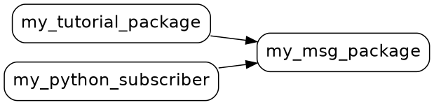

<!--

author:   Sebastian Zug & Georg Jäger & Claude.ai & Claude Code (Opus 5.5) mit LiaScript Teaching-Agent
email:    sebastian.zug@informatik.tu-freiberg.de & Georg.Jaeger@informatik.tu-freiberg.de
version:  0.3.0
language: de
narrator: Deutsch Female

import:   https://raw.githubusercontent.com/TUBAF-IfI-LiaScript/VL_SoftwareprojektRobotik/refs/heads/master/config.md
          https://raw.githubusercontent.com/liaTemplates/mermaid_template/master/README.md

-->

[](https://liascript.github.io/course/?https://raw.githubusercontent.com/TUBAF-IfI-LiaScript/VL_SoftwareprojektRobotik/refs/heads/master/02_ROS_Pakete/02_ROS_Pakete.md)

# ROS 2 Pakete

| Parameter            | Kursinformationen                                                                                                      |
| -------------------- | ---------------------------------------------------------------------------------------------------------------------- |
| **Veranstaltung:**   | @config.lecture                                                                                                        |
| **Semester**         | @config.semester                                                                                                       |
| **Hochschule:**      | `Technische Universität Freiberg`                                                                                      |
| **Inhalte:**         | `Eigene ROS-2-Pakete anlegen und bauen, eigene Nachrichtentypen, Launch-Dateien, Logging, verteilte Systeme`           |
| **Link auf GitHub:** | https://github.com/TUBAF-IfI-LiaScript/VL_SoftwareprojektRobotik/blob/master/02_ROS_Pakete/02_ROS_Pakete.md     |
| **Autoren**          | @author                                                                                                                |

**Zum Einstieg:** So startet der TurtleBot im Praktikum:

```bash
ros2 launch turtlebot3_bringup robot.launch.py
```

+ ein Befehl → LiDAR-Treiber, Motorsteuerung, Robotergeometrie
+ verteilt auf drei Launch-Dateien in zwei Paketen
+ in VL 01: zwei Knoten, zwei Terminals

**Wie kommen wir von dort zu einem Befehl für ein ganzes System?**

    --{{0}}--
Wenn Sie im Praktikum den TurtleBot hochfahren, tippen Sie genau diesen einen Befehl. Er startet den LiDAR-Treiber, die Motorsteuerung und einen Knoten, der die Geometrie des Roboters veröffentlicht. In VL 01 brauchten wir für zwei Knoten noch zwei Terminals mit je zwei source-Befehlen. Der Weg dazwischen ist das Thema dieser Vorlesung.

--------------------------------------------------------------------------------

**Zielstellung der heutigen Veranstaltung**

+ Aufbau eines ROS-2-Pakets und eines Workspace erklären
+ Pakete in C++ und Python anlegen, mit `colcon` bauen und starten
+ Einen eigenen Nachrichtentyp definieren und in beiden Sprachen verwenden
+ Mehrere Knoten mit einer Launch-Datei gemeinsam starten und konfigurieren
+ Log-Ausgaben gezielt einsetzen und ROS 2 über mehrere Rechner betreiben

<!-- kurslandkarte:knopf-start -->

<a href="https://tubaf-ifi-liascript.github.io/VL_SoftwareprojektRobotik/kurslandkarte/#termin=04" style="display: inline-block; padding: 0.5em 1.1em; background-color: #00718A; color: #ffffff; text-decoration: none; font-family: 'IBM Plex Sans', 'Segoe UI', system-ui, sans-serif; font-weight: 600;">🗺️ Diese Vorlesung in der Kurslandkarte →</a>

<!-- kurslandkarte:knopf-ende -->

    --{{1}}--
In VL 01 haben wir fertige Knoten gestartet und untersucht. Heute schreiben wir eigene, so wie Sie später Ihre Spurerkennung und Ihr Fahrverhalten für den TurtleBot umsetzen.

--------------------------------------------------------------------------------

<!-- kurslandkarte:wo-start -->

## Wo stehen wir?

    --{{0}}--
Kurz zur Orientierung. Wir sind in Block 1, Termin 4 von 32. Sie bauen eigene Knoten und starten sie gemeinsam mit einer Launch-Datei – das Gerüst für jede spätere Projektfunktion. Neu sind heute: ROS-2-Paket, Workspace, colcon build, Eigener Nachrichtentyp, Launch-Datei.

**Ziel im Projekt:** Sie bauen eigene Knoten und starten sie gemeinsam mit einer Launch-Datei – das Gerüst für jede spätere Projektfunktion.

**Block 1 · ROS-Grundlagen** – Termin 4 von 32, heute farbig markiert

<!-- data-type="none" -->
| Woche | Vorlesung | Übung | Praktikum |
| :-- | :-- | :-- | :-- |
| KW 43 · 19.–23.10. | [VL 00 Einführung](https://liascript.github.io/course/?https://raw.githubusercontent.com/TUBAF-IfI-LiaScript/VL_SoftwareprojektRobotik/master/00_Einfuehrung/00_Einfuehrung.md) · Mi 21.10. |  |  |
| KW 44 · 26.–30.10. | [VL 01 ROS 2 Grundlagen](https://liascript.github.io/course/?https://raw.githubusercontent.com/TUBAF-IfI-LiaScript/VL_SoftwareprojektRobotik/master/01_ROS_Grundlagen/01_ROS_Grundlagen.md) · Mi 28.10. | [Ü 1 Linux Shell](https://liascript.github.io/course/?https://raw.githubusercontent.com/TUBAF-IfI-LiaScript/VL_SoftwareprojektRobotik/master/exercises/uebung_01_linux_shell/README.md) · Do 29.10. |  |
| **KW 45 · 2.–6.11.**<!-- style="background-color: rgba(255, 166, 0, 0.35); padding: 2px 6px; border-radius: 4px;" --> | **[VL 02 ROS 2 Pakete](https://liascript.github.io/course/?https://raw.githubusercontent.com/TUBAF-IfI-LiaScript/VL_SoftwareprojektRobotik/master/02_ROS_Pakete/02_ROS_Pakete.md)**<!-- style="background-color: rgba(255, 166, 0, 0.35); padding: 2px 6px; border-radius: 4px;" --> · Mi 4.11. |  |  |
| KW 46 · 9.–13.11. | [VL 03 Koordinaten + QoS](https://liascript.github.io/course/?https://raw.githubusercontent.com/TUBAF-IfI-LiaScript/VL_SoftwareprojektRobotik/master/03_Koordinaten_QoS/03_Koordinaten_QoS.md) · Mi 11.11. | [Ü 2 Erster Workspace](https://liascript.github.io/course/?https://raw.githubusercontent.com/TUBAF-IfI-LiaScript/VL_SoftwareprojektRobotik/master/exercises/uebung_02_workspace/README.md) · Do 12.11. |  |
| KW 48 · 23.–27.11. |  |  | [P 1 TurtleBot + Bags](https://liascript.github.io/course/?https://raw.githubusercontent.com/TUBAF-IfI-LiaScript/VL_SoftwareprojektRobotik/master/exercises/praktikum_01_turtlebot/README.md) · Mi 25.11. + Do 26.11. |

- **Sie brauchen:** [ros2-Kommandozeile](https://tubaf-ifi-liascript.github.io/VL_SoftwareprojektRobotik/kurslandkarte/#begriff=ros2cli) (VL 01) · [Nachricht (Message)](https://tubaf-ifi-liascript.github.io/VL_SoftwareprojektRobotik/kurslandkarte/#begriff=message) (VL 01) · [Aufbau einer Nachricht](https://tubaf-ifi-liascript.github.io/VL_SoftwareprojektRobotik/kurslandkarte/#begriff=msgdef) (VL 01) · [source](https://tubaf-ifi-liascript.github.io/VL_SoftwareprojektRobotik/kurslandkarte/#begriff=source) (Ü 1)
- **Heute neu:** [ROS-2-Paket](https://tubaf-ifi-liascript.github.io/VL_SoftwareprojektRobotik/kurslandkarte/#begriff=paket) · [Workspace](https://tubaf-ifi-liascript.github.io/VL_SoftwareprojektRobotik/kurslandkarte/#begriff=workspace) · [colcon build](https://tubaf-ifi-liascript.github.io/VL_SoftwareprojektRobotik/kurslandkarte/#begriff=colcon) · [Eigener Nachrichtentyp](https://tubaf-ifi-liascript.github.io/VL_SoftwareprojektRobotik/kurslandkarte/#begriff=custommsg) · [Launch-Datei](https://tubaf-ifi-liascript.github.io/VL_SoftwareprojektRobotik/kurslandkarte/#begriff=launch)

> [!TIP]
> **Tipp – Kurslandkarte:** [Ganze Kurslandkarte öffnen](https://tubaf-ifi-liascript.github.io/VL_SoftwareprojektRobotik/kurslandkarte/#termin=04) – dort finden Sie jeden Begriff mit Erklärung, typischer Stolperfalle, Link auf die passende Folie und die roten Fäden durch die Veranstaltung.

<!-- kurslandkarte:wo-ende -->

## Vom Beispiel zum eigenen Paket

**Paket** = Ordner mit zusammengehörigem Code und einer Beschreibung für ROS

+ Quellcode der Knoten (C++ oder Python)
+ Abhängigkeiten: andere Pakete, die gebraucht werden
+ Anweisungen zum Bauen
+ bei Bedarf eigene Nachrichtentypen und Launch-Dateien
+ installierte Pakete anzeigen: `ros2 pkg list`

    --{{0}}--
Bisher haben wir mit ros2 run Programme gestartet, die mit ROS 2 installiert wurden. Für das Projekt brauchen Sie eigene Knoten: eine Spurerkennung, eine Ampelerkennung, ein Fahrverhalten. Damit ROS diese finden, bauen und starten kann, müssen sie in Paketen liegen. Ein Paket ist nichts Magisches, sondern ein Ordner mit Code und einer Beschreibung, die ROS lesen kann.

**Wie fein aufteilen?**

+ jedes Paket hat **eine** Aufgabe
+ Pakete sind nur über Nachrichten gekoppelt, nicht über gemeinsamen Code
+ Wiederverwendbares (z. B. Nachrichtentypen) in ein eigenes Paket

    --{{1}}--
Wie fein man ein System in Pakete aufteilt, folgt Grundsätzen aus dem Software-Engineering. Die Spurerkennung weiß nichts vom Motor, sie veröffentlicht nur, wo die Spur liegt. So lässt sich jedes Paket einzeln testen und austauschen. Was mehrere Pakete brauchen, etwa ein gemeinsamer Nachrichtentyp für den Ampelzustand, bekommt ein eigenes Paket, damit die Nutzer nicht voneinander abhängen.

### Workspace und Paketstruktur

**Workspace** = Arbeitsordner mit Unterordner `src`

```bash
mkdir -p ~/ros2_ws/src      # -p legt auch den übergeordneten Ordner an (Ü 1)
```

```text
ros2_ws/
└── src/
    ├── my_msg_package/          ← C++/CMake-Paket (Nachrichtentyp)
    │   ├── CMakeLists.txt
    │   ├── package.xml
    │   └── msg/MyMsg.msg
    ├── my_tutorial_package/     ← C++-Paket (Knoten)
    │   ├── CMakeLists.txt
    │   ├── package.xml
    │   ├── src/data_generator.cpp
    │   └── launch/counter.launch.py
    └── my_python_subscriber/    ← Python-Paket (Knoten)
        ├── package.xml
        ├── setup.py
        ├── setup.cfg
        ├── resource/my_python_subscriber
        └── my_python_subscriber/data_receiver.py
```

    --{{0}}--
Alle Ihre Pakete liegen in einem Arbeitsordner, dem Workspace. Ein Workspace kann viele Pakete enthalten, C++ und Python gemischt. So sieht unserer am Ende dieser Vorlesung aus: ein Paket für den Nachrichtentyp, eines für einen Knoten in C++ und eines für einen Knoten in Python.

**Pflicht in jedem Paket:** `package.xml` — Name, Version, Lizenz, **Abhängigkeiten**

+ C++: `CMakeLists.txt` beschreibt das Bauen · Python: `setup.py`

**colcon legt neben `src` an:**

+ `build/` — Zwischendateien des Compilers
+ `install/` — fertige Programme und `setup.bash`
+ `log/` — Protokolle der Build-Vorgänge
+ alle drei gehören **nicht** in Git

    --{{1}}--
Die package.xml sagt, was ein Paket braucht. Die CMakeLists.txt beziehungsweise die setup.py sagt, wie es gebaut wird. Merken Sie sich die vier Ordner des Workspace: src schreiben Sie selbst, build, install und log erzeugt das Bauwerkzeug. Weil sich diese drei jederzeit neu erzeugen lassen, gehören sie nicht ins Repository.

## Bauen mit colcon

**Warum nicht einfach `g++ main.cpp`?** — Pakete hängen voneinander ab:

+ Abhängigkeiten erkennen, Reihenfolge festlegen
+ jedes Paket mit seinem Build-System bauen (CMake für C++, setuptools für Python)
+ Ergebnisse so ablegen, dass ROS sie findet

<!-- data-type="none" -->
| Werkzeug   | Ebene            | Aufgabe                                                        |
| :--------- | :--------------- | :------------------------------------------------------------- |
| **ament**  | ein Paket        | Build-Regeln: `ament_cmake` (C++) oder `ament_python`          |
| **colcon** | ganzer Workspace | baut alle Pakete in Reihenfolge, erzeugt `install/setup.bash`  |

    --{{0}}--
Bei einem einzelnen Programm würde der Compiler genügen. In einem Workspace braucht aber der Knoten in my_tutorial_package den Nachrichtentyp aus my_msg_package, und der muss vorher in C++- und Python-Code übersetzt werden. Ein Bauwerkzeug muss also die richtige Reihenfolge finden. ROS 2 teilt die Arbeit auf: ament kennt die Regeln für ein einzelnes Paket, colcon koordiniert den ganzen Workspace.

**Bauen — immer im Wurzelordner, nicht in `src`:**

```bash
cd ~/ros2_ws
source /opt/ros/jazzy/setup.bash
colcon build --symlink-install
source ~/ros2_ws/install/setup.bash    # Workspace in diesem Terminal bekannt machen
```

> [!IMPORTANT]
> **Merke:** Erst ROS laden, dann bauen, dann den Workspace laden — in **jedem neuen Terminal** erneut, am sichersten mit dem vollständigen Pfad `~/ros2_ws/install/setup.bash`.

    --{{1}}--
Nach dem Bauen muss die Shell den neuen Inhalt kennen. Wie in Ü 1 bei der ROS-Installation erweitert die Datei setup.bash im Ordner install die Umgebungsvariablen, diesmal um Ihre eigenen Pakete. Ein neues Terminal startet in Ihrem Home-Verzeichnis. Der relative Pfad install/setup.bash funktioniert deshalb nur, wenn Sie vorher in den Workspace gewechselt sind.

### Optionen und typische Fehler

+ `--symlink-install`: Python- und Launch-Dateien nur verlinkt → Änderungen wirken sofort
  + neu bauen nach Änderung an `setup.py`, `package.xml` oder C++-Code
+ `--packages-select <paket>`: nur dieses Paket bauen

    --{{0}}--
Mit symlink-install legt colcon im Ordner install nur Verweise auf Ihre Python- und Launch-Dateien an, statt sie zu kopieren. Eine Änderung am Python-Code wirkt dann sofort, ohne neuen Build. C++-Code muss dagegen immer neu übersetzt werden, und auch Änderungen an den Beschreibungsdateien brauchen einen neuen Build. Mit packages-select sparen Sie Zeit, wenn Sie nur an einem Paket arbeiten.

**Kurze Kontrolle:** `colcon build` lief fehlerfrei, aber `ros2 run my_tutorial_package data_generator` meldet `Package 'my_tutorial_package' not found`. Was fehlt?

[( )] Das Paket muss zusätzlich mit `sudo apt install` installiert werden.
[(X)] In diesem Terminal wurde `source ~/ros2_ws/install/setup.bash` nicht ausgeführt.
[( )] `colcon build` muss im Ordner `src` aufgerufen werden.
***
`colcon build` legt die Programme in `install/` ab. Welche Pakete `ros2` kennt, steht aber in den Umgebungsvariablen — erst `source ~/ros2_ws/install/setup.bash` trägt den Workspace dort ein, in jedem Terminal einzeln (vgl. Ü 1).
***

## Ein eigenes Paket Schritt für Schritt

**Ziel:** der Zähler aus VL 01 — als Zahl mit Kommentar statt als Text

1. eigener Nachrichtentyp (Paket `my_msg_package`)
2. Publisher in **C++** (Paket `my_tutorial_package`) — der Publisher aus VL 01, jetzt in C++
3. Subscriber in **Python** (Paket `my_python_subscriber`)

Vollständiger, unter Jazzy getesteter Code: [02_ROS_Pakete/example](https://github.com/TUBAF-IfI-LiaScript/VL_SoftwareprojektRobotik/tree/master/02_ROS_Pakete/example/pkg_example)

    --{{0}}--
Wir erweitern das Beispiel aus VL 01 in drei Schritten. Statt eines Textes soll der Zählwert als Zahl übertragen werden, zusammen mit einem Kommentar. Den Publisher haben Sie in VL 01 in Python gelesen, heute schreiben wir ihn in C++. Den Subscriber kennen Sie aus VL 01 in C++, heute schreiben wir ihn in Python. Achten Sie darauf, was in jedem Schritt gleich bleibt: Das ist das Muster für Ihre eigenen Pakete.

### Schritt 1: Eigener Nachrichtentyp

**Paket anlegen** — im Ordner `src` des Workspace:

```text
> cd ~/ros2_ws/src
> ros2 pkg create my_msg_package --build-type ament_cmake --license MIT
going to create a new package
package name: my_msg_package
...
build type: ament_cmake
dependencies: []
creating folder ./my_msg_package
creating ./my_msg_package/package.xml
creating source and include folder
creating folder ./my_msg_package/src
creating folder ./my_msg_package/include/my_msg_package
creating ./my_msg_package/CMakeLists.txt
```

    --{{0}}--
Für die Verkehrswelt brauchen Sie später eigene Nachrichten, etwa für den Zustand einer Ampel. Wie das geht, zeigen wir an einem einfachen Zähler. Neue Pakete legt ros2 pkg create an, und zwar immer im Ordner src des Workspace.

**Nachricht beschreiben:** Ordner `msg` anlegen, darin die Datei `MyMsg.msg` — je Zeile Typ, Name, optional Standardwert

```bash
mkdir ~/ros2_ws/src/my_msg_package/msg
code ~/ros2_ws/src/my_msg_package/msg/MyMsg.msg     # oder ein anderer Editor, z. B. nano
```

```text  msg/MyMsg.msg
int32 counter
string comment "Keine Evaluation des Wertes"
```

    --{{1}}--
Die Datei MyMsg.msg beschreibt die Felder der Nachricht, ein Feld pro Zeile: erst der Typ, dann der Name. Ein Standardwert ist nützlich, wenn ein Feld meist gleich bleibt. Wer sendet, muss es dann nicht jedes Mal angeben.

### Code-Generator eintragen

**`CMakeLists.txt` von `my_msg_package`** — nach `find_package(ament_cmake REQUIRED)`, vor `ament_package()`:

```cmake  CMakeLists.txt
find_package(rosidl_default_generators REQUIRED)

rosidl_generate_interfaces(${PROJECT_NAME}
  "msg/MyMsg.msg"
)
```

+ `rosidl_generate_interfaces`: erzeugt beim Bauen C++- und Python-Code aus der `.msg`-Datei
+ `${PROJECT_NAME}`: Name des Pakets (aus `package.xml`)

    --{{0}}--
Aus der Beschreibung der Nachricht muss beim Bauen C++- und Python-Code entstehen. Das erledigt ein Code-Generator von ROS. Wir tragen ihn in die CMakeLists.txt ein, und zwar direkt nach dem Suchen von ament_cmake und in jedem Fall vor der letzten Zeile.

**… und in `package.xml`** — innerhalb von `<package>`, vor `<export>`:

```xml  package.xml
<buildtool_depend>rosidl_default_generators</buildtool_depend>
<exec_depend>rosidl_default_runtime</exec_depend>
<member_of_group>rosidl_interface_packages</member_of_group>
```

+ `buildtool_depend`: nur zum Bauen · `exec_depend`: nur zur Laufzeit · `depend`: beides (Normalfall)
+ `member_of_group`: meldet das Paket als Nachrichtenpaket an

    --{{1}}--
Die package.xml unterscheidet, wofür eine Abhängigkeit gebraucht wird. Der Generator wird nur beim Bauen gebraucht, die Laufzeitbibliothek nur beim Ausführen. Im Normalfall braucht man ein Paket für beides, dann schreibt man einfach depend.

### Den Nachrichtentyp testen

**Bauen und prüfen** — noch ganz ohne eigenen Knoten:

```text
> cd ~/ros2_ws
> colcon build --symlink-install
Starting >>> my_msg_package
Finished <<< my_msg_package [5.07s]

Summary: 1 package finished [5.22s]
> source install/setup.bash
> ros2 interface show my_msg_package/msg/MyMsg
int32 counter
string comment "Keine Evaluation des Wertes"
> ros2 topic pub --rate 2 /counter my_msg_package/msg/MyMsg "{counter: 8}"
```

```text
# zweites Terminal
> source /opt/ros/jazzy/setup.bash
> source ~/ros2_ws/install/setup.bash
> ros2 topic echo --once /counter
counter: 8
comment: Keine Evaluation des Wertes
---
```

+ `comment` nicht gesendet → trotzdem der Standardwert

    --{{0}}--
Wir testen den neuen Typ zuerst nur mit der Kommandozeile. So wissen wir, dass die Nachricht stimmt, bevor wir eigenen Code schreiben. Achten Sie auf die Ausgabe von echo: Sie zeigt beide Felder, obwohl wir nur den Zähler gesendet haben.

> [!WARNING]
> **Stolperfalle:** `ros2 topic echo` vor dem Publisher gestartet → `Could not determine the type for the passed topic`. Abhilfe: Typ mit angeben, `ros2 topic echo /counter my_msg_package/msg/MyMsg`.

Auch eigene Service-Typen: [Creating custom msg and srv files](https://docs.ros.org/en/jazzy/Tutorials/Beginner-Client-Libraries/Custom-ROS2-Interfaces.html)

### Schritt 2: Publisher in C++

**Paket mit Abhängigkeiten und Programmgerüst anlegen:**

```text
> cd ~/ros2_ws/src
> ros2 pkg create my_tutorial_package --build-type ament_cmake --license MIT --node-name data_generator --dependencies rclcpp my_msg_package
...
dependencies: ['rclcpp', 'my_msg_package']
node_name: data_generator
...
creating ./my_tutorial_package/src/data_generator.cpp
```

**`--dependencies` trägt die Abhängigkeiten schon ein:**

```xml  package.xml
<depend>rclcpp</depend>
<depend>my_msg_package</depend>
```

```cmake  CMakeLists.txt
find_package(rclcpp REQUIRED)
find_package(my_msg_package REQUIRED)

add_executable(data_generator src/data_generator.cpp)
ament_target_dependencies(data_generator "rclcpp" "my_msg_package")

install(TARGETS data_generator
  DESTINATION lib/${PROJECT_NAME})
```

    --{{0}}--
Das Paket für den Knoten legen wir gleich mit seinen Abhängigkeiten und einem Programmgerüst an. Durch die Option dependencies stehen die Abhängigkeiten bereits in beiden Beschreibungsdateien. In der CMakeLists.txt sehen Sie vier typische Befehle. CMake ist das Build-System für C++, das hinter ament_cmake steckt.

<!-- data-type="none" -->
| CMake-Befehl                  | Bedeutung                                                   |
| :---------------------------- | :---------------------------------------------------------- |
| `find_package(xyz REQUIRED)`  | Paket suchen; Abbruch, wenn es fehlt                        |
| `add_executable(name datei)`  | aus der Quelldatei ein Programm `name` kompilieren          |
| `ament_target_dependencies`   | Header und Bibliotheken der Pakete bereitstellen            |
| `install(TARGETS ...)`        | Programm nach `install/` kopieren, damit `ros2 run` es findet |

    --{{1}}--
Der letzte Befehl wird gern vergessen: Ohne install landet das Programm nur im Ordner build, und ros2 run findet es nicht.

### Der Publisher aus VL 01 in C++

**`src/data_generator.cpp`** — das erzeugte Gerüst vollständig durch diesen Code ersetzen:

```cpp  data_generator.cpp
#include <chrono>
#include <memory>

#include "rclcpp/rclcpp.hpp"
#include "my_msg_package/msg/my_msg.hpp"      // aus MyMsg.msg generiert

using namespace std::chrono_literals;

class DataGenerator : public rclcpp::Node
{
public:
  DataGenerator()
  : Node("data_generator"), count_(0)
  {
    publisher_ = this->create_publisher<my_msg_package::msg::MyMsg>("counter", 10);
    timer_ = this->create_wall_timer(
      500ms, std::bind(&DataGenerator::timer_callback, this));
  }

private:
  void timer_callback()
  {
    auto message = my_msg_package::msg::MyMsg();
    message.counter = count_++;
    RCLCPP_INFO(this->get_logger(), "Publishing: %d, %s",
      message.counter, message.comment.c_str());
    publisher_->publish(message);
  }
  rclcpp::TimerBase::SharedPtr timer_;
  rclcpp::Publisher<my_msg_package::msg::MyMsg>::SharedPtr publisher_;
  int32_t count_;
};

int main(int argc, char * argv[])
{
  rclcpp::init(argc, argv);
  rclcpp::spin(std::make_shared<DataGenerator>());
  rclcpp::shutdown();
  return 0;
}
```

    --{{0}}--
Das Programmgerüst ersetzen wir durch diesen Publisher. Er macht dasselbe wie der Python-Publisher aus VL 01, mit zwei Änderungen: Er verwendet unseren neuen Nachrichtentyp und sendet auf dem Topic counter. Legen Sie die beiden Fassungen gedanklich nebeneinander, die Tabelle hilft dabei.

<!-- data-type="none" -->
| Baustein     | Python (VL 01)                           | C++ (heute)                                          |
| :----------- | :--------------------------------------- | :--------------------------------------------------- |
| Knotenklasse | `class MinimalPublisher(Node)`           | `class DataGenerator : public rclcpp::Node`          |
| Publisher    | `create_publisher(String, 'topic', 10)`  | `create_publisher<MyMsg>("counter", 10)`             |
| Timer        | `create_timer(0.5, self.timer_callback)` | `create_wall_timer(500ms, std::bind(…, this))`       |
| Senden       | `self.publisher_.publish(msg)`           | `publisher_->publish(message)`                       |
| Logausgabe   | `self.get_logger().info(…)`              | `RCLCPP_INFO(this->get_logger(), …)`                 |
| Starten      | `rclpy.spin(node)`                       | `rclcpp::spin(std::make_shared<DataGenerator>())`    |

+ `MyMsg.msg` in `my_msg_package` → Header `my_msg_package/msg/my_msg.hpp`, Typ `my_msg_package::msg::MyMsg`
+ `: Node("data_generator"), count_(0)`: Basisklasse mit Knotennamen und Zähler vorbelegen
+ `SharedPtr`: Zeiger, der den Speicher selbst freigibt · `.c_str()`: Text für das `printf`-Format

    --{{1}}--
Die Struktur ist dieselbe, C++ verlangt nur mehr Schreibarbeit. Spitze Klammern und std bind kennen Sie schon vom Subscriber aus VL 01. Neu ist die Zeitangabe 500 Millisekunden direkt im Code. Hinter dem Doppelpunkt des Konstruktors steht, womit die Basisklasse und der Zähler vorbelegt werden. Beachten Sie auch den Zusammenhang der Namen: Aus der Datei MyMsg.msg wird ein Header mit kleingeschriebenem Namen und ein C++-Typ. Die Felder counter und comment sind ganz normale Membervariablen.

### Schritt 3: Subscriber in Python

**Vorhersage:** Welche Datei übernimmt bei einem Python-Paket die Rolle von `add_executable`?

[( )] ebenfalls eine `CMakeLists.txt`
[(X)] eine Python-Datei, die das Paket beschreibt (`setup.py`)
[( )] keine — Python-Dateien sind direkt ausführbar, ROS findet sie selbst
***
Auch ein Python-Programm muss ROS bekannt gemacht werden, sonst findet `ros2 run` es nicht. Das übernimmt der Eintrag `entry_points` in `setup.py` — gleich auf dieser Folie.
***

**Python-Paket anlegen:** `--build-type ament_python`

```text
> cd ~/ros2_ws/src
> ros2 pkg create my_python_subscriber --build-type ament_python --license MIT --dependencies rclpy my_msg_package
...
creating ./my_python_subscriber/setup.py
creating ./my_python_subscriber/setup.cfg
creating folder ./my_python_subscriber/resource
creating ./my_python_subscriber/resource/my_python_subscriber
creating ./my_python_subscriber/my_python_subscriber/__init__.py
...
```

**Knoten** im inneren Ordner: `my_python_subscriber/my_python_subscriber/data_receiver.py`

```python  data_receiver.py
import rclpy
from rclpy.node import Node

from my_msg_package.msg import MyMsg


class DataReceiver(Node):

    def __init__(self):
        super().__init__('data_receiver')
        self.subscription = self.create_subscription(
            MyMsg, 'counter', self.listener_callback, 10)

    def listener_callback(self, msg):
        self.get_logger().info(f'Received: {msg.counter} ({msg.comment})')


def main(args=None):
    rclpy.init(args=args)
    node = DataReceiver()
    try:
        rclpy.spin(node)
    except KeyboardInterrupt:
        pass
    finally:
        node.destroy_node()
        rclpy.try_shutdown()


if __name__ == '__main__':
    main()
```

+ Bausteine wie beim C++-Subscriber aus VL 01: Knotenklasse · `create_subscription` · Callback · `spin()`
+ C++: `create_subscription<String>("topic", 10, std::bind(…, _1))`
+ Python: `create_subscription(MyMsg, 'counter', self.listener_callback, 10)`
+ `try/finally`: sauberes Ende auch bei `Strg+C`

    --{{0}}--
Jetzt die Gegenseite in Python. Den Subscriber haben Sie in VL 01 in C++ gelesen, die Bausteine sind dieselben: eine Klasse, die von Node erbt, ein Abonnement im Konstruktor und spin, das auf Nachrichten wartet. Neu ist der try-Block. Er sorgt dafür, dass der Knoten auch beim Abbruch mit Strg und C sauber beendet wird.

**Programm anmelden** — in der vorhandenen, **leeren** Liste `console_scripts` von `setup.py` ergänzen:

```python  setup.py
    entry_points={
        'console_scripts': [
            'data_receiver = my_python_subscriber.data_receiver:main',
        ],
    },
```

    --{{1}}--
Anders als in C++ gibt es kein add_executable. Stattdessen meldet ein Eintrag in setup.py die Funktion main als ausführbares Programm data_receiver an, das ist der Name, den ros2 run erwartet. Die generierte setup.py enthält bereits eine leere Liste. Ergänzen Sie dort die Zeile, statt einen zweiten Block einzufügen, sonst gilt nur einer von beiden.

### Alles bauen und testen

**Alle drei Pakete bauen** — `colcon` findet die Reihenfolge selbst:

```text
> cd ~/ros2_ws
> colcon build --symlink-install
Starting >>> my_msg_package
Finished <<< my_msg_package [0.46s]
Starting >>> my_python_subscriber
Starting >>> my_tutorial_package
Finished <<< my_python_subscriber [1.95s]
Finished <<< my_tutorial_package [4.81s]

Summary: 3 packages finished [5.42s]
```

<!-- width="55%" -->

*Abhängigkeiten: `colcon graph --dot | dot -Tpng -o graph.png`*

    --{{0}}--
Die Abhängigkeit zu my_msg_package steht durch die Option dependencies bereits in der package.xml. colcon erkennt daraus, dass das Nachrichtenpaket zuerst gebaut werden muss, und baut die beiden anderen danach, sogar parallel. Den Abhängigkeitsgraphen gibt colcon graph aus, mit dem Werkzeug Graphviz wird daraus ein Bild.

**Test in zwei Terminals** (jeweils nach `source /opt/ros/jazzy/setup.bash` und `source ~/ros2_ws/install/setup.bash`):

```text
# Terminal 1
> ros2 run my_tutorial_package data_generator
[INFO] [...] [data_generator]: Publishing: 0, Keine Evaluation des Wertes
[INFO] [...] [data_generator]: Publishing: 1, Keine Evaluation des Wertes
```

```text
# Terminal 2
> ros2 run my_python_subscriber data_receiver
[INFO] [...] [data_receiver]: Received: 1 (Keine Evaluation des Wertes)
[INFO] [...] [data_receiver]: Received: 2 (Keine Evaluation des Wertes)
```

+ C++ und Python tauschen einen **eigenen** Nachrichtentyp aus
+ **Warum empfängt der Subscriber erst ab 1?**

    --{{1}}--
Ein C++-Knoten und ein Python-Knoten tauschen also problemlos einen selbst definierten Nachrichtentyp aus. Warum empfängt der Subscriber erst ab eins? Er wurde nach dem Publisher gestartet. Nachrichten, die vor seinem Start gesendet wurden, verpasst er. Topics sind ein Live-Strom, keine Ablage.

### C++- und Python-Pakete im Vergleich

<!-- data-type="none" -->
| Aspekt                  | C++ (`ament_cmake`)                     | Python (`ament_python`)                      |
| :---------------------- | :-------------------------------------- | :------------------------------------------- |
| Build-Beschreibung      | `CMakeLists.txt`                        | `setup.py`, `setup.cfg`                      |
| Quellcode-Ordner        | `src/`, `include/`                      | `<paketname>/`                               |
| Programm anmelden       | `add_executable()` + `install()`        | `entry_points` in `setup.py`                 |
| Abhängigkeiten          | `package.xml` und `find_package()`      | `package.xml`                                |
| Nachrichtentyp einbinden | `#include "pkg/msg/my_msg.hpp"`        | `from pkg.msg import MyMsg`                  |
| Nach Codeänderung       | neu bauen                               | sofort wirksam (`--symlink-install`)         |

> [!IMPORTANT]
> **Merke:** Eigene Nachrichtentypen definieren Sie immer in einem CMake-Paket — auch wenn alle Knoten in Python geschrieben sind.

    --{{0}}--
Die Tabelle fasst die Unterschiede zusammen. Die wichtigste Konsequenz für Ihr Projekt: Auch wenn Sie alle Knoten in Python schreiben, brauchen Sie für eigene Nachrichtentypen ein CMake-Paket, denn nur dort läuft der Code-Generator.

**Kurze Kontrolle:** Sie legen in `my_python_subscriber` eine neue Datei `lane_detector.py` mit einer Funktion `main` an und bauen. `ros2 run my_python_subscriber lane_detector` meldet `No executable found`. Was fehlt?

[( )] Ein Eintrag `add_executable(lane_detector ...)` in der `CMakeLists.txt`.
[(X)] Ein Eintrag für `lane_detector` unter `console_scripts` in `setup.py` — und danach ein neuer Build.
[( )] Die Abhängigkeit `rclcpp` in der `package.xml`.
***
Programme werden über `entry_points` in `setup.py` angemeldet. Weil sich damit die Paketbeschreibung ändert, ist ein neuer Build nötig — `--symlink-install` hilft nur bei Änderungen am Code selbst.
***

## Systeme starten mit Launch-Dateien

**Launch-Datei** = welche Knoten mit welchen Einstellungen starten (Python, XML, YAML; wir: Python)

```python  launch/counter.launch.py
from launch import LaunchDescription
from launch.actions import DeclareLaunchArgument
from launch.substitutions import LaunchConfiguration
from launch_ros.actions import Node


def generate_launch_description():
    topic = LaunchConfiguration('topic')
    return LaunchDescription([
        DeclareLaunchArgument('topic', default_value='counter',
                              description='Name des Topics für die Zählwerte'),
        Node(package='my_tutorial_package', executable='data_generator',
             remappings=[('counter', topic)], output='screen'),
        Node(package='my_python_subscriber', executable='data_receiver',
             remappings=[('counter', topic)], output='screen'),
    ])
```

    --{{0}}--
Zurück zur Einstiegsfrage. Für zwei Knoten brauchen wir zwei Terminals, jeweils mit zwei source-Befehlen. Unser TurtleBot-System wird aus Kameratreiber, Spurerkennung, Ampelerkennung und Fahrverhalten bestehen, dazu kommen Parameter und Umbenennungen. Das von Hand zu starten ist fehleranfällig. Eine Launch-Datei beschreibt das System einmal, danach genügt ein Befehl. Unsere Datei startet Publisher und Subscriber gemeinsam und erlaubt, den Topic-Namen beim Start festzulegen.

| Element                         | Bedeutung                                                     |
| :------------------------------ | :------------------------------------------------------------ |
| `generate_launch_description()` | ruft `ros2 launch` auf; liefert die zu startenden Elemente     |
| `DeclareLaunchArgument`         | beim Start überschreibbares Argument, Standard `counter`      |
| `LaunchConfiguration('topic')`  | Platzhalter für den Wert — erst beim Start eingesetzt         |
| `Node(...)`                     | ein Knoten: Paket, Programm, Einstellungen                    |
| `remappings=[('counter', topic)]` | Topic `counter` aus dem Code → Wert von `topic`; wie `--ros-args -r` in VL 01 |
| `parameters=['datei.yaml']`     | Parameter aus YAML laden — hier nicht verwendet, mehr in Ü 2  |
| `output='screen'`               | Logausgaben im Terminal anzeigen                              |

    --{{1}}--
Wichtig ist der Unterschied zwischen Argument und Platzhalter. Das Argument wird deklariert und hat einen Standardwert. Der Platzhalter steht im Text der Launch-Datei und wird erst beim Start durch den tatsächlichen Wert ersetzt. So können beide Knoten mit einem einzigen Argument auf ein anderes Topic umgelenkt werden.

### Launch-Datei installieren und starten

+ Ablage: Ordner `launch` in `my_tutorial_package`
+ darf Knoten aus **beliebigen** Paketen starten
+ in größeren Projekten: eigenes Paket, z. B. `verkehrswelt_bringup`

**Ordner anlegen**, Datei `counter.launch.py` darin speichern:

```bash
mkdir ~/ros2_ws/src/my_tutorial_package/launch
```

**Mitinstallieren** — in der `CMakeLists.txt` von `my_tutorial_package` vor `ament_package()`:

```cmake  CMakeLists.txt
install(DIRECTORY launch
  DESTINATION share/${PROJECT_NAME})
```

    --{{0}}--
Die Launch-Datei legen wir in einen Ordner launch im Paket my_tutorial_package. Sie darf Knoten aus beliebigen Paketen starten, die nur gebaut und per source bekannt sein müssen. Damit ros2 launch die Datei findet, muss sie beim Bauen mitinstalliert werden, genau wie ein Programm.

**Neu bauen, dann startet ein Befehl das ganze System:**

```text
> cd ~/ros2_ws && colcon build --symlink-install
> source ~/ros2_ws/install/setup.bash
> ros2 launch my_tutorial_package counter.launch.py
[INFO] [launch]: All log files can be found below /home/.../.ros/log/...
[INFO] [data_generator-1]: process started with pid [202935]
[INFO] [data_receiver-2]: process started with pid [202936]
[data_generator-1] [INFO] [...] [data_generator]: Publishing: 0, Keine Evaluation des Wertes
[data_receiver-2] [INFO] [...] [data_receiver]: Received: 0 (Keine Evaluation des Wertes)
...
> ros2 launch my_tutorial_package counter.launch.py topic:=zaehler
```

+ mit `topic:=zaehler` senden beide über `/zaehler` — prüfen mit `ros2 topic list`
+ Argumente anzeigen: `--show-args`

    --{{1}}--
Nach colcon build startet ein einziger Befehl das ganze System. Mit dem Argument topic gleich zaehler senden und empfangen beide Knoten über das neue Topic. Welche Argumente eine Launch-Datei kennt, zeigt die Option show-args.

**Kurze Kontrolle:** Sie entfernen in der Launch-Datei `remappings=[('counter', topic)]` beim **Subscriber** und starten mit `topic:=zaehler`. Was passiert?

[( )] Beide Knoten verwenden weiterhin `/zaehler`.
[(X)] Der Publisher sendet auf `/zaehler`, der Subscriber wartet auf `/counter` — er empfängt nichts.
[( )] `ros2 launch` bricht mit einer Fehlermeldung ab.
***
Ein Remapping gilt nur für den Knoten, bei dem es steht; der Subscriber benutzt den Namen aus seinem Code, `counter`. Beide Knoten laufen fehlerfrei, sind aber nicht verbunden — `ros2 topic info` oder `rqt_graph` zeigen es sofort.
***

**Mehr:** einbinden (`IncludeLaunchDescription`), verzögert starten (`TimerAction`), Parameter aus YAML — [Tutorial Launch](https://docs.ros.org/en/jazzy/Tutorials/Intermediate/Launch/Launch-Main.html)

    --{{2}}--
Launch-Dateien können noch mehr: andere Launch-Dateien einbinden, Parameter aus Dateien laden, Knoten zeitverzögert oder abhängig von Bedingungen starten. Der TurtleBot selbst startet über die Launch-Datei robot.launch.py des Pakets turtlebot3_bringup. Schauen Sie im ersten Praktikum hinein, dann erkennen Sie die Elemente von heute wieder.

## Logging

**Logger statt `print`:** `RCLCPP_INFO(...)` in C++, `self.get_logger().info(...)` in Python

+ jede Meldung mit Zeitstempel und Knotenname
+ zusätzlich in Logdateien und auf `/rosout`
+ **Schweregrad:** `DEBUG` < `INFO` < `WARN` < `ERROR` < `FATAL`

    --{{0}}--
Statt print nutzen ROS-Knoten den eingebauten Logger. Er sagt Ihnen, wann und von welchem Knoten eine Meldung kommt. Vor allem hat jede Meldung einen Schweregrad, und Sie können beim Start einstellen, ab welchem Schweregrad Meldungen erscheinen, ohne den Code zu ändern.

**Schwelle beim Start festlegen:**

```bash
ros2 run my_tutorial_package data_generator --ros-args --log-level warn                  # nur noch Warnungen und Fehler
ros2 run my_tutorial_package data_generator --ros-args --log-level data_generator:=debug # Debug-Meldungen nur dieses Knotens
```

> [!WARNING]
> **Stolperfalle:** `--log-level debug` ohne Knotennamen schaltet auch die internen Debug-Meldungen von ROS frei — Hunderte Zeilen. Geben Sie den Logger an, hier `data_generator`.

    --{{1}}--
Der Name vor dem Doppelpunkt ist der Name des Loggers, also des Knotens. Ohne ihn gilt die Einstellung für alles, was in diesem Prozess läuft, auch für ROS selbst.

### Logmeldungen filtern

<details>
<summary>Vertiefung: Logmeldungen filtern (zum Nachlesen)</summary>

Für C++ stellt `rclcpp` Varianten der Makros bereit, die Ausgaben filtern ([Doku: Logging](https://docs.ros.org/en/jazzy/Concepts/Intermediate/About-Logging.html)). `x` steht für den Schweregrad, z.B. `RCLCPP_WARN_ONCE`:

<!-- data-type="none" -->
| Makro                  | Zusätzliche Argumente      | Ausgabe erfolgt …                                        |
| :--------------------- | :------------------------- | :------------------------------------------------------- |
| `RCLCPP_x`             | —                          | bei jedem Aufruf                                         |
| `RCLCPP_x_ONCE`        | —                          | nur beim ersten Aufruf                                   |
| `RCLCPP_x_SKIPFIRST`   | —                          | bei jedem Aufruf außer dem ersten                        |
| `RCLCPP_x_EXPRESSION`  | Bedingung                  | nur, wenn die Bedingung wahr ist                         |
| `RCLCPP_x_THROTTLE`    | Uhr, Zeitspanne in ms      | höchstens einmal pro Zeitspanne                          |

```cpp  Logging.cpp
// erscheint nur beim ersten Durchlauf
RCLCPP_INFO_ONCE(this->get_logger(), "Timer läuft");
// nur gerade Zählwerte, und nur bei --log-level debug
RCLCPP_DEBUG_EXPRESSION(this->get_logger(), (count_ % 2) == 0, "Zählwert %d ist gerade", count_);
// höchstens alle 2 Sekunden; *this->get_clock() übergibt die Uhr des Knotens
RCLCPP_WARN_THROTTLE(this->get_logger(), *this->get_clock(), 2000, "Kein Bild empfangen");
```

</details>

+ im Projekt wichtig: `…_THROTTLE` — höchstens eine Meldung pro Zeitspanne

    --{{0}}--
Gerade die Variante THROTTLE ist im Projekt wichtig. Ein Knoten, der dreißigmal pro Sekunde „Keine Spur erkannt“ meldet, macht das Terminal unlesbar. Mit THROTTLE erscheint die Meldung zum Beispiel nur noch einmal alle zwei Sekunden.

**Aufgabe:** Die Logmeldung des `data_generator` soll nur alle 10 s erscheinen, gesendet wird weiter zweimal pro Sekunde.

<details>
<summary>Lösung anzeigen</summary>

```cpp
RCLCPP_INFO_THROTTLE(this->get_logger(), *this->get_clock(), 10000,
  "Publishing: %d, %s", message.counter, message.comment.c_str());
```

Nach der Änderung muss das C++-Paket neu gebaut werden (`colcon build --packages-select my_tutorial_package`).

</details>

## ROS 2 auf mehreren Rechnern

**Im Praktikum verteilt:** Treiber auf dem TurtleBot (Raspberry Pi), Ihre Knoten auf dem Laptop

+ nichts zu programmieren — Discovery (VL 01) findet die Knoten
+ Voraussetzung: dasselbe Netz und **dieselbe `ROS_DOMAIN_ID`**
+ jede Gruppe eine eigene ID (0 bis 101)

```bash
export ROS_DOMAIN_ID=12      # auf dem Laptop UND auf dem TurtleBot
ros2 topic list              # zeigt jetzt /scan, /odom, /cmd_vel ... des eigenen Roboters
```

    --{{0}}--
Im Praktikum läuft Ihr System verteilt. Auf dem Raspberry Pi des TurtleBot laufen die Treiber für LiDAR, Kamera und Motoren, auf Ihrem Laptop Ihre eigenen Knoten und die Visualisierung. Programmieren müssen Sie dafür nichts, die Knoten finden sich im Netz von selbst. Jede Gruppe bekommt eine eigene Domänennummer, damit Ihr Laptop nicht die Fahrbefehle für den Roboter der Nachbargruppe sendet.

**Zu Hause:** niemanden im WLAN stören → `export ROS_AUTOMATIC_DISCOVERY_RANGE=LOCALHOST`

> [!NOTE]
> **Hinweis – WSL2:** WSL2 hat ein eigenes, internes Netz, aus dem der TurtleBot nicht sichtbar ist. Die Umstellung auf den gespiegelten Netzwerkmodus erledigen Sie vor P 1 zu Hause (Anleitung in P 1, „Vorbereitung“). Für die Übungen ist nichts zu tun.

    --{{1}}--
Zu Hause gilt das Umgekehrte: Mit dieser Variable sucht ROS 2 nur auf dem eigenen Rechner nach Knoten. Sie stören dann niemanden im WLAN, und niemand stört Sie.

## Zusammenfassung und Ausblick

**Vom Code zum laufenden System**

<!-- data-type="none" -->
| Schritt              | Befehl / Datei                                                        |
| :------------------- | :-------------------------------------------------------------------- |
| 1. Paket anlegen     | `ros2 pkg create <name> --build-type ament_cmake` bzw. `ament_python` |
| 2. Beschreiben       | `package.xml` (Abhängigkeiten), `CMakeLists.txt` bzw. `setup.py` (Programme) |
| 3. Bauen             | `cd ~/ros2_ws && colcon build --symlink-install`                      |
| 4. Bekannt machen    | `source ~/ros2_ws/install/setup.bash` — in jedem neuen Terminal       |
| 5. Starten           | `ros2 run <paket> <programm>` oder `ros2 launch <paket> <datei>`      |

    --{{0}}--
Halten wir den Weg vom Code zum laufenden System fest. Er ist für jedes Paket gleich und wird Ihnen in jedem Praktikum begegnen. Zurück zur Einstiegsfrage: Der TurtleBot startet mit einem Befehl, weil seine Knoten in Paketen liegen, mit colcon gebaut sind und eine Launch-Datei sie gemeinsam startet. Genau so werden Sie Ihr Verkehrswelt-System aufbauen.

**Ausblick**

+ **Ü 2:** erster eigener Workspace, fremdes Paket zur Tastatursteuerung, Umsetzer auf Fahrbefehle, Launch-Datei mit Parametern, `ros2 bag`
+ **Block 5:** Lebenszyklus von Knoten (Navigation mit Nav2)

    --{{1}}--
In Ü 2 legen Sie Ihren ersten eigenen Workspace an, holen sich ein fremdes Paket zur Tastatursteuerung und schreiben einen Knoten, der daraus einen Fahrbefehl macht. Alles starten Sie mit einer Launch-Datei, mit Parametern aus einer YAML-Datei, und zum Schluss zeichnen Sie Daten auf. Später, beim Navigations-Stack Nav2, sehen Sie, dass große Systeme ihre Knoten geordnet über einen Lebenszyklus starten: konfigurieren, aktivieren, deaktivieren.

### Abschluss-Check

Ordnen Sie die Dateien ihrem Zweck zu.

[ [package.xml] [CMakeLists.txt] [setup.py] [Launch-Datei] ]
[     (X)            ( )           ( )           ( )      ] Das Paket braucht `my_msg_package`.
[     ( )            (X)           ( )           ( )      ] Aus `data_generator.cpp` soll ein Programm entstehen.
[     ( )            ( )           (X)           ( )      ] Die Python-Funktion `main` soll als `data_receiver` startbar sein.
[     ( )            ( )           ( )           (X)      ] Publisher und Subscriber sollen gemeinsam mit einem Topic-Namen starten.
***
`package.xml` beschreibt, **was** ein Paket braucht; `CMakeLists.txt` und `setup.py` beschreiben, **wie** es gebaut wird; die Launch-Datei, **wie das System startet**.
***

Sie wollen die Debug-Meldungen **dieses einen** C++-Knotens sehen. Welche Option hängen Sie an `ros2 run` an?

[( )] `--ros-args --log-level debug`
[(X)] `--ros-args --log-level data_generator:=debug`
[( )] `--log debug`
***
Ohne Knotennamen schaltet `--log-level debug` auch die internen Meldungen von ROS frei — das Terminal wird geflutet.
***

    --{{0}}--
Zwei Fragen zum Abschluss. Die erste prüft, ob Sie die Rollen der Beschreibungsdateien auseinanderhalten, die zweite greift die Stolperfalle beim Logging auf.

## Aufgabe der Woche

1. **Nachbauen:** Workspace `~/ros2_ws` mit den drei Paketen dieser Vorlesung ([Installationsanleitung](https://liascript.github.io/course/?https://raw.githubusercontent.com/TUBAF-IfI-LiaScript/VL_SoftwareprojektRobotik/refs/heads/master/exercises/installation_ros2/README.md), falls ROS noch fehlt)
   + prüfen mit `ros2 interface show`, `ros2 topic echo` und `ros2 pkg executables my_tutorial_package` (zeigt die Programme eines Pakets)
   + **erwartet:** `my_tutorial_package data_generator`; `ros2 launch my_tutorial_package counter.launch.py` liefert abwechselnd `Publishing:` und `Received:`
2. **Erweitern:** `MyMsg.msg` um `float32 temperature`, Zufallswert senden (C++: `std::rand()` aus `<cstdlib>`) — was muss neu gebaut werden?
3. **Skizze aus VL 01 ergänzen:** Pakete für Spurerkennung, Ampelerkennung, Fahrverhalten; wohin gehört ein Typ „Ampelzustand“?

    --{{0}}--
Bauen Sie die drei Pakete selbst nach, erst dann merken Sie, wo es hakt. Ihre ROS-2-Umgebung haben Sie in Ü 1 eingerichtet, sonst hilft die Installationsanleitung. Bei der dritten Aufgabe ordnen Sie die Knoten und Topics Ihrer Skizze aus VL 01 Paketen zu. Wir vergleichen die Skizzen zu Beginn von Ü 2, bewahren Sie Ihre danach für das Gruppen-Repository im ersten Praktikum auf.

<details>
<summary>Lösungshinweise zu Aufgabe 2 und 3 anzeigen</summary>

**Aufgabe 2:** Im Callback z. B. `message.temperature = 15.0f + std::rand() % 100 / 10.0f;` (dazu `#include <cstdlib>`). `my_msg_package` muss neu gebaut werden, damit der Code für das neue Feld entsteht, und `my_tutorial_package`, weil der C++-Knoten gegen den geänderten Header kompiliert wird. Am einfachsten bauen Sie mit `colcon build` alle Pakete; `colcon` hält die Reihenfolge ein. Danach zeigt `ros2 topic echo /counter` das Feld `temperature`; der Python-Subscriber gibt es erst aus, wenn Sie seine Logzeile ergänzen.

**Aufgabe 3 — eine mögliche Lösung:**

```text
verkehrswelt_msgs/        TrafficLight.msg   (eigener Nachrichtentyp, CMake-Paket)
lane_detection/           Knoten lane_detector     /camera/image_raw → /lane
traffic_light_detection/  Knoten light_detector    /camera/image_raw → /traffic_light (TrafficLight)
driving/                  Knoten driver            /lane, /traffic_light, /scan → /cmd_vel
verkehrswelt_bringup/     Launch-Datei, die alles zusammen mit dem TurtleBot startet
```

Der Nachrichtentyp liegt in einem eigenen Paket, damit Ampelerkennung und Fahrverhalten ihn beide verwenden können, ohne voneinander abzuhängen.

</details>

**Zum Weiterlesen**

+ [ROS 2 Jazzy: Creating a workspace](https://docs.ros.org/en/jazzy/Tutorials/Beginner-Client-Libraries/Creating-A-Workspace/Creating-A-Workspace.html) und [Creating a package](https://docs.ros.org/en/jazzy/Tutorials/Beginner-Client-Libraries/Creating-Your-First-ROS2-Package.html)
+ [colcon Dokumentation](https://colcon.readthedocs.io/en/released/user/quick-start.html)

<!-- kurslandkarte:ausblick-start -->

--------------------------------------------------------------------------------

**🗺️ Nächster Halt:** VL 03 · Koordinaten + QoS (Mi 11.11. · 11:30–13:00) – Der TurtleBot weiß, wo seine Sensoren sitzen, und seine Daten kommen beim Empfänger an – sonst bleibt RViz leer. [Auf der Kurslandkarte ansehen](https://tubaf-ifi-liascript.github.io/VL_SoftwareprojektRobotik/kurslandkarte/#termin=02)

<!-- kurslandkarte:ausblick-ende -->
