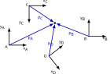
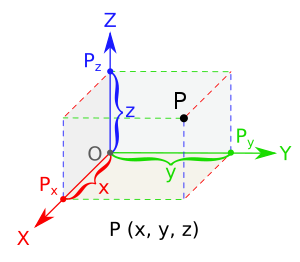
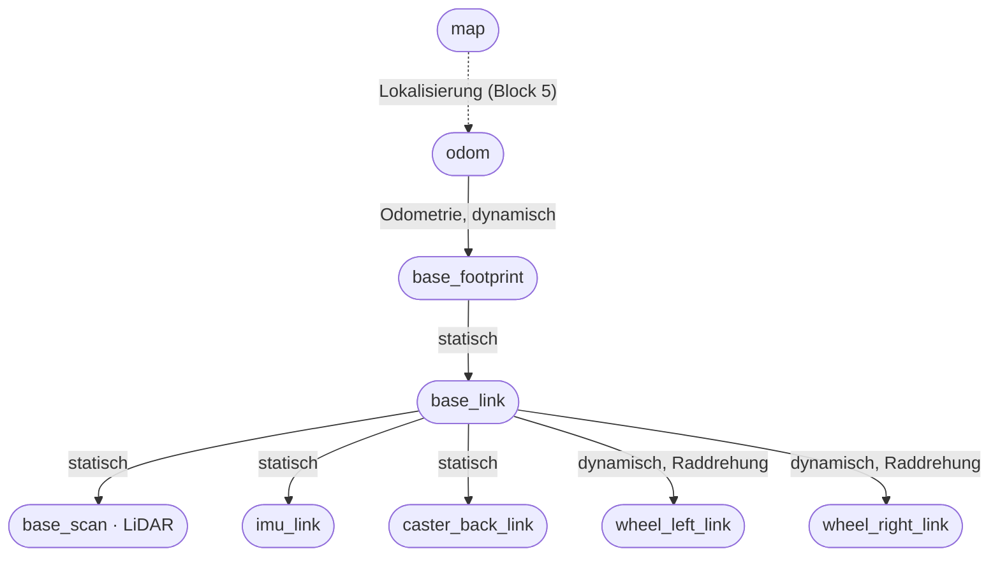

<!--

author:   Sebastian Zug & Georg Jäger & Claude Code (Opus 5.5) mit LiaScript Teaching-Agent
email:    sebastian.zug@informatik.tu-freiberg.de & Georg.Jaeger@informatik.tu-freiberg.de
version:  0.2.0
language: de
narrator: Deutsch Female

import:  https://github.com/liascript/CodeRunner
         https://raw.githubusercontent.com/TUBAF-IfI-LiaScript/VL_SoftwareprojektRobotik/refs/heads/master/config.md
         https://raw.githubusercontent.com/liaTemplates/mermaid_template/master/README.md

@python: @LIA.eval(`["main.py"]`, `none`, `python3 main.py`)

-->

[](https://liascript.github.io/course/?https://raw.githubusercontent.com/TUBAF-IfI-LiaScript/VL_SoftwareprojektRobotik/refs/heads/master/03_Koordinaten_QoS/03_Koordinaten_QoS.md)

# Koordinaten und Kommunikationsqualität

| Parameter            | Kursinformationen                                                                                                                       |
| -------------------- | --------------------------------------------------------------------------------------------------------------------------------------- |
| **Veranstaltung:**   | @config.lecture                                                                                                                         |
| **Semester**         | @config.semester                                                                                                                        |
| **Hochschule:**      | `Technische Universität Freiberg`                                                                                                       |
| **Inhalte:**         | `Koordinatentransformationen, tf2 und Quality of Service in ROS 2`                                                                      |
| **Link auf GitHub:** | https://github.com/TUBAF-IfI-LiaScript/VL_SoftwareprojektRobotik/blob/master/03_Koordinaten_QoS/03_Koordinaten_QoS.md       |
| **Autoren**          | @author                                                                                                                                 |

--------------------------------------------------------------------------------

**Zielstellung der heutigen Veranstaltung** — nach dieser Vorlesung können Sie

+ einen Punkt mit einer homogenen Transformationsmatrix von einem Bezugssystem in ein anderes umrechnen und Transformationen verketten,
+ erklären, warum ROS Orientierungen als Quaternion angibt, und ein Quaternion für eine Drehung um die Hochachse aufstellen,
+ den tf-Baum des TurtleBots lesen und Transformationen mit `tf2_echo` abfragen und mit `static_transform_publisher` veröffentlichen,
+ für einen Datenstrom passende QoS-Einstellungen wählen und eine QoS-Unverträglichkeit als Fehlerursache erkennen.

<!-- kurslandkarte:knopf-start -->

<a href="https://tubaf-ifi-liascript.github.io/VL_SoftwareprojektRobotik/kurslandkarte/#termin=02" style="display: inline-block; padding: 0.5em 1.1em; background-color: #00718A; color: #ffffff; text-decoration: none; font-family: 'IBM Plex Sans', 'Segoe UI', system-ui, sans-serif; font-weight: 600;">🗺️ Diese Vorlesung in der Kurslandkarte →</a>

<!-- kurslandkarte:knopf-ende -->

--------------------------------------------------------------------------------

<!-- kurslandkarte:wo-start -->

## Wo stehen wir?

    --{{0}}--
Kurz zur Orientierung. Wir sind in Block 1, Termin 5 von 32. Der TurtleBot weiß, wo seine Sensoren sitzen, und seine Daten kommen beim Empfänger an – sonst bleibt RViz leer. Neu sind heute: Bezugskoordinatensystem, Translation und Rotation, Homogene Koordinaten, Verkettung, Quaternion, tf2, Quality of Service.

**Ziel im Projekt:** Der TurtleBot weiß, wo seine Sensoren sitzen, und seine Daten kommen beim Empfänger an – sonst bleibt RViz leer.

**Block 1 · ROS-Grundlagen** – Termin 5 von 32, heute farbig markiert

<!-- data-type="none" -->
| Woche | Vorlesung | Übung | Praktikum |
| :-- | :-- | :-- | :-- |
| KW 43 · 19.–23.10. | [VL 00 Einführung](https://liascript.github.io/course/?https://raw.githubusercontent.com/TUBAF-IfI-LiaScript/VL_SoftwareprojektRobotik/master/00_Einfuehrung/00_Einfuehrung.md) · Mi 21.10. |  |  |
| KW 44 · 26.–30.10. | [VL 01 ROS 2 Grundlagen](https://liascript.github.io/course/?https://raw.githubusercontent.com/TUBAF-IfI-LiaScript/VL_SoftwareprojektRobotik/master/01_ROS_Grundlagen/01_ROS_Grundlagen.md) · Mi 28.10. | [Ü 1 Linux Shell](https://liascript.github.io/course/?https://raw.githubusercontent.com/TUBAF-IfI-LiaScript/VL_SoftwareprojektRobotik/master/exercises/uebung_01_linux_shell/README.md) · Do 29.10. |  |
| KW 45 · 2.–6.11. | [VL 02 ROS 2 Pakete](https://liascript.github.io/course/?https://raw.githubusercontent.com/TUBAF-IfI-LiaScript/VL_SoftwareprojektRobotik/master/02_ROS_Pakete/02_ROS_Pakete.md) · Mi 4.11. |  |  |
| **KW 46 · 9.–13.11.**<!-- style="background-color: rgba(255, 166, 0, 0.35); padding: 2px 6px; border-radius: 4px;" --> | **[VL 03 Koordinaten + QoS](https://liascript.github.io/course/?https://raw.githubusercontent.com/TUBAF-IfI-LiaScript/VL_SoftwareprojektRobotik/master/03_Koordinaten_QoS/03_Koordinaten_QoS.md)**<!-- style="background-color: rgba(255, 166, 0, 0.35); padding: 2px 6px; border-radius: 4px;" --> · Mi 11.11. | [Ü 2 Erster Workspace](https://liascript.github.io/course/?https://raw.githubusercontent.com/TUBAF-IfI-LiaScript/VL_SoftwareprojektRobotik/master/exercises/uebung_02_workspace/README.md) · Do 12.11. |  |
| KW 48 · 23.–27.11. |  |  | [P 1 TurtleBot + Bags](https://liascript.github.io/course/?https://raw.githubusercontent.com/TUBAF-IfI-LiaScript/VL_SoftwareprojektRobotik/master/exercises/praktikum_01_turtlebot/README.md) · Mi 25.11. + Do 26.11. |

- **Sie brauchen:** [Nachricht (Message)](https://tubaf-ifi-liascript.github.io/VL_SoftwareprojektRobotik/kurslandkarte/#begriff=message) (VL 01) · [ros2 topic …](https://tubaf-ifi-liascript.github.io/VL_SoftwareprojektRobotik/kurslandkarte/#begriff=topiccli) (VL 01) · [Discovery](https://tubaf-ifi-liascript.github.io/VL_SoftwareprojektRobotik/kurslandkarte/#begriff=discovery) (VL 01)
- **Heute neu:** [Bezugskoordinatensystem](https://tubaf-ifi-liascript.github.io/VL_SoftwareprojektRobotik/kurslandkarte/#begriff=frame) · [Translation und Rotation](https://tubaf-ifi-liascript.github.io/VL_SoftwareprojektRobotik/kurslandkarte/#begriff=starrtrafo) · [Homogene Koordinaten](https://tubaf-ifi-liascript.github.io/VL_SoftwareprojektRobotik/kurslandkarte/#begriff=homtrafo) · [Verkettung](https://tubaf-ifi-liascript.github.io/VL_SoftwareprojektRobotik/kurslandkarte/#begriff=verkettung) · [Quaternion](https://tubaf-ifi-liascript.github.io/VL_SoftwareprojektRobotik/kurslandkarte/#begriff=quaternion) · [tf2](https://tubaf-ifi-liascript.github.io/VL_SoftwareprojektRobotik/kurslandkarte/#begriff=tf2) · [Quality of Service](https://tubaf-ifi-liascript.github.io/VL_SoftwareprojektRobotik/kurslandkarte/#begriff=qos)

> [!TIP]
> **Tipp – Kurslandkarte:** [Ganze Kurslandkarte öffnen](https://tubaf-ifi-liascript.github.io/VL_SoftwareprojektRobotik/kurslandkarte/#termin=02) – dort finden Sie jeden Begriff mit Erklärung, typischer Stolperfalle, Link auf die passende Folie und die roten Fäden durch die Veranstaltung.

<!-- kurslandkarte:wo-ende -->

## Leitfrage: Warum zeigt RViz den Scan nicht?

**Im ersten Praktikum:** TurtleBot läuft, `ros2 topic echo /scan` zeigt Werte — RViz bleibt leer.

<!-- data-type="none" -->
| Symptom in RViz                                         | Ursache                                             | Thema heute         |
| :------------------------------------------------------ | :-------------------------------------------------- | :------------------ |
| `Frame [base_scan] does not exist` oder `No transform`  | RViz weiß nicht, **wo** der Sensor sitzt            | Koordinaten und tf2 |
| keine Fehlermeldung, aber keine Daten                   | **unverträgliche Anforderungen** an die Übertragung | Quality of Service  |

+ aus VL 01: jede Sensornachricht hat einen **Header** mit `frame_id`

    --{{0}}--
Dieses Bild werden viele von Ihnen im ersten Praktikum sehen: ein leeres RViz-Fenster, obwohl der Roboter Daten liefert. Meist steckt eine von zwei Ursachen dahinter. Die erste Hälfte der Vorlesung erklärt die erste Ursache, die zweite Hälfte die zweite. Der Schlüssel zum ersten Teil ist die frame_id im Header, die Sie in VL 01 beim LiDAR-Scan gesehen haben. Am Ende können Sie beide Ursachen selbst prüfen.

## Bezugssysteme

**Bezugssystem (_Frame_):** ein Punkt bedeutet nur etwas zusammen mit seinem System

+ Schreibweise: $\textbf{p}_A$ = Punkt $\textbf{p}$, ausgedrückt im System $A$

<!-- style="width: 50%;"-->

    --{{0}}--
Eine Koordinatenangabe ist ohne Bezugssystem wertlos. Der LiDAR misst ein Hindernis einen halben Meter vor sich, also vor dem Sensor, nicht vor der Mitte des Roboters und schon gar nicht relativ zur Kreuzung in der Verkehrswelt. Jede dieser Sichtweisen ist ein eigenes Koordinatensystem, in ROS Frame genannt.

<!-- data-type="none" -->
| Frame         | Ursprung                         | Wofür?                                                    |
| :------------ | :------------------------------- | :-------------------------------------------------------- |
| `base_scan`   | Mitte des LiDAR                  | so liefert der Sensor seine Messungen                     |
| `base_link`   | Mitte des Roboters               | so plant das Fahrverhalten: „Hindernis 40 cm voraus“      |
| `map`         | fester Punkt in der Verkehrswelt | so sind Kreuzungen, Parklücken und Ampeln eingetragen     |

    --{{1}}--
Beim TurtleBot in der Verkehrswelt gibt es mindestens diese drei wichtigen Bezugssysteme. Jedes beantwortet eine andere Frage: Was misst der Sensor? Wohin muss der Roboter ausweichen? Wo auf der Karte ist er?

**Kurze Kontrolle:** Der LiDAR misst ein Hindernis bei $\textbf{p}_{base\_scan} = (0{,}5;\ 0)$ m. Liegt es auch 0,5 m vor der **Mitte** des Roboters?

[( )] Ja, Koordinaten sind unabhängig vom Bezugssystem.
[(X)] Nicht unbedingt — das hängt davon ab, wo der LiDAR relativ zur Robotermitte sitzt.
***
Beim TurtleBot sitzt der LiDAR 3,2 cm hinter der Mitte. Das Hindernis liegt daher nur 46,8 cm vor der Robotermitte — die Werte zeigt gleich der tf-Baum.
***

## Pose eines Koordinatensystems in 2D

**Pose** = Position $\textbf{t} = (t_x, t_y)$ des Ursprungs + Drehwinkel $\varphi$

+ kennen Sie aus VL 01: `/turtle1/pose` liefert `x`, `y`, `theta`

<!-- style="width: 35%;"-->

    --{{0}}--
Um Koordinaten zwischen zwei Systemen umzurechnen, müssen wir wissen, wie das eine System im anderen liegt: wo sein Ursprung ist und wie es gedreht ist. Diese Kombination aus Position und Orientierung heißt Pose. In der Ebene sind das drei Zahlen. Die Schildkröte im turtlesim aus VL 01 meldet genau diese drei Zahlen: Position und Blickrichtung im Fenster.

**Umrechnung von $A$ nach $O$:** erst drehen, dann verschieben

$$
\textbf{p}_O = \textbf{R}(\varphi) \cdot \textbf{p}_A + \textbf{t}
\qquad \text{mit} \qquad
\textbf{R}(\varphi) =
\begin{bmatrix}
\cos\varphi & -\sin\varphi \\
\sin\varphi & \cos\varphi
\end{bmatrix}
$$

+ positive Winkel drehen **gegen den Uhrzeigersinn**

> [!IMPORTANT]
> **Merke – Konvention:** Wir beschreiben immer die Pose eines **Kind-Systems** ($A$) in seinem **Eltern-System** ($O$). Genau so speichert ROS seine Transformationen.

    --{{1}}--
Ein Punkt im System A lässt sich so im System O ausdrücken: Wir drehen ihn um den Winkel des Systems und verschieben ihn dann um die Position des Ursprungs. Die Drehmatrix kennen Sie aus der Linearen Algebra.

### Homogene Koordinaten

**Problem:** Drehung = Multiplikation, Verschiebung = Addition → **Trick:** zusätzliche Koordinate $1$

$$
\begin{bmatrix} \textbf{p}_O \\ 1 \end{bmatrix}
=
\underbrace{
\begin{bmatrix}
\cos\varphi & -\sin\varphi & t_x \\
\sin\varphi & \cos\varphi  & t_y \\
0 & 0 & 1
\end{bmatrix}}_{\textbf{T}_{OA}}
\cdot
\begin{bmatrix} \textbf{p}_A \\ 1 \end{bmatrix}
$$

+ links oben: Drehung · rechte Spalte: Verschiebung
+ **homogene Transformationsmatrix** $\textbf{T}_{OA}$: rechnet „von $A$ nach $O$“ (Index von rechts nach links lesen)

    --{{0}}--
Die Formel von eben hat einen Schönheitsfehler: Sobald wir mehrere Transformationen hintereinander ausführen, wechseln sich Multiplikationen und Additionen ab, und das wird unübersichtlich. Hängen wir an jeden Punkt eine Eins an, wird auch die Verschiebung zu einem Teil der Matrixmultiplikation. Eine einzige Matrix beschreibt dann die ganze Pose.

**Kurze Kontrolle:** $A$ ist gegenüber $O$ um $(2;\ 0{,}5)$ verschoben, **nicht** gedreht. $\textbf{p}_A = (2;\ 3)$. Wo liegt der Punkt in $O$?

$x_O =$ [[4]] , $y_O =$ [[3.5]]
[[?]] Ohne Drehung ist $\textbf{R}$ die Einheitsmatrix — es bleibt nur die Verschiebung.
***
$\textbf{p}_O = \textbf{p}_A + \textbf{t} = (2 + 2;\ 3 + 0{,}5) = (4;\ 3{,}5)$.
***

### Inverse Transformation

**Gegenrichtung $O \rightarrow A$:** $\textbf{T}_{AO} = \textbf{T}_{OA}^{-1}$ — ohne allgemeine Inversion, denn $\textbf{R}^{-1} = \textbf{R}^T$

$$
\textbf{T}_{OA} =
\begin{bmatrix} \textbf{R} & \textbf{t} \\ \textbf{0} & 1 \end{bmatrix}
\qquad \Rightarrow \qquad
\textbf{T}_{AO} = \textbf{T}_{OA}^{-1} =
\begin{bmatrix} \textbf{R}^T & -\textbf{R}^T\textbf{t} \\ \textbf{0} & 1 \end{bmatrix}
$$

+ zurückverschieben, dann zurückdrehen — die Verschiebung wird mitgedreht
+ im Programm genauso gut: `np.linalg.inv`

    --{{0}}--
Oft brauchen wir die Gegenrichtung: Wir kennen die Lage eines Hindernisses in der Karte und wollen wissen, wo es aus Sicht des Roboters liegt. Dafür invertieren wir die Matrix, und das geht ohne aufwendige Rechnung, weil Drehmatrizen orthogonal sind. Achten Sie auf die rechte Spalte: Es heißt minus R transponiert mal t, nicht einfach minus t.

**Kurze Kontrolle:** $A$ liegt bei $(2;\ 0)$ in $O$, ohne Drehung. $\textbf{p}_O = (3;\ 1)$. Wo liegt der Punkt in $A$?

$x_A =$ [[1]] , $y_A =$ [[1]]
***
Ohne Drehung ist $\textbf{R}^T$ die Einheitsmatrix, es bleibt $\textbf{p}_A = \textbf{p}_O - \textbf{t} = (3-2;\ 1-0) = (1;\ 1)$.
***

### Verkettung von Transformationen

**Ketten werden multipliziert** — die Indizes „kürzen sich“ von innen heraus:

$$
\textbf{T}_{OC} = \textbf{T}_{OA} \cdot \textbf{T}_{AB} \cdot \textbf{T}_{BC}
\qquad\qquad
\textbf{p}_O = \textbf{T}_{OA} \cdot \textbf{T}_{AB} \cdot \textbf{T}_{BC} \cdot \textbf{p}_C
$$

**Am Roboter:**

$$
\textbf{p}_{map} = \textbf{T}_{map,\ base\_link} \cdot \textbf{T}_{base\_link,\ base\_scan} \cdot \textbf{p}_{base\_scan}
$$

+ **Reihenfolge entscheidet** — die Matrix direkt am Punkt wirkt zuerst

    --{{0}}--
Die eigentliche Stärke der homogenen Matrizen zeigt sich beim Verketten. Ein Messpunkt des LiDAR soll in Kartenkoordinaten umgerechnet werden: vom Sensor zum Roboter, vom Roboter zur Karte. Wir multiplizieren einfach die Matrizen entlang der Kette. Weil Matrixmultiplikation nicht vertauschbar ist, kommt es auf die Reihenfolge an.

**Kurze Kontrolle:** $\textbf{T}_{trans}$ verschiebt um 1 in $x$, $\textbf{T}_{rot}$ dreht um 90° gegen den Uhrzeigersinn. Wohin gelangt $(1;\ 0)$?

[ [$(1;\ 1)$] [$(0;\ 2)$] ]
[     (X)          ( )    ] mit $\textbf{T}_{trans} \cdot \textbf{T}_{rot}$ (erst drehen, dann verschieben)
[     ( )          (X)    ] mit $\textbf{T}_{rot} \cdot \textbf{T}_{trans}$ (erst verschieben, dann drehen)
***
$\textbf{T}_{trans}\cdot\textbf{T}_{rot}$: Drehung $(1;0) \to (0;1)$, Verschiebung $\to (1;1)$. $\textbf{T}_{rot}\cdot\textbf{T}_{trans}$: Verschiebung $\to (2;0)$, Drehung $\to (0;2)$. Eine Pose $\textbf{T}_{OA}$ ist genau $\textbf{T}_{trans} \cdot \textbf{T}_{rot}$.
***

**Typische Fehlerquellen**

+ Reihenfolge der Matrizen vertauscht
+ Richtung verwechselt: $\textbf{T}_{OA}$ statt $\textbf{T}_{AO}$
+ Winkel in Grad statt im Bogenmaß

    --{{1}}--
Diese drei Fehler machen fast alle irgendwann. Der dritte ist besonders tückisch, weil das Programm ohne Fehlermeldung weiterrechnet: Ein Winkel von 90, als Bogenmaß gelesen, ist eine ganz andere Drehung.

## Beispiel: Ein Hindernis in Weltkoordinaten

**System $A$ im globalen System $O$** — Hindernis in $A$ bei $(2;\ 3)$, grüner Vektor = Lage in $O$

??[Interaktive Darstellung: Koordinatensystem A im globalen System O mit einem Hindernis](https://www.geogebra.org/classic/htug5qmn?embed)

    --{{0}}--
Probieren wir das an einem Beispiel aus. Ein Roboter mit dem Koordinatensystem A hat ein Hindernis bei zwei, drei erkannt. Wo liegt es in Weltkoordinaten? Verschieben Sie mit den Schiebereglern Position und Drehung von A und beobachten Sie, wie sich der grüne Vektor ändert.

**Dieselbe Rechnung in Python** — `phi_deg` ändern und neu starten:

```python  main.py
import numpy as np

def T(phi_deg, t):
    """Homogene 2D-Transformation: Pose (Drehung phi, Verschiebung t) eines Systems"""
    phi = np.radians(phi_deg)
    c, s = np.cos(phi), np.sin(phi)
    return np.array([[c, -s, t[0]],
                     [s,  c, t[1]],
                     [0,  0, 1   ]])

phi_deg = 90                   # Drehung von A gegenüber O in Grad
T_OA = T(phi_deg, [2, 0.5])    # Pose von A in O
p_A = np.array([2, 3, 1])      # Hindernis in A, homogen

p_O = T_OA @ p_A
print("Hindernis in O:", np.round(p_O[:2], 3))

T_AO = np.linalg.inv(T_OA)     # Gegenrichtung
print("zurück nach A: ", np.round((T_AO @ p_O)[:2], 3))
```
@python

    --{{1}}--
Der Code macht genau das, was wir an der Tafel gerechnet haben: Er baut die homogene Matrix aus Winkel und Verschiebung, multipliziert sie mit dem Punkt und rechnet zur Probe wieder zurück. Beachten Sie die Umrechnung von Grad in Bogenmaß in der zweiten Zeile der Funktion.

## Drei Dimensionen

**Im Raum:** homogene Matrix $4 \times 4$ — Prinzip unverändert

$$
\textbf{T}_{OA} =
\begin{bmatrix}
\textbf{R}_{3\times3} & \textbf{t}_{3\times1} \\
\textbf{0} & 1
\end{bmatrix}
$$

<!-- style="width:40%;" -->

> [!TIP]
> **Tipp – RViz:** Achsen werden immer gleich eingefärbt — **rot = x** (vorwärts), **grün = y** (links), **blau = z** (oben). Beim TurtleBot zeigt $x$ in Fahrtrichtung.

    --{{0}}--
Im Raum ändert sich am Prinzip nichts: Die homogene Matrix wird vier mal vier groß, mit einer drei mal drei Drehmatrix links oben und dem Verschiebungsvektor rechts. Schwieriger wird die Beschreibung der Drehung selbst. Spätestens nach 45 Minuten sollten wir hier sein, damit für tf2 und Quality of Service genug Zeit bleibt.

### Euler-Winkel

_Zum Nachlesen — für den TurtleBot brauchen Sie nur das Gieren._

+ **Gieren** (_yaw_, um $z$) · **Nicken** (_pitch_, um $y$) · **Rollen** (_roll_, um $x$)
+ $\varphi$ aus der Ebene = Gierwinkel — beim TurtleBot der einzige, der sich ändert

**Nachteile**

+ **Reihenfolge:** viele Konventionen — gleiche Zahlen, verschiedene Orientierungen
+ **Gimbal Lock:** Nicken auf ±90° → Gier- und Rollachse fallen zusammen

    --{{0}}--
Die naheliegende Idee ist, jede Drehung in drei Drehungen um die Koordinatenachsen zu zerlegen. Das ist anschaulich, hat aber zwei Haken. Erstens gibt es viele Konventionen, in welcher Reihenfolge gedreht wird. Zweitens geht beim Gimbal Lock ein Freiheitsgrad verloren, wenn der Nickwinkel auf neunzig Grad steht. Für Drohnen und Roboterarme ist das ein echtes Problem, für unseren TurtleBot nicht.

<details>
<summary>Drehmatrizen um die drei Achsen anzeigen</summary>

<!-- data-type="none" -->
| Bezeichnung          | Achse | Drehmatrix |
| -------------------- | ----- | ---------- |
| Gieren (_yaw_) $\psi$  | $z$   | $\textbf{R}_z(\psi) = \begin{bmatrix} \cos\psi & -\sin\psi & 0 \\ \sin\psi & \cos\psi & 0 \\ 0 & 0 & 1 \end{bmatrix}$ |
| Nicken (_pitch_) $\vartheta$ | $y$   | $\textbf{R}_y(\vartheta) = \begin{bmatrix} \cos\vartheta & 0 & \sin\vartheta \\ 0 & 1 & 0 \\ -\sin\vartheta & 0 & \cos\vartheta \end{bmatrix}$ |
| Rollen (_roll_) $\rho$ | $x$   | $\textbf{R}_x(\rho) = \begin{bmatrix} 1 & 0 & 0 \\ 0 & \cos\rho & -\sin\rho \\ 0 & \sin\rho & \cos\rho \end{bmatrix}$ |

</details>

### Quaternionen

**Quaternion** = Drehung um eine Achse $\vec{u}$ (Einheitsvektor) mit Winkel $\alpha$, vier Zahlen:

$$
\textbf{q} = \left(q_x,\ q_y,\ q_z,\ q_w\right) = \left(u_x \sin\tfrac{\alpha}{2},\ u_y \sin\tfrac{\alpha}{2},\ u_z \sin\tfrac{\alpha}{2},\ \cos\tfrac{\alpha}{2}\right)
$$

+ kein Gimbal Lock, numerisch stabil, gut zu interpolieren
+ $\textbf{q}$ und $-\textbf{q}$ = dieselbe Drehung
+ ROS: in allen Nachrichten, Reihenfolge **$x, y, z, w$**

> [!NOTE]
> **Hinweis:** Für den TurtleBot, der sich nur um $z$ dreht, reicht eine Formel mit dem Gierwinkel $\psi$:
>
> $$\textbf{q} = \left(0,\ 0,\ \sin\tfrac{\psi}{2},\ \cos\tfrac{\psi}{2}\right)$$

    --{{0}}--
ROS speichert Orientierungen deshalb nicht als Winkel, sondern als Quaternion: vier Zahlen, die eine Drehung um eine beliebige Achse beschreiben. Sie müssen Quaternionen nicht von Hand rechnen, das übernehmen Bibliotheken. Wichtig ist, dass Sie die Zahlen in einer Nachricht deuten können. Für eine Drehung um die Hochachse sind die ersten beiden Werte null, und die anderen beiden hängen nur vom halben Gierwinkel ab.

**Kurze Kontrolle:** Quaternion für eine Drehung um 180°: $q_z =$ [[1]] , $q_w =$ [[0]]
***
$\sin 90° = 1$, $\cos 90° = 0$ — also $(0;\ 0;\ 1;\ 0)$.
***

Der TurtleBot steht um 90° gedreht (nach links). Welches Quaternion meldet ROS?

[( )] $(0;\ 0;\ 1;\ 0)$
[(X)] $(0;\ 0;\ 0{,}707;\ 0{,}707)$
[( )] $(0;\ 0;\ 90;\ 1)$
***
$\sin 45° = \cos 45° \approx 0{,}707$; $(0;0;1;0)$ wäre 180°. In Python rechnet z. B. `scipy.spatial.transform.Rotation.from_euler('z', 90, degrees=True).as_quat()` um — auch dort $x, y, z, w$.
***

## Transformationen in ROS 2: tf2

**Zurück zur Leitfrage, Ursache 1:** Wie verwaltet ROS die Transformationen?

+ jede Sensornachricht nennt im Header ihre `frame_id`
+ Knoten veröffentlichen Transformationen auf `/tf` (veränderlich) und `/tf_static` (fest)
+ tf2 setzt alle Frames zu einem **Baum** zusammen — genau ein Weg zwischen zwei Frames

    --{{0}}--
In einem echten Roboter gibt es Dutzende Koordinatensysteme, und einige davon bewegen sich ständig. Diese Buchführung übernimmt tf2. Jeder Knoten veröffentlicht nur die Transformationen, die er kennt, jeweils zwischen zwei Frames. tf2 setzt daraus einen Baum zusammen und multipliziert für Sie die Matrizen entlang des Weges, genau wie bei der Verkettung von vorhin.

**Statisch oder dynamisch?**

+ **statisch:** ändert sich nie (Montage des LiDAR) — einmal veröffentlicht
+ **dynamisch:** ändert sich laufend (Roboter in der Karte) — ständig neu, mit Zeitstempel

    --{{1}}--
Der LiDAR ist fest an den Roboter geschraubt, diese Transformation ändert sich nie und wird deshalb nur einmal veröffentlicht. Die Lage des Roboters in der Karte ändert sich dagegen bei jeder Bewegung. Weil Sensordaten immer zu einem bestimmten Zeitpunkt gehören, trägt jede dynamische Transformation einen Zeitstempel. So kann tf2 für einen Scan die Lage des Roboters genau zum Messzeitpunkt liefern.

### Der tf-Baum des TurtleBot



+ `odom`: Startpunkt der Fahrt; Odometrie schätzt die Lage aus Radumdrehungen — driftet
+ `base_footprint`: Boden unter der Radachse, Drehpunkt; `base_link` 1 cm darüber

    --{{0}}--
Hier ist der Baum unseres Roboters. Lesen Sie ihn von oben nach unten: Die Karte kennt den Startpunkt der Odometrie, die Odometrie kennt die Lage des Roboters, und der Roboter kennt die Montageorte seiner Bauteile. Die Frames unterhalb von base_footprint stammen aus dem Modell des Roboters, die oberen kommen beim Fahren dazu. Gestrichelt ist, was erst in Block 5 dazukommt. Die Odometrie zählt die Radumdrehungen. Mit der Zeit summieren sich kleine Fehler, die Schätzung driftet.

<!-- data-type="none" -->
| Eltern-Frame       | Kind-Frame   | Verschiebung $(x;\ y;\ z)$ in m |
| :----------------- | :----------- | :------------------------------ |
| `base_footprint`   | `base_link`  | $(0;\ 0;\ 0{,}010)$             |
| `base_link`        | `base_scan`  | $(-0{,}032;\ 0;\ 0{,}172)$      |

*Werte aus dem Modell des TurtleBot 3 Burger*

**Kurze Kontrolle:** Wo liegt der LiDAR (`base_scan`) relativ zu `base_footprint`? Beide Transformationen ohne Drehung.

$x =$ [[-0.032]] m, $z =$ [[0.182]] m
[[?]] Ohne Drehung addieren sich die Verschiebungen entlang der Kette.
***
$\textbf{T}_{base\_footprint,\ base\_scan} = \textbf{T}_{base\_footprint,\ base\_link} \cdot \textbf{T}_{base\_link,\ base\_scan}$ — ohne Drehungen $(-0{,}032;\ 0;\ 0{,}182)$. Genau das zeigt gleich `tf2_echo`. Das Hindernis 0,5 m vor dem LiDAR liegt also 0,468 m vor der Robotermitte.
***

### Transformationen abfragen und veröffentlichen

**Abfragen:** `tf2_echo <Eltern-Frame> <Kind-Frame>`

```text
> ros2 run tf2_ros tf2_echo base_footprint base_scan
At time 0.0
- Translation: [-0.032, 0.000, 0.182]
- Rotation: in Quaternion (xyzw) [0.000, 0.000, 0.000, 1.000]
- Rotation: in RPY (radian) [0.000, -0.000, 0.000]
- Rotation: in RPY (degree) [0.000, -0.000, 0.000]
- Matrix:
  1.000  0.000  0.000 -0.032
  0.000  1.000  0.000  0.000
  ...
```

+ ganzer Baum als PDF: `ros2 run tf2_tools view_frames`

    --{{0}}--
Zwei Werkzeuge brauchen Sie ständig. Das erste, tf2_echo, fragt eine Transformation ab. Die Ausgabe zeigt alles aus dieser Vorlesung: die Verschiebung, das Quaternion, die Euler-Winkel und die homogene Matrix. Wer den ganzen Baum sehen will, erzeugt mit view_frames eine Grafik.

**Veröffentlichen:** Kamera 10 cm vor, 15 cm über `base_link`, um 90° nach links gedreht

```text
> ros2 run tf2_ros static_transform_publisher --x 0.1 --z 0.15 --yaw 1.5708 --frame-id base_link --child-frame-id camera_link
[INFO] [...] [static_transform_publisher_...]: Spinning until stopped - publishing transform
translation: ('0.100000', '0.000000', '0.150000')
rotation: ('0.000000', '0.000000', '0.707108', '0.707105')
from 'base_link' to 'camera_link'
```

+ Winkel im **Bogenmaß** ($90° \approx 1{,}5708$); fehlende Werte sind 0
+ **Vorhersage:** Winkel auf 180° — was zeigt `tf2_echo`? (Lösung: Aufgabe der Woche)

    --{{1}}--
Mit dem zweiten Werkzeug, dem static_transform_publisher, tragen Sie selbst eine feste Transformation ein, etwa für eine Kamera, die im Modell des Roboters fehlt. Erkennen Sie das Quaternion für neunzig Grad wieder? Beide Befehle führe ich jetzt im Terminal vor. Ändern Sie in Gedanken den Winkel auf hundertachtzig Grad und überlegen Sie, was tf2_echo dann zeigt.

### RViz in drei Schritten

1. `rviz2` starten, unter _Global Options_ den **Fixed Frame** wählen, z. B. `base_footprint`
2. _Add → By topic → /scan → LaserScan_
3. leer? Statusmeldung im _Displays_-Panel lesen (Transformation?) und _Topic → Reliability Policy_ prüfen (QoS)

<!-- style="width:70%;" -->

    --{{0}}--
So stellen Sie im Praktikum einen Scan dar. Der Fixed Frame ist das System, in dem RViz alles zeichnet. Damit ein Scan erscheint, muss tf2 eine Kette vom Frame des Scans zu diesem Fixed Frame kennen. Bleibt die Anzeige leer, prüfen Sie genau die beiden Ursachen aus der Leitfrage.

### URDF: der Roboter als Modell

**URDF** (_Unified Robot Description Format_, XML): **Links** = Bauteile, **Joints** = Verbindungen mit Pose

```xml  turtlebot3_burger.urdf (Ausschnitt)
<joint name="scan_joint" type="fixed">
  <parent link="base_link"/>
  <child link="base_scan"/>
  <origin xyz="-0.032 0 0.172" rpy="0 0 0"/>
</joint>
```

+ `robot_state_publisher` liest das Modell und veröffentlicht alle festen Transformationen
+ beim TurtleBot startet ihn `robot.launch.py` (VL 02)

    --{{0}}--
Woher kommen die statischen Transformationen des TurtleBot? Aus einem Modell des Roboters, Sie müssen sie also nicht von Hand eintragen. Im Ausschnitt erkennen Sie die Werte aus dem tf-Baum wieder: Der LiDAR sitzt 3,2 Zentimeter hinter und 17,2 Zentimeter über base_link. Den Knoten, der das Modell liest, startet die Launch-Datei aus der Einstiegsfrage von VL 02.

## Quality of Service

**Zurück zur Leitfrage, Ursache 2:** Quality of Service (QoS) = Regeln für Verluste, Verspätungen, spät gestartete Empfänger

<!-- data-type="none" -->
| Einstellung         | Werte                                  | Bedeutung                                         |
| :------------------ | :------------------------------------- | :------------------------------------------------ |
| **Reliability**     | `reliable` / `best_effort`             | Verlorenes erneut senden — oder gleich das Nächste? |
| **Durability**      | `volatile` / `transient_local`         | Bekommt ein Spätstarter die letzte Nachricht?     |
| **History / Depth** | `keep_last` mit Tiefe $n$ / `keep_all` | Wie viele Nachrichten puffern? — die `10` aus VL 01 |

+ Profile: `sensor_data` (best effort, kleine Tiefe) · Standard (reliable, volatile, Tiefe 10)

    --{{0}}--
Jetzt zur zweiten Ursache für ein leeres RViz. Nicht jede Nachricht ist gleich wichtig. Ein LiDAR-Scan ist nach einer Zehntelsekunde veraltet, geht einer verloren, nimmt man den nächsten. Ein Fahrbefehl oder eine Karte dagegen sollte ankommen. ROS 2 lässt Sie das pro Verbindung einstellen. Die Zahl zehn, die Sie in VL 01 bei create_publisher gesehen haben, ist bereits eine dieser Einstellungen: die Tiefe des Puffers. Für typische Fälle gibt es fertige Profile.

### Zuverlässigkeit: reliable oder best effort

**Empfänger verlangt, Sender bietet** — Verbindung nur, wenn das Angebot reicht:

<!-- data-type="none" -->
| Sender bietet    | Empfänger verlangt | Verbindung? |
| :--------------- | :----------------- | :---------- |
| `reliable`       | `reliable`         | ja          |
| `reliable`       | `best_effort`      | ja          |
| `best_effort`    | `best_effort`      | ja          |
| `best_effort`    | `reliable`         | **nein**    |

    --{{0}}--
Was passiert, wenn Sender und Empfänger Unterschiedliches erwarten? Der Empfänger stellt Mindestanforderungen, der Sender macht ein Angebot. Der letzte Fall der Tabelle ist unsere zweite Ursache für ein leeres RViz: Viele Sensortreiber senden mit dem Profil sensor_data, also best effort. Verlangt der Empfänger reliable, kommt keine Verbindung zustande, und zwar ohne Absturz.

**So sieht das aus:**

```text
# Terminal 1: Sender mit best effort
> ros2 topic pub --rate 2 --qos-reliability best_effort /chatter std_msgs/msg/String "{data: hallo}"
```

```text
# Terminal 2: Empfänger verlangt reliable
> ros2 topic echo --qos-reliability reliable /chatter
[WARN] [...]: New publisher discovered on topic '/chatter', offering incompatible QoS. No messages will be received from it. Last incompatible policy: RELIABILITY
```

+ kein Absturz, nur diese eine Warnung
+ in RViz: _Reliability Policy_ auf `Best Effort`

    --{{1}}--
Die Warnung erscheint genau einmal, wenn sich die beiden finden. Wer sie übersieht, sucht lange. In RViz lösen Sie das Problem, indem Sie in der Anzeige des Scans die Reliability Policy auf Best Effort stellen: Der Empfänger verlangt dann nicht mehr, als der Sender bietet.

**Kurze Kontrolle:** Welche Kombinationen funktionieren?

[ [Verbindung] [keine Verbindung] ]
[     (X)            ( )          ] LiDAR-Treiber sendet `best_effort`, Ihre Spurerkennung verlangt `best_effort`
[     ( )            (X)          ] LiDAR-Treiber sendet `best_effort`, RViz verlangt `reliable`
[     (X)            ( )          ] Ihr Fahrverhalten sendet `reliable`, ein Rekorder verlangt `best_effort`
***
Faustregel: Wer weniger verlangt, als angeboten wird, bekommt Daten. Ein Empfänger, der `reliable` verlangt, braucht einen Sender, der `reliable` anbietet.
***

### Dauerhaftigkeit: Wer zu spät kommt …

**`volatile`:** Spätstarter bekommt nichts · **`transient_local`:** Sender liefert die letzten Nachrichten nach

```text
# Sender mit transient_local: eine Nachricht, danach noch 8 s aktiv
> ros2 topic pub -w 0 --times 1 --keep-alive 8 --qos-durability transient_local /ampel std_msgs/msg/String "{data: rot}"

# Empfänger, 3 s später gestartet
> ros2 topic echo --once --qos-durability transient_local --qos-reliability reliable /ampel
data: rot
---
```

+ Nachlieferung nur an Empfänger mit `reliable` (sonst wählt `echo` selbst `best_effort`)
+ mit `volatile` auf beiden Seiten: Der Empfänger zeigt nichts
+ Empfänger `transient_local` + Sender `volatile` → keine Verbindung (`DURABILITY`)

    --{{0}}--
Die zweite wichtige Einstellung betrifft Knoten, die später starten. Normalerweise bekommen sie nur Nachrichten, die nach ihrem Start gesendet werden. Im Versuch schickt der Sender genau eine Nachricht und bleibt danach noch acht Sekunden aktiv, ohne auf Empfänger zu warten. Der Empfänger startet drei Sekunden später und bekommt die Nachricht trotzdem, allerdings nur, wenn er reliable verlangt. Nachgeliefert wird nur an zuverlässige Empfänger. Ohne diese Angabe wählt ros2 topic echo seit Jazzy selbst eine passende Einstellung, hier best effort, und die Nachricht bleibt aus. Auch hier gilt die Regel von eben: nicht mehr verlangen, als angeboten wird. Hier schließt sich der Kreis zu tf2.

**Kurze Kontrolle:** `/tf_static` wird nur **einmal** veröffentlicht, RViz startet eine Minute später. Welche Durability braucht `/tf_static`?

[( )] `volatile`
[(X)] `transient_local`
***
Mit `volatile` hätte RViz die feste Transformation des LiDAR verpasst — wieder ein leerer Bildschirm. Darum verwendet `/tf_static` `transient_local`; genauso Karten, die nur einmal veröffentlicht werden.
***

### QoS untersuchen

**Tatsächliche Einstellungen:** `ros2 topic info --verbose` (kurz `-v`)

```text
> ros2 topic info -v /tf_static
Type: tf2_msgs/msg/TFMessage

Publisher count: 1

Node name: robot_state_publisher
...
QoS profile:
  Reliability: RELIABLE
  History (Depth): UNKNOWN
  Durability: TRANSIENT_LOCAL
  ...
```

+ `History (Depth): UNKNOWN` ist kein Fehler — die Tiefe ist lokal und wird nicht mitgeteilt

    --{{0}}--
Mit diesem Werkzeug grenzen Sie im Labor jedes QoS-Problem ein. Es zeigt für jeden Sender und Empfänger, welche Einstellungen er tatsächlich verwendet, hier am Beispiel der festen Transformationen, veröffentlicht vom robot_state_publisher. Die Puffertiefe ist eine lokale Einstellung jedes Knotens, deshalb steht dort unbekannt.

**Im eigenen Code** — Profil statt der `10` aus VL 01:

```python
# Python
from rclpy.qos import qos_profile_sensor_data
self.create_subscription(LaserScan, 'scan', self.callback, qos_profile_sensor_data)
```

```cpp
// C++
subscription_ = this->create_subscription<sensor_msgs::msg::LaserScan>(
  "scan", rclcpp::SensorDataQoS(), std::bind(&LaneDetector::callback, this, _1));
```

    --{{1}}--
Im eigenen Code wählen Sie die QoS beim Anlegen von Publisher oder Subscriber. Statt der Zahl zehn übergeben Sie ein Profil, für Sensordaten zum Beispiel das sensor_data-Profil. Ihre Spurerkennung empfängt dann auch von einem Kameratreiber, der nur best effort anbietet.

## Zusammenfassung und Ausblick

**Zurück zur Leitfrage — RViz bleibt leer, wenn …**

1. tf2 den Frame des Sensors nicht kennt → `tf2_echo`, `view_frames`; fehlende feste Transformation mit `static_transform_publisher`
2. die QoS nicht verträglich ist → `ros2 topic info -v`; in RViz `Best Effort`

**Das Wichtigste**

+ Koordinaten nur mit Bezugssystem (`frame_id`)
+ $\textbf{T}_{OA}$ rechnet von $A$ nach $O$; Verkettung = Multiplikation, Reihenfolge zählt
+ Orientierung als Quaternion $(x, y, z, w)$; um $z$: $(0;\ 0;\ \sin\frac{\psi}{2};\ \cos\frac{\psi}{2})$
+ tf2 verwaltet den Baum; feste Transformationen aus der URDF
+ QoS: nicht mehr verlangen als angeboten; `transient_local` für Spätstarter

    --{{0}}--
Zurück zur Leitfrage: RViz zeigt den Scan nicht, wenn die Transformation zum Sensor fehlt oder wenn die QoS-Einstellungen nicht zusammenpassen. Beides können Sie jetzt prüfen, mit tf2_echo und mit ros2 topic info minus v.

**Ausblick**

+ **Ü 2** (diese Woche): erster Workspace, Parameter, `ros2 bag`
+ **P 1:** TurtleBot verbinden, `view_frames`, Scan in RViz, Fahrt aufzeichnen
+ **Block 2:** Sensoren selbst — und die Koordinatensysteme einer Kamera

    --{{1}}--
Im Praktikum P 1 wenden Sie das an: TurtleBot verbinden, den tf-Baum ansehen, den Scan in RViz darstellen und eine Fahrt aufzeichnen. In Block 2 geht es um die Sensoren selbst und um die Koordinatensysteme einer Kamera.

### Abschluss-Check

Sie kennen $\textbf{T}_{map,\ base\_link}$ und $\textbf{T}_{base\_link,\ base\_scan}$. Wie berechnen Sie einen LiDAR-Punkt in Kartenkoordinaten?

[(X)] $\textbf{p}_{map} = \textbf{T}_{map,\ base\_link} \cdot \textbf{T}_{base\_link,\ base\_scan} \cdot \textbf{p}_{base\_scan}$
[( )] $\textbf{p}_{map} = \textbf{T}_{base\_link,\ base\_scan} \cdot \textbf{T}_{map,\ base\_link} \cdot \textbf{p}_{base\_scan}$
[( )] $\textbf{p}_{map} = \textbf{T}_{map,\ base\_link} + \textbf{T}_{base\_link,\ base\_scan} + \textbf{p}_{base\_scan}$
***
Die Indizes müssen sich von innen heraus „kürzen“: $base\_scan$ neben $\textbf{p}_{base\_scan}$, dann $base\_link$ neben $base\_link$.
***

Ihre Spurerkennung abonniert das Kamerabild, erhält aber nichts. `ros2 topic info -v` zeigt beim Kameratreiber `Reliability: BEST_EFFORT`. Was ändern Sie?

[( )] Den Kameratreiber auf `reliable` umstellen — das geht immer.
[(X)] In der Spurerkennung `qos_profile_sensor_data` (best effort) verwenden.
[( )] Die `ROS_DOMAIN_ID` ändern.
***
Den Treiber zu ändern ist oft nicht möglich und für Bilder nicht sinnvoll — der Empfänger passt sich an. Die Domain-ID ist es nicht, sonst würde `ros2 topic info` den Publisher gar nicht zeigen.
***

Mit welchem Befehl prüfen Sie im Labor, ob tf2 die Lage des LiDAR kennt?

[(X)] `ros2 run tf2_ros tf2_echo base_link base_scan`
[( )] `ros2 topic echo /scan`
[( )] `ros2 topic info -v /scan`
***
`/scan` zu sehen beweist nur, dass Daten fließen. Ob tf2 die Transformation kennt, zeigt `tf2_echo` (oder `view_frames`); `topic info -v` hilft bei der QoS.
***

    --{{0}}--
Drei Fragen zum Abschluss: eine zur Verkettung und je eine zu den beiden Ursachen aus der Leitfrage.

## Aufgabe der Woche

**Optional (Rechnen üben):**

1. **Zwei Roboter:** Roboter $B$ steht bei $(5;\ 4)$ in $O$, um 180° gedreht. Wo liegt das Hindernis aus seiner Sicht? Ergänzen Sie den Code um `T_OB` und berechnen Sie $\textbf{p}_B = \textbf{T}_{OB}^{-1} \cdot \textbf{p}_O$.

   <details>
   <summary>Lösung anzeigen</summary>

   ```python
   T_OB = T(180, [5, 4])
   p_B = np.linalg.inv(T_OB) @ p_O
   print(np.round(p_B[:2], 3))   # bei phi_deg = 90: [6.  1.5]
   ```

   Bei $\varphi_A = 90°$ liegt das Hindernis in $O$ bei $(-1;\ 2{,}5)$. Vom Roboter $B$ aus gesehen sind das 6 m voraus und 1,5 m nach links — $B$ schaut ja in die Gegenrichtung.

   </details>
2. Ein LiDAR-Punkt liegt bei $(0{,}5;\ 0;\ 0)$ in `base_scan`. Wo liegt er in `base_footprint`? (Werte aus der Tabelle zum tf-Baum.)

**Pflicht als Vorbereitung auf P 1:**

3. In drei Terminals: `static_transform_publisher` für `base_link` → `camera_link` wie oben, `tf2_echo base_link camera_link`, `view_frames`. Winkel auf 180° ändern, Quaternion und Matrix vergleichen.
   + `view_frames` legt eine PDF im aktuellen Ordner ab; unter WSL2 öffnet `explorer.exe .` den Ordner
4. **Den TurtleBot ohne Roboter:** Modell installieren (`sudo apt install ros-jazzy-turtlebot3-description`) und ohne Hardware starten:

   ```bash
   ros2 run robot_state_publisher robot_state_publisher --ros-args -p robot_description:="$(sed 's/${namespace}//g' /opt/ros/jazzy/share/turtlebot3_description/urdf/turtlebot3_burger.urdf)"
   ```

   + prüfen: `tf2_echo base_footprint base_scan` und `ros2 topic info -v /tf_static`
   + `rviz2`: Fixed Frame `base_footprint`, _Add → TF_ und _Add → RobotModel_ (Topic `/robot_description`)
5. Publisher mit `--qos-reliability best_effort`, Empfänger mit `--qos-reliability reliable`: Warnung lesen, auf der Empfängerseite beheben.

    --{{0}}--
Die Aufgaben dieser Woche bereiten Sie direkt auf das erste Praktikum vor. Wenn Sie die Aufgaben drei bis fünf lösen, wissen Sie im Labor sofort, wo Sie suchen müssen, falls RViz leer bleibt. In Aufgabe vier entfernt der sed-Befehl einen Platzhalter aus dem Modell, den sonst die Launch-Datei des TurtleBot ersetzt. Danach sehen Sie den TurtleBot mit all seinen Koordinatensystemen, ganz ohne Hardware.

<details>
<summary>Lösungshinweise anzeigen</summary>

1. Siehe die aufklappbare Lösung oben bei der Aufgabe.
2. Ohne Drehungen addieren sich die Verschiebungen: $(0{,}5 - 0{,}032;\ 0;\ 0 + 0{,}182) = (0{,}468;\ 0;\ 0{,}182)$ m. Der Punkt liegt also 46,8 cm vor der Robotermitte — siehe die Kontrollfrage zu Beginn.
3. Bei 180° (`--yaw 3.1416`) zeigt `tf2_echo` das Quaternion $(0;\ 0;\ 1;\ 0)$ und in der Matrix $-1$ auf der Diagonalen für $x$ und $y$.
4. `tf2_echo` zeigt die Translation $(-0{,}032;\ 0;\ 0{,}182)$ wie in der Vorlesung, `/tf_static` hat `Durability: TRANSIENT_LOCAL`.
5. Der Empfänger muss `--qos-reliability best_effort` verwenden; dann kommen die Nachrichten an.

</details>

**Zum Weiterlesen**

+ [ROS 2 Jazzy: tf2 Tutorials](https://docs.ros.org/en/jazzy/Tutorials/Intermediate/Tf2/Tf2-Main.html)
+ [ROS 2 Jazzy: Quality of Service settings](https://docs.ros.org/en/jazzy/Concepts/Intermediate/About-Quality-of-Service-Settings.html)
+ [REP 105: Koordinatensysteme mobiler Roboter](https://www.ros.org/reps/rep-0105.html) — warum `map`, `odom` und `base_link`

<!-- kurslandkarte:ausblick-start -->

--------------------------------------------------------------------------------

**🗺️ Nächster Halt:** VL 04 · Sensorik (Mi 2.12. · 11:30–13:00) – Sie wissen, was die Sensoren des TurtleBots messen und wo ihre Grenzen liegen. [Auf der Kurslandkarte ansehen](https://tubaf-ifi-liascript.github.io/VL_SoftwareprojektRobotik/kurslandkarte/#termin=01)

**Außerdem bis dahin:** [Ü 2 · Erster Workspace](https://tubaf-ifi-liascript.github.io/VL_SoftwareprojektRobotik/kurslandkarte/#termin=ue2) (Do 12.11. · 16:15–17:45) · [P 1 · TurtleBot + Bags](https://tubaf-ifi-liascript.github.io/VL_SoftwareprojektRobotik/kurslandkarte/#termin=p1) (Mi 25.11. 11:30–13:00 + Do 26.11. 16:15–17:45)

<!-- kurslandkarte:ausblick-ende -->
