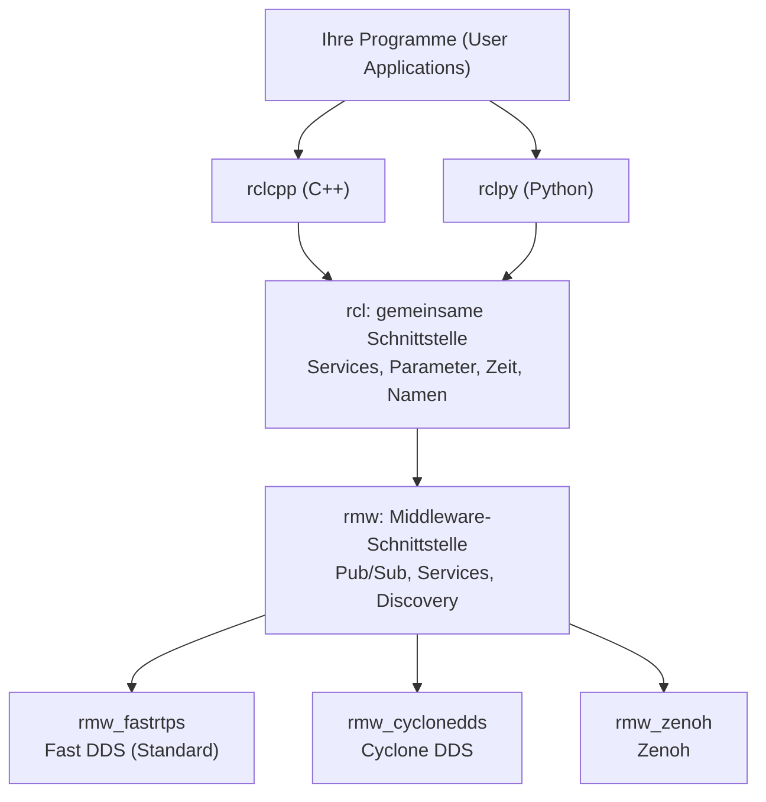
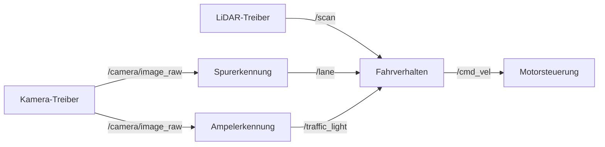
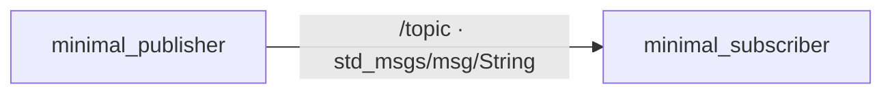

<!--

author:   Sebastian Zug & Georg Jäger & Claude Code (Opus 5.5) mit LiaScript Teaching-Agent
email:    sebastian.zug@informatik.tu-freiberg.de & Georg.Jaeger@informatik.tu-freiberg.de
version:  0.2.0
language: de
narrator: Deutsch Female

import:   https://raw.githubusercontent.com/TUBAF-IfI-LiaScript/VL_SoftwareprojektRobotik/refs/heads/master/config.md
          https://raw.githubusercontent.com/liaTemplates/mermaid_template/master/README.md
  
-->

[](https://liascript.github.io/course/?https://raw.githubusercontent.com/TUBAF-IfI-LiaScript/VL_SoftwareprojektRobotik/refs/heads/master/03_ROS_Grundlagen_I/03_EinfuehrungROS.md)


# Einführung in ROS 2

| Parameter            | Kursinformationen                                                                                                                                                                                   |
|----------------------|-----------------------------------------------------------------------------------------------------------------------------------------------------------------------------------------------------|
| **Veranstaltung:**   | @config.lecture                                                                                               |
| **Semester**         | @config.semester                                                                                              |
| **Hochschule:**      | `Technische Universität Freiberg`                                                                                                                                                                   |
| **Inhalte:**         | `Motivation für ROS 2, Architektur, Knoten, Topics und Nachrichten, erste Schritte mit der Kommandozeile`                                                                                           |
| **Link auf GitHub:** | https://github.com/TUBAF-IfI-LiaScript/VL_SoftwareprojektRobotik/blob/master/03_ROS_Grundlagen_I/03_EinfuehrungROS.md |
| **Autoren**          | @author                                                                                                       |


--------------------------------------------------------------------------------

**Zielstellung der heutigen Veranstaltung** — nach dieser Vorlesung können Sie

+ an einem TurtleBot-Beispiel begründen, welche Probleme ein Framework wie ROS 2 löst,
+ für eine Aufgabe das passende Kommunikationsmuster (Topic, Service, Action) wählen und einen ROS-Graphen aus Knoten und Topics skizzieren,
+ im Code eines Knotens Topic, Nachrichtentyp, Callback und `spin()` benennen,
+ ein laufendes System mit `ros2 topic` untersuchen und typische Verbindungsfehler erklären.

--------------------------------------------------------------------------------

**Was wir schon wissen**

    --{{0}}--
Zwei Dinge aus den letzten Terminen brauchen wir heute. Aus VL 1 den Sense-Think-Act-Kreislauf: Beim TurtleBot sind das getrennte Programme, die Daten austauschen müssen. Und aus Ü 1 die Umgebungsvariablen: Was Sie mit export setzen, gilt nur in diesem Terminal. Heute sehen wir, wie ROS 2 beides zusammenbringt.

+ **VL 1:** Sense, Think und Act sind beim TurtleBot eigene Programme — heute sehen wir, **wie sie Daten austauschen**.
+ **Ü 1:** Umgebungsvariablen gelten pro Terminal, `source` lädt sie in die aktuelle Shell — das wird heute zur häufigsten Fehlerquelle.

Was gibt `echo $ROS_DOMAIN_ID` in einem **neuen** Terminal aus, wenn Sie den Wert im ersten Terminal mit `export ROS_DOMAIN_ID=12` gesetzt haben (und nichts in `~/.bashrc` steht)?

[( )] `12`
[(X)] eine leere Zeile
[( )] eine Fehlermeldung
***
Jedes Terminal hat seine eigene Umgebung. Das wird uns heute wiederbegegnen: Zwei ROS-Programme in Terminals mit unterschiedlicher `ROS_DOMAIN_ID` sehen sich nicht.
***

--------------------------------------------------------------------------------

## Warum ein Framework?

    --{{0}}--
Stellen Sie sich vor, Sie sollen den TurtleBot ganz ohne Hilfsmittel programmieren: eigene Treiber für LiDAR und Kamera, eigene Kommunikation zwischen den Programmen, eigene Werkzeuge zur Fehlersuche. Genau dieses Problem hatten Forschungsgruppen über Jahre — jede hat das Rad neu erfunden.

                                   {{0-1}}
********************************************************************************

**Welche Herausforderungen stecken in der Programmierung eines Roboters?**

<!-- width="100%" -->
*Roboter des RoboCupTeams aus Nürnberg* [^1]

[^1]: TDP des Teams AutonOhm, 2019

********************************************************************************

                                  {{1-2}}
********************************************************************************

<!-- width="80%" -->
Comic der Firma Willow Garage: Jede Gruppe erfindet das Rad neu — Treiber, Kommunikation, Visualisierung. [^2]

[^2]: Willow Garage, http://www.willowgarage.com/blog/2010/04/27/reinventing-wheel, 2010

********************************************************************************

                                  {{2}}
********************************************************************************

Schon unser kleiner TurtleBot zeigt, was ein Framework leisten muss:

<!-- data-type="none" -->
| Anforderung                  | Was heißt das in der Verkehrswelt?                                                                 |
| :--------------------------- | :------------------------------------------------------------------------------------------------- |
| **Treiber**                  | LiDAR, Kamera und Motoren sollen sofort Daten liefern, ohne dass wir Treiber selbst schreiben.     |
| **Kommunikation**            | Spurerkennung, Ampelerkennung und Fahrverhalten laufen als getrennte Programme — teils auf dem Roboter, teils auf dem Laptop — und tauschen Daten aus. |
| **Zeitverhalten**            | Ein Fahrbefehl, der eine halbe Sekunde zu spät kommt, lässt den Roboter über die Haltelinie fahren. |
| **Wiederverwendung**         | Lokalisierung, Kartierung und Navigation gibt es fertig — wir wollen sie nutzen, nicht neu bauen.  |
| **Werkzeuge**                | Daten anzeigen, aufzeichnen und im Simulator testen, ohne jedes Mal den Roboter aufzubauen.        |
| **Sprachen**                 | C++ für schnelle Bildverarbeitung, Python für schnelle Experimente — beides im selben System.      |

Genau diese Aufgaben übernimmt ROS 2.

********************************************************************************

## ROS, was ist das?

    --{{0}}--
ROS ist trotz des Namens kein Betriebssystem, sondern eine Middleware mit einem riesigen Ökosystem an Paketen. Für Sie ist vor allem eines wichtig: Achten Sie bei jeder Anleitung auf die Version. Wir arbeiten mit ROS 2 Jazzy.

Das Robot Operating System (ROS) ist ein Open-Source-Framework für die Entwicklung von Robotern. Trotz des Namens ist ROS kein Betriebssystem, sondern eine **Middleware**: eine Softwareschicht zwischen Betriebssystem und Anwendung, die den Datenaustausch zwischen Programmen übernimmt — auch über Rechnergrenzen hinweg. Dazu kommen tausende Pakete mit Treibern, Algorithmen und Werkzeugen. ROS entstand 2007 in Stanford und wird heute von der gemeinnützigen Open Source Robotics Foundation koordiniert ([ros.org](https://www.ros.org/)).

Seit 2017 gibt es mit ROS 2 eine grundlegend neu entworfene Generation. ROS 1 und ROS 2 sind nicht miteinander kompatibel. Die letzte ROS-1-Version _Noetic Ninjemys_ wird seit Mai 2025 nicht mehr gepflegt — **neue Projekte setzen ausschließlich auf ROS 2.** Wenn Sie im Netz auf Beispiele mit `roscore`, `rosrun` oder `catkin` stoßen, handelt es sich um ROS 1.

ROS 2 erscheint jedes Jahr im Mai in einer neuen _Distribution_. Die Namen folgen dem Alphabet und benennen jeweils eine Schildkröte. Versionen aus geraden Jahren werden fünf Jahre lang gepflegt (_Long Term Support_, LTS), die übrigen etwa anderthalb Jahre.

<!-- data-type="none" -->
| Distribution         | Erschienen | Gepflegt bis | Bemerkung                                       |
| :------------------- | :--------- | :----------- | :---------------------------------------------- |
| _Humble Hawksbill_   | Mai 2022   | Mai 2027     | LTS, Ubuntu 22.04                               |
| **_Jazzy Jalisco_**  | Mai 2024   | Mai 2029     | LTS, Ubuntu 24.04 — **in dieser Veranstaltung** |
| _Kilted Kaiju_       | Mai 2025   | Nov. 2026    | kurzer Support                                  |
| _Lyrical Luth_       | Mai 2026   | Mai 2031     | LTS, aktuellste Version                         |
| _Rolling Ridley_     | fortlaufend | —           | Entwicklungsstand, für Experimente              |

Warum nicht die neueste Version? Für die TurtleBots, die Treiber und viele Pakete, die wir nutzen, ist Jazzy erprobt. Eine LTS-Version, die über beide Semester stabil bleibt, ist für ein Projekt wichtiger als die neuesten Funktionen.

>  In der Fachwelt für das autonome Fahren werden auch gerne zumindest Teile von ROS eingesetzt. In der Robotik nutzen mittlerweile nahezu alle Forschungsgruppen zumindest teilweise ROS. Viele Forschungsgruppen besitzen gar kein eigenes Softwareframework mehr, sondern konzentrieren sich voll auf ROS. *golem.de [Beitrag - Für wen ist ROS?](https://www.golem.de/news/robot-operating-system-was-bratwurst-bot-und-autonome-autos-gemeinsam-haben-1612-124079-4.html)*

Das erste Paper, in dem die Basiskonzepte beschrieben wurden, ist unter [Link](http://www.robotics.stanford.edu/~ang/papers/icraoss09-ROS.pdf) zu finden.

**Kurze Kontrolle:** Sie finden im Netz eine Anleitung, die mit `roscore` beginnt und Pakete mit `catkin_make` baut. Was schließen Sie daraus?

[( )] Die Anleitung passt zu ROS 2 Jazzy, ich muss nur die Befehle in der richtigen Reihenfolge ausführen.
[(X)] Die Anleitung stammt aus ROS 1 und lässt sich nicht direkt auf ROS 2 übertragen.
[( )] Die Anleitung ist für Lyrical Luth geschrieben und funktioniert erst nach einem Update.
***
`roscore` (der zentrale Master) und `catkin` (das Build-System) gibt es nur in ROS 1. ROS 2 kommt ohne zentralen Master aus und baut mit `colcon`. Achten Sie bei jeder Anleitung zuerst auf die ROS-Version!
***

### Was macht ROS 2 anders?

    --{{0}}--
Drei Unterschiede zu ROS 1 sind für uns entscheidend: Es gibt keinen zentralen Rechner mehr, die Kommunikationsschicht ist austauschbar, und C++ und Python folgen demselben Konzept. Alles Weitere lernen Sie in den nächsten Vorlesungen kennen.

ROS 2 wurde neu entworfen, weil ROS 1 für einzelne Forschungsroboter im Labor gedacht war. Für Flotten, eingebettete Systeme, unzuverlässige Funknetze und industrielle Anwendungen fehlten wesentliche Eigenschaften.

<!-- data-type="none" -->
| Merkmal                    | ROS 2                                                                                                         |
| :------------------------- | :------------------------------------------------------------------------------------------------------------ |
| Kein zentraler Master      | Programme finden sich im Netz selbstständig (_Discovery_, „Entdecken“), kein zentraler Rechner kann ausfallen. |
| Austauschbare Middleware   | Kommunikation über ein abstraktes Interface (`rmw`), standardmäßig DDS — mehr dazu im nächsten Abschnitt.     |
| Plattformen und Sprachen   | Linux, Windows, macOS; aktuelles C++ (`rclcpp`) und Python 3 (`rclpy`) mit gleichem Konzept.                  |

Weitere Neuerungen — Quality of Service, Launch-Dateien, das Build-System `colcon` — lernen Sie in VL 3 und VL 4 kennen.

Einen Überblick über die Entwurfsentscheidungen gibt die Seite [Changes between ROS 1 and ROS 2](http://design.ros2.org/articles/changes.html).

## Architektur von ROS 2

    --{{0}}--
Sie programmieren nur gegen die oberste Schicht, rclcpp oder rclpy. Was darunter passiert, bemerken Sie meist nur, wenn sich zwei Rechner nicht finden. Dann lohnt der Blick auf die beiden Umgebungsvariablen am Ende dieser Folie.

Wie schafft ROS 2 es, dass ein Python-Programm auf dem Laptop und ein C++-Programm auf dem Roboter miteinander reden? Durch Schichten: Ihr Programm spricht nur mit der obersten, alles darunter ist austauschbar.



> **Merkkasten: Ebenen der ROS-2-Architektur**
>
> - **User Applications**: Programme in Python, C++, Java etc., die ROS 2 nutzen.
> - **rcl/rclcpp/rclpy**: ROS-2-Client-Libraries – bieten die ROS-API für verschiedene Sprachen.
> - **rmw**: Abstraktes Middleware-Interface – trennt ROS-2-Logik von der konkreten Kommunikations-Implementierung.
> - **rmw-Implementierungen**: Bindeglied zu einer konkreten Middleware, z.B. Fast DDS, Cyclone DDS oder Zenoh.
> - **Middleware**: Die eigentliche Kommunikationsschicht, die für Discovery, Nachrichtenübertragung und QoS sorgt — meist DDS (_Data Distribution Service_).
>
> *Vorteil:* ROS 2 kann flexibel mit verschiedenen Kommunikations-Backends betrieben werden und ist nicht an einen Anbieter gebunden.
>
> **Für Sie als Anwender zählt vor allem:** Sie programmieren gegen `rclcpp` oder `rclpy`. Was darunter passiert, merken Sie nur, wenn zwei Rechner sich nicht finden — dann lohnt der Blick auf die beiden Umgebungsvariablen unten.


<details>
<summary>Exkurs: Welche Middleware steckt darunter?</summary>

ROS 2 Jazzy nutzt standardmäßig `rmw_fastrtps_cpp`, also Fast DDS der Firma eProsima (Apache-2.0-Lizenz). Alternativen sind Cyclone DDS (Eclipse), RTI Connext und — als Paket auch für Jazzy verfügbar — `rmw_zenoh`, das ohne DDS auskommt und in WLAN-Netzen mit vielen Robotern oft robuster ist. Die Implementierungen unterscheiden sich in unterstützter Hardware, Overhead und Latenz. Welche verwendet wird, legt die Umgebungsvariable `RMW_IMPLEMENTATION` fest — der Code Ihrer Knoten bleibt derselbe.

```bash
export RMW_IMPLEMENTATION=rmw_cyclonedds_cpp   # wie in Ü 1: gilt nur für diese Shell und die daraus gestarteten Knoten
```

</details>

Wichtig für das Praktikum: Alle Knoten eines Systems müssen dieselbe Middleware verwenden, sonst sehen sie sich nicht.

vgl. [ROS 2 Jazzy: Different ROS 2 middleware vendors](https://docs.ros.org/en/jazzy/Concepts/Intermediate/About-Different-Middleware-Vendors.html)

## Basiskonzepte

    --{{0}}--
Jetzt kommen die drei Begriffe, die Sie heute mitnehmen müssen: Knoten, Topics und Nachrichten. Schauen Sie besonders auf den Graphen aus unserer Verkehrswelt — so oder so ähnlich wird Ihr eigenes System aussehen.

**Node** - Ein Knoten (_Node_) ist ein Programm, das am ROS-System teilnimmt — beim TurtleBot etwa der Kameratreiber oder Ihre Spurerkennung. Knoten nutzen eine ROS-Clientbibliothek (`rclcpp` oder `rclpy`), um Nachrichten zu einem *Topic* zu veröffentlichen oder zu abonnieren. Sie können auf demselben oder auf verschiedenen Rechnern laufen.

. Ellipsen sind Knoten, Rechtecke sind Topics, die Pfeile zeigen die Richtung des Datenflusses.")

**Discovery** - Wie finden sich die Knoten, ohne dass jemand eine Adressliste pflegt? Die Erkennung (_Discovery_) erledigt die Middleware automatisch:

+ Wenn ein Knoten gestartet wird, kündigt er seine Anwesenheit anderen Knoten im Netzwerk mit derselben ROS-Domäne an (festgelegt mit der Umgebungsvariablen `ROS_DOMAIN_ID`). Knoten antworten auf diese Ankündigung mit Informationen über sich selbst, so dass die entsprechenden Verbindungen hergestellt werden können und die Knoten kommunizieren können.

+ Knoten melden sich regelmäßig, damit auch Knoten, die später gestartet werden, Verbindungen aufbauen können.

+ Knoten verbinden sich nur, wenn ihre Quality-of-Service-Einstellungen zueinander passen (VL 4).

**Topics** - Ein Topic ist ein benannter Kanal, vergleichbar mit einem Radiosender. Knoten, die Daten liefern, **veröffentlichen** (_publish_) auf diesem Kanal; Knoten, die Daten brauchen, **abonnieren** ihn (_subscribe_). Dieses Muster heißt _Publish-Subscribe_. Sender und Empfänger müssen sich nicht kennen, allein der Name des Topics verbindet sie. Topics sind für fortlaufende Datenströme in eine Richtung gedacht — wer eine Antwort auf eine Anfrage braucht, verwendet einen _Service_ (siehe unten).



Das Beispiel zeigt einen Ausschnitt, wie er in unserem Projekt entstehen könnte. Jeder Pfeil ist ein Topic, jeder Kasten ein Knoten. Ein Topic kann mehrere Abonnenten haben: `/camera/image_raw` geht an die Spurerkennung und an die Ampelerkennung. Kein Sender weiß, wer seine Daten liest — deshalb lässt sich ein neuer Knoten wie die Ampelerkennung ergänzen, ohne die übrigen zu ändern.

**Services, Parameter und Actions** - Neben Topics kennt ROS 2 drei weitere Kommunikationsmuster:

<!-- data-type="none" -->
| Muster        | Ablauf                                           | Beispiel am TurtleBot                                     |
| :------------ | :----------------------------------------------- | :-------------------------------------------------------- |
| **Topic**     | fortlaufender Datenstrom, 1:n, ohne Antwort      | LiDAR-Scans, Kamerabilder, Fahrbefehle                    |
| **Service**   | Anfrage → eine Antwort, kurz                     | Karte speichern, Odometrie zurücksetzen                   |
| **Parameter** | Konfigurationswert eines Knotens, zur Laufzeit änderbar | Schwellwert der Spurerkennung, maximale Geschwindigkeit |
| **Action**    | lang laufender Auftrag mit Zwischenständen und Abbruch | „Fahre zur Parklücke“ mit Rückmeldung zum Fortschritt  |

In dieser Vorlesung konzentrieren wir uns auf Topics. Services, Parameter und Actions probieren Sie in der Übung mit der Kommandozeile aus.

**Kurze Kontrolle:** Welches Kommunikationsmuster passt jeweils?

[ [Topic] [Service] [Action] ]
[  (X)      ( )       ( )    ] Die Kamera liefert 30 Bilder pro Sekunde.
[  ( )      (X)       ( )    ] Die Spurerkennung soll auf Anfrage einmal ihre Kalibrierung neu laden.
[  ( )      ( )       (X)    ] Der Roboter soll in eine Parklücke fahren und dabei melden, wie weit er ist.
[  (X)      ( )       ( )    ] Die Ampelerkennung meldet laufend den erkannten Zustand der Ampel.
***
Die Faustregel: fortlaufende Daten ohne Antwort → **Topic**; eine einmalige Anfrage mit kurzer Antwort → **Service**; ein lang laufender Auftrag mit Zwischenständen, den man abbrechen kann → **Action**. Die Ampelerkennung ist ein Topic, weil sich der Zustand ständig ändern kann und mehrere Knoten ihn brauchen.
***

**Messages** - Damit Sender und Empfänger dieselbe Sprache sprechen, legt ein Nachrichtentyp (_Message_) fest, welche Felder mit welchen Datentypen übertragen werden. Für fast alle Sensoren und Aktoren gibt es Standardtypen. Schauen wir uns die zwei an, mit denen unser TurtleBot fährt und sieht:

```text
> ros2 interface show --no-comments geometry_msgs/msg/Twist
Vector3  linear
	float64 x
	float64 y
	float64 z
Vector3  angular
	float64 x
	float64 y
	float64 z
```

`Twist` ist der Fahrbefehl auf `/cmd_vel`: eine Geschwindigkeit nach vorne (`linear.x`, in m/s) und eine Drehgeschwindigkeit (`angular.z`, in rad/s). Die übrigen Felder braucht ein Roboter, der fliegen oder seitwärts fahren kann. Nachrichten lassen sich also verschachteln: `Twist` besteht aus zwei `Vector3`.

```text
> ros2 interface show --no-comments sensor_msgs/msg/LaserScan
std_msgs/Header header
	builtin_interfaces/Time stamp
		int32 sec
		uint32 nanosec
	string frame_id
float32 angle_min
float32 angle_max
float32 angle_increment
float32 time_increment
float32 scan_time
float32 range_min
float32 range_max
float32[] ranges
float32[] intensities
```

Ein LiDAR-Scan enthält einen **Header** mit Zeitstempel und Bezugssystem (`frame_id`, dazu mehr in VL 4), die Winkelangaben des Scans und die eigentlichen Messwerte im Array `ranges` — eine Entfernung pro Winkelschritt.

Die Basistypen heißen ähnlich wie in C++ (`bool`, `int32`, `float64`, `string`). Arrays werden mit `[]` (beliebige Länge) oder `[5]` (feste Länge) angegeben. Eigene Nachrichtentypen definieren Sie in VL 3.

**Kurze Kontrolle:** Ihr Fahrverhalten soll den TurtleBot mit 0,1 m/s geradeaus fahren lassen. Welches Feld der `Twist`-Nachricht setzen Sie auf `0.1`?

[( )] `angular.z`
[(X)] `linear.x`
[( )] `linear.z`
***
`linear.x` ist die Vorwärtsgeschwindigkeit in Fahrtrichtung des Roboters, `angular.z` die Drehung um die Hochachse. `linear.z` wäre eine Bewegung nach oben — für einen Bodenroboter bedeutungslos.
***

## Einführungsbeispiele

    --{{0}}--
Ein laufendes ROS-2-System untersuchen Sie mit dem Werkzeug ros2. Die Befehle folgen immer dem Schema ros2, Bereich, Befehl. Die Tabelle ist Ihr Spickzettel für die nächsten Wochen.

**Arbeit auf der Konsole**

Ein laufendes ROS-2-System untersuchen Sie mit dem Kommandozeilenwerkzeug `ros2`. Es ist nach dem Schema `ros2 <bereich> <befehl>` aufgebaut — die Bereiche entsprechen den Konzepten von eben:

<!-- data-type="none" -->
| Befehl                   | Wofür?                                                     |
| :----------------------- | :--------------------------------------------------------- |
| `ros2 run`               | einen Knoten aus einem Paket starten                       |
| `ros2 node list / info`  | welche Knoten laufen, was veröffentlichen sie?             |
| `ros2 topic list / echo / hz / pub` | Topics anzeigen, mitlesen, Takt messen, selbst senden |
| `ros2 interface show`    | den Aufbau eines Nachrichtentyps anzeigen                  |
| `ros2 service`, `ros2 param`, `ros2 action` | die übrigen Kommunikationsmuster (Ü 2)   |
| `ros2 bag`               | Daten aufzeichnen und abspielen (Ü 2)                      |
| `ros2 doctor`            | Installation und Netzwerk auf typische Probleme prüfen     |

Jeder Befehl hat eine Hilfe: `ros2 topic -h`.

### Hello-World Implementierung

    --{{0}}--
Wir lesen jetzt Code. Ziel ist nicht, jede Zeile C++ selbst schreiben zu können, sondern die Struktur zu erkennen: eine Klasse, ein Publisher, ein Timer mit Callback und der Aufruf von spin. Diese Struktur finden Sie in jedem ROS-Knoten wieder. Bevor ich die Ausgaben der Demo zeige, überlegen Sie jeweils kurz, was passieren wird.

Wir lesen das „Hello World“-Beispiel der ROS-Community: zwei einfache Knoten, `minimal_publisher` und `minimal_subscriber`. Ziel ist nicht, jede Zeile C++ selbst schreiben zu können, sondern die **Struktur** eines Knotens zu erkennen — Sie finden sie in jedem ROS-2-Programm wieder, auch in Ihrer späteren Spurerkennung.



Eine ausführliche Kommentierung eines ähnlichen Codes findet sich im Tutorial [Writing a simple publisher and subscriber (C++)](https://docs.ros.org/en/jazzy/Tutorials/Beginner-Client-Libraries/Writing-A-Simple-Cpp-Publisher-And-Subscriber.html) der ROS-2-Dokumentation.

```cpp    Publisher.cpp
#include <chrono>
#include <memory>

#include "rclcpp/rclcpp.hpp"
#include "std_msgs/msg/string.hpp"

using namespace std::chrono_literals;

class MinimalPublisher : public rclcpp::Node
{
  public:
    MinimalPublisher()
    : Node("minimal_publisher"), count_(0)
    {
      publisher_ = this->create_publisher<std_msgs::msg::String>("topic", 10);
      timer_ = this->create_wall_timer(500ms,
                           std::bind(&MinimalPublisher::timer_callback, this));
    }

  private:
    void timer_callback()
    {
      auto message = std_msgs::msg::String();
      message.data = "Hello, world! " + std::to_string(count_++);
      RCLCPP_INFO(this->get_logger(), "Publishing: '%s'", message.data.c_str());
      publisher_->publish(message);
    }
    rclcpp::TimerBase::SharedPtr timer_;
    rclcpp::Publisher<std_msgs::msg::String>::SharedPtr publisher_;
    size_t count_;
};

int main(int argc, char * argv[])
{
  rclcpp::init(argc, argv);
  rclcpp::spin(std::make_shared<MinimalPublisher>());
  rclcpp::shutdown();
  return 0;
}
```

| Zeile | Bedeutung                                                                                                                                                                                                                                                                                                                                                                    |
|:------|:-----------------------------------------------------------------------------------------------------------------------------------------------------------------------------------------------------------------------------------------------------------------------------------------------------------------------------------------------------------------------------|
| 1-7   | `chrono` stellt Zeittypen bereit; zusammen mit `using namespace std::chrono_literals` (Zeile 7) dürfen wir Zeiten direkt als `500ms` schreiben. `memory` liefert Smart Pointer (siehe Zeile 36).                      |
| 4-5   | Einbinden der ROS-2-Bibliothek für C++ (`rclcpp.hpp`, immer nötig) und des verwendeten Nachrichtentyps `String`.                                                                                                                                                                                        |
| 9     | Definition einer individuellen Knotenklasse, die von der API-Basisklasse `rclcpp::Node` erbt.                                                                                                                                                                                                                                                                                |
| 12-13 | Der zugehörige Konstruktor der Klasse `MinimalPublisher()` ruft den Konstruktor der Basisklasse `Node` mit dem Knotennamen `minimal_publisher` auf und initialisiert die eigene Variable `count_`. Diese dient als variabler Dateninhalt unserer Kommunikation.                                                                                                                          |
| 15    | Wir erzeugen einen Publisher für Nachrichten vom Typ `std_msgs::msg::String` (der Typ steht in spitzen Klammern, ein sogenannter Template-Parameter) auf dem Topic `"topic"`. Die `10` gibt die Größe des Nachrichtenpuffers an (Quality of Service, siehe VL 4).                                                                                                                                     |
| 16-17 | Ein Timer soll alle 500 ms eine Methode aufrufen. Eine solche Funktion, die nicht wir selbst aufrufen, sondern ROS für uns, wenn ein Ereignis eintritt, heißt **Callback**. `std::bind(&MinimalPublisher::timer_callback, this)` bedeutet: „Rufe die Methode `timer_callback` dieses Objekts auf.“                                                                                                           |
| 21-26 | Der Callback erledigt die eigentliche Arbeit: Nachricht anlegen und befüllen, mit `RCLCPP_INFO` eine Logzeile ausgeben (ein Makro, ähnlich `printf`), Nachricht mit `publish()` versenden. |
| 28-30 | Die Membervariablen. `SharedPtr` ist ein _Smart Pointer_: ein Zeiger, der das Objekt automatisch freigibt, sobald ihn niemand mehr benutzt — kein `delete` nötig. |
| 35    | `init` aktiviert die abstrakte Middlewareschnittstelle von ROS 2 für einen Knoten. Dabei können unterschiedliche Parameter für die Konfiguration (zum Beispiel Logging-Levels, Kommunikationsparameter, usw.) übergeben werden.                                                                                                                                               |
| 36    | `std::make_shared<MinimalPublisher>()` erzeugt unseren Knoten (mit Smart Pointer). `spin()` übergibt die Kontrolle an ROS 2: Die Funktion wartet auf Ereignisse (hier den Timer) und ruft die passenden Callbacks auf. Sie kehrt erst zurück, wenn der Knoten beendet wird, z.B. mit `Ctrl+C`.                                                                                                                                                                                                                                               |

**Kurze Kontrolle:** Lesen Sie den Publisher-Code.

Auf welchem Topic sendet der Knoten? [[topic]]
[[?]] Suchen Sie den Aufruf `create_publisher`.
Wie viele Nachrichten pro Sekunde sendet er? [[2]]
[[?]] Der Timer wird in Zeile 16 mit einer Periodendauer angelegt.
***
`create_publisher<…>("topic", 10)` legt das Topic `topic` fest. Der Timer ruft den Callback alle 500 ms auf, also zweimal pro Sekunde — genau das misst später `ros2 topic hz`.
***

Was passiert, wenn Sie in `main()` die Zeile mit `rclcpp::spin(...)` weglassen?

[( )] Der Knoten sendet weiter, nur ohne Logausgaben.
[(X)] Das Programm endet sofort, der Timer-Callback wird nie aufgerufen.
[( )] Der Compiler meldet einen Fehler.
***
Ohne `spin()` gibt niemand die Kontrolle an ROS ab: Kein Ereignis wird bearbeitet, `main()` läuft direkt zu `shutdown()` und beendet das Programm. Das Programm kompiliert aber problemlos — ein typischer Fehler, den erst die Laufzeit zeigt.
***

> Den Subscriber zeigen wir hier in Python. Schlagen Sie im Tutorial jeweils die Umsetzung des Publishers in Python und die des Subscribers in C++ nach, um die Unterschiede der beiden Client-Bibliotheken zu erkennen. Die Struktur — Knotenklasse, `create_…`, Callback, `spin()` — ist in beiden Sprachen dieselbe.

```python    Subscriber.py
import rclpy
from rclpy.node import Node

from std_msgs.msg import String


class MinimalSubscriber(Node):

    def __init__(self):
        super().__init__('minimal_subscriber')
        self.subscription = self.create_subscription(
            String,
            'topic',
            self.listener_callback,
            10)
        self.subscription  # prevent unused variable warning

    def listener_callback(self, msg):
        self.get_logger().info(f'I heard: "{msg.data}"')


def main(args=None):
    rclpy.init(args=args)

    minimal_subscriber = MinimalSubscriber()

    rclpy.spin(minimal_subscriber)

    # Destroy the node explicitly
    # (optional - otherwise it will be done automatically
    # when the garbage collector destroys the node object)
    minimal_subscriber.destroy_node()
    rclpy.shutdown()


if __name__ == '__main__':
    main()
```

Wie lassen sich diese beiden Knoten nun starten? Wir nutzen die Beispiele, die mit ROS 2 bereits installiert werden: die Pakete `examples_rclcpp_minimal_publisher` und `examples_rclcpp_minimal_subscriber` (beide in C++). Jeder Knoten läuft in einem eigenen Terminal — und in jedem Terminal muss zuerst die ROS-2-Umgebung geladen werden (vgl. Ü 1).

```bash
# Terminal 1
source /opt/ros/jazzy/setup.bash
ros2 run examples_rclcpp_minimal_subscriber subscriber_member_function

# Terminal 2
source /opt/ros/jazzy/setup.bash
ros2 run examples_rclcpp_minimal_publisher publisher_member_function
```

Das Schema lautet `ros2 run <paket> <ausführbare_datei>`. Lassen Sie uns diese Konfiguration systematisch untersuchen:

**1. Welche Nachrichten werden in unserem bescheidenen ROS-2-System ausgetauscht?**

```text
> ros2 topic list
/parameter_events
/rosout
/topic
> ros2 topic info /topic
Type: std_msgs/msg/String
Publisher count: 1
Subscription count: 1
> ros2 topic hz /topic
average rate: 2.000
   min: 0.500s max: 0.500s std dev: 0.00012s window: 4
> ros2 topic echo /topic
data: Hello, world! 42
---
```

`/parameter_events` und `/rosout` legt ROS 2 für jeden Knoten automatisch an (Parameteränderungen und Logausgaben).

**2. Wie lassen sich mehrere Instanzen ein und desselben Knotens starten?**

Ein Knotenname muss im System eindeutig sein. Wollen wir einen zweiten Subscriber starten, benennen wir ihn beim Start per _Remapping_ um:

```bash
ros2 run examples_rclcpp_minimal_subscriber subscriber_member_function --ros-args -r __node:=zweiter_subscriber
```

**Vorhersage:** Wie viele Subscriber meldet `ros2 topic info /topic` jetzt? [[2]]
***
Der zweite Subscriber hat einen anderen Knotennamen, hört aber auf dasselbe Topic. Beide erhalten jede Nachricht — ein Topic hat beliebig viele Empfänger.
***

```text
> ros2 topic info /topic
Type: std_msgs/msg/String
Publisher count: 1
Subscription count: 2
```


**3. Wie verbinde ich Knoten, deren Topic-Namen nicht zusammenpassen?**

`topic` ist ein willkürlich gewählter Name für unseren Kanal. Auch Topic-Namen lassen sich beim Start umbenennen. Beenden Sie den Publisher mit `Ctrl+C` und starten Sie ihn mit einem anderen Topic-Namen neu — es entsteht ein neuer Kanal, der keinen Subscriber hat:

```bash
ros2 run examples_rclcpp_minimal_publisher publisher_member_function --ros-args -r topic:=topic2
```

**Vorhersage:** Was zeigt der laufende Subscriber jetzt an?

[( )] Er empfängt weiter Nachrichten, weil er denselben Typ verwendet.
[(X)] Er empfängt nichts mehr, weil er auf `/topic` wartet und der Publisher auf `/topic2` sendet.
[( )] Er stürzt mit einer Fehlermeldung ab.
***
Verbunden werden Knoten allein über den Topic-Namen (und den Typ). Ein falscher Name ist kein Fehler im Sinne von ROS — beide Knoten laufen weiter, nur eben aneinander vorbei.
***


Genau so passen Sie später fremde Pakete an Ihr System an, ohne deren Code zu ändern — etwa wenn ein Kameratreiber auf `/camera/image_raw` sendet, Ihre Spurerkennung aber `/image` erwartet.

**4. Kann ich auch einen Publisher in der Konsole erzeugen?**

Natürlich, dies ist ein wichtiges Element des Debugging. Starten Sie also zum Beispiel den Subscriber mit den bereits bekannten Kommandos und führen Sie dann in einer anderen Konsole den nachfolgenden Befehl aus.

```bash
ros2 topic pub --rate 1 /topic std_msgs/msg/String "{data: 'Glück Auf'}"
```

Informieren Sie sich mit `ros2 topic pub -h` über die weiteren Parameter. Sie können zum Beispiel nur eine einzige Nachricht senden (`--once`) und die Qualitätskriterien der Übertragung festlegen.

**Kurze Kontrolle:** Sie starten Publisher und Subscriber in zwei Terminals, aber der Subscriber empfängt nichts. `ros2 topic list` zeigt im Terminal des Publishers `/topic`, im Terminal des Subscribers nur `/parameter_events` und `/rosout`. Was ist eine plausible Ursache?

[[ ]] Der Subscriber ist in C++ geschrieben, der Publisher in Python.
[[X]] Die beiden Terminals verwenden unterschiedliche Werte für `ROS_DOMAIN_ID`.
[[X]] Die beiden Terminals verwenden unterschiedliche Middleware (`RMW_IMPLEMENTATION`).
[[ ]] Ein Topic kann nur von Knoten auf demselben Rechner gelesen werden.
***
Knoten verschiedener Sprachen kommunizieren problemlos miteinander, auch über Rechnergrenzen hinweg. Sie müssen aber dieselbe Domäne (`ROS_DOMAIN_ID`) und dieselbe Middleware nutzen — sonst sehen sie sich nicht. Prüfen Sie in jedem Terminal mit `printenv | grep -E "ROS|RMW"`, was gesetzt ist. (Fehlt dagegen das `source`, gibt es gar keinen `ros2`-Befehl: `command not found`.)
***

### turtlesim: ROS 2 zum Anfassen

    --{{0}}--
Der turtlesim ist ein Spielzeug, aber er hat dieselbe Schnittstelle wie ein echter Roboter: Fahrbefehle kommen über ein Topic, die Position geht über ein anderes Topic hinaus. Alles, was Sie hier üben, funktioniert später genauso am TurtleBot.

Das Beispiel `turtlesim` ist der Klassiker für die ersten Schritte. Eine simulierte Schildkröte lässt sich per Tastatur steuern. Dabei arbeiten zwei Knoten über Topics zusammen: einer liest die Tastatur, der andere simuliert und zeichnet die Schildkröte.

```bash
# Terminal 1
source /opt/ros/jazzy/setup.bash
ros2 run turtlesim turtlesim_node
```

```bash
# Terminal 2 — die Pfeiltasten wirken nur, solange dieses Terminal den Fokus hat
source /opt/ros/jazzy/setup.bash
ros2 run turtlesim turtle_teleop_key
```

> **WSL2:** Fenster wie turtlesim oder `rqt` erscheinen unter Windows 11 automatisch (WSLg). Bleibt das Fenster aus, prüfen Sie mit `echo $DISPLAY`, ob eine Anzeige gesetzt ist, und aktualisieren Sie WSL mit `wsl --update` in der Windows-Eingabeaufforderung.

<!-- width="90%" -->
*Screenshot des TurtleSim-Knotens*

Wir wollen wiederum das System inspizieren und nutzen dafür das grafische Werkzeug `rqt`. Es bildet die Funktionen, die `ros2` auf der Kommandozeile bereithält, in einer Oberfläche ab, z.B. den Graphen der Knoten (`rqt_graph`) oder den Verlauf von Nachrichten.

```bash
rqt
```

<!-- width="90%" -->
*Untersuchung des turtlesim-Systems mit `rqt`*

Ein Blick in die Topics zeigt das Prinzip, das uns durch die ganze Veranstaltung begleitet:

```text
> ros2 topic list
/turtle1/cmd_vel        # Fahrbefehle:  geometry_msgs/msg/Twist
/turtle1/pose           # Position:     turtlesim/msg/Pose
...
```

Die Schildkröte bewegt sich, sobald jemand Nachrichten auf `/turtle1/cmd_vel` veröffentlicht — egal ob das die Tastatur, die Kommandozeile oder später Ihr eigener Regler ist:

```bash
ros2 topic pub --rate 1 /turtle1/cmd_vel geometry_msgs/msg/Twist "{linear: {x: 2.0}, angular: {z: 1.8}}"
```

### Vom turtlesim zum TurtleBot

    --{{0}}--
Und hier der Beweis: Der TurtleBot stellt seine Sensoren und Motoren ebenfalls als Topics bereit. Ihre Spurerkennung wird das Kamerabild abonnieren, Ihr Fahrverhalten wird auf cmd_vel veröffentlichen.

Was beim turtlesim funktioniert, funktioniert beim echten Roboter genauso. Der TurtleBot 3 stellt seine Sensoren und Antriebe ebenfalls als Topics bereit. Sie untersuchen ihn mit denselben Werkzeugen:

<!-- data-type="none" -->
| Topic        | Inhalt                                           | Nachrichtentyp                |
| :----------- | :----------------------------------------------- | :---------------------------- |
| `/scan`      | Abstandsmessungen des LiDAR, eine Umdrehung      | `sensor_msgs/msg/LaserScan`   |
| `/odom`      | geschätzte Position aus den Radumdrehungen       | `nav_msgs/msg/Odometry`       |
| `/imu`       | Beschleunigungen und Drehraten                   | `sensor_msgs/msg/Imu`         |
| `/cmd_vel`   | Fahrbefehl: Vorwärts- und Drehgeschwindigkeit    | je nach Konfiguration `Twist` oder `TwistStamped` |
| Kamerabild   | je nach Treiber z.B. `/camera/image_raw`         | `sensor_msgs/msg/Image`       |

Sobald Ihr Rechner mit dem Roboter verbunden ist (erstes Praktikum), funktionieren die bekannten Befehle:

```bash
ros2 topic echo /scan --once                       # eine einzelne LiDAR-Messung ansehen
ros2 run teleop_twist_keyboard teleop_twist_keyboard   # den Roboter per Tastatur fahren — wie turtle_teleop_key
```

Ob `/cmd_vel` den Typ `Twist` oder `TwistStamped` (ein `Twist` mit Zeitstempel) erwartet, hängt von der Konfiguration des Roboters ab. `ros2 topic info /cmd_vel` verrät es Ihnen.

Wie Sie sich mit „Ihrem“ TurtleBot verbinden, lernen Sie in VL 3 und wenden es im ersten Praktikum an.

> **Merke:** Wer die Topics eines Systems kennt, kann es untersuchen, aufzeichnen und Teile davon ersetzen. Für unsere Verkehrswelt heißt das: Ihre Spurerkennung abonniert das Kamerabild, Ihr Fahrverhalten veröffentlicht auf `/cmd_vel`.

## Zusammenfassung und Ausblick

    --{{0}}--
Fassen wir zusammen. ROS 2 verbindet die Programme eines Roboters über benannte Kanäle. Wer die Kanäle eines Systems kennt, kann es untersuchen, aufzeichnen und Teile davon ersetzen. Im nächsten Schritt schreiben wir eigene Knoten und bauen sie als Paket.

+ ROS 2 nimmt uns **Treiber, Kommunikation und Werkzeuge** ab — wir konzentrieren uns auf die Fahrlogik.
+ **Knoten** sind Programme; sie tauschen **Nachrichten** über benannte **Topics** aus. Services und Actions ergänzen das für Anfragen und lange Aufträge.
+ Jeder Knoten hat dieselbe Struktur: Klasse, `create_publisher`/`create_subscription`, **Callback**, `spin()`.
+ `ros2 topic list/info/echo/hz/pub` macht ein laufendes System sichtbar — beim turtlesim wie beim TurtleBot.
+ Knoten finden sich nur bei **gleicher `ROS_DOMAIN_ID`** und Middleware; Namen verbinden, Remapping lenkt um.

**Abschluss-Check**

Die Ampelerkennung soll ihr Ergebnis an das Fahrverhalten **und** an eine Anzeige auf dem Laptop schicken. Was brauchen Sie?

[(X)] ein Topic, das beide Knoten abonnieren
[( )] zwei Services, einen pro Empfänger
[( )] eine Action, weil zwei Empfänger beteiligt sind
***
Ein Topic kann beliebig viele Abonnenten haben, der Sender muss sie nicht kennen — genau die Entkopplung aus dem Verkehrswelt-Graphen.
***

In welcher Zeile des Publisher-Codes steht, **wie oft** gesendet wird?

[( )] `create_publisher<std_msgs::msg::String>("topic", 10)`
[(X)] `create_wall_timer(500ms, ...)`
[( )] `rclcpp::spin(...)`
***
Der Timer ruft den Callback alle 500 ms auf. Die `10` bei `create_publisher` ist die Puffergröße, keine Rate.
***

**Ausblick:** In **VL 3** schreiben Sie den Publisher als eigenes Paket, bauen ihn mit `colcon` und starten Publisher und Subscriber gemeinsam mit einer Launch-Datei. In **Ü 2** probieren Sie Services, Parameter und Actions selbst aus.

## Installation

    --{{0}}--
Bis zur Übung Ü 2 installieren Sie ROS 2 Jazzy selbstständig. Die Anleitung führt Sie Schritt für Schritt hindurch und endet mit einem Selbsttest. Wenn etwas hakt, bringen Sie die Fehlermeldung in die Übung mit.

Bis zur Übung Ü 2 installieren Sie ROS 2 Jazzy selbstständig — Schritt für Schritt nach unserer [Installationsanleitung](https://liascript.github.io/course/?https://raw.githubusercontent.com/TUBAF-IfI-LiaScript/VL_SoftwareprojektRobotik/refs/heads/master/exercises/installation_ros2/README.md). Die Übung selbst gehört dann ganz der Arbeit mit ROS 2. Mögliche Umgebungen:

Welche Umgebung Sie nutzen können (Ubuntu nativ, WSL2, Rechnerpool), steht am Anfang der Anleitung.

Unsere Anleitung folgt der offiziellen Anleitung [Ubuntu (deb packages)](https://docs.ros.org/en/jazzy/Installation/Ubuntu-Install-Debs.html) und installiert das Paket `ros-jazzy-desktop` — es enthält `rqt`, `turtlesim` und die Beispiele aus dieser Vorlesung. Am Ende steht ein Selbsttest; bringen Sie Probleme in die Übung mit.

## Aufgabe der Woche

    --{{0}}--
Die wichtigste Aufgabe dieser Woche ist die Installation. Die dritte Aufgabe, den ROS-Graphen für Spurfolgen und Ampelhalt zu skizzieren, ist der beste Test, ob Sie die heutige Vorlesung verstanden haben.

1. Installieren Sie ROS 2 Jazzy nach der [Installationsanleitung](https://liascript.github.io/course/?https://raw.githubusercontent.com/TUBAF-IfI-LiaScript/VL_SoftwareprojektRobotik/refs/heads/master/exercises/installation_ros2/README.md) und führen Sie den Selbsttest aus — spätestens bis zur Übung Ü 2.
2. Arbeiten Sie zwei Tutorials der ROS-2-Dokumentation durch: [Understanding nodes](https://docs.ros.org/en/jazzy/Tutorials/Beginner-CLI-Tools/Understanding-ROS2-Nodes/Understanding-ROS2-Nodes.html) und [Understanding topics](https://docs.ros.org/en/jazzy/Tutorials/Beginner-CLI-Tools/Understanding-ROS2-Topics/Understanding-ROS2-Topics.html). Services, Parameter und Actions folgen in Ü 2 — die übrigen Tutorials dürfen Sie bis dahin auslassen.
3. Überlegen Sie für die Verkehrswelt: Welche Knoten braucht ein TurtleBot, der einer Fahrspur folgt und an einer roten Ampel hält? Skizzieren Sie den ROS-Graphen mit Knoten und Topics wie in Abschnitt „Basiskonzepte“. Bewahren Sie die Skizze auf — in VL 3 ergänzen Sie sie um Pakete.

**Zum Weiterlesen**

<!-- data-type="none" -->
| Angebot                                                                                  | Inhalt                                             |
| :--------------------------------------------------------------------------------------- | :------------------------------------------------- |
| [ROS 2 Jazzy Dokumentation](https://docs.ros.org/en/jazzy/)                              | Installation, Konzepte, How-to-Guides              |
| [Tutorials für Einsteiger](https://docs.ros.org/en/jazzy/Tutorials.html)                 | Kommandozeile, erste Pakete, Publisher/Subscriber  |
| [Robotics Stack Exchange](https://robotics.stackexchange.com/questions/tagged/ros2)      | Fragen und Antworten (Nachfolger von ROS Answers)  |
| [TurtleBot 3 e-Manual](https://emanual.robotis.com/docs/en/platform/turtlebot3/overview/) | Hardware und ROS-2-Pakete unseres Roboters         |

> **Achtung bei Tutorials und Chatbot-Antworten:** Prüfen Sie immer, für welche ROS-Version ein Beispiel geschrieben ist. In der Dokumentation steht die Distribution in der Adresse (`docs.ros.org/en/jazzy/…`).
