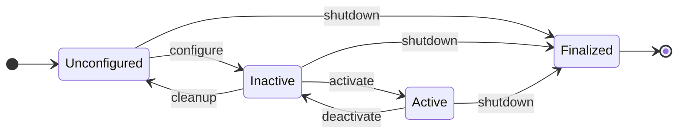
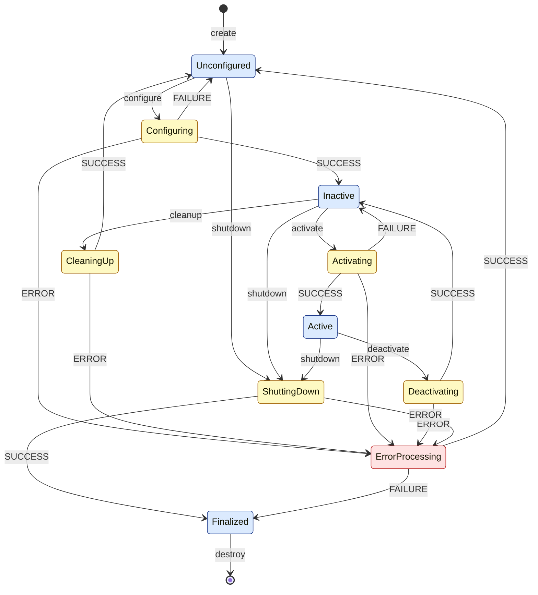

<!--

author:   Sebastian Zug & Georg Jäger & Claude.ai & Claude Code (Opus 5.5) mit LiaScript Teaching-Agent
email:    sebastian.zug@informatik.tu-freiberg.de & Georg.Jaeger@informatik.tu-freiberg.de
version:  0.1.0
language: de
narrator: Deutsch Female

import:   https://raw.githubusercontent.com/TUBAF-IfI-LiaScript/VL_SoftwareprojektRobotik/refs/heads/master/config.md
          https://raw.githubusercontent.com/liaTemplates/mermaid_template/master/README.md

-->

[](https://liascript.github.io/course/?https://raw.githubusercontent.com/TUBAF-IfI-LiaScript/VL_SoftwareprojektRobotik/refs/heads/master/04_ROS_Pakete_Tools/04_ROS_Pakete.md)

# ROS 2 Pakete

| Parameter            | Kursinformationen                                                                                                      |
| -------------------- | ---------------------------------------------------------------------------------------------------------------------- |
| **Veranstaltung:**   | @config.lecture                                                                                                        |
| **Semester**         | @config.semester                                                                                                       |
| **Hochschule:**      | `Technische Universität Freiberg`                                                                                      |
| **Inhalte:**         | `Eigene ROS-2-Pakete anlegen und bauen, eigene Nachrichtentypen, Launch-Dateien, Logging, verteilte Systeme`           |
| **Link auf GitHub:** | https://github.com/TUBAF-IfI-LiaScript/VL_SoftwareprojektRobotik/blob/master/04_ROS_Pakete_Tools/04_ROS_Pakete.md     |
| **Autoren**          | @author                                                                                                                |


--------------------------------------------------------------------------------

**Zielstellung der heutigen Veranstaltung**

In VL 2 haben wir fertige Knoten gestartet und untersucht. Heute schreiben wir eigene — so, wie Sie später Ihre Spurerkennung und Ihr Fahrverhalten für den TurtleBot umsetzen.

+ Aufbau eines ROS-2-Pakets und eines Workspace erklären
+ Pakete in C++ und Python anlegen, mit `colcon` bauen und starten
+ Einen eigenen Nachrichtentyp definieren und in beiden Sprachen verwenden
+ Mehrere Knoten mit einer Launch-Datei gemeinsam starten und konfigurieren
+ Log-Ausgaben gezielt einsetzen und ROS 2 über mehrere Rechner betreiben
+ Verwaltete Knoten mit Lebenszyklus verstehen und steuern

--------------------------------------------------------------------------------

## Vom Beispiel zum eigenen Paket

Bisher haben wir mit `ros2 run` Programme gestartet, die mit ROS 2 installiert wurden. Für das Projekt brauchen Sie eigene Knoten — eine Spurerkennung, eine Ampelerkennung, ein Fahrverhalten. Damit ROS diese finden, bauen und starten kann, müssen sie in **Paketen** organisiert sein.

Ein Paket ist ein Ordner mit zusammengehörigem Code und einer Beschreibung, die ROS lesen kann. Es enthält

+ den Quellcode der Knoten (C++ oder Python),
+ eine Liste der Abhängigkeiten, also anderer Pakete, die gebraucht werden,
+ die Anweisungen zum Bauen,
+ bei Bedarf eigene Nachrichtentypen und Launch-Dateien.

Welche Pakete installiert sind, verrät `ros2 pkg list`. Wie fein sollte man ein System in Pakete aufteilen? Einige Grundsätze aus dem Software-Engineering helfen:

+ Jedes Paket hat **eine** Aufgabe — die Spurerkennung weiß nichts vom Motor.
+ Pakete sind nur über Nachrichten gekoppelt, nicht über gemeinsamen Code.
+ Was in einem anderen Projekt wiederverwendbar sein soll (z.B. eigene Nachrichtentypen), kommt in ein eigenes Paket.

### Workspace und Paketstruktur

Pakete liegen in einem **Workspace**, einem Arbeitsordner mit dem Unterordner `src`. Angelegt ist er mit einem Befehl:

```bash
mkdir -p ~/ros2_ws/src      # -p legt auch den übergeordneten Ordner an (Ü 1)
```

Ein Workspace kann viele Pakete enthalten — C++ und Python gemischt. Am Ende dieser Vorlesung sieht unserer so aus:

```text
ros2_ws/
└── src/
    ├── my_msg_package/          ← C++/CMake-Paket (Nachrichtentyp)
    │   ├── CMakeLists.txt
    │   ├── package.xml
    │   └── msg/MyMsg.msg
    ├── my_tutorial_package/     ← C++-Paket (Knoten)
    │   ├── CMakeLists.txt
    │   ├── package.xml
    │   ├── src/data_generator.cpp
    │   └── launch/counter.launch.py
    └── my_python_subscriber/    ← Python-Paket (Knoten)
        ├── package.xml
        ├── setup.py
        ├── setup.cfg
        ├── resource/my_python_subscriber
        └── my_python_subscriber/data_receiver.py
```

Zwei Dateien sind in jedem C++-Paket Pflicht:

+ `package.xml` — Name, Version, Autor, Lizenz und **Abhängigkeiten** des Pakets
+ `CMakeLists.txt` — wie das Paket gebaut wird (bei Python-Paketen übernimmt das `setup.py`)

Beim Bauen legt `colcon` neben `src` drei weitere Ordner an:

+ `build/` — Zwischendateien des Compilers
+ `install/` — die fertigen Programme und das Skript `setup.bash`
+ `log/` — Protokolle jedes Build-Vorgangs

> Diese drei Ordner gehören nicht in Git. Sie lassen sich jederzeit neu erzeugen.

## Bauen mit colcon

Warum reicht nicht einfach `g++ main.cpp`? Bei einem einzelnen Programm würde das genügen. In einem Workspace hängen Pakete aber voneinander ab: Der Knoten in `my_tutorial_package` braucht den Nachrichtentyp aus `my_msg_package`, der vorher in C++- und Python-Code übersetzt werden muss. Ein Build-Werkzeug muss also

+ die Abhängigkeiten aller Pakete erkennen und eine Reihenfolge festlegen,
+ jedes Paket mit seinem eigenen Build-System bauen (CMake für C++, setuptools für Python),
+ die Ergebnisse so installieren, dass ROS sie findet.

ROS 2 teilt diese Aufgabe auf zwei Werkzeuge auf:

<!-- data-type="none" -->
| Werkzeug   | Ebene          | Aufgabe                                                                            |
| :--------- | :------------- | :--------------------------------------------------------------------------------- |
| **ament**  | ein Paket      | Build-Regeln für ein einzelnes Paket: `ament_cmake` (C++) oder `ament_python`      |
| **colcon** | ganzer Workspace | baut alle Pakete in der richtigen Reihenfolge und erzeugt `install/setup.bash`  |

Gebaut wird immer im Wurzelordner des Workspace, nicht in `src`:

```bash
cd ~/ros2_ws
source /opt/ros/jazzy/setup.bash
colcon build --symlink-install
```

Danach muss die Shell den neuen Inhalt kennen. Wie in Ü 1 bei `source /opt/ros/jazzy/setup.bash` erweitert `install/setup.bash` die Umgebungsvariablen — diesmal um Ihre eigenen Pakete:

```bash
source ~/ros2_ws/install/setup.bash
```

> **Merke:** Erst ROS laden, dann bauen, dann den Workspace laden — und das in **jedem neuen Terminal** erneut. Ein neues Terminal startet in Ihrem Home-Verzeichnis; der relative Pfad `source install/setup.bash` funktioniert nur, wenn Sie vorher mit `cd ~/ros2_ws` in den Workspace gewechselt sind. Mit dem vollständigen Pfad `~/ros2_ws/install/setup.bash` sind Sie auf der sicheren Seite.

Zwei nützliche Optionen:

+ `--symlink-install` legt in `install/` nur Verweise (_Links_) auf Ihre Python- und Launch-Dateien an, statt sie zu kopieren. Änderungen am Code wirken dann sofort, ohne neuen Build. Ändern Sie dagegen `setup.py`, `package.xml` oder C++-Code, müssen Sie neu bauen.
+ `--packages-select <paket>` baut nur das genannte Paket — spart Zeit, wenn Sie nur an einem Paket arbeiten.

**Kurze Kontrolle:** Sie haben `colcon build` erfolgreich ausgeführt, aber `ros2 run my_tutorial_package data_generator` meldet `Package 'my_tutorial_package' not found`. Was fehlt?

[( )] Das Paket muss zusätzlich mit `sudo apt install` installiert werden.
[(X)] In diesem Terminal wurde `source install/setup.bash` nicht ausgeführt.
[( )] `colcon build` muss im Ordner `src` aufgerufen werden.
***
`colcon build` legt die Programme in `install/` ab. Welche Pakete `ros2` kennt, steht aber in den Umgebungsvariablen der Shell — erst `source install/setup.bash` trägt den Workspace dort ein. Das gilt für jedes Terminal einzeln (vgl. Ü 1).
***

## Ein eigenes Paket Schritt für Schritt

Wir erweitern das Publisher/Subscriber-Beispiel aus VL 2. Statt eines Textes soll der Zählwert als Zahl übertragen werden, zusammen mit einem Kommentar. Dazu brauchen wir

1. einen eigenen Nachrichtentyp (Paket `my_msg_package`),
2. einen Publisher in C++ (Paket `my_tutorial_package`),
3. einen Subscriber in Python (Paket `my_python_subscriber`).

Den vollständigen, unter Jazzy getesteten Code finden Sie im Repository unter [04_ROS_Pakete_Tools/example](https://github.com/TUBAF-IfI-LiaScript/VL_SoftwareprojektRobotik/tree/master/04_ROS_Pakete_Tools/example/pkg_example).

### Schritt 1: Eigener Nachrichtentyp

Neue Pakete legt `ros2 pkg create` an. Wir starten im Ordner `src` des Workspace:

```text
> cd ~/ros2_ws/src
> ros2 pkg create my_msg_package --build-type ament_cmake --license MIT
going to create a new package
package name: my_msg_package
...
build type: ament_cmake
dependencies: []
creating folder ./my_msg_package
creating ./my_msg_package/package.xml
creating source and include folder
creating folder ./my_msg_package/src
creating folder ./my_msg_package/include/my_msg_package
creating ./my_msg_package/CMakeLists.txt
```

Im Paket legen wir einen Ordner `msg` an (`mkdir ~/ros2_ws/src/my_msg_package/msg`) und darin die Datei `MyMsg.msg`. Sie beschreibt die Felder der Nachricht — ein Feld pro Zeile, erst der Typ, dann der Name, optional ein Standardwert:

```text  msg/MyMsg.msg
int32 counter
string comment "Keine Evaluation des Wertes"
```

Aus dieser Beschreibung muss beim Bauen C++- und Python-Code entstehen. Das erledigt ein Code-Generator von ROS, das Paket `rosidl_default_generators`. Wir tragen ihn in die `CMakeLists.txt` ein — direkt nach der Zeile `find_package(ament_cmake REQUIRED)` und in jedem Fall vor der letzten Zeile `ament_package()`:

```cmake  CMakeLists.txt
find_package(rosidl_default_generators REQUIRED)

rosidl_generate_interfaces(${PROJECT_NAME}
  "msg/MyMsg.msg"
)
```

und in die `package.xml`, innerhalb von `<package>` und vor dem Abschnitt `<export>`:

```xml  package.xml
<buildtool_depend>rosidl_default_generators</buildtool_depend>
<exec_depend>rosidl_default_runtime</exec_depend>
<member_of_group>rosidl_interface_packages</member_of_group>
```

Die `package.xml` unterscheidet, **wofür** eine Abhängigkeit gebraucht wird: `buildtool_depend` nur zum Bauen (der Generator), `exec_depend` nur zur Laufzeit, `depend` für beides — das ist der Normalfall. `member_of_group` meldet das Paket als Nachrichtenpaket an.

Bauen und testen — noch ganz ohne eigenen Knoten, nur mit der Kommandozeile:

```text
> cd ~/ros2_ws
> colcon build --symlink-install
Starting >>> my_msg_package
Finished <<< my_msg_package [5.07s]

Summary: 1 package finished [5.22s]
> source install/setup.bash
> ros2 interface show my_msg_package/msg/MyMsg
int32 counter
string comment "Keine Evaluation des Wertes"
> ros2 topic pub --rate 2 /counter my_msg_package/msg/MyMsg "{counter: 8}"
```

```text
# zweites Terminal
> source /opt/ros/jazzy/setup.bash
> source ~/ros2_ws/install/setup.bash
> ros2 topic echo --once /counter
counter: 8
comment: Keine Evaluation des Wertes
---
```

Das Feld `comment` haben wir beim Senden nicht angegeben — es enthält trotzdem den Standardwert aus der `.msg`-Datei.

> **Stolperfalle:** Starten Sie `ros2 topic echo` für einen eigenen Nachrichtentyp, bevor ein Publisher läuft, meldet ROS `Could not determine the type for the passed topic`. Starten Sie dann zuerst den Publisher oder geben Sie den Typ mit an: `ros2 topic echo /counter my_msg_package/msg/MyMsg`.

Eine ausführliche Anleitung, auch zu eigenen Service-Typen, bietet das Tutorial [Creating custom msg and srv files](https://docs.ros.org/en/jazzy/Tutorials/Beginner-Client-Libraries/Custom-ROS2-Interfaces.html).

### Schritt 2: Publisher in C++

Das Paket für den Knoten legen wir gleich mit seinen Abhängigkeiten und einem Programmgerüst an:

```text
> cd ~/ros2_ws/src
> ros2 pkg create my_tutorial_package --build-type ament_cmake --license MIT --node-name data_generator --dependencies rclcpp my_msg_package
...
dependencies: ['rclcpp', 'my_msg_package']
node_name: data_generator
...
creating ./my_tutorial_package/src/data_generator.cpp
```

Durch `--dependencies` stehen die Abhängigkeiten bereits in beiden Beschreibungsdateien:

```xml  package.xml
<depend>rclcpp</depend>
<depend>my_msg_package</depend>
```

```cmake  CMakeLists.txt
find_package(rclcpp REQUIRED)
find_package(my_msg_package REQUIRED)

add_executable(data_generator src/data_generator.cpp)
ament_target_dependencies(data_generator "rclcpp" "my_msg_package")

install(TARGETS data_generator
  DESTINATION lib/${PROJECT_NAME})
```

CMake ist das Build-System für C++, das hinter `ament_cmake` steckt. Die Befehle im Überblick:

<!-- data-type="none" -->
| CMake-Befehl                  | Bedeutung                                                                     |
| :---------------------------- | :---------------------------------------------------------------------------- |
| `find_package(xyz REQUIRED)`  | Paket `xyz` suchen; Abbruch mit Fehlermeldung, wenn es nicht installiert ist  |
| `add_executable(name datei)`  | aus der Quelldatei ein Programm `name` kompilieren                            |
| `ament_target_dependencies`   | dem Programm die Header und Bibliotheken der genannten Pakete bereitstellen   |
| `install(TARGETS ...)`        | das fertige Programm nach `install/` kopieren, damit `ros2 run` es findet      |

Das Gerüst `data_generator.cpp` ersetzen wir durch den Publisher aus VL 2 — mit zwei Änderungen: dem neuen Nachrichtentyp und dem Topic `counter`.

```cpp  data_generator.cpp
#include <chrono>
#include <memory>

#include "rclcpp/rclcpp.hpp"
#include "my_msg_package/msg/my_msg.hpp"      // aus MyMsg.msg generiert

using namespace std::chrono_literals;

class DataGenerator : public rclcpp::Node
{
public:
  DataGenerator()
  : Node("data_generator"), count_(0)
  {
    publisher_ = this->create_publisher<my_msg_package::msg::MyMsg>("counter", 10);
    timer_ = this->create_wall_timer(
      500ms, std::bind(&DataGenerator::timer_callback, this));
  }

private:
  void timer_callback()
  {
    auto message = my_msg_package::msg::MyMsg();
    message.counter = count_++;
    RCLCPP_INFO(this->get_logger(), "Publishing: %d, %s",
      message.counter, message.comment.c_str());
    publisher_->publish(message);
  }
  rclcpp::TimerBase::SharedPtr timer_;
  rclcpp::Publisher<my_msg_package::msg::MyMsg>::SharedPtr publisher_;
  int32_t count_;
};

int main(int argc, char * argv[])
{
  rclcpp::init(argc, argv);
  rclcpp::spin(std::make_shared<DataGenerator>());
  rclcpp::shutdown();
  return 0;
}
```

Beachten Sie den Zusammenhang der Namen: Aus der Datei `MyMsg.msg` im Paket `my_msg_package` wird der Header `my_msg_package/msg/my_msg.hpp` und der C++-Typ `my_msg_package::msg::MyMsg`. Die Felder `counter` und `comment` sind ganz normale Membervariablen.

### Schritt 3: Subscriber in Python

Python-Pakete werden mit `--build-type ament_python` angelegt:

```text
> ros2 pkg create my_python_subscriber --build-type ament_python --license MIT --dependencies rclpy my_msg_package
...
creating ./my_python_subscriber/setup.py
creating ./my_python_subscriber/setup.cfg
creating folder ./my_python_subscriber/resource
creating ./my_python_subscriber/resource/my_python_subscriber
creating ./my_python_subscriber/my_python_subscriber/__init__.py
...
```

Den Knoten legen wir in den inneren Ordner, der wie das Paket heißt: `my_python_subscriber/my_python_subscriber/data_receiver.py`.

```python  data_receiver.py
import rclpy
from rclpy.node import Node

from my_msg_package.msg import MyMsg


class DataReceiver(Node):

    def __init__(self):
        super().__init__('data_receiver')
        self.subscription = self.create_subscription(
            MyMsg, 'counter', self.listener_callback, 10)

    def listener_callback(self, msg):
        self.get_logger().info(f'Received: {msg.counter} ({msg.comment})')


def main(args=None):
    rclpy.init(args=args)
    node = DataReceiver()
    try:
        rclpy.spin(node)
    except KeyboardInterrupt:
        pass
    finally:
        node.destroy_node()
        rclpy.try_shutdown()


if __name__ == '__main__':
    main()
```

Der Aufbau entspricht dem C++-Knoten aus VL 2: eine Klasse, die von `Node` erbt, im Konstruktor (`__init__`) wird mit `create_subscription(Typ, Topic, Callback, Puffergröße)` das Abonnement angelegt, und `rclpy.spin()` wartet auf Nachrichten. `try/finally` sorgt dafür, dass der Knoten auch bei `Ctrl+C` sauber beendet wird.

Anders als in C++ gibt es kein `add_executable`. Stattdessen meldet ein Eintrag in `setup.py` die Funktion `main` als ausführbares Programm `data_receiver` an — das ist der Name, den `ros2 run` erwartet. Die generierte `setup.py` enthält bereits eine **leere** Liste `'console_scripts': []`; ergänzen Sie dort die Zeile, statt einen zweiten Block einzufügen:

```python  setup.py
    entry_points={
        'console_scripts': [
            'data_receiver = my_python_subscriber.data_receiver:main',
        ],
    },
```

Die Abhängigkeit zu `my_msg_package` steht durch `--dependencies` bereits in der `package.xml`. Jetzt bauen wir alle drei Pakete gemeinsam — `colcon` erkennt selbst, dass `my_msg_package` zuerst an der Reihe ist:

```text
> cd ~/ros2_ws
> colcon build --symlink-install
Starting >>> my_msg_package
Finished <<< my_msg_package [0.46s]
Starting >>> my_python_subscriber
Starting >>> my_tutorial_package
Finished <<< my_python_subscriber [1.95s]
Finished <<< my_tutorial_package [4.81s]

Summary: 3 packages finished [5.42s]
```

Die Abhängigkeiten zwischen den Paketen gibt `colcon graph --dot` aus:

```text
> colcon graph --dot
digraph graphname {
  "my_tutorial_package";
  "my_python_subscriber";
  "my_msg_package";
  "my_tutorial_package" -> "my_msg_package" [color="#0000ff:#ff0000"];
  "my_python_subscriber" -> "my_msg_package" [color="#0000ff:#ff0000"];
}
```

Mit dem Werkzeug Graphviz wird daraus ein Bild (`colcon graph --dot | dot -Tpng -o graph.png`):

<!-- width="55%" -->

Test in zwei Terminals (jeweils nach `source /opt/ros/jazzy/setup.bash` und `source ~/ros2_ws/install/setup.bash`):

```text
# Terminal 1
> ros2 run my_tutorial_package data_generator
[INFO] [...] [data_generator]: Publishing: 0, Keine Evaluation des Wertes
[INFO] [...] [data_generator]: Publishing: 1, Keine Evaluation des Wertes
```

```text
# Terminal 2
> ros2 run my_python_subscriber data_receiver
[INFO] [...] [data_receiver]: Received: 1 (Keine Evaluation des Wertes)
[INFO] [...] [data_receiver]: Received: 2 (Keine Evaluation des Wertes)
```

Ein C++-Knoten und ein Python-Knoten tauschen also problemlos einen selbst definierten Nachrichtentyp aus. Warum empfängt der Subscriber erst ab 1? Er wurde nach dem Publisher gestartet — Nachrichten, die vor seinem Start gesendet wurden, verpasst er. Topics sind ein Live-Strom, keine Ablage.

**C++- und Python-Pakete im Vergleich**

<!-- data-type="none" -->
| Aspekt                  | C++ (`ament_cmake`)                     | Python (`ament_python`)                      |
| :---------------------- | :-------------------------------------- | :------------------------------------------- |
| Build-Beschreibung      | `CMakeLists.txt`                        | `setup.py`, `setup.cfg`                      |
| Quellcode-Ordner        | `src/`, `include/`                      | `<paketname>/`                               |
| Programm anmelden       | `add_executable()` + `install()`        | `entry_points` in `setup.py`                 |
| Abhängigkeiten          | `package.xml` (`<depend>`) und `find_package()` | `package.xml` (`<depend>`)           |
| Nachrichtentyp einbinden | `#include "pkg/msg/my_msg.hpp"`        | `from pkg.msg import MyMsg`                  |
| Nach Codeänderung       | neu bauen                               | mit `--symlink-install` sofort wirksam; nach Änderung an `setup.py` neu bauen |

> Eigene Nachrichtentypen definieren Sie immer in einem CMake-Paket — auch wenn alle Knoten in Python geschrieben sind.

**Kurze Kontrolle:** Sie legen im Paket `my_python_subscriber` eine neue Datei `lane_detector.py` mit einem Knoten und einer Funktion `main` an und bauen den Workspace. `ros2 run my_python_subscriber lane_detector` meldet `No executable found`. Was fehlt am wahrscheinlichsten?

[( )] Ein Eintrag `add_executable(lane_detector ...)` in der `CMakeLists.txt`.
[(X)] Ein Eintrag für `lane_detector` unter `console_scripts` in `setup.py` — und danach ein neuer Build.
[( )] Die Abhängigkeit `rclcpp` in der `package.xml`.
***
Python-Pakete haben keine `CMakeLists.txt`; ausführbare Programme werden über `entry_points` in `setup.py` angemeldet. Weil sich damit die Paketbeschreibung ändert, ist ein erneutes `colcon build` nötig — `--symlink-install` hilft nur bei Änderungen am Code selbst.
***

## Systeme starten mit Launch-Dateien

Sie haben gesehen: Für zwei Knoten brauchen wir zwei Terminals, jeweils mit zwei `source`-Befehlen. Unser TurtleBot-System wird aus Kameratreiber, Spurerkennung, Ampelerkennung und Fahrverhalten bestehen — dazu Parameter und Umbenennungen. Das von Hand zu starten ist fehleranfällig.

Eine **Launch-Datei** beschreibt, welche Knoten mit welchen Einstellungen gestartet werden. ROS 2 akzeptiert Launch-Dateien in Python, XML oder YAML; wir verwenden Python. Unsere Datei startet Publisher und Subscriber gemeinsam und erlaubt, den Topic-Namen beim Start festzulegen:

```python  launch/counter.launch.py
from launch import LaunchDescription
from launch.actions import DeclareLaunchArgument
from launch.substitutions import LaunchConfiguration
from launch_ros.actions import Node


def generate_launch_description():
    topic = LaunchConfiguration('topic')
    return LaunchDescription([
        DeclareLaunchArgument('topic', default_value='counter',
                              description='Name des Topics für die Zählwerte'),
        Node(package='my_tutorial_package', executable='data_generator',
             remappings=[('counter', topic)], output='screen'),
        Node(package='my_python_subscriber', executable='data_receiver',
             remappings=[('counter', topic)], output='screen'),
    ])
```

| Element                   | Bedeutung                                                                                     |
| :------------------------ | :-------------------------------------------------------------------------------------------- |
| `generate_launch_description()` | Diese Funktion ruft `ros2 launch` auf; sie gibt die Liste der zu startenden Elemente zurück. |
| `DeclareLaunchArgument`   | ein Argument, das beim Start überschrieben werden kann, hier mit Standardwert `counter`       |
| `Node(...)`               | ein Knoten: Paket, Programm und Einstellungen                                                  |
| `LaunchConfiguration('topic')` | Platzhalter für den Wert des Arguments `topic` — wird erst beim Start eingesetzt          |
| `remappings`              | Umbenennung wie `--ros-args -r counter:=...` in VL 2                                           |
| `output='screen'`         | Logausgaben des Knotens im Terminal anzeigen                                                   |

Die Datei liegt im Ordner `launch` des Pakets `my_tutorial_package` (`mkdir ~/ros2_ws/src/my_tutorial_package/launch`). Eine Launch-Datei darf Knoten aus beliebigen Paketen starten — sie müssen nur gebaut und per `source` bekannt sein. In größeren Projekten legt man dafür oft ein eigenes Paket an, z.B. `verkehrswelt_bringup`.

Damit die Launch-Datei beim Bauen mit installiert wird, ergänzen wir in der `CMakeLists.txt` von `my_tutorial_package` vor `ament_package()`:

```cmake  CMakeLists.txt
install(DIRECTORY launch
  DESTINATION share/${PROJECT_NAME})
```

Nach `colcon build` startet **ein** Befehl das ganze System:

```text
> ros2 launch my_tutorial_package counter.launch.py
[INFO] [launch]: All log files can be found below /home/.../.ros/log/...
[INFO] [data_generator-1]: process started with pid [202935]
[INFO] [data_receiver-2]: process started with pid [202936]
[data_generator-1] [INFO] [...] [data_generator]: Publishing: 0, Keine Evaluation des Wertes
[data_receiver-2] [INFO] [...] [data_receiver]: Received: 0 (Keine Evaluation des Wertes)
...
> ros2 launch my_tutorial_package counter.launch.py topic:=zaehler
```

Mit `topic:=zaehler` senden beide Knoten über `/zaehler` — prüfen Sie es mit `ros2 topic list`. Welche Argumente eine Launch-Datei kennt, zeigt `ros2 launch my_tutorial_package counter.launch.py --show-args`.

**Kurze Kontrolle:** Sie entfernen in der Launch-Datei die Zeile `remappings=[('counter', topic)]` beim **Subscriber** und starten mit `topic:=zaehler`. Was passiert?

[( )] Beide Knoten verwenden weiterhin `/zaehler`.
[(X)] Der Publisher sendet auf `/zaehler`, der Subscriber wartet auf `/counter` — er empfängt nichts.
[( )] `ros2 launch` bricht mit einer Fehlermeldung ab.
***
Das Remapping gilt nur für den Knoten, bei dem es eingetragen ist. Der Subscriber benutzt den Namen aus seinem Code, `counter`. Beide Knoten laufen fehlerfrei, sind aber nicht verbunden — ein typischer Fehler, den `ros2 topic info` oder `rqt_graph` sofort sichtbar machen.
***

Launch-Dateien können noch mehr: andere Launch-Dateien einbinden (`IncludeLaunchDescription`), Parameter aus YAML-Dateien laden, Knoten zeitverzögert starten (`TimerAction`) oder abhängig von Bedingungen. Beispiele zeigt das Tutorial [Launch](https://docs.ros.org/en/jazzy/Tutorials/Intermediate/Launch/Launch-Main.html). Der TurtleBot selbst wird über die Launch-Datei `robot.launch.py` des Pakets `turtlebot3_bringup` gestartet — schauen Sie im ersten Praktikum hinein.

## Logging

Statt `printf` oder `print` nutzen ROS-Knoten den eingebauten Logger, der den Namen des Knotens trägt: `RCLCPP_INFO(...)` in C++, `self.get_logger().info(...)` in Python. Das hat Vorteile: Jede Meldung trägt Zeitstempel und Knotennamen, sie landet zusätzlich in Logdateien und auf dem Topic `/rosout`, und sie hat einen **Schweregrad**:

`DEBUG` < `INFO` < `WARN` < `ERROR` < `FATAL`

Beim Start lässt sich festlegen, ab welchem Schweregrad Meldungen erscheinen — ohne den Code zu ändern:

```bash
ros2 run my_tutorial_package data_generator --ros-args --log-level warn                  # nur noch Warnungen und Fehler
ros2 run my_tutorial_package data_generator --ros-args --log-level data_generator:=debug # Debug-Meldungen nur dieses Knotens
```

> **Stolperfalle:** `--log-level debug` ohne Knotennamen schaltet auch die internen Debug-Meldungen von ROS selbst frei — das Terminal wird mit Hunderten Zeilen geflutet. Geben Sie deshalb den Namen des Loggers an, hier `data_generator`.

Für C++ stellt `rclcpp` Varianten der Makros bereit, die Ausgaben filtern ([Doku: Logging](https://docs.ros.org/en/jazzy/Concepts/Intermediate/About-Logging.html)). `x` steht für den Schweregrad, z.B. `RCLCPP_WARN_ONCE`:

<!-- data-type="none" -->
| Makro                  | Zusätzliche Argumente      | Ausgabe erfolgt …                                        |
| :--------------------- | :------------------------- | :------------------------------------------------------- |
| `RCLCPP_x`             | —                          | bei jedem Aufruf                                         |
| `RCLCPP_x_ONCE`        | —                          | nur beim ersten Aufruf                                   |
| `RCLCPP_x_SKIPFIRST`   | —                          | bei jedem Aufruf außer dem ersten                        |
| `RCLCPP_x_EXPRESSION`  | Bedingung                  | nur, wenn die Bedingung wahr ist                         |
| `RCLCPP_x_THROTTLE`    | Uhr, Zeitspanne in ms      | höchstens einmal pro Zeitspanne                          |

```cpp  Logging.cpp
// erscheint nur beim ersten Durchlauf
RCLCPP_INFO_ONCE(this->get_logger(), "Timer läuft");
// nur gerade Zählwerte, und nur bei --log-level debug
RCLCPP_DEBUG_EXPRESSION(this->get_logger(), (count_ % 2) == 0, "Zählwert %d ist gerade", count_);
// höchstens alle 2 Sekunden; *this->get_clock() übergibt die Uhr des Knotens
RCLCPP_WARN_THROTTLE(this->get_logger(), *this->get_clock(), 2000, "Kein Bild empfangen");
```

Gerade die letzte Variante ist im Projekt wichtig: Ein Knoten, der 30-mal pro Sekunde „Keine Spur erkannt“ meldet, macht das Terminal unlesbar.

> **Aufgabe:** Ändern Sie den `data_generator` so, dass die Logmeldung nur noch alle 10 Sekunden erscheint, die Nachrichten aber weiter zweimal pro Sekunde gesendet werden.

<details>
<summary>Lösung anzeigen</summary>

```cpp
RCLCPP_INFO_THROTTLE(this->get_logger(), *this->get_clock(), 10000,
  "Publishing: %d, %s", message.counter, message.comment.c_str());
```

Nach der Änderung muss das C++-Paket neu gebaut werden (`colcon build --packages-select my_tutorial_package`).

</details>

## ROS 2 auf mehreren Rechnern

Im Praktikum läuft Ihr System verteilt: Auf dem Raspberry Pi des TurtleBot laufen die Treiber für LiDAR, Kamera und Motoren, auf Ihrem Laptop Ihre eigenen Knoten und die Visualisierung. Programmieren müssen Sie dafür nichts — dank Discovery (VL 2) finden sich die Knoten im Netz von selbst, wenn beide Rechner im selben Netz sind und **dieselbe `ROS_DOMAIN_ID`** verwenden.

Jede Gruppe bekommt eine eigene ID (0 bis 101), damit Ihr Laptop nicht die Fahrbefehle für den Roboter der Nachbargruppe sendet:

```bash
export ROS_DOMAIN_ID=12      # auf dem Laptop UND auf dem TurtleBot
ros2 topic list              # zeigt jetzt /scan, /odom, /cmd_vel ... des eigenen Roboters
```

Zu Hause wollen Sie dagegen niemanden im WLAN stören: Mit `export ROS_AUTOMATIC_DISCOVERY_RANGE=LOCALHOST` sucht ROS 2 nur auf dem eigenen Rechner nach Knoten.

> **WSL2:** WSL2 hat standardmäßig ein eigenes, internes Netz, aus dem heraus der TurtleBot nicht sichtbar ist. Die Umstellung auf den gespiegelten Netzwerkmodus richten wir gemeinsam im ersten Praktikum ein. Für alle Übungen auf dem eigenen Rechner ist nichts zu tun.

## Ausblick: Daten aufzeichnen

Mit `ros2 bag` zeichnen Sie Nachrichten auf und spielen sie später wieder ab. So können Sie Ihre Spurerkennung am Schreibtisch mit immer denselben Kamerabildern testen, ohne den Roboter aufzubauen. Ein Beispiel mit unserem Zähler:

```text
> ros2 bag record -o zaehler_bag /counter
...
> ros2 bag info zaehler_bag
Files:             zaehler_bag_0.mcap
Bag size:          5.3 KiB
Storage id:        mcap
ROS Distro:        jazzy
Duration:          3.999984206s
Messages:          9
Topic information: Topic: /counter | Type: my_msg_package/msg/MyMsg | Count: 9 | Serialization Format: cdr
> ros2 bag play zaehler_bag
```

Wählen Sie die aufgezeichneten Topics bewusst aus: Eine RGB-D-Kamera erzeugte in einem früheren Durchgang dieser Veranstaltung in **12 Sekunden** über **1 GB** Daten. Wie Sie für den TurtleBot sinnvoll aufzeichnen und die Daten auswerten, üben wir im Praktikum P 1.

## Knoten mit Lebenszyklus

Unsere bisherigen Knoten legen los, sobald sie gestartet sind. Bei einem echten Roboter ist das problematisch: Das Fahrverhalten sollte erst Befehle senden, wenn Kamera, Spurerkennung und Lokalisierung bereit sind. Und wenn die Kamera ausfällt, soll die Spurerkennung pausieren — nicht abstürzen und neu gestartet werden müssen.

ROS 2 bietet dafür **verwaltete Knoten** (_managed_ oder _lifecycle nodes_). Sie durchlaufen einen festen Zustandsautomaten und wechseln den Zustand nur auf Anweisung von außen:



Vereinfachte Darstellung nach dem [Design-Dokument](https://design.ros2.org/articles/node_lifecycle.html) von Geoffrey Biggs und Tully Foote

<!-- data-type="none" -->
| Zustand        | Bedeutung                                                         | Beispiel Spurerkennung                       |
| :------------- | :---------------------------------------------------------------- | :------------------------------------------- |
| `Unconfigured` | Knoten existiert, hat aber noch nichts vorbereitet                | gerade gestartet                             |
| `Inactive`     | konfiguriert, Ressourcen angelegt, verarbeitet aber nichts        | Parameter geladen, Publisher angelegt        |
| `Active`       | arbeitet normal                                                   | wertet Bilder aus, sendet Ergebnisse         |
| `Finalized`    | beendet, kann nur noch zerstört werden                            | Programmende                                 |

Die Übergänge heißen `configure`, `activate`, `deactivate`, `cleanup` und `shutdown`. Bei jedem Übergang ruft ROS eine Methode des Knotens auf — `on_configure()`, `on_activate()` usw. —, in der Sie festlegen, was passieren soll. Während diese Methode läuft, befindet sich der Knoten kurz in einem **Übergangszustand** wie `configuring` oder `activating`; das vollständige Diagramm unten zeigt auch diese Zwischenzustände und die Fehlerbehandlung.

<details>
<summary>Vollständiger Zustandsautomat mit Übergangszuständen anzeigen (zum Nachlesen, nicht zum Auswendiglernen)</summary>



Blau: Hauptzustände, gelb: Übergangszustände, in denen die `on_…`-Methode läuft, rot: Fehlerbehandlung. `SUCCESS`, `FAILURE` und `ERROR` sind die Rückgabewerte der `on_…`-Methode. Nach dem [Design-Dokument](https://design.ros2.org/articles/node_lifecycle.html) von Geoffrey Biggs und Tully Foote.

</details>

### Ausprobieren mit dem Demo

ROS 2 bringt ein Beispiel mit: einen verwalteten Publisher `lc_talker` und einen Subscriber `lc_listener`, der die Zustandswechsel mitprotokolliert. Starten Sie beide in zwei Terminals:

```bash
ros2 run lifecycle lifecycle_talker      # Terminal 1
ros2 run lifecycle lifecycle_listener    # Terminal 2
```

Im dritten Terminal steuern Sie den Talker:

```text
> ros2 lifecycle get /lc_talker
unconfigured [1]
> ros2 lifecycle list /lc_talker
- configure [1]
	Start: unconfigured
	Goal: configuring
- shutdown [5]
	Start: unconfigured
	Goal: shuttingdown
> ros2 lifecycle set /lc_talker configure
Transitioning successful
> ros2 lifecycle set /lc_talker activate
Transitioning successful
> ros2 lifecycle get /lc_talker
active [3]
```

`ros2 lifecycle list` zeigt, welche Übergänge im aktuellen Zustand erlaubt sind und in welchen Übergangszustand sie führen (`Goal`). Die Zahlen in eckigen Klammern sind die internen IDs der Zustände bzw. Übergänge — Sie können sie ignorieren.

Beobachten Sie dabei die Terminals 1 und 2:

+ Nach `configure` existiert das Topic bereits (`ros2 topic list` zeigt `/lifecycle_chatter`), aber der Talker meldet `Messages are not published`.
+ Erst nach `activate` kommen beim Listener Nachrichten an: `data_callback: Lifecycle HelloWorld #5`.
+ Mit `ros2 lifecycle set /lc_talker deactivate` pausiert der Talker wieder — der Prozess läuft weiter, `ros2 lifecycle get /lc_talker` meldet `inactive [2]`.

### Ein eigener verwalteter Knoten

So sieht das Prinzip in Python aus — eine Spurerkennung, die vorerst nur einen Text sendet. Der Knoten erbt von `LifecycleNode` statt von `Node` und legt seine Ressourcen erst in `on_configure()` an. Ein _Lifecycle-Publisher_ sendet nur im Zustand `Active`:

```python  lane_detector.py
import rclpy
from rclpy.executors import ExternalShutdownException
from rclpy.lifecycle import LifecycleNode, TransitionCallbackReturn
from std_msgs.msg import String


class LaneDetector(LifecycleNode):

    def __init__(self):
        super().__init__('lane_detector')

    def on_configure(self, state):
        # Ressourcen anlegen: Publisher, Parameter lesen, Kamera öffnen ...
        self.pub = self.create_lifecycle_publisher(String, 'lane', 10)
        self.timer = self.create_timer(1.0, self.detect)
        self.get_logger().info('konfiguriert')
        return TransitionCallbackReturn.SUCCESS

    def on_activate(self, state):
        self.get_logger().info('aktiv — sende Ergebnisse')
        return super().on_activate(state)      # aktiviert den Lifecycle-Publisher

    def on_deactivate(self, state):
        self.get_logger().info('inaktiv — pausiert')
        return super().on_deactivate(state)

    def on_cleanup(self, state):
        self.destroy_timer(self.timer)
        self.destroy_lifecycle_publisher(self.pub)
        return TransitionCallbackReturn.SUCCESS

    def detect(self):
        if self.pub.is_activated:
            self.pub.publish(String(data='Spur erkannt'))


def main():
    rclpy.init()
    node = LaneDetector()
    try:
        rclpy.spin(node)
    except (KeyboardInterrupt, ExternalShutdownException):
        pass
    finally:
        node.destroy_node()
        rclpy.try_shutdown()


if __name__ == '__main__':
    main()
```

Was im Code neu ist:

+ Jede `on_…`-Methode meldet mit `TransitionCallbackReturn.SUCCESS`, dass der Übergang geklappt hat. Mit `FAILURE` lehnt der Knoten ab und bleibt im alten Zustand — etwa wenn in `on_configure()` die Kamera nicht gefunden wird. `ERROR` signalisiert einen schweren Fehler.
+ `on_activate()` und `on_deactivate()` rufen zusätzlich die Methode der Basisklasse auf (`super()`): Sie schaltet alle Lifecycle-Publisher des Knotens ein bzw. aus. In `on_configure()` hat die Basisklasse nichts zu tun.
+ `on_cleanup()` gibt zurück, was `on_configure()` angelegt hat. So lässt sich der Knoten neu konfigurieren, z.B. mit anderen Parametern, ohne ihn neu zu starten.
+ Der Parameter `state` enthält den Zustand vor dem Übergang; wir brauchen ihn hier nicht.
+ Die Abfrage `is_activated` in `detect()` ist streng genommen nicht nötig — ein inaktiver Lifecycle-Publisher verwirft Nachrichten ohnehin. Er schreibt dann aber bei jedem Aufruf eine Warnung ins Terminal; die Abfrage vermeidet das.
+ In `main()` fangen wir zusätzlich `ExternalShutdownException` ab. Sie tritt auf, wenn der Knoten von außen beendet wird, etwa per `shutdown`-Übergang oder durch `ros2 launch`.

Ausprobieren in zwei Terminals:

```bash
python3 lane_detector.py      # Terminal 1 — ein einzelnes Skript lässt sich auch ohne Paket starten
```

```text
# Terminal 2
> ros2 lifecycle set /lane_detector configure
Transitioning successful
> ros2 lifecycle set /lane_detector activate
Transitioning successful
> ros2 topic echo --once /lane
data: Spur erkannt
---
```

**Kurze Kontrolle:** Der Knoten `lane_detector` wurde konfiguriert, aber noch nicht aktiviert. Was zeigt `ros2 topic echo /lane`?

[( )] Jede Sekunde „Spur erkannt“ — der Timer läuft ja bereits.
[(X)] Nichts — der Lifecycle-Publisher sendet erst im Zustand `Active`.
[( )] Eine Fehlermeldung, weil das Topic noch nicht existiert.
***
Der Timer läuft nach `configure` tatsächlich, aber `detect()` prüft `self.pub.is_activated`, und ein Lifecycle-Publisher verwirft Nachrichten im Zustand `Inactive`. Das Topic existiert bereits — deshalb gibt es keine Fehlermeldung, sondern einfach keine Daten.
***

Wer gibt im echten System die Befehle? Niemand tippt `ros2 lifecycle set` von Hand. Ein **Lifecycle-Manager** übernimmt das und bringt alle Knoten in der richtigen Reihenfolge nach `Active`. Genau so arbeitet der Navigations-Stack **Nav2**, den Sie in Block 5 einsetzen: Kartenserver, Lokalisierung, Planer und Regler sind verwaltete Knoten, die der `lifecycle_manager` gemeinsam hochfährt. Wenn dort ein Knoten in `Inactive` hängen bleibt, wissen Sie jetzt, wo Sie suchen müssen.

## Aufgabe der Woche

1. Legen Sie in Ihrer ROS-2-Umgebung (Ü 2) einen Workspace `~/ros2_ws` an und bauen Sie die drei Pakete dieser Vorlesung nach. Prüfen Sie jeden Schritt mit `ros2 interface show`, `ros2 pkg executables` und `ros2 topic echo`.
2. Ergänzen Sie `MyMsg.msg` um ein Feld `float32 temperature` und senden Sie einen Zufallswert. Was müssen Sie neu bauen?
3. Überlegen Sie für die Verkehrswelt: Welche Pakete würden Sie für Spurerkennung, Ampelerkennung und Fahrverhalten anlegen? Wohin gehört ein eigener Nachrichtentyp „Ampelzustand“? Skizzieren Sie Pakete, Knoten und Topics.

**Zum Weiterlesen**

+ [ROS 2 Jazzy: Creating a workspace](https://docs.ros.org/en/jazzy/Tutorials/Beginner-Client-Libraries/Creating-A-Workspace/Creating-A-Workspace.html) und [Creating a package](https://docs.ros.org/en/jazzy/Tutorials/Beginner-Client-Libraries/Creating-Your-First-ROS2-Package.html)
+ [colcon Dokumentation](https://colcon.readthedocs.io/en/released/user/quick-start.html)
