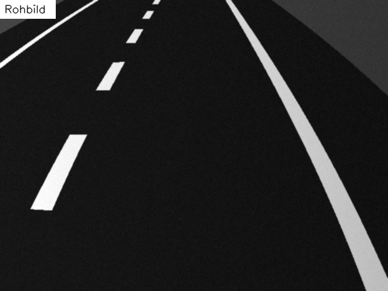
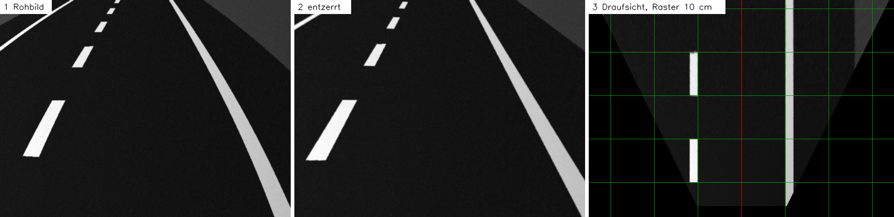
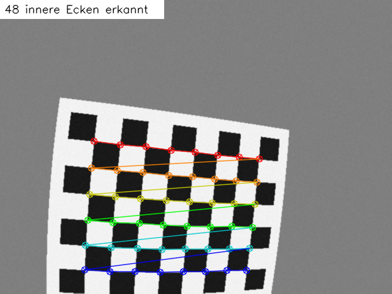
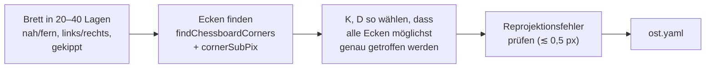
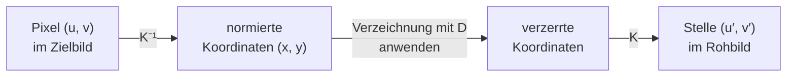
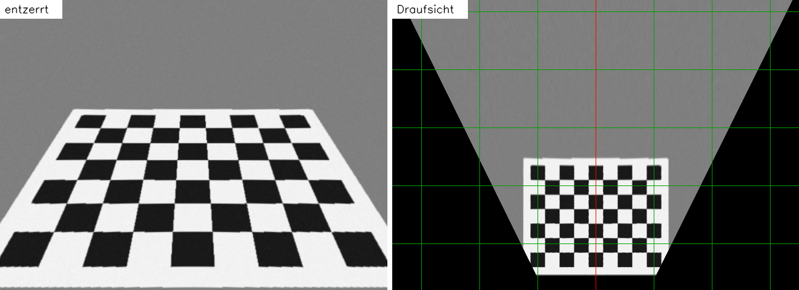
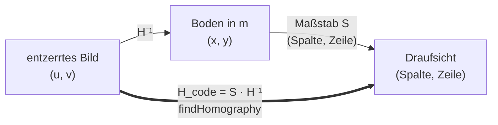
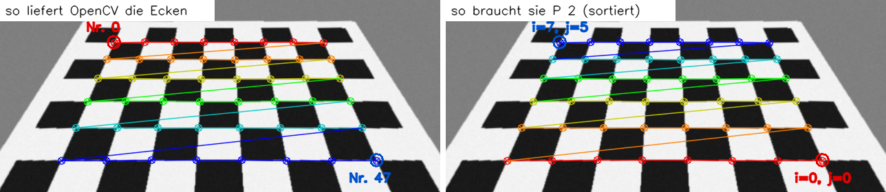
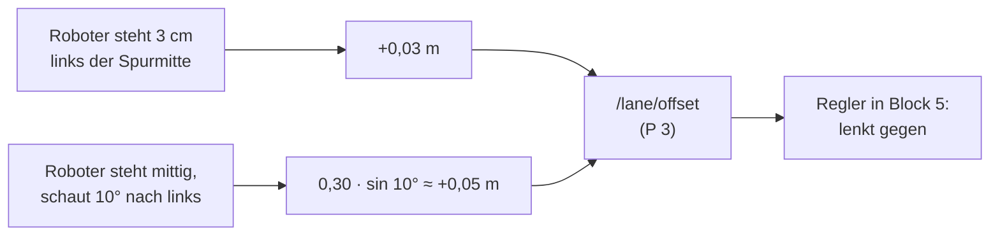

<!--

author:   Sebastian Zug & Claude.ai & Claude Code (Opus 5.5) mit LiaScript Teaching-Agent
email:    sebastian.zug@informatik.tu-freiberg.de & Georg.Jaeger@informatik.tu-freiberg.de
version:  0.2.1
language: de
narrator: Deutsch Female

import:   https://raw.githubusercontent.com/TUBAF-IfI-LiaScript/VL_SoftwareprojektRobotik/refs/heads/master/config.md
          https://raw.githubusercontent.com/liaTemplates/mermaid_template/master/README.md
          https://raw.githubusercontent.com/LiaTemplates/Wikimedia/0.0.2/README.md

-->

[](https://liascript.github.io/course/?https://raw.githubusercontent.com/TUBAF-IfI-LiaScript/VL_SoftwareprojektRobotik/refs/heads/master/06_Kamera/06_Kamera.md)

# Kamera: Modell, Kalibrierung, Draufsicht

| Parameter            | Kursinformationen                                                                                                     |
| -------------------- | --------------------------------------------------------------------------------------------------------------------- |
| **Veranstaltung:**   | @config.lecture                                                                                                       |
| **Semester**         | @config.semester                                                                                                      |
| **Hochschule:**      | `Technische Universität Freiberg`                                                                                     |
| **Inhalte:**         | `Lochkameramodell, Verzeichnung, Kalibrierung, Entzerren, Homographie und Vogelperspektive`                           |
| **Link auf GitHub:** | https://github.com/TUBAF-IfI-LiaScript/VL_SoftwareprojektRobotik/blob/master/06_Kamera/06_Kamera.md |
| **Autoren**          | @author                                                                                                               |

--------------------------------------------------------------------------------

**Zielstellung der heutigen Veranstaltung** — nach dieser Vorlesung können Sie

+ mit der Kamera-Matrix $K$ berechnen, auf welchem Pixel ein Punkt vor der Kamera landet, und erklären, warum dabei die Tiefe verloren geht,
+ die Verzeichnung einer Linse an ihren Koeffizienten erkennen und erklären, warum sie am Bildrand am größten ist,
+ den Ablauf einer Kalibrierung mit dem Schachbrett beschreiben und ihr Ergebnis (`ost.yaml`) auf Plausibilität prüfen,
+ ein Bild mit vorab berechneten Tabellen entzerren und begründen, warum man die Tabellen nur einmal berechnet,
+ mit einer Homographie aus Punktpaaren eine maßstäbliche Draufsicht auf den Boden erzeugen, ihre Grenzen benennen und darin die Abweichung von der Spurmitte mit Vorausschau ablesen.

<!-- kurslandkarte:knopf-start -->

<a href="https://tubaf-ifi-liascript.github.io/VL_SoftwareprojektRobotik/kurslandkarte/#termin=06" style="display: inline-block; padding: 0.5em 1.1em; background-color: #00718A; color: #ffffff; text-decoration: none; font-family: 'IBM Plex Sans', 'Segoe UI', system-ui, sans-serif; font-weight: 600;">🗺️ Diese Vorlesung in der Kurslandkarte →</a>

<!-- kurslandkarte:knopf-ende -->

--------------------------------------------------------------------------------

<!-- kurslandkarte:wo-start -->

## Wo stehen wir?

    --{{0}}--
Kurz zur Orientierung. Wir sind in Block 2, Termin 10 von 32. Sie schließen von einem Pixel auf eine Richtung in der Welt – dafür muss die Kamera kalibriert sein. Neu sind heute: Kamera-Matrix K, Verzeichnung, Kamerakalibrierung, Homographie, Draufsicht (Vogelperspektive).

**Ziel im Projekt:** Sie schließen von einem Pixel auf eine Richtung in der Welt – dafür muss die Kamera kalibriert sein.

**Block 2 · Sensorgrundlagen** – Termin 10 von 32, heute farbig markiert

<!-- data-type="none" -->
| Woche | Vorlesung | Übung | Praktikum |
| :-- | :-- | :-- | :-- |
| KW 49 · 30.11.–4.12. | [VL 04 Sensorik](https://liascript.github.io/course/?https://raw.githubusercontent.com/TUBAF-IfI-LiaScript/VL_SoftwareprojektRobotik/master/04_Sensorik/04_Sensorik.md) · Mi 2.12. |  |  |
| **KW 50 · 7.–11.12.**<!-- style="background-color: rgba(255, 166, 0, 0.35); padding: 2px 6px; border-radius: 4px;" --> | [VL 05 Bildverarbeitung](https://liascript.github.io/course/?https://raw.githubusercontent.com/TUBAF-IfI-LiaScript/VL_SoftwareprojektRobotik/master/05_Bildverarbeitung/05_Bildverarbeitung.md) · Mi 9.12.<br>**[VL 06 Kamera + Draufsicht](https://liascript.github.io/course/?https://raw.githubusercontent.com/TUBAF-IfI-LiaScript/VL_SoftwareprojektRobotik/master/06_Kamera/06_Kamera.md)**<!-- style="background-color: rgba(255, 166, 0, 0.35); padding: 2px 6px; border-radius: 4px;" --> · Do 10.12. |  |  |
| KW 51 · 14.–18.12. | VL 07 LiDAR · Mi 16.12. |  |  |
| KW 1 · 4.–8.1. |  | Ü 3 Datenvisualisierung · Mi 6.1.<br>Ü 4 Kameradaten · Do 7.1. |  |
| KW 2 · 11.–15.1. |  |  | [P 2 Bildkorrektur](https://liascript.github.io/course/?https://raw.githubusercontent.com/TUBAF-IfI-LiaScript/VL_SoftwareprojektRobotik/master/exercises/praktikum_02_bildkorrektur/README.md) · Mi 13.1. |
| KW 3 · 18.–22.1. |  |  | [P 3 Spurerkennung](https://liascript.github.io/course/?https://raw.githubusercontent.com/TUBAF-IfI-LiaScript/VL_SoftwareprojektRobotik/master/exercises/praktikum_03_spurerkennung/README.md) · Mi 20.1. |

- **Sie brauchen:** [Bezugskoordinatensystem](https://tubaf-ifi-liascript.github.io/VL_SoftwareprojektRobotik/kurslandkarte/#begriff=frame) (VL 03) · [Homogene Koordinaten](https://tubaf-ifi-liascript.github.io/VL_SoftwareprojektRobotik/kurslandkarte/#begriff=homtrafo) (VL 03) · [Verkettung](https://tubaf-ifi-liascript.github.io/VL_SoftwareprojektRobotik/kurslandkarte/#begriff=verkettung) (VL 03) · [Bild als Pixelmatrix](https://tubaf-ifi-liascript.github.io/VL_SoftwareprojektRobotik/kurslandkarte/#begriff=bildmatrix) (VL 05)
- **Heute neu:** [Kamera-Matrix K](https://tubaf-ifi-liascript.github.io/VL_SoftwareprojektRobotik/kurslandkarte/#begriff=kmatrix) · [Verzeichnung](https://tubaf-ifi-liascript.github.io/VL_SoftwareprojektRobotik/kurslandkarte/#begriff=verzerrung) · [Kamerakalibrierung](https://tubaf-ifi-liascript.github.io/VL_SoftwareprojektRobotik/kurslandkarte/#begriff=kalibrierung) · [Homographie](https://tubaf-ifi-liascript.github.io/VL_SoftwareprojektRobotik/kurslandkarte/#begriff=homographie) · [Draufsicht (Vogelperspektive)](https://tubaf-ifi-liascript.github.io/VL_SoftwareprojektRobotik/kurslandkarte/#begriff=draufsicht)

> [!TIP]
> **Tipp – Kurslandkarte:** [Ganze Kurslandkarte öffnen](https://tubaf-ifi-liascript.github.io/VL_SoftwareprojektRobotik/kurslandkarte/#termin=06) – dort finden Sie jeden Begriff mit Erklärung, typischer Stolperfalle, Link auf die passende Folie und die roten Fäden durch die Veranstaltung.

<!-- kurslandkarte:wo-ende -->

## Leitfrage: Wo steht der Roboter auf der Fahrbahn?

    --{{0}}--
In P 3 soll Ihr TurtleBot eine einzige Zahl liefern: wie weit er neben der Mitte seiner Fahrspur steht. Im Kamerabild sehen Sie die Spur. Aber messen Sie dort einmal die Spurbreite in Pixeln: unten im Bild sind es fast sechshundert, oben nur gut hundertfünfzig. Und die rechte Randlinie ist gebogen, obwohl die Straße hier schnurgerade ist. Heute lernen Sie, wie man aus diesem Bild eine Ansicht von oben macht, in der man in Zentimetern messen kann.

Das ist das Kamerabild Ihres TurtleBots in der Verkehrswelt, auf einem **geraden** Straßenstück:

<!-- style="width: 50%;" -->

**Vorhersage:** Wie breit ist die Fahrspur in diesem Bild — und warum lässt sich das in Pixeln nicht beantworten?

    --{{1}}--
Zwei Effekte stehen im Weg. Die Perspektive lässt die Spur nach oben schmaler werden, und die Linse krümmt gerade Linien zum Rand hin. Schauen Sie auf das mittlere Bild der Kette: Nach dem Entzerren ist die Randlinie gerade. Rechts sehen Sie das Ziel der heutigen Vorlesung, die Draufsicht. Dort ist die Spur überall gleich breit, und ein Kästchen des Rasters sind zehn Zentimeter.

{{1}}
****

Zwei Effekte stehen dem Messen im Weg:

<!-- data-type="none" -->
| Effekt                    | Was man sieht                                           | Heute                                  |
| :------------------------ | :------------------------------------------------------ | :------------------------------------- |
| **Perspektive**           | Spurbreite nimmt nach oben ab, Linien laufen zusammen   | Lochkameramodell, Homographie          |
| **Verzeichnung der Linse** | Gerade Linien am Bildrand sind gekrümmt                 | Verzeichnung, Kalibrierung, Entzerren  |

Am Ende der Vorlesung steht diese Kette — genau die bauen Sie in P 2 als ROS-2-Knoten:



****

## Das Lochkameramodell

    --{{0}}--
Beginnen wir mit der einfachsten Kamera, die es gibt: einer Kiste mit einem Loch. Jeder Lichtstrahl von einem Punkt der Welt geht durch dieses Loch und trifft hinten auf die Bildebene. Mehr Mathematik als ähnliche Dreiecke brauchen wir dafür nicht.

<div style="max-width: 420px; margin: auto;">

@Wikimedia.embed(File:Pinhole-camera.svg)

</div>

Für die Rechnung legen wir die Bildebene gedanklich **vor** das Loch, im Abstand $f$ (Brennweite). Dann steht das Bild nicht auf dem Kopf, und die Gleichungen werden einfacher.

**Koordinatensystem der Kamera** (so verwenden es OpenCV und ROS im *optical frame*, VL 03):

+ Ursprung im optischen Zentrum (dem „Loch“),
+ $Z$ zeigt in Blickrichtung,
+ $X$ nach rechts, $Y$ nach **unten** — wie die Zeilen und Spalten eines Bildes.

> [!WARNING]
> **Stolperfalle:** Das ist ein anderes Achsensystem als `base_link` und `base_footprint` des Roboters ($x$ vorn, $y$ links, $z$ oben). In ROS trägt es einen eigenen Frame-Namen mit `_optical_frame` am Ende; die Umrechnung übernimmt tf2 (VL 03).

### Vom 3D-Punkt zum Pixel

    --{{0}}--
Ein Punkt im Abstand Z vor der Kamera, X nach rechts versetzt. Sein Strahl geht durch das Zentrum und trifft die Bildebene. Die beiden Dreiecke sind ähnlich, also verhält sich x zu f wie X zu Z. Daraus folgt sofort: Je weiter weg, desto näher an der Bildmitte.

<div style="max-width: 520px; margin: auto;">

@Wikimedia.embed(File:Pinhole.svg)

</div>

Ein Punkt $(X, Y, Z)$ vor der Kamera landet nach den ähnlichen Dreiecken auf der Bildebene bei

$$
x = f \cdot \frac{X}{Z}, \qquad y = f \cdot \frac{Y}{Z}
$$

Lässt man $f$ weg, bleiben die **normierten Koordinaten** $x_n = X/Z$, $y_n = Y/Z$ — die Lage auf einer gedachten Bildebene im Abstand 1. Sie brauchen wir gleich bei der Verzeichnung.

**Die Tiefe geht verloren:** Alle Punkte auf demselben Strahl — $(X, Y, Z)$, $(2X, 2Y, 2Z)$, … — landen auf demselben Bildpunkt. Ein einzelnes Bild verrät nicht, ob ein Objekt klein und nah oder groß und fern ist.

    --{{1}}--
Das hat für uns eine wichtige Folge, die wir gleich nutzen: Wenn wir zusätzlich wissen, dass ein Punkt auf dem Boden liegt, ist er wieder eindeutig. Der Strahl trifft den Boden nur an einer Stelle.

{{1}}
> [!IMPORTANT]
> **Merke:** Aus *einem* Bild allein bekommt man keine Tiefe. Mit einer *Zusatzannahme* — „der Punkt liegt auf dem Boden“ — schon. Darauf baut die Draufsicht auf.

### Die Kamera-Matrix K

    --{{0}}--
Im Bild rechnen wir nicht in Millimetern, sondern in Pixeln, und der Ursprung liegt oben links, nicht in der Mitte. Beides fasst die Kamera-Matrix K zusammen: Brennweite in Pixeln und die Lage des Hauptpunkts. Mit homogenen Koordinaten aus VL 03 wird daraus eine einzige Matrixmultiplikation.

**Aus VL 03:** In homogenen Koordinaten bekommt ein Punkt eine zusätzliche Komponente. Welcher Bildpunkt $(x, y)$ gehört zum homogenen Vektor $(6,\ 4,\ 2)$?

[( )] $(6, 4)$
[(X)] $(3, 2)$
[( )] $(12, 8)$
***
Man teilt durch die letzte Komponente: $(6/2,\ 4/2) = (3, 2)$. Genau dieses Teilen steckt gleich in der Kamera-Matrix — dort ist die letzte Komponente die Tiefe $Z$.
***

Zwei Schritte machen aus $(x, y)$ Pixelkoordinaten $(u, v)$: in Pixel umrechnen (Brennweite in Pixeln $f_x, f_y$) und den Ursprung von der Bildmitte nach oben links schieben (Hauptpunkt $c_x, c_y$). In homogenen Koordinaten (VL 03) ist das eine Matrixmultiplikation:

$$
\lambda \begin{bmatrix} u \\ v \\ 1 \end{bmatrix}
= K \begin{bmatrix} X \\ Y \\ Z \end{bmatrix},
\qquad
K = \begin{bmatrix} f_x & 0 & c_x \\ 0 & f_y & c_y \\ 0 & 0 & 1 \end{bmatrix}
$$

Der Faktor $\lambda$ ist die Tiefe $Z$ — man teilt am Ende durch die dritte Komponente: $u = f_x \frac{X}{Z} + c_x$, $v = f_y \frac{Y}{Z} + c_y$.

<!-- data-type="none" -->
| Parameter  | Bedeutung                                          | Plausibel, wenn …                                    |
| ---------- | -------------------------------------------------- | ---------------------------------------------------- |
| $f_x, f_y$ | Brennweite in Pixeln                               | fast gleich groß (quadratische Pixel)                 |
| $c_x, c_y$ | Hauptpunkt: wo die optische Achse das Bild trifft  | nahe der Bildmitte, aber selten genau dort            |

**Brennweite in Pixeln — ein Beispiel:** Die Raspberry-Pi-Kamera v2 hat $f = 3{,}04$ mm. Liest man sie mit 640 × 480 aus, ist ein Pixel etwa $5{,}7\ \mu\text{m}$ breit. Also $f_x \approx 3{,}04\ \text{mm} / 0{,}0057\ \text{mm} \approx 530$ Pixel.

**Rechnen Sie selbst:** Die Kamera unseres TurtleBots hat (in der Testwelt) $f_x = f_y = 530$, $c_x = 318$, $c_y = 243$. Ein Punkt liegt bei $X = 0{,}1$ m, $Y = 0{,}05$ m, $Z = 0{,}5$ m vor der Kamera. Auf welcher Spalte $u$ landet er?

[[424]]
[[?]] $u = f_x \cdot X / Z + c_x$
***
$u = 530 \cdot 0{,}1 / 0{,}5 + 318 = 106 + 318 = 424$. Für die Zeile gilt entsprechend $v = 530 \cdot 0{,}05 / 0{,}5 + 243 = 296$.
***

Und wenn der Punkt doppelt so weit weg ist ($X = 0{,}2$, $Y = 0{,}1$, $Z = 1{,}0$)?

[( )] $u = 530$, weil alles doppelt so groß ist
[(X)] wieder $u = 424$
[( )] $u = 371$, halb so weit vom Hauptpunkt
***
Der Punkt liegt auf demselben Sehstrahl — $X/Z$ ist unverändert, also auch $u$. Genau das meint „die Tiefe geht verloren“.
***

## Reale Linsen: Verzeichnung

    --{{0}}--
Echte Kameras haben kein Loch, sondern eine Linse. Sie sammelt mehr Licht, verbiegt dafür aber die Strahlen, besonders weit außen. Links sehen Sie ein Schachbrett, wie es die Kamera aufnimmt: Die Linien sind tonnenförmig nach außen gewölbt. Rechts dasselbe Bild nach der Entzerrung.

 und ihre Korrektur")

Die **radiale Verzeichnung** verschiebt jeden Punkt abhängig von seinem Abstand $r$ zur Bildmitte (in normierten Koordinaten $x_n, y_n$, $r^2 = x_n^2 + y_n^2$):

$$
x_\text{n,verzerrt} = x_n \,(1 + k_1 r^2 + k_2 r^4 + k_3 r^6)
$$

und entsprechend für $y_n$. **Zahlenbeispiel** mit der Testkamera ($k_1 = -0{,}28$, $k_2 = 0{,}09$): In der Bildecke ist $r^2 \approx 0{,}57$, der Faktor also $1 - 0{,}28 \cdot 0{,}57 + 0{,}09 \cdot 0{,}57^2 \approx 0{,}87$ — dort wird das Bild um 13 % zur Mitte gestaucht. In der Bildmitte ist der Faktor 1.

Dazu kommt eine kleine **tangentiale** Verzeichnung ($p_1, p_2$), wenn Linse und Sensor nicht genau parallel sitzen. OpenCV und ROS fassen alles im Modell `plumb_bob` zusammen — so heißt dieses Polynom-Modell in der Kalibrierdatei:

$$
D = (k_1,\ k_2,\ p_1,\ p_2,\ k_3)
$$

<!-- data-type="none" -->
| Vorzeichen von $k_1$ | Verzeichnung                     | Typisch für                     |
| :------------------- | :------------------------------- | :------------------------------ |
| $k_1 < 0$            | **tonnenförmig** — Rand wird gestaucht | Weitwinkel, z.B. die Kamera unserer Testdaten |
| $k_1 > 0$            | **kissenförmig** — Rand wird gedehnt   | Teleobjektive                  |

<div style="max-width: 420px; margin: auto;">

@Wikimedia.embed(File:Lens_distorsion.svg)

</div>

Warum ist die Verzeichnung am Bildrand am stärksten?

[( )] Weil dort das Licht schräger einfällt und schwächer ist
[(X)] Weil die Korrektur mit $r^2$, $r^4$, $r^6$ wächst — in der Bildmitte ist $r \approx 0$
[( )] Weil der Sensor am Rand gröber auflöst
***
Der Faktor $1 + k_1 r^2 + \dots$ ist in der Mitte fast 1. Deshalb prüfen Sie eine Entzerrung immer mit einer geraden Kante **nahe am Bildrand** (P 2, Teil B).
***

## Kamerakalibrierung

    --{{0}}--
Woher kommen K und D? Nicht aus dem Datenblatt. Jede Kamera ist ein wenig anders geschliffen und montiert, deshalb misst man sie aus: mit einem Muster, dessen Geometrie man genau kennt. Das Schachbrett ist dafür ideal, weil seine Ecken scharf sind und automatisch gefunden werden.

Kalibrieren heißt: $K$ und $D$ **einer bestimmten Kamera** messen. Zwei baugleiche Kameras unterscheiden sich durch Fertigung und Montage — deshalb kalibriert in P 2 jede Gruppe ihre eigene.

### Ablauf mit dem Schachbrett

    --{{0}}--
Das Schachbrett wird in vielen Lagen vor die Kamera gehalten. In jedem Bild findet OpenCV die inneren Ecken. Von diesen Ecken kennen wir die echte Lage auf dem Brett. Gesucht sind die K und D, mit denen sich alle Ecken in allen Bildern am besten vorhersagen lassen.

<!-- style="width: 45%;" -->

**Innere Ecken** sind die Punkte, an denen sich vier Felder berühren. Ein Brett mit $9 \times 7$ Feldern hat $8 \times 6$ innere Ecken — diese Zahl verlangen alle Werkzeuge.



`findChessboardCorners` findet die Ecken auf etwa ein Pixel genau. `cornerSubPix` verfeinert jede Ecke danach in einem kleinen Fenster um sie herum auf Bruchteile eines Pixels — dort, wo sich die Helligkeitskanten der vier Felder schneiden.

**Reprojektionsfehler:** Mit dem gefundenen $K$ und $D$ rechnet man die Ecken zurück ins Bild und misst, wie weit sie von den erkannten Ecken entfernt liegen. OpenCV meldet den quadratischen Mittelwert (RMS) — bei guter Kalibrierung einige Zehntel Pixel. Ein großer Wert heißt: unscharfe Bilder, verbogenes Brett oder zu wenige verschiedene Lagen.

    --{{1}}--
Den Code müssen Sie heute nicht Zeile für Zeile verstehen, das machen Sie in Ü 4. Achten Sie auf drei Stellen. Erstens: Die Lage der Ecken auf dem Brett schreiben wir selbst auf, das Brett ist die Ebene Z gleich null, und die Zeile mit mgrid erzeugt einfach alle Gitterpunkte im Abstand einer Feldbreite. Zweitens: Für jedes Bild suchen wir die Ecken und verfeinern sie mit cornerSubPix. Drittens: calibrateCamera bekommt beide Listen und liefert den Reprojektionsfehler, K und D.

{{1}}
****

So sieht die Kalibrierung in OpenCV aus — in Ü 4 führen Sie sie an vorgegebenen Bildern selbst aus:

```python
import glob
import cv2
import numpy as np

ECKEN = (8, 6)        # innere Ecken (quer, längs)
FELD = 0.025          # Kantenlänge eines Feldes in m

# Lage der Ecken auf dem Brett: (0,0,0), (0.025,0,0), … – das Brett ist die Ebene Z = 0
brett = np.zeros((ECKEN[0] * ECKEN[1], 3), np.float32)
brett[:, :2] = np.mgrid[0:ECKEN[0], 0:ECKEN[1]].T.reshape(-1, 2) * FELD

punkte_brett, punkte_bild = [], []
for datei in sorted(glob.glob('kalibrierbilder/*.png')):
    grau = cv2.imread(datei, cv2.IMREAD_GRAYSCALE)
    ok, ecken = cv2.findChessboardCorners(grau, ECKEN)
    if ok:
        ecken = cv2.cornerSubPix(grau, ecken, (5, 5), (-1, -1),
                                 (cv2.TERM_CRITERIA_EPS + cv2.TERM_CRITERIA_MAX_ITER, 30, 0.01))
        punkte_brett.append(brett)
        punkte_bild.append(ecken)

fehler, K, D, _, _ = cv2.calibrateCamera(punkte_brett, punkte_bild, grau.shape[::-1], None, None)
print(f'Reprojektionsfehler: {fehler:.2f} px')
print('K =\n', K.round(1))
print('D =', D.ravel().round(3))
```

Ausgabe mit den 30 Kalibrierbildern der Testkamera (wahre Werte: $f_x = f_y = 530$, $c_x = 318$, $c_y = 243$, $k_1 = -0{,}28$, $k_2 = 0{,}09$):

```text
Reprojektionsfehler: 0.31 px
K =
 [[528.7   0.  317. ]
 [  0.  528.6 242.8]
 [  0.    0.    1. ]]
D = [-0.281  0.097  0.001 -0.    -0.012]
```

****

Am Roboter nimmt Ihnen das Werkzeug `cameracalibrator` aus dem Paket `camera_calibration` die Schleife ab: Es zeigt das Kamerabild live, sammelt selbst geeignete Lagen (Balken `X`, `Y`, `Size`, `Skew`) und speichert das Ergebnis nach **CALIBRATE** und **SAVE**. Wie Sie es bedienen, üben Sie in Ü 4.

### Das Ergebnis lesen: ost.yaml

    --{{0}}--
Das Ergebnis landet in einer kleinen Textdatei. Zwei Einträge brauchen Sie: die Kamera-Matrix und die Verzerrungskoeffizienten. Daneben steht eine Projektionsmatrix P, die oft verwirrt. Sie gehört zu einem entzerrten Bild, das zusätzlich beschnitten und neu skaliert wurde. Das ROS-Paket image_proc entzerrt mit dieser Matrix. Wir entzerren dagegen in P 2 selbst und behalten K, deshalb lassen wir P liegen.

`cameracalibrator` schreibt diese Datei. Sie stammt aus einem **eigenen Lauf** mit anderen Bildern derselben Testkamera — deshalb weichen die Werte in der zweiten Nachkommastelle von der Ausgabe oben ab (gekürzt):

```yaml
image_width: 640
image_height: 480
camera_matrix:            # K
  rows: 3
  cols: 3
  data: [528.87, 0.0, 317.57, 0.0, 528.85, 243.49, 0.0, 0.0, 1.0]
distortion_model: plumb_bob
distortion_coefficients:  # D = k1, k2, p1, p2, k3
  rows: 1
  cols: 5
  data: [-0.2787, 0.0867, 0.0007, -0.0003, 0.0]   # k3 = 0: cameracalibrator schätzt nur k1, k2
projection_matrix:        # P – für image_proc; in unserem Kurs NICHT verwenden
  rows: 3
  cols: 4
  data: [469.73, 0.0, 316.12, 0.0, 0.0, 495.88, 243.74, 0.0, 0.0, 0.0, 1.0, 0.0]
```

Zwei Unterschiede zur OpenCV-Ausgabe oben: `cameracalibrator` hält $k_3$ standardmäßig bei 0 fest (für normale Objektive genügen $k_1$, $k_2$), und es schreibt zusätzlich $P$. Diese Matrix beschreibt das entzerrte Bild, nachdem es so beschnitten und skaliert wurde, dass keine schwarzen Ränder bleiben — deshalb weichen $f_x, f_y$ darin deutlich von $K$ ab. Das ROS-Paket `image_proc` entzerrt mit $P$; wir entzerren in P 2 selbst und behalten $K$. Wer beides mischt, bekommt einen anderen Maßstab.

In ROS 2 überträgt die Nachricht `sensor_msgs/msg/CameraInfo` genau diese Werte (Felder `k`, `d`, `p`), wenn der Kameratreiber eine Kalibrierung kennt.

Prüfen Sie diese Kalibrierung: Welche Aussagen stimmen?

[[X]] $f_x$ und $f_y$ sind fast gleich — die Pixel sind quadratisch.
[[X]] Der Hauptpunkt liegt nahe der Bildmitte $(320, 240)$.
[[ ]] Die Verzeichnung ist kissenförmig.
[[X]] Für das Entzerren werden `camera_matrix` und `distortion_coefficients` gebraucht.
***
$k_1 = -0{,}28 < 0$: tonnenförmig, typisch für Weitwinkel-Objektive. Die `projection_matrix` beschreibt ein anderes, beschnittenes Zielbild; in unserem Knoten bleibt $K$ auch nach dem Entzerren die Kamera-Matrix.
***

## Bilder entzerren

    --{{0}}--
Jetzt wollen wir mit K und D ein ganzes Bild gerade rücken. Der Trick ist, rückwärts zu denken: Für jedes Pixel des geraden Zielbilds fragen wir, wo es im verzerrten Rohbild liegt, und holen den Grauwert von dort. Diese Frage hängt nur von K und D ab, nicht vom Bildinhalt. Also berechnen wir die Antwort einmal und schlagen sie dann für jedes Bild nur noch nach.

**Rückwärts denken:** Für jedes Pixel $(u, v)$ des entzerrten Zielbilds berechnet man, an welcher Stelle $(u', v')$ es im verzerrten Rohbild liegt, und übernimmt den Grauwert von dort (mit Interpolation).



Diese Zuordnung hängt **nur von $K$ und $D$** ab, nicht vom Bildinhalt. Deshalb berechnet man sie einmal als Nachschlagetabelle und wendet sie auf jedes Bild an:

```python
import cv2

# einmal beim Start: zwei Tabellen, welche Rohbild-Stelle zu welchem Zielpixel gehört
tab1, tab2 = cv2.initUndistortRectifyMap(K, D, None, K, (640, 480), cv2.CV_16SC2)

# für jedes Kamerabild: nur noch nachschlagen und interpolieren
entzerrt = cv2.remap(rohbild, tab1, tab2, cv2.INTER_LINEAR)
```

<!-- data-type="none" -->
| Weg                                    | Rechenzeit je Bild (640 × 480, ein Kern eines Laborrechners) | Wann?                    |
| :------------------------------------- | :------------------------------------------------------------ | :----------------------- |
| `cv2.undistort(rohbild, K, D)`         | etwa 2,5 ms — berechnet die Zuordnung jedes Mal neu           | ein einzelnes Foto       |
| `initUndistortRectifyMap` + `remap`    | etwa 1,3 ms — die Tabellen (1,2 ms) nur einmal beim Start     | Videostrom im ROS-Knoten — **P 2** |

Auf dem Laborrechner ist das nur ein Faktor zwei. Auf dem kleinen Rechner eines Roboters, der nebenbei noch LiDAR, Odometrie und Regler bedient, zählt jede gesparte Millisekunde — und 30 Bilder pro Sekunde lassen nur 33 ms je Bild für die ganze Kette.

    --{{1}}--
Warum ist das rückwärts so viel einfacher als vorwärts? Vorwärts müssten wir die Verzeichnung umkehren, und dafür gibt es keine Formel, nur eine iterative Näherung. Rückwärts wenden wir die Verzeichnung einfach an, genau in der Richtung, in der die Formel geschrieben ist.

{{1}}
**Warum rückwärts?** Vorwärts (Rohbild → Zielbild) müsste man die Verzeichnungsformel *umkehren* — das geht nur iterativ, und manche Zielpixel blieben leer. Rückwärts wendet man die Formel einfach an, und jedes Zielpixel bekommt genau einen Wert.

## Homographie: vom Bild auf den Boden

    --{{0}}--
Jetzt kommt der wichtigste Schritt für unser Projekt. Wir wissen: Ein einzelnes Bild verrät keine Tiefe. Aber die Fahrbahnlinien liegen alle auf dem Boden, also auf einer Ebene. Und zwischen einer Ebene in der Welt und dem Kamerabild gibt es eine besonders einfache Abbildung, die Homographie.

Für einen Punkt, der auf dem **Boden** liegt, braucht man keine Tiefe: Der Sehstrahl trifft den Boden nur an einer Stelle. Als Boden-Koordinatensystem nehmen wir `base_footprint` (VL 03): Der Boden ist dort die Ebene $z = 0$, ein Bodenpunkt hat die Koordinaten $(x, y)$.

Um einen Bodenpunkt ins Bild zu bringen, drückt man ihn zuerst im Kamera-System aus — mit Drehung $R = [\,r_1\ r_2\ r_3\,]$ und Verschiebung $t$ von $\textbf{T}_{\text{cam},\text{base}}$. Das ist die Umkehrung dessen, was tf2 für die montierte Kamera liefert: $\textbf{T}_{\text{cam},\text{base}} = \textbf{T}_{\text{base},\text{cam}}^{-1}$, einschließlich der Drehung ins *optical frame*. Danach wirkt $K$:

$$
\lambda \begin{bmatrix} u \\ v \\ 1 \end{bmatrix}
= K \begin{bmatrix} r_1 & r_2 & r_3 & t \end{bmatrix} \begin{bmatrix} x \\ y \\ 0 \\ 1 \end{bmatrix}
= \underbrace{K \begin{bmatrix} r_1 & r_2 & t \end{bmatrix}}_{H} \begin{bmatrix} x \\ y \\ 1 \end{bmatrix}
$$

Die dritte Spalte $r_3$ fällt weg, weil $z = 0$ ist. Übrig bleibt eine $3 \times 3$-Matrix $H$, die **Homographie**: Sie bildet Punkte einer Ebene auf Punkte einer anderen Ebene ab — hier Boden → Bild, und mit $H^{-1}$ zurück.

> [!NOTE]
> **Hinweis:** Diese Rechnung müssen Sie in P 2 **nicht** von Hand ausführen. Sie zeigt nur, *warum* eine $3 \times 3$-Matrix genügt. Die Matrix selbst misst `findHomography` aus Punktpaaren — dann muss niemand $R$, $t$ und die Kamerahöhe genau kennen.

### Vier Punktpaare genügen

    --{{0}}--
Bevor Sie weiterlesen: Überlegen Sie kurz, wie viele Punktpaare man braucht. Der Trick ist, dass man bei homogenen Koordinaten am Ende durch die dritte Komponente teilt. Eine Matrix, die man mit zwei multipliziert, liefert also dieselben Punkte.

**Vorhersage:** Wie viele Punktpaare „Bodenpunkt ↔ Bildpunkt“ braucht man mindestens, um $H$ zu bestimmen?

[( )] 3
[(X)] 4
[( )] 9
***
$H$ hat 9 Einträge, aber die gemeinsame Skalierung ist beliebig — es bleiben **8 Unbekannte**. Jedes Punktpaar liefert 2 Gleichungen (eine für $u$, eine für $v$). Also genügen **4 Punktpaare**, von denen keine drei auf einer Geraden liegen.
***

Woher bekommt man Punktpaare mit bekannter Bodenlage? Vom **Schachbrett, flach auf dem Boden**: Seine Ecken findet OpenCV im Bild, und ihre Lage auf dem Boden kennt man aus Feldgröße und gemessenem Abstand. Mit 48 Ecken statt 4 mittelt `findHomography` Messfehler heraus.

### Die Draufsicht auf die Fahrbahn

    --{{0}}--
Damit wir in der Draufsicht in Metern messen können, legen wir fest, wie Pixel und Boden zusammenhängen. Bei uns sind es vierhundert Pixel pro Meter, also ein Pixel pro zweieinhalb Millimeter. Oben im Bild liegt der Boden weit vor dem Roboter, links liegt das, was links vom Roboter ist.

Die Draufsicht ist ein neues Bild, in dem jedes Pixel ein Stück Boden ist. Wir legen fest:

<!-- data-type="none" -->
| Festlegung   | Wert in P 2 und P 3                        | Folgt daraus                               |
| :----------- | :----------------------------------------- | :----------------------------------------- |
| Maßstab      | 400 Pixel pro Meter (1 px = 2,5 mm)        |                                            |
| vorn/hinten  | $x$ von 0,12 m bis $x_\text{max} = 0{,}62$ m | Höhe $(0{,}62 - 0{,}12) \cdot 400 = 200$ px |
| links/rechts | $y$ von −0,35 m bis $y_\text{max} = 0{,}35$ m | Breite $2 \cdot 0{,}35 \cdot 400 = 280$ px |

Ein Bodenpunkt $(x, y)$ in `base_footprint` ($x$ vorn, $y$ links) landet auf

$$
\text{Spalte} = (y_\text{max} - y) \cdot 400, \qquad \text{Zeile} = (x_\text{max} - x) \cdot 400
$$

Oben im Bild liegt also der Boden **weit vor** dem Roboter, links liegt, was **links** vom Roboter ist. Unter 0,12 m sieht die Kamera den Boden nicht — sie schaut über die eigene Radachse hinweg.



Ein Punkt liegt 0,30 m vor dem Roboter und 0,10 m **rechts** von ihm. In welcher Spalte der Draufsicht landet er?

[[180]]
[[?]] Rechts heißt $y = -0{,}10$ m.
***
$\text{Spalte} = (0{,}35 - (-0{,}10)) \cdot 400 = 0{,}45 \cdot 400 = 180$ — rechts von der Mittelachse, die bei Spalte $0{,}35 \cdot 400 = 140$ liegt.
***

Und in welcher Zeile?

[[128]]
***
$\text{Zeile} = (0{,}62 - 0{,}30) \cdot 400 = 128$. In dieser Zeile misst P 3 die Lage der Spur — merken Sie sich die Zahl.
***

### Welche Richtung rechnet der Code?

    --{{0}}--
Achtung, hier stolpern viele. Die Herleitung ging vom Boden in Metern zum Bild. Im Programm wollen wir aber das Umgekehrte: Wir haben ein Bild und wollen die Draufsicht in Pixeln. Wir geben findHomography deshalb gleich die richtigen Paare, nämlich Bildpixel und Draufsicht-Pixel. Dann rechnet die Matrix alles in einem Schritt.

Die Herleitung oben bildet **Boden (in m) → Bild** ab. Im Programm brauchen wir die Gegenrichtung, und zwar gleich bis in die Pixel der Draufsicht:



Wir rechnen die Bodenpunkte der Brettecken deshalb *vorher* mit der Formel für Spalte und Zeile in Draufsicht-Pixel um und übergeben `findHomography` die Paare **Bildpixel → Draufsicht-Pixel**. Die gefundene Matrix enthält dann $S \cdot H^{-1}$ in einem — und `warpPerspective` kann damit direkt das Bild erzeugen.

> [!WARNING]
> **Stolperfalle:** OpenCV schreibt Bildpunkte immer als $(x, y) = (\text{Spalte}, \text{Zeile})$ — also *erst* die Spalte. NumPy-Bilder indiziert man dagegen mit `bild[zeile, spalte]`. Und `warpPerspective` will die Größe als (Breite, Höhe).

```python
import cv2

# ecken_bild: (N, 2) Pixel im ENTZERRTEN Bild, ecken_ziel: (N, 2) zugehörige (Spalte, Zeile) der Draufsicht
H, _ = cv2.findHomography(ecken_bild, ecken_ziel)

# einen einzelnen Punkt umrechnen …
punkt_ziel = cv2.perspectiveTransform(punkt_bild.reshape(-1, 1, 2), H)

# … oder ein ganzes Bild: Größe als (Breite, Höhe) = (280, 200)
draufsicht = cv2.warpPerspective(entzerrt, H, (280, 200))
```

### Die Ecken des Bretts: Reihenfolge und Bodenlage

    --{{0}}--
Die Punktpaare müssen zusammenpassen: die erste Ecke im Bild zur ersten Ecke auf dem Boden. findChessboardCorners nummeriert aber nicht so, wie wir denken. Links sehen Sie, wo OpenCV hier anfängt: oben links, also fern und links. Gibt man dazu Bodenpunkte in einer anderen Reihenfolge an, ist die Draufsicht gespiegelt oder um hundertachtzig Grad gedreht.

`findChessboardCorners` beginnt an **irgendeiner** Außenecke des Bretts — welche, hängt von der Lage im Bild ab. Die Bodenkoordinaten müssen aber in **derselben Reihenfolge** stehen wie die Bildpunkte, sonst passt Ecke Nr. 0 im Bild zu einer ganz anderen Ecke auf dem Boden.



Deshalb legen wir die Reihenfolge an der **Lage im Bild** fest: Reihe $j = 0$ ist die dem Roboter nächste Reihe (unten im Bild), darin läuft $i$ von rechts nach links (so wächst $y$). In P 2 übernimmt das Sortieren schon die Vorlage; Sie stellen die Bodenpunkte in dieser Reihenfolge auf.

**Durchgerechnetes Beispiel** — so wie in den Testdaten von P 2: Brett mit $8 \times 6$ inneren Ecken, Feldgröße 2,5 cm, mittig vor dem Roboter, die nächste Eckenreihe liegt 0,185 m vor der Radachse.

<!-- data-type="none" -->
Die Brettmitte liegt auf $y = 0$. Die rechte Ecke der ersten Reihe liegt deshalb $\frac{8 - 1}{2} = 3{,}5$ Feldbreiten rechts davon, bei $y = -3{,}5 \cdot 0{,}025 = -0{,}0875$ m (rechts ist $y$ negativ). Mit der Formel für Spalte und Zeile:

<!-- data-type="none" -->
| Ecke       | Bodenpunkt $(x;\ y)$ in m | Spalte                              | Zeile                              |
| :--------- | :------------------------ | :---------------------------------- | :--------------------------------- |
| $i=0, j=0$ | $(0{,}185;\ -0{,}0875)$   | $(0{,}35 + 0{,}0875) \cdot 400 = 175$ | $(0{,}62 - 0{,}185) \cdot 400 = 174$ |
| $i=1, j=0$ | $(0{,}185;\ -0{,}0625)$   | 165                                 | 174                                |
| $i=0, j=1$ | $(0{,}210;\ -0{,}0875)$   | 175                                 | 164                                |

`ecken_ziel` beginnt also mit `[[175, 174], [165, 174], …]` — erst die Spalte, dann die Zeile.

In welcher **Spalte** der Draufsicht liegt die Ecke $i = 7$, $j = 5$ (fern, links)?

[[105]]
[[?]] $y = +3{,}5 \cdot 0{,}025$ m — links ist positiv.
***
$y = +0{,}0875$ m, also $\text{Spalte} = (0{,}35 - 0{,}0875) \cdot 400 = 105$. Die Zeile wäre $(0{,}62 - (0{,}185 + 5 \cdot 0{,}025)) \cdot 400 = 124$.
***

### Grenzen der Draufsicht

    --{{0}}--
Die Draufsicht ist nur so gut wie die Annahme dahinter: Alles liegt auf einer Ebene. Für Fahrbahnlinien stimmt das. Für eine Ampel, ein Schild oder einen Fußgänger nicht. Die werden in der Draufsicht lang nach hinten gezogen. Und die Homographie gehört zu genau einer Kamerastellung. Wird die Kamera verdreht, stimmt sie nicht mehr.

<!-- data-type="none" -->
| Annahme                                       | Was passiert, wenn sie nicht stimmt                                        |
| :-------------------------------------------- | :------------------------------------------------------------------------- |
| Der Punkt liegt **auf dem Boden**             | Erhabene Objekte (Ampel, Schild, Fußgänger) werden lang nach hinten gezogen |
| Die Kamera sitzt **genau wie bei der Messung** | Nach Stoß oder Verdrehen ist die ganze Draufsicht verschoben → Homographie neu bestimmen |
| Der Boden ist **eben**                        | Rampen und Wellen verfälschen die Abstände                                  |
| Nur im **gemessenen Bereich** genau           | Weit außerhalb des Bretts wachsen kleine Fehler an (Extrapolation)          |

Warum erscheint ein Verkehrsschild in der Draufsicht verzerrt, die Fahrbahnlinie daneben aber nicht?

[( )] Weil das Schild farbig ist und die Linie weiß
[(X)] Weil die Homographie annimmt, dass jeder Bildpunkt auf dem Boden liegt — das Schild ragt aus der Ebene heraus
[( )] Weil das Schild weiter vom Roboter entfernt ist
***
Für jeden Bildpunkt sucht die Homographie den Schnitt seines Sehstrahls mit dem **Boden**. Der Mast eines Schilds wird deshalb auf eine lange Spur am Boden abgebildet. Hindernisse erkennen Sie in Block 3 deshalb anders — mit dem LiDAR.
***

## Brücke zu P 3: Abweichung mit Vorausschau

    --{{0}}--
In der Draufsicht können wir jetzt messen. Aber wo? An der Radachse sieht die Kamera gar nichts, die Draufsicht beginnt erst zwölf Zentimeter davor. Wir messen deshalb dreißig Zentimeter voraus. Das ist kein Nachteil, im Gegenteil: Auch ein Fahrer schaut nach vorn.

In P 3 bestimmt Ihr Knoten in der Draufsicht die seitliche Lage der Spurmitte — und zwar an einer festen Stelle **0,30 m vor dem Roboter**, der *Vorausschau*. Dort sieht die Kamera die Fahrbahn gut, an der Radachse sieht sie gar nichts.

Die Abweichung, die dort gemessen wird, setzt sich auf einer geraden Straße aus zwei Anteilen zusammen. Dabei ist $\Delta y > 0$, wenn der Roboter **links** der Spurmitte steht, und $\psi > 0$, wenn er nach **links** gedreht ist (mathematisch positiv, VL 03):

$$
\text{Abweichung} \approx \underbrace{\Delta y}_{\text{seitlicher Versatz}} + \underbrace{0{,}30\ \text{m} \cdot \sin\psi}_{\text{Blickrichtung}}
$$

Das „≈“ gilt für kleine Winkel, wie sie beim Spurfolgen vorkommen. In einer **Kurve** kommt ein dritter Anteil hinzu: Die Spur biegt bis 0,30 m voraus schon ab, deshalb schlägt der Wert dort aus, auch wenn der Roboter gerade richtig steht.



Ein Roboter steht genau auf der Spurmitte, ist aber um 10° nach links gedreht. Was meldet die Abweichung bei 0,30 m Vorausschau (positiv = Roboter links der Spurmitte)? Gerundet in ganzen **Zentimetern**:

[[5]]
[[?]] $0{,}30 \cdot \sin 10° = 0{,}30 \cdot 0{,}174$
***
$0{,}30 \cdot 0{,}174 \approx 0{,}05$ m. Genau das will der Regler wissen: Der Roboter wird gleich links von der Spur sein — also früh gegenlenken.
***

## Zusammenfassung

    --{{0}}--
Fassen wir zusammen. Die Kamera bildet die Welt nach dem Lochkameramodell ab, dabei geht die Tiefe verloren. Die Linse verbiegt das Bild zusätzlich, besonders am Rand. Mit der Kalibrierung messen wir K und D, mit Nachschlagetabellen entzerren wir jedes Bild in einer Millisekunde. Und weil die Fahrbahn eben ist, holt die Homographie die verlorene Information für alle Punkte auf dem Boden zurück.

<!-- data-type="none" -->
| Begriff              | In einem Satz                                                              | Brauchen Sie in |
| :------------------- | :------------------------------------------------------------------------- | :-------------- |
| Lochkameramodell     | $u = f_x X/Z + c_x$ — Punkte auf einem Sehstrahl landen auf demselben Pixel | P 2            |
| Kamera-Matrix $K$    | Brennweite in Pixeln und Hauptpunkt                                         | Ü 4, P 2       |
| Verzeichnung $D$     | Linse verbiegt mit $r^2$, $r^4$, …; $k_1 < 0$ tonnenförmig                  | Ü 4, P 2       |
| Kalibrierung         | $K$ und $D$ aus vielen Schachbrettlagen; Reprojektionsfehler prüfen         | Ü 4, P 2       |
| Entzerren            | Tabellen einmal berechnen (`initUndistortRectifyMap`), dann `remap`         | P 2            |
| Homographie $H$      | $3 \times 3$, bildet eine Ebene ab; 4 Punktpaare, `findHomography`          | P 2            |
| Draufsicht           | gilt nur für Punkte auf dem Boden und eine feste Kamerastellung             | P 2, P 3       |
| Vorausschau          | Abweichung 0,30 m voraus = Versatz + Blickrichtung                          | P 3, Block 5   |

**Zurück zur Leitfrage:** *Wo steht der Roboter auf der Fahrbahn?* Im Rohbild war die Spur unten fast 600 Pixel breit, oben gut 150. In der Draufsicht ist sie überall $0{,}22 \cdot 400 = 88$ Pixel breit — und die Lage der Spurmitte in Zeile 128 sagt in Zentimetern, wie weit der Roboter 0,30 m voraus neben ihr steht. Genau diese Zahl veröffentlicht Ihr Knoten in P 3.

**Abschluss-Check**

Ordnen Sie zu: Was brauchen Sie für welchen Schritt?

[ [$K$ und $D$] [Homographie $H$] [nur den Maßstab 400 px/m] ]
[ [X] [ ] [ ] ] Rohbild entzerren
[ [ ] [X] [ ] ] entzerrtes Bild in die Draufsicht umrechnen
[ [X] [ ] [ ] ] prüfen, ob die Kalibrierung plausibel ist
[ [ ] [X] [ ] ] einen Bodenpunkt aus einem Pixel des entzerrten Bilds bestimmen
[ [ ] [ ] [X] ] aus Pixeln der Draufsicht Meter auf dem Boden berechnen

Warum berechnet der Knoten in P 2 die Entzerrungstabellen nur einmal beim Start?

[( )] Weil sich das Kamerabild nicht ändert
[(X)] Weil die Zuordnung Zielpixel → Rohbild-Stelle nur von $K$ und $D$ abhängt, nicht vom Bildinhalt
[( )] Weil `remap` die Tabellen sonst überschreibt
***
$K$ und $D$ bleiben gleich, solange die Kamera dieselbe ist. Also ist auch die Nachschlagetabelle für jedes Bild dieselbe — nur der Grauwert, der nachgeschlagen wird, ändert sich.
***

Ihr Roboter stößt gegen eine Wand, danach sitzt die Kamera etwas schief in ihrer Halterung. Linse und Fokus sind unberührt. Was müssen Sie neu bestimmen?

[( )] nur $K$ und $D$
[(X)] nur die Homographie — die Linse ist dieselbe, aber die Lage der Kamera zum Boden hat sich geändert
[( )] beides
***
$K$ und $D$ beschreiben die Kamera selbst, sie ändern sich durch ein Verdrehen in der Halterung nicht. Die Homographie enthält dagegen die Lage der Kamera zum Boden ($R$, $t$) — sie muss neu gemessen werden (P 2, Teil C). Wurde dagegen am Objektiv gedreht (Fokus) oder die Kamera getauscht, ist auch eine neue Kalibrierung fällig (P 2, Teil A).
***

**Nächste Schritte:** In **Ü 4** kalibrieren Sie an vorgegebenen Schachbrettbildern, schreiben einen Bildknoten und probieren `cameracalibrator` aus. In **P 2** bauen Sie die ganze Kette aus dieser Vorlesung an Ihrem TurtleBot auf.

## Aufgabe der Woche

    --{{0}}--
Die Aufgaben dieser Woche sind kurz. Wenn Sie sie lösen, haben Sie die drei Rechnungen im Kopf, die Sie in P 2 brauchen: ein Punkt ins Bild, ein Bodenpunkt in die Draufsicht und die Reihenfolge der Brettecken.

1. **Von Hand projizieren:** Mit $f_x = f_y = 530$, $c_x = 318$, $c_y = 243$ — wo landet der Punkt $X = -0{,}2$ m, $Y = 0{,}1$ m, $Z = 0{,}8$ m? Ist er im Bild (640 × 480)?

   <details>
   <summary>Lösung anzeigen</summary>

   $u = 530 \cdot (-0{,}25) + 318 = 185{,}5$, $v = 530 \cdot 0{,}125 + 243 = 309{,}25$ — ja, im Bild.

   </details>

2. **Draufsicht:** Die Mittellinie liegt 0,40 m vor dem Roboter bei $y = +0{,}11$ m. Welche (Spalte, Zeile) hat sie in der Draufsicht?

   <details>
   <summary>Lösung anzeigen</summary>

   Spalte $= (0{,}35 - 0{,}11) \cdot 400 = 96$, Zeile $= (0{,}62 - 0{,}40) \cdot 400 = 88$, also $(96, 88)$.

   </details>

3. **Vorbereitung auf P 2:** Schreiben Sie für ein Brett mit $4 \times 3$ inneren Ecken, Feldgröße 3 cm, nächste Reihe bei 0,20 m, die Bodenpunkte aller 12 Ecken in der Reihenfolge von P 2 auf (Reihe $j = 0$ zuerst, darin von rechts nach links). Prüfen Sie: Liegt die Brettmitte auf $y = 0$?

   <details>
   <summary>Lösung anzeigen</summary>

   $y$ läuft über $-0{,}045;\ -0{,}015;\ 0{,}015;\ 0{,}045$, $x$ über $0{,}20;\ 0{,}23;\ 0{,}26$. Erste Ecke $(0{,}20;\ -0{,}045)$, letzte $(0{,}26;\ 0{,}045)$. Mittelwert der $y$-Werte: 0 — ja.

   </details>

**Zum Weiterlesen**

+ [OpenCV: Camera Calibration (Python-Tutorial)](https://docs.opencv.org/4.x/dc/dbb/tutorial_py_calibration.html)
+ [ROS 2 Jazzy: camera_calibration – Monokamera kalibrieren](https://docs.ros.org/en/jazzy/p/camera_calibration/doc/tutorial_mono.html)
+ [OpenCV: Basic concepts of the homography](https://docs.opencv.org/4.x/d9/dab/tutorial_homography.html)
+ R. Szeliski: *Computer Vision: Algorithms and Applications*, 2. Aufl., Kap. 2.1 und 11.1 — [frei als PDF](https://szeliski.org/Book/)

<!-- kurslandkarte:ausblick-start -->

--------------------------------------------------------------------------------

**🗺️ Nächster Halt:** VL 07 · LiDAR (Mi 16.12. · 11:30–13:00) – Sie werten die Abstandsmessungen des LiDAR aus und erkennen, was vor dem Roboter liegt. [Auf der Kurslandkarte ansehen](https://tubaf-ifi-liascript.github.io/VL_SoftwareprojektRobotik/kurslandkarte/#termin=lid)

<!-- kurslandkarte:ausblick-ende -->
