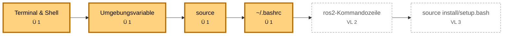
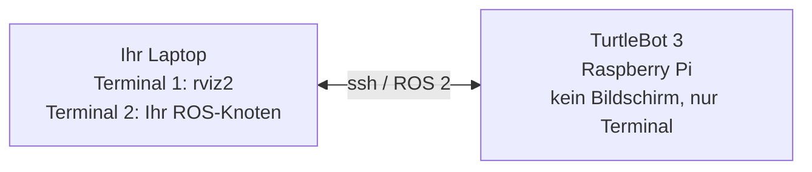

<!--

author:   Sebastian Zug & Georg Jäger & Claude Code (Opus 5.5) mit LiaScript Teaching-Agent
email:    sebastian.zug@informatik.tu-freiberg.de & Georg.Jaeger@informatik.tu-freiberg.de
version:  0.2.0
language: de
narrator: Deutsch Female

import:   https://raw.githubusercontent.com/TUBAF-IfI-LiaScript/VL_SoftwareprojektRobotik/refs/heads/master/config.md
          https://raw.githubusercontent.com/liaTemplates/mermaid_template/master/README.md
          https://github.com/liascript/CodeRunner

@bash:      @LIA.eval(`["main.sh"]`, `none`, `bash main.sh`)
@bashShell: @LIA.eval(`["main.sh"]`, `none`, `bash --rcfile main.sh -i`)
@bashLog:   @LIA.eval(`["main.sh", "ros.log"]`, `none`, `bash main.sh`)

-->

[](https://liascript.github.io/course/?https://raw.githubusercontent.com/TUBAF-IfI-LiaScript/VL_SoftwareprojektRobotik/refs/heads/master/exercises/exercise_00_linux_shell/README.md)

# Übung: OS + Linux Shell

<!-- data-type="none" -->
| Parameter            | Kursinformationen                                                                                                       |
| -------------------- | ----------------------------------------------------------------------------------------------------------------------- |
| **Veranstaltung:**   | @config.lecture                                                                                                         |
| **Semester**         | @config.semester                                                                                                        |
| **Hochschule:**      | `Technische Universität Freiberg`                                                                                       |
| **Inhalte:**         | `Arbeiten im Linux-Terminal: Dateisystem, Rechte, Prozesse, Umgebungsvariablen`                                         |
| **Link auf GitHub:** | https://github.com/TUBAF-IfI-LiaScript/VL_SoftwareprojektRobotik/blob/master/exercises/exercise_00_linux_shell/README.md |
| **Autoren**          | @author                                                                                                                 |

--------------------------------------------------------------------------------

**Zielstellung der heutigen Übung** — nach der Übung können Sie

+ sich im Linux-Dateisystem mit absoluten und relativen Pfaden bewegen,
+ Dateien anlegen, durchsuchen und Ausgaben mit Pipes verknüpfen,
+ Dateirechte lesen und eigene Skripte ausführbar machen,
+ Prozesse starten, finden und beenden,
+ erklären, warum `source /opt/ros/jazzy/setup.bash` in jedem Terminal nötig ist.

**Ablauf (90 min)**

<!-- data-type="none" -->
| Zeit      | Inhalt                                                     |
| --------- | ---------------------------------------------------------- |
| 10 min    | Warum Terminal? Arbeitsumgebung                            |
| 15 min    | Dateisystem + Aufgabe 1                                    |
| 15 min    | Dateien und Pipes + Aufgabe 2                              |
| 10 min    | Rechte, Prozesse + Aufgabe 3                               |
| 30 min    | Umgebungsvariablen + Aufgaben 4 und 5                      |
| 10 min    | Selbsttest und Ausblick                                    |

Die Abschnitte „Zum Nachschlagen“ am Ende gehören nicht zum Zeitplan — Sie brauchen sie bei der Installation von ROS 2 und im ersten Praktikum.

--------------------------------------------------------------------------------

<!-- kurslandkarte:wo-start -->

## Wo stehen wir?

**Block 1 · ROS-Grundlagen** · Termin 2 von 32 · Ü 1 in der Woche ab 26.10.2026

**Ziel im Projekt:** Ihr Rechner wird zur Werkbank: Ohne sicheren Umgang mit der Shell erreichen Sie weder ROS 2 noch den TurtleBot.

- **Heute neu:** [Terminal & Shell](https://tubaf-ifi-liascript.github.io/VL_SoftwareprojektRobotik/kurslandkarte/#begriff=shell) · [Absolute & relative Pfade](https://tubaf-ifi-liascript.github.io/VL_SoftwareprojektRobotik/kurslandkarte/#begriff=pfade) · [Umgebungsvariable](https://tubaf-ifi-liascript.github.io/VL_SoftwareprojektRobotik/kurslandkarte/#begriff=umgebung) · [source](https://tubaf-ifi-liascript.github.io/VL_SoftwareprojektRobotik/kurslandkarte/#begriff=source)
- **Danach:** VL 2 · ROS 2 Grundlagen – Sie verstehen, wie die Software des TurtleBots aus Knoten und Topics zusammengesetzt ist.

**Roter Faden „Umgebung im Griff“** – Von der Shell über Umgebungsvariablen zum lauffähigen ROS-2-Workspace.



[🗺️ Ganze Kurslandkarte öffnen](https://tubaf-ifi-liascript.github.io/VL_SoftwareprojektRobotik/kurslandkarte/#termin=ue1) – dort finden Sie jeden Begriff mit Erklärung, typischer Stolperfalle und Link auf die passende Folie.

<!-- kurslandkarte:wo-ende -->

## Warum Terminal?

In der Robotik kommen Sie am Terminal nicht vorbei. Der TurtleBot hat keinen Bildschirm, Sie erreichen ihn über das Netzwerk mit `ssh`. ROS 2 wird über Kommandozeilenwerkzeuge gestartet, konfiguriert und untersucht. Und viele Fehler, die Ihnen in den nächsten Wochen begegnen, sind in Wahrheit keine ROS-Fehler, sondern Fehler in der Shell-Umgebung: eine vergessene Umgebungsvariable, ein falscher Pfad, fehlende Rechte.

Erinnern Sie sich an VL 1: Sense, Think und Act sind beim TurtleBot getrennte Programme — Kameratreiber, Spurerkennung, Motorsteuerung. Unter Linux ist jedes davon ein **Prozess**, den Sie aus einem Terminal starten, beobachten und beenden. Und jedes liest seine Einstellungen aus der **Umgebung** dieses Terminals. Genau darum geht es heute.



**Begriffe**

+ **Terminal** — das Fenster, in dem Sie Text eingeben und Ausgaben sehen
+ **Shell** — das Programm, das Ihre Eingaben interpretiert; bei Ubuntu ist das `bash`
+ **Prompt** — die Eingabeaufforderung, z. B. `student@laptop:~/ros2_ws$` (Benutzer, Rechner, aktuelles Verzeichnis)

**Ihre Arbeitsumgebung**

<!-- data-type="none" -->
| Variante                  | Bemerkung                                                                                  |
| ------------------------- | ------------------------------------------------------------------------------------------ |
| Ubuntu 24.04 nativ        | empfohlen — alle Werkzeuge der Veranstaltung laufen direkt                                  |
| WSL2 unter Windows        | gute Alternative, `wsl --install -d Ubuntu-24.04`                                           |
| Rechnerpool               | Ausweichlösung für alle Aufgaben, falls Ihr eigenes System noch nicht läuft                  |

### Wie funktionieren die Beispiele in diesem Skript?

+ **Codeblock mit Ausführen-Knopf:** Der Code läuft auf einem Server mit Ubuntu und `bash`. Sie können ihn verändern und neu starten.
+ **Interaktive Blöcke:** Nach dem Skript erscheint ein Prompt — tippen Sie weitere Befehle ein, `exit` beendet die Shell.
+ **Browser-Linux:** ein kleines Alpine-Linux (JSLinux), das komplett in Ihrem Browser läuft. Es nutzt die Shell `ash` statt `bash`; die Grundbefehle sind identisch.

> **Hinweis:** Die Server-Beispiele laufen jeweils in einem frischen, temporären Verzeichnis. Arbeiten Sie dort mit **relativen Pfaden** — `~` zeigt auf dem Server nicht auf ein eigenes Home-Verzeichnis.

Probieren Sie es aus: Starten Sie den Block und geben Sie danach `whoami` und `date` ein.

```bash  main.sh
echo "Hallo aus der Shell!"
echo "Ich bin gerade in: $(pwd)"
```
@bashShell

## Dateisystem

Linux kennt keine Laufwerksbuchstaben. Alles hängt in einem einzigen Baum, der bei der Wurzel `/` beginnt. Ihr persönliches Verzeichnis liegt unter `/home/benutzername` und hat die Abkürzung `~`. ROS 2 selbst wird später unter `/opt/ros/jazzy` installiert.

```text
/
├── home/
│   └── student/            <- ~  (Ihr Home-Verzeichnis)
│       └── ros2_ws/
│           └── src/
├── opt/
│   └── ros/
│       └── jazzy/          <- ROS 2 Installation
├── etc/                    <- Konfigurationsdateien
├── tmp/                    <- temporäre Dateien
└── usr/bin/                <- Programme
```

<!-- data-type="none" -->
| Befehl         | Bedeutung                                   | Beispiel                       |
| -------------- | ------------------------------------------- | ------------------------------ |
| `pwd`          | aktuelles Verzeichnis anzeigen              | `pwd`                          |
| `ls`           | Inhalt auflisten (`-l` lang, `-a` versteckt)| `ls -la`                       |
| `cd`           | Verzeichnis wechseln                        | `cd ros2_ws`, `cd ..`, `cd ~`  |
| `mkdir`        | Verzeichnis anlegen (`-p` mit Zwischenpfad) | `mkdir -p ros2_ws/src`         |
| `touch`        | leere Datei anlegen                         | `touch notes.txt`              |
| `cp` / `mv`    | kopieren / verschieben bzw. umbenennen      | `cp a.txt b.txt`               |
| `rm`           | löschen (`-r` rekursiv) — **ohne Papierkorb!** | `rm -r build`               |

**Absolute und relative Pfade**

+ **absolut** beginnt bei `/`: `/opt/ros/jazzy/setup.bash`
+ **relativ** geht vom aktuellen Verzeichnis aus: `src/my_package`, `../install`
+ `.` ist das aktuelle, `..` das übergeordnete Verzeichnis

```bash  main.sh
mkdir -p ros2_ws/src/my_package
cd ros2_ws
pwd
touch src/my_package/package.xml
ls -R
cd src/my_package
echo "Jetzt bin ich in: $(pwd)"
ls ../..
```
@bash

**Variante:** Legen Sie zusätzlich ein Verzeichnis `build` an und löschen Sie es wieder. Was passiert, wenn Sie `mkdir` ohne die Option `-p` verwenden?

### Aufgabe 1: Workspace anlegen

Die Aufgaben lösen Sie auf Ihrem eigenen Ubuntu-System, in WSL2 oder am Pool-Rechner — nicht in den Server-Beispielen, denn dort gibt es kein eigenes Home-Verzeichnis.


Legen Sie in Ihrem Home-Verzeichnis folgende Struktur an — mit möglichst wenigen Befehlen:

```text
~/ros2_ws/
├── src/
│   ├── turtle_tools/
│   │   └── README.md
│   └── line_follower/
└── notes.txt
```

Kopieren Sie anschließend `notes.txt` nach `src/line_follower/` und benennen Sie die Kopie in `todo.txt` um.

**Prüfkriterium:** `find ~/ros2_ws` listet genau die Dateien und Verzeichnisse oben plus `src/line_follower/todo.txt`.

<details>
<summary>**Lösungsvorschlag**</summary>

```bash
mkdir -p ~/ros2_ws/src/turtle_tools ~/ros2_ws/src/line_follower
touch ~/ros2_ws/src/turtle_tools/README.md ~/ros2_ws/notes.txt
cp ~/ros2_ws/notes.txt ~/ros2_ws/src/line_follower/todo.txt
find ~/ros2_ws
```

</details>

## Dateien ansehen, suchen und verknüpfen

Die eigentliche Stärke der Shell liegt im Kombinieren kleiner Werkzeuge. Jedes Programm liest Text und gibt Text aus. Mit dem senkrechten Strich, der Pipe, leiten Sie die Ausgabe eines Programms als Eingabe an das nächste weiter. Mit dem Größerzeichen schreiben Sie eine Ausgabe in eine Datei.

<!-- data-type="none" -->
| Befehl                  | Bedeutung                                         |
| ----------------------- | ------------------------------------------------- |
| `cat datei`             | Datei vollständig ausgeben                        |
| `less datei`            | Datei seitenweise anzeigen (`q` beendet)          |
| `head -n 5` / `tail -n 5` | erste / letzte Zeilen; `tail -f` folgt einer wachsenden Datei |
| `grep muster datei`     | Zeilen mit einem Suchmuster finden (`-i`, `-c`, `-v`) |
| `find . -name "*.py"`   | Dateien im Verzeichnisbaum suchen                 |
| `wc -l`                 | Zeilen zählen                                     |
| `a \| b`                | Pipe: Ausgabe von `a` wird Eingabe von `b`        |
| `> datei` / `>> datei`  | Ausgabe in Datei schreiben / anhängen             |

Das folgende Beispiel arbeitet mit einem (gekürzten) Log eines ROS-2-Systems:

```bash  main.sh
echo "--- Die ersten 3 Zeilen:"
head -n 3 ros.log
echo "--- Alle Warnungen:"
grep "WARN" ros.log
echo "--- Anzahl der Fehler:"
grep -c "ERROR" ros.log
echo "--- Welche Knoten melden Fehler?"
grep "ERROR" ros.log | cut -d' ' -f3 | sort | uniq -c
grep "ERROR" ros.log > errors.txt
echo "--- errors.txt hat $(wc -l < errors.txt) Zeilen"
```
```text  ros.log
[1728550001.10] [INFO] [camera_node]: Camera started, 640x480 @ 30 fps
[1728550001.20] [INFO] [lidar_node]: RPLIDAR C1 connected on /dev/ttyUSB0
[1728550001.95] [WARN] [lidar_node]: Scan frequency below 10 Hz
[1728550002.31] [INFO] [line_detector]: Subscribed to /camera/image_raw
[1728550003.02] [ERROR] [line_detector]: No line found in image
[1728550003.40] [WARN] [controller_node]: cmd_vel limited to 0.22 m/s
[1728550004.12] [ERROR] [line_detector]: No line found in image
[1728550004.80] [ERROR] [lidar_node]: Lost connection to /dev/ttyUSB0
[1728550005.01] [INFO] [controller_node]: Emergency stop
```
@bashLog

### Aufgabe 2: Fehlersuche im Log

Laden Sie das Log aus dem Abschnitt „Dateien ansehen, suchen und verknüpfen“ als `ros.log` in Ihren Workspace (oder kopieren Sie es per Copy & Paste mit `cat > ros.log`).

1. Wie viele Zeilen enthalten `INFO`, `WARN` und `ERROR`?
2. Schreiben Sie alle Meldungen des `lidar_node` in die Datei `lidar.txt`.
3. Welcher Knoten meldet die meisten Fehler?

**Prüfkriterium:** `INFO` 4, `WARN` 2, `ERROR` 3 Zeilen; `wc -l lidar.txt` ergibt 3.

Wie viele `ERROR`-Zeilen enthält das Log?

[[3]]
[[?]] `grep -c "ERROR" ros.log`
***
`grep -c` zählt die passenden Zeilen.
***

<details>
<summary>**Lösungsvorschlag**</summary>

```bash
grep -c "INFO" ros.log            # 4
grep -c "WARN" ros.log            # 2
grep -c "ERROR" ros.log           # 3
grep "lidar_node" ros.log > lidar.txt
wc -l lidar.txt                   # 3 lidar.txt
grep "ERROR" ros.log | cut -d' ' -f3 | sort | uniq -c | sort -rn
```

Die letzte Pipe zählt die Fehler je Knoten und sortiert absteigend: Der `line_detector` meldet zwei Fehler — in der Verkehrswelt hieße das: Die Kamera liefert Bilder, aber die Spurerkennung findet keine Linie.

</details>

## Rechte und Benutzer

Jede Datei gehört einem Benutzer und einer Gruppe. Für den Besitzer, die Gruppe und alle anderen ist jeweils festgelegt, ob gelesen, geschrieben oder ausgeführt werden darf. Das sehen Sie mit `ls -l`. Ein Skript, das Sie selbst geschrieben haben, dürfen Sie zunächst nicht ausführen — dafür müssen Sie das Ausführungsrecht setzen.

```text
  -rwxr-xr--  1 student student  42 Oct 20 10:00 hello.sh
  |\_/\_/\_/    \_____/ \_____/
  | |  |  |        |       +-- Gruppe
  | |  |  |        +---------- Besitzer
  | |  |  +-- alle anderen:  r--  = 4        lesen
  | |  +----- Gruppe:        r-x  = 4+1 = 5  lesen, ausführen
  | +-------- Besitzer:      rwx  = 4+2+1 = 7
  +---------- Dateityp (- Datei, d Verzeichnis)
```

+ `chmod +x datei` — Ausführungsrecht hinzufügen
+ `chmod 754 datei` — Rechte als Zahl setzen (r = 4, w = 2, x = 1)
+ `sudo befehl` — Befehl mit Administratorrechten ausführen, z. B. `sudo apt install ...`
+ **Shebang:** Die erste Zeile `#!/bin/bash` legt fest, mit welchem Programm ein Skript ausgeführt wird.

```bash  main.sh
cat > hello.sh << 'EOF'
#!/bin/bash
echo "Hallo, ich bin ein Skript!"
EOF
ls -l hello.sh
./hello.sh || echo ">>> Nicht ausführbar!"
chmod +x hello.sh
ls -l hello.sh
./hello.sh
```
@bash

## Prozesse

Jedes laufende Programm ist ein Prozess mit einer eigenen Nummer, der PID. In ROS 2 ist jeder Knoten ein Prozess — Sie werden also oft mehrere Programme parallel laufen lassen, jedes in seinem eigenen Terminal. Ein Programm im Vordergrund beenden Sie mit `Strg+C`.

<!-- data-type="none" -->
| Befehl / Taste       | Bedeutung                                              |
| -------------------- | ------------------------------------------------------ |
| `Strg+C`             | laufendes Programm im Vordergrund beenden              |
| `befehl &`           | Programm im Hintergrund starten                        |
| `ps aux`, `pgrep`    | Prozesse anzeigen / suchen                             |
| `top`, `htop`        | Prozesse und Auslastung live anzeigen (`q` beendet)    |
| `kill PID`           | Prozess beenden                                        |
| `pkill name`         | alle Prozesse mit diesem Namen beenden                 |

```bash  main.sh
sleep 30 &
PID=$!
echo "Hintergrundprozess gestartet mit PID $PID"
ps -o pid,cmd -p $PID
kill $PID
sleep 0.5
ps -p $PID > /dev/null || echo "Prozess $PID wurde beendet"
```
@bash

### Aufgabe 3: Prozesse im Griff

Im Projekt laufen viele Knoten gleichzeitig — und manchmal bleibt einer hängen.

1. Starten Sie zweimal `sleep 600 &`.
2. Finden Sie beide Prozessnummern mit `pgrep sleep`.
3. Beenden Sie einen der beiden Prozesse mit `kill`.

**Prüfkriterium:** `pgrep sleep` liefert danach genau eine Nummer. Räumen Sie zum Schluss mit `pkill sleep` auf.

<details>
<summary>**Lösungsvorschlag**</summary>

```bash
sleep 600 &
sleep 600 &
pgrep sleep          # z. B. 4711 und 4712
kill 4711
pgrep sleep          # nur noch 4712
pkill sleep          # beendet alle Prozesse namens sleep
```

</details>

## Umgebungsvariablen

Jetzt kommen wir zum wichtigsten Abschnitt für ROS 2. Jede Shell hat eine Umgebung: eine Sammlung von Variablen wie PATH, HOME oder später ROS_DOMAIN_ID. Programme lesen diese Variablen, um zu wissen, wo sie Dateien finden oder mit wem sie kommunizieren sollen. Entscheidend ist: Die Umgebung gilt nur für die aktuelle Shell und die Programme, die aus ihr heraus gestartet werden. Ein neues Terminal beginnt wieder von vorn.

<!-- data-type="none" -->
| Befehl                       | Bedeutung                                                      |
| ---------------------------- | -------------------------------------------------------------- |
| `env`                        | alle Umgebungsvariablen anzeigen                               |
| `echo $PATH`                 | Wert einer Variable ausgeben                                   |
| `NAME=wert`                  | Shell-Variable setzen — nur in dieser Shell sichtbar           |
| `export NAME=wert`           | Umgebungsvariable setzen — auch für gestartete Programme sichtbar |
| `~/.bashrc`                  | wird beim Öffnen jedes neuen Terminals ausgeführt              |
| `source datei`               | Datei **in der aktuellen Shell** ausführen                     |

### `export` — wer sieht die Variable?

```bash  main.sh
LOKAL="nur hier"
export GLOBAL="auch für Kindprozesse"
echo "In der Shell:   LOKAL=$LOKAL, GLOBAL=$GLOBAL"
bash -c 'echo "Im Kindprozess: LOKAL=$LOKAL, GLOBAL=$GLOBAL"'
```
@bash

Der Kindprozess, hier eine zweite bash, sieht nur die exportierte Variable. Genau so verhält es sich mit einem ROS-Knoten, den Sie aus der Shell starten: Er sieht nur, was exportiert wurde.

### `PATH` — wo findet die Shell Programme?

Wenn Sie einen Befehl wie ros2 eintippen, durchsucht die Shell der Reihe nach alle Verzeichnisse, die in der Variablen PATH stehen. Ist ein Programm dort nicht zu finden, erhalten Sie die Meldung command not found. Genau das passiert, wenn Sie vergessen, ROS 2 zu sourcen.

```bash  main.sh
mkdir -p mybin
printf '#!/bin/bash\necho "Hallo von mytool"\n' > mybin/mytool
chmod +x mybin/mytool
mytool || echo ">>> mytool liegt nicht im PATH"
export PATH="$PWD/mybin:$PATH"
echo "PATH beginnt jetzt mit: ${PATH%%:*}"
mytool
which mytool
```
@bash

### `source` oder ausführen?

Ein Skript, das Sie mit Punkt-Schrägstrich ausführen, läuft in einer neuen Shell. Alle Variablen, die es setzt, verschwinden mit dieser Shell. Mit source dagegen werden die Befehle in Ihrer aktuellen Shell ausgeführt, und die Variablen bleiben erhalten. Deshalb heißt es bei ROS 2 immer source /opt/ros/jazzy/setup.bash und nicht einfach ausführen.

```bash  main.sh
cat > setup.bash << 'EOF'
export ROS_DOMAIN_ID=42
export MY_SETUP_DONE=yes
EOF
chmod +x setup.bash

./setup.bash
echo "Nach ./setup.bash:     ROS_DOMAIN_ID='$ROS_DOMAIN_ID'"

source setup.bash
echo "Nach source setup.bash: ROS_DOMAIN_ID='$ROS_DOMAIN_ID'"
```
@bash

**Was bedeutet das für ROS 2?**

```bash
# in jedem neuen Terminal nötig — oder einmalig in ~/.bashrc eintragen:
source /opt/ros/jazzy/setup.bash
export ROS_DOMAIN_ID=42          # trennt später die TurtleBots im Labor; Ihre echte ID gibt es in P 1
```

### Aufgabe 4: Ein eigenes Werkzeug

1. Schreiben Sie ein Skript `~/bin/rosinfo.sh`, das das aktuelle Datum, den Rechnernamen (`hostname`) und den Wert von `ROS_DOMAIN_ID` ausgibt.
2. Machen Sie es ausführbar.
3. Sorgen Sie dafür, dass Sie es aus jedem Verzeichnis einfach mit `rosinfo.sh` aufrufen können.

**Prüfkriterium:** `cd /tmp && rosinfo.sh` funktioniert — auch in einem neu geöffneten Terminal.

<details>
<summary>**Lösungsvorschlag**</summary>

```bash
mkdir -p ~/bin
cat > ~/bin/rosinfo.sh << 'EOF'
#!/bin/bash
echo "Datum:         $(date)"
echo "Rechner:       $(hostname)"
echo "ROS_DOMAIN_ID: ${ROS_DOMAIN_ID:-nicht gesetzt}"
EOF
chmod +x ~/bin/rosinfo.sh
echo 'export PATH="$HOME/bin:$PATH"' >> ~/.bashrc
source ~/.bashrc
```

Unter Ubuntu wird `~/bin` beim Anmelden automatisch in den `PATH` aufgenommen, sofern das Verzeichnis existiert — der Eintrag in `~/.bashrc` macht das Verhalten aber explizit und sofort wirksam.

</details>

### Aufgabe 5: Zwei Terminals, zwei Welten

1. Öffnen Sie zwei Terminals. Setzen Sie im ersten `export ROS_DOMAIN_ID=7` und prüfen Sie den Wert in beiden Terminals mit `rosinfo.sh`. Erklären Sie das Ergebnis.
2. Sorgen Sie dafür, dass `ROS_DOMAIN_ID` in **jedem** neuen Terminal automatisch auf `7` gesetzt ist. (Die echte ID Ihrer Gruppe erhalten Sie im ersten Praktikum — dann ersetzen Sie diese Zeile.)
3. Warum reicht es nicht, die Zeile in eine Datei `setup.sh` zu schreiben und diese mit `./setup.sh` auszuführen?

**Prüfkriterium:** Ein neues Terminal zeigt mit `echo $ROS_DOMAIN_ID` sofort `7`.

<details>
<summary>**Lösungsvorschlag**</summary>

1. Die Variable existiert nur in der Shell des ersten Terminals und in den daraus gestarteten Programmen. Das zweite Terminal ist eine eigene Shell mit eigener Umgebung.
2. `echo 'export ROS_DOMAIN_ID=7' >> ~/.bashrc` — die `~/.bashrc` wird beim Öffnen jedes neuen Terminals ausgeführt.
3. `./setup.sh` startet eine neue Shell als Kindprozess. Die Variable wird dort gesetzt und verschwindet mit dem Ende des Skripts. Nur `source setup.sh` führt die Befehle in der aktuellen Shell aus.

</details>

## Selbsttest

Welche Rechte hat eine Datei nach `chmod 754 datei`?

[( )] `rwxrwxr--`
[(X)] `rwxr-xr--`
[( )] `rwxr--r-x`
[( )] `r-xr-xr--`
***
7 = 4+2+1 = `rwx` (Besitzer), 5 = 4+1 = `r-x` (Gruppe), 4 = `r--` (alle anderen).
***

Sie befinden sich in `/home/student/ros2_ws/src`. Welcher Befehl führt nach `/home/student/ros2_ws/install`?

[[X]] `cd ../install`
[[X]] `cd /home/student/ros2_ws/install`
[[X]] `cd ~/ros2_ws/install`
[[ ]] `cd /install`
[[ ]] `cd ./install`
***
`..` führt eine Ebene nach oben, `~` steht für das Home-Verzeichnis. `/install` sucht direkt unter der Wurzel, `./install` im aktuellen Ordner `src` — beides falsch.
***

In einem neuen Terminal meldet `ros2 topic list` die Fehlermeldung `ros2: command not found`. Was ist die wahrscheinlichste Ursache?

[( )] ROS 2 ist nicht installiert.
[(X)] `/opt/ros/jazzy/setup.bash` wurde in diesem Terminal nicht gesourct.
[( )] Die Datei `ros2` hat keine Leserechte.
[( )] Es läuft kein ROS-Knoten.
***
Nach der Installation liegen die ROS-2-Programme unter `/opt/ros/jazzy`. Dieses Verzeichnis steht erst nach `source /opt/ros/jazzy/setup.bash` im `PATH` — und zwar nur in dem Terminal, in dem Sie das ausgeführt haben, außer Sie tragen es in `~/.bashrc` ein.
***

Ein Skript setzt `export ROS_DOMAIN_ID=5`. Sie starten es mit `./skript.sh` und geben danach `echo $ROS_DOMAIN_ID` ein. Was sehen Sie?

[[ (den vorherigen Wert bzw. eine leere Zeile) | 5 | eine Fehlermeldung ]]
***
`./skript.sh` läuft in einer eigenen Shell (Kindprozess). Deren Variablen verschwinden mit ihr — erst `source skript.sh` setzt den Wert in Ihrer Shell.
***

Welcher Befehl zählt die Warnungen im Log? `grep` [[ (-c "WARN" ros.log) | "WARN" > ros.log | -v "WARN" ros.log ]]
***
`-c` zählt die passenden Zeilen. Vorsicht bei der zweiten Variante: `>` würde `ros.log` mit der leeren Ausgabe überschreiben!
***

Ein ROS-Knoten läuft im Vordergrund und reagiert nicht mehr. Wie beenden Sie ihn?

[[X]] `Strg+C` im Terminal des Knotens
[[X]] in einem anderen Terminal die PID mit `pgrep` suchen und `kill PID` ausführen
[[ ]] das Terminal-Fenster mit `cd ..` verlassen
[[ ]] `rm` auf die Programmdatei anwenden
***
`Strg+C` sendet dem Vordergrundprozess das Signal zum Beenden; `kill` tut dasselbe von außen. `rm` löscht nur die Datei — der laufende Prozess bleibt davon unberührt.
***

## Zum Nachschlagen: Pakete und Fernzugriff

Diese beiden Werkzeuge begegnen Ihnen bei der Installation und im ersten Praktikum — hier zum Nachschlagen: die Paketverwaltung apt, mit der Sie Software installieren, und ssh, mit dem Sie sich auf dem TurtleBot anmelden.

**Paketverwaltung**

```bash
sudo apt update                    # Paketlisten aktualisieren
sudo apt install tree htop tmux    # Pakete installieren
apt search turtlebot3              # Pakete suchen
```

**Fernzugriff auf einen anderen Rechner**

```bash
ssh ubuntu@192.168.0.42            # anmelden (Adresse bekommen Sie im Praktikum)
scp mein_skript.py ubuntu@192.168.0.42:~/   # Datei kopieren
exit                               # Verbindung beenden
```

> Im Praktikum arbeiten Sie meist direkt von Ihrem Laptop aus; `ssh` auf den TurtleBot brauchen Sie nur für Wartungsarbeiten.

## Zum Nachschlagen: Freies Terminal im Browser

Hier können Sie frei experimentieren. Das Linux läuft vollständig in Ihrem Browser, Sie können nichts kaputt machen. Nach dem Neuladen der Seite ist alles wieder im Ausgangszustand.

??[JSLinux: Alpine Linux im Browser](https://bellard.org/jslinux/vm.html?url=alpine-x86.cfg&mem=192 "JSLinux von Fabrice Bellard — Alpine Linux mit der Shell ash")

**Vorschläge zum Ausprobieren**

+ `cd /` und `ls` — wie sieht der Verzeichnisbaum aus?
+ `cat /etc/os-release` — welches System läuft hier?
+ `echo $PATH` und `env`
+ `ls -l /bin | head` — wem gehören die Programme, welche Rechte haben sie?

> Das Browser-Linux nutzt `ash` statt `bash`: Einträge in `~/.bashrc` (Aufgaben 4 und 5) wirken dort nicht, und nach dem Neuladen ist alles weg.

## Zum Nachschlagen: Git in sechs Befehlen

Im Praktikum arbeitet jede Gruppe in einem gemeinsamen **Git-Repository** — ein Ordner, dessen Änderungen Git aufzeichnet und mit einem Server abgleicht. Eine Person legt es auf dem Server an und lädt die anderen ein; dann:

<!-- data-type="none" -->
| Befehl                         | Bedeutung                                                     |
| :----------------------------- | :------------------------------------------------------------ |
| `git clone <adresse>`          | Repository einmalig auf den eigenen Rechner kopieren          |
| `git status`                   | Was hat sich geändert, was ist vorgemerkt?                    |
| `git add datei`                | Änderung für den nächsten Schnappschuss vormerken            |
| `git commit -m "Nachricht"`    | Schnappschuss mit Beschreibung speichern                      |
| `git push`                     | eigene Schnappschüsse auf den Server hochladen                |
| `git pull`                     | Schnappschüsse der anderen herunterladen                      |

Arbeitsablauf: zu Beginn `git pull`, am Ende `git add`, `git commit`, `git push`. Eine ausführliche Einführung bietet das [Git-Buch (deutsch)](https://git-scm.com/book/de/v2).

## Ausblick

Mit diesen Grundlagen sind Sie für die nächsten Schritte gerüstet. In der Vorlesung geht es um die Konzepte von ROS 2. Vor der nächsten Übung installieren Sie ROS 2 Jazzy selbstständig — und dabei begegnen Ihnen apt, sudo, source und die Datei bashrc wieder.

**Das Wichtigste in 5 Zeilen**

<!-- data-type="none" -->
| Thema               | Merksatz                                                                       |
| ------------------- | ------------------------------------------------------------------------------ |
| Pfade               | absolut beginnt bei `/`, relativ beim aktuellen Ordner; `~` ist Ihr Home       |
| Pipes               | `a \| b` verkettet Werkzeuge, `>` überschreibt, `>>` hängt an                    |
| Rechte              | eigene Skripte brauchen `chmod +x` und eine Shebang-Zeile                      |
| Prozesse            | jeder ROS-Knoten ist ein Prozess: `Strg+C`, `pgrep`, `kill`                    |
| Umgebung            | gilt pro Terminal; `source` lädt in die aktuelle Shell, `~/.bashrc` in jede neue |

**Transferfrage:** Ihre Spurerkennung startet auf dem TurtleBot nicht, die Meldung lautet `ros2: command not found`. Auf dem Laptop lief alles. Woran liegt es, und wie stellen Sie es dauerhaft ab? (Tipp: Aufgaben 4 und 5.)

**Bis zur nächsten Übung:** Installieren Sie ROS 2 Jazzy nach der [Installationsanleitung](https://liascript.github.io/course/?https://raw.githubusercontent.com/TUBAF-IfI-LiaScript/VL_SoftwareprojektRobotik/refs/heads/master/exercises/installation_ros2/README.md) — dabei begegnen Ihnen `sudo`, `apt`, `source` und `~/.bashrc` wieder.

+ **VL 2** Grundlagen ROS 2 — Architektur, Knoten, Topics, Nachrichten
+ **VL 3** ROS 2 Pakete — eigene Pakete bauen und starten
+ **Ü 2** Werkzeuge von ROS 2 — Services, Parameter, Actions, Daten aufzeichnen

**Weiterführende Ressourcen**

+ [Ubuntu Tutorial: The Linux command line for beginners](https://ubuntu.com/tutorials/command-line-for-beginners)
+ [ROS 2 Jazzy: Configuring environment](https://docs.ros.org/en/jazzy/Tutorials/Beginner-CLI-Tools/Configuring-ROS2-Environment.html)
+ [explainshell.com](https://explainshell.com/) — zerlegt beliebige Shell-Befehle in ihre Bestandteile

!?[Linux Command Line Full Course](https://www.youtube.com/watch?v=2PGnYjbYuUo "Geek's Lesson: Linux Command Line Full course – Beginners to Experts (englisch)")

<!-- kurslandkarte:ausblick-start -->

--------------------------------------------------------------------------------

**🗺️ Nächster Halt:** VL 2 · ROS 2 Grundlagen (Woche ab 26.10.2026) – Sie verstehen, wie die Software des TurtleBots aus Knoten und Topics zusammengesetzt ist. [Auf der Kurslandkarte ansehen](https://tubaf-ifi-liascript.github.io/VL_SoftwareprojektRobotik/kurslandkarte/#termin=03)

<!-- kurslandkarte:ausblick-ende -->
