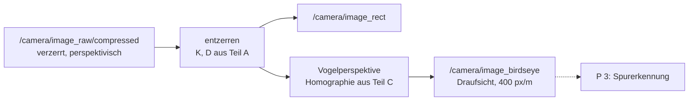

<!--

author:   Sebastian Zug & Claude Code (Opus 5.5) mit LiaScript Teaching-Agent
email:    sebastian.zug@informatik.tu-freiberg.de
version:  0.2.1
language: de
narrator: Deutsch Female

import:   https://raw.githubusercontent.com/TUBAF-IfI-LiaScript/VL_SoftwareprojektRobotik/refs/heads/master/config.md
          https://raw.githubusercontent.com/liaTemplates/mermaid_template/master/README.md

-->

[](https://liascript.github.io/course/?https://raw.githubusercontent.com/TUBAF-IfI-LiaScript/VL_SoftwareprojektRobotik/refs/heads/master/exercises/praktikum_02_bildkorrektur/README.md)

# Praktikum 2: Kamerabild korrigieren

<!-- data-type="none" -->
| Parameter            | Kursinformationen                                                                                                          |
| -------------------- | -------------------------------------------------------------------------------------------------------------------------- |
| **Veranstaltung:**   | @config.lecture                                                                                                            |
| **Semester**         | @config.semester                                                                                                           |
| **Hochschule:**      | `Technische Universität Freiberg`                                                                                          |
| **Inhalte:**         | `Kamera kalibrieren, Bild entzerren, Vogelperspektive auf die Fahrbahn — Anwendung von VL 4, VL 6, VL 7 und Ü 4`           |
| **Link auf GitHub:** | https://github.com/TUBAF-IfI-LiaScript/VL_SoftwareprojektRobotik/blob/master/exercises/praktikum_02_bildkorrektur/README.md |
| **Autoren**          | @author                                                                                                                    |

--------------------------------------------------------------------------------

**Ihre Spurerkennung in P 3 braucht ein Bild, in dem man messen kann.** Das Rohbild der Kamera taugt dafür nicht: Die Linse verzerrt es, und durch die Perspektive laufen parallele Fahrbahnlinien aufeinander zu. Heute bauen Sie den Knoten, der daraus eine maßstäbliche Draufsicht auf die Fahrbahn macht, und nehmen damit die Daten für P 3 auf. Sie lernen nichts Neues — Sie wenden an, was Sie in VL 4, VL 6, VL 7 und Ü 4 gelernt haben.



**Ziele** — am Ende dieses Praktikums können Sie als Gruppe

+ die Kamera Ihres TurtleBots mit einem Schachbrett kalibrieren und das Ergebnis auf Plausibilität prüfen,
+ das Kamerabild in einem eigenen ROS-2-Knoten entzerren,
+ aus einem flach liegenden Schachbrett die Abbildung zwischen Bild und Fahrbahn bestimmen und eine maßstäbliche Draufsicht erzeugen.

**Ablauf (90 min)** — die Abnahme läuft gestaffelt: Zeigen Sie jeden Nachweis, sobald der zugehörige Teil fertig ist.

<!-- data-type="none" -->
| Zeit   | Teil                                                      | Wendet an           | Nachweis |
| ------ | --------------------------------------------------------- | ------------------- | -------- |
| 10 min | Sicherheit, Rollen, Verbinden                             | P 1                 | —        |
| 25 min | A: Kamera kalibrieren                                     | VL 7, Ü 4           | 2        |
| 10 min | B: Bild entzerren                                         | VL 6, VL 7, Ü 4     | 3        |
| 25 min | C: Vogelperspektive                                       | VL 4, VL 7          | 4, 5     |
| 10 min | D: Daten für P 3 aufnehmen                                | Ü 2, P 1            | 6        |
| 10 min | Verständnisfrage, Roboter zurückgeben, Puffer             | —                   | 7        |

Ob der Knoten auch live mit voller Rate läuft, prüfen Sie zu Beginn von P 3.

--------------------------------------------------------------------------------

<!-- kurslandkarte:wo-start -->

## Wo stehen wir?

**Ziel im Projekt:** Ihr TurtleBot liefert eine entzerrte, maßstäbliche Draufsicht auf die Fahrbahn – die Grundlage der Spurerkennung.

**Block 2 · Sensorgrundlagen** – Termin 14 von 32, heute farbig markiert

<!-- data-type="none" -->
| Woche ab | Vorlesung | Übung | Praktikum |
| :-- | :-- | :-- | :-- |
| 30.11.2026 | [VL 5 Sensorik](https://liascript.github.io/course/?https://raw.githubusercontent.com/TUBAF-IfI-LiaScript/VL_SoftwareprojektRobotik/master/01_Sensorik/01_Sensorik.md) |  |  |
| 7.12.2026 | [VL 6 Bildverarbeitung](https://liascript.github.io/course/?https://raw.githubusercontent.com/TUBAF-IfI-LiaScript/VL_SoftwareprojektRobotik/master/05_Bildverarbeitung/05_Bildverarbeitung.md)<br>[VL 7 Kamera + Draufsicht](https://liascript.github.io/course/?https://raw.githubusercontent.com/TUBAF-IfI-LiaScript/VL_SoftwareprojektRobotik/master/06_Kamera_Stereo/06_Kamera_Stereo.md) |  |  |
| 14.12.2026 | VL 8 LiDAR |  |  |
| 4.1.2027 |  | Ü 3 Datenvisualisierung |  |
| **11.1.2027**<!-- style="background-color: rgba(255, 166, 0, 0.35); padding: 2px 6px; border-radius: 4px;" --> |  | Ü 4 Kameradaten | **[P 2 Bildkorrektur](https://liascript.github.io/course/?https://raw.githubusercontent.com/TUBAF-IfI-LiaScript/VL_SoftwareprojektRobotik/master/exercises/praktikum_02_bildkorrektur/README.md)**<!-- style="background-color: rgba(255, 166, 0, 0.35); padding: 2px 6px; border-radius: 4px;" --> |
| 18.1.2027 |  |  | [P 3 Spurerkennung](https://liascript.github.io/course/?https://raw.githubusercontent.com/TUBAF-IfI-LiaScript/VL_SoftwareprojektRobotik/master/exercises/praktikum_03_spurerkennung/README.md) |

- **Sie brauchen:** [Launch-Datei](https://tubaf-ifi-liascript.github.io/VL_SoftwareprojektRobotik/kurslandkarte/#begriff=launch) (VL 3) · [QoS-Verträglichkeit](https://tubaf-ifi-liascript.github.io/VL_SoftwareprojektRobotik/kurslandkarte/#begriff=qoscompat) (VL 4) · [CompressedImage](https://tubaf-ifi-liascript.github.io/VL_SoftwareprojektRobotik/kurslandkarte/#begriff=compressed_image) (VL 6) · [Kamerakalibrierung](https://tubaf-ifi-liascript.github.io/VL_SoftwareprojektRobotik/kurslandkarte/#begriff=kalibrierung) (VL 7) · [Entzerren mit Tabellen](https://tubaf-ifi-liascript.github.io/VL_SoftwareprojektRobotik/kurslandkarte/#begriff=entzerrung) (VL 7) · [Homographie](https://tubaf-ifi-liascript.github.io/VL_SoftwareprojektRobotik/kurslandkarte/#begriff=homographie) (VL 7) · [Draufsicht (Vogelperspektive)](https://tubaf-ifi-liascript.github.io/VL_SoftwareprojektRobotik/kurslandkarte/#begriff=draufsicht) (VL 7)
- **Heute:** anwenden, nichts Neues – Ihre Arbeit hier ist die Prüfungsleistung

> [!TIP]
> **Tipp – Kurslandkarte:** [Ganze Kurslandkarte öffnen](https://tubaf-ifi-liascript.github.io/VL_SoftwareprojektRobotik/kurslandkarte/#termin=p2) – dort finden Sie jeden Begriff mit Erklärung, typischer Stolperfalle, Link auf die passende Folie und die roten Fäden durch die Veranstaltung.

<!-- kurslandkarte:wo-ende -->

## Vorbereitung zu Hause

Im Labor reicht die Zeit nur, wenn Ihr Code vorher läuft. Rechnen Sie mit **2 bis 3 Stunden**. Die Vorbereitung ist Teil der Bewertung (Nachweis 1): Laden Sie das Ergebnis von Schritt 4 **vor dem Termin** in das Git-Repository Ihrer Gruppe hoch. Fehlt es, arbeitet Ihre Gruppe im Labor zuerst daran, bevor sie einen Roboter bekommt.

**1. Pakete installieren**

```bash
sudo apt install ros-jazzy-camera-calibration ros-jazzy-image-transport-plugins ros-jazzy-cv-bridge
```

**2. Projektpaket anlegen.** Sie bauen ab heute ein Paket `verkehrswelt`, das bis zum Ende des Projekts wächst. Holen Sie das Kurs-Repository (einmalig; später genügt `git pull` in diesem Ordner) und kopieren Sie die Vorlage in Ihren Workspace (Ü 1, VL 3):

```bash
git clone https://github.com/TUBAF-IfI-LiaScript/VL_SoftwareprojektRobotik.git ~/kurs
cp -r ~/kurs/exercises/praktikum_02_bildkorrektur/verkehrswelt ~/ros2_ws/src/
cd ~/ros2_ws
colcon build --symlink-install --packages-select verkehrswelt
source install/setup.bash
```

Dank `--symlink-install` müssen Sie nach Änderungen an Python-Dateien **nicht** neu bauen — nur nach neuen Dateien oder Änderungen an `setup.py`. Das Paket gehört ins Git-Repository Ihrer Gruppe (Ü 1, „Git in sechs Befehlen“).

**3. TODOs ergänzen.** Die Vorlage ist lauffähig, macht aber noch nichts Sinnvolles. Ergänzen Sie die fünf mit `TODO` markierten Stellen:

<!-- data-type="none" -->
| Datei                   | TODO | Was                                                        | Wo gelernt |
| :---------------------- | :--: | :--------------------------------------------------------- | :--------- |
| `image_corrector.py`    | 1, 2 | Entzerrungstabellen berechnen, Bild entzerren              | Ü 4, VL 7  |
| `image_corrector.py`    | 3    | Bild mit der Homographie in die Vogelperspektive abbilden  | VL 7       |
| `boden_kalibrieren.py`  | 4    | Bodenkoordinaten der Schachbrettecken aufstellen           | VL 4       |
| `boden_kalibrieren.py`  | 5    | Homographie aus Punktpaaren bestimmen                      | VL 7       |

Zu TODO 4: Das Brett liegt flach und mittig vor dem Roboter. So sind die inneren Ecken nummeriert — Ansicht von oben, der Roboter steht unten und schaut nach oben, Beispiel mit 8 × 6 inneren Ecken:

<!-- data-type="none" -->
|                                                   | links ($y > 0$) |       |     | rechts ($y < 0$) |
| :------------------------------------------------ | :-------------: | :---: | :-: | :--------------: |
| **Reihe j = 5** (am weitesten vorn)               | i = 7           | i = 6 | …   | i = 0            |
| ⋮                                                 | ⋮               | ⋮     |     | ⋮                |
| **Reihe j = 0** (am nächsten)                     | i = 7           | i = 6 | …   | i = 0            |
| ↕ `abstand` (Zollstock)                           |                 |       |     |                  |
| **Roboter**: Radachse = `base_footprint`, $x$ nach vorn |           |       |     |                  |

Die erste Ecke (`i = 0`, `j = 0`) liegt also bei $x = \text{abstand}$, $y = -\frac{(\text{ecken\_x} - 1)}{2} \cdot \text{feld}$ — rechts vom Roboter, deshalb negativ.

**4. Mit den Testdaten prüfen.** Im Ordner `testdaten/` liegen eine kurze Aufnahme eines flach liegenden Schachbretts und die Kalibrierung `ost_test.yaml` der Kamera, mit der sie entstanden ist. Die Aufnahme ist berechnet, nicht fotografiert — deshalb kennen wir die richtige Antwort: Die nächste Eckenreihe liegt **0,185 m** vor der Radachse, das Brett mittig.

```bash
# Terminal 1: Knoten mit der Testkalibrierung starten
ros2 launch verkehrswelt bildkorrektur.launch.py kalibrierdatei:=$HOME/kurs/exercises/praktikum_02_bildkorrektur/testdaten/ost_test.yaml

# Terminal 2: Testaufnahme in Schleife abspielen
ros2 bag play ~/kurs/exercises/praktikum_02_bildkorrektur/testdaten/brett_boden --loop

# Terminal 3: Homographie bestimmen – das Ergebnis landet im aktuellen Ordner
mkdir -p ~/p2_test && cd ~/p2_test
ros2 run verkehrswelt boden_kalibrieren --ros-args -p abstand:=0.185
```

Erwartete Ausgabe von Terminal 3:

```text
[INFO] [boden_kalibrieren]: 48 Ecken, mittlerer Fehler 0.2 mm -> homographie.yaml geschrieben
```

Der mittlere Fehler zeigt nur, ob die Ecken in der **richtigen Reihenfolge** zugeordnet sind. Ob das Brett an der **richtigen Stelle** landet, sehen Sie erst im Bild: Beenden Sie Terminal 1, starten Sie es mit der Homographie neu und sehen Sie sich das Bild mit Raster in `rqt` an (Image View, VL 2):

```bash
ros2 launch verkehrswelt bildkorrektur.launch.py \
  kalibrierdatei:=$HOME/kurs/exercises/praktikum_02_bildkorrektur/testdaten/ost_test.yaml \
  homographie:=$HOME/p2_test/homographie.yaml
```

Im Topic `/camera/image_birdseye_raster` haben die grünen Linien 10 cm Abstand, die rote Linie ist die Mittelachse des Roboters. Richtig ist Ihre Lösung, wenn

+ das Brett als Rechteck mit **quadratischen** Feldern erscheint,
+ die rote Linie **genau durch die Mitte** des Bretts läuft,
+ die unterste Reihe innerer Ecken knapp **unterhalb** der grünen Linie für 0,2 m liegt (bei 0,185 m).

📝 Speichern Sie die Ausgabe von Terminal 3 und ein Bildschirmfoto der Draufsicht als `praktikum_02/vorbereitung.png` in Ihrem Gruppen-Repository.

<details>
<summary>Fehlerbilder und ihre Ursache</summary>

<!-- data-type="none" -->
| Was Sie sehen                                                  | Wahrscheinliche Ursache                                                       |
| :------------------------------------------------------------- | :---------------------------------------------------------------------------- |
| `Kalibrierdatei nicht gefunden`                                | Pfad falsch — absoluten Pfad angeben                                          |
| `Schachbrett nicht gefunden`                                   | Läuft die Aufnahme? Liefert `/camera/image_rect` Bilder (`ros2 topic hz`)?    |
| `Die Draufsicht wäre gespiegelt oder verdreht`                 | TODO 4: Vorzeichen — y wächst nach **links**, x nach **vorn** (VL 4)          |
| mittlerer Fehler mehrere cm                                    | TODO 4: Reihenfolge — erst alle Ecken der Reihe j = 0, dann j = 1 …          |
| Brett liegt neben der roten Linie                              | TODO 4: Brettmitte nicht auf y = 0 gelegt                                     |
| Brett liegt zu weit vorn oder hinten                           | TODO 4: `abstand` nicht für die Reihe j = 0 verwendet                         |
| `/camera/image_birdseye` bleibt aus                            | Homographie-Datei nicht übergeben — der Knoten meldet „noch ohne Homographie“ |

</details>

**5. Mit Ihrer eigenen Aufnahme aus P 1** prüfen Sie TODO 1 und 2 an echten Bildern. Ihre Aufnahme enthält Rohbilder auf `/camera/image_raw`, deshalb `komprimiert:=false`. Als Kalibrierung nehmen Sie bis heute Ihr Ergebnis aus Ü 4 — es stammt von einer baugleichen Kamera.

```bash
ros2 launch verkehrswelt bildkorrektur.launch.py kalibrierdatei:=<Ihre ost.yaml aus Ü 4> komprimiert:=false
ros2 bag play <Ihre Aufnahme aus P 1>
```

Im `rqt`-Fenster `/camera/image_rect` müssen gerade Kanten am Bildrand gerader sein als in `/camera/image_raw`. Meldet der Knoten `passt nicht zur Kalibrierung`, haben Aufnahme und Kalibrierung verschiedene Bildgrößen — dann lassen Sie diesen Schritt aus.

## Sicherheit, Rollen, Verbinden

**Sicherheit**

+ Der Roboter **fährt heute nicht**. Starten Sie keine Teleop- oder anderen Fahrknoten. Sie schieben ihn höchstens von Hand über den Boden.
+ Fassen Sie den Roboter unten am Gehäuse an, **nicht an Kamera und Kabeln** — eine verstellte Kamera macht Ihre Kalibrierung aus Teil C ungültig.
+ Akku: Ist die Spannung zu niedrig, melden Sie das den Betreuern.

**Rollen** — je Teil wechseln, jede Person ist mindestens einmal an der Tastatur (bei der Verständnisfrage kann jede gefragt werden):

<!-- data-type="none" -->
| Rolle          | Aufgabe                                                                 |
| :------------- | :---------------------------------------------------------------------- |
| Brett          | bewegt bzw. legt das Schachbrett, misst mit dem Zollstock               |
| Tastatur       | startet die Befehle, prüft die Ausgaben                                 |
| Protokoll      | hält die 📝-Antworten und Bildschirmfotos fest                          |

In Zweiergruppen übernimmt die Person am Brett auch das Protokoll.

**Protokoll:** Führen Sie `praktikum_02/PROTOKOLL.md` lokal und laden Sie es nach dem Praktikum ins Git-Repository Ihrer Gruppe hoch, spätestens zu Beginn von P 3.

**Verbinden** wie in P 1, Teil A: WLAN des Roboters, `ROS_DOMAIN_ID` Ihrer Gruppe, `LOCALHOST` auskommentieren, neues Terminal. WSL2: Der gespiegelte Netzwerkmodus aus P 1 muss weiterhin aktiv sein.

Ihre Gruppe arbeitet im ganzen Projekt mit **demselben Roboter**. 📝 Notieren Sie seine Nummer (Gehäuse) — Ihre Kalibrierung gilt **nur für diese Kamera**.

**Schachbrett:** 📝 Wie viele **innere** Ecken hat Ihr Brett quer und längs, und wie lang ist eine Feldkante? Innere Ecken sind die Punkte, an denen sich vier Felder berühren — ein Brett mit 9 × 7 Feldern hat 8 × 6 innere Ecken. Diese Werte setzen Sie in A.2 und C.2 ein; die Befehle unten verwenden das Beispiel 8 × 6 und 25 mm.

## A: Kamera kalibrieren

Jede Kamera ist ein wenig anders montiert und geschliffen. Die Werte aus Ü 4 stammen von einer baugleichen Kamera — für Messungen auf der Fahrbahn brauchen Sie die Werte **Ihrer** Kamera (VL 7).

**A.1 Welche Kamerabilder sendet Ihr Roboter?**

```bash
ros2 topic list | grep camera
ros2 topic bw /camera/image_raw/compressed
```

Beenden Sie `bw` mit `Strg+C` und messen Sie dann `ros2 topic bw /camera/image_raw` — nacheinander, damit Sie das WLAN nicht doppelt belasten.

📝 Welche Kamera-Topics gibt es, und wie viele MB/s braucht jedes? Warum kommt das komprimierte Topic über das WLAN zuverlässiger an?

**A.2 Kalibrierwerkzeug starten.** `cameracalibrator` (Ü 4) liest nur unkomprimierte Bilder. Die komprimierten Bilder wandeln Sie deshalb auf Ihrem Laptop zurück:

```bash
# Terminal 1: komprimiert -> roh, als /camera/image_kalib
ros2 run image_transport republish --ros-args -p in_transport:=compressed -p out_transport:=raw \
  -r in/compressed:=/camera/image_raw/compressed -r out:=/camera/image_kalib \
  -p "qos_overrides./camera/image_raw/compressed.subscription.reliability:=best_effort"

# Terminal 2: Kalibrierung – Ecken und Feldgröße Ihres Bretts einsetzen
ros2 run camera_calibration cameracalibrator --size 8x6 --square 0.025 --no-service-check \
  --ros-args -r image:=/camera/image_kalib
```

Die letzte Zeile von Terminal 1 kennen Sie aus VL 4 und Ü 4: `republish` empfängt sonst nur von Sendern mit *reliable*. Sendet Ihre Kamera *best effort*, bleibt alles still — bis auf die Warnung `offering incompatible QoS`. Ein Empfänger mit *best effort* passt zu beiden. `--no-service-check` in Terminal 2: Sie speichern das Ergebnis auf Ihrem Laptop, nicht auf dem Roboter.

📝 Mit welcher Reliability sendet Ihre Kamera (`ros2 topic info -v`, P 1)?

<details>
<summary>Ihr Roboter sendet kein komprimiertes Topic?</summary>

Dann lassen Sie Terminal 1 weg und verwenden `image:=/camera/image_raw`. Das Bild ruckelt über das WLAN, für die Kalibrierung reicht es — halten Sie das Brett einen Moment ruhig, bis es erkannt ist.

</details>

<details>
<summary>Das Fenster bleibt grau?</summary>

`cameracalibrator` übernimmt beim Start die QoS-Einstellung des Senders. Läuft Terminal 1 noch nicht, wenn Terminal 2 startet, passt sie nicht. Starten Sie Terminal 2 neu, sobald `ros2 topic hz /camera/image_kalib` Bilder zeigt.

</details>

**A.3 Bilder sammeln.** Die Person mit der Rolle *Brett* hält das Schachbrett vor die Kamera — nah und fern, links und rechts, oben und unten, gekippt in beide Richtungen. Erkannte Ecken erscheinen farbig. Die Balken `X`, `Y`, `Size` und `Skew` rechts zeigen, wie gut die Lagen bisher abgedeckt sind. Sammeln Sie, bis alle vier grün sind und die Schaltfläche **CALIBRATE** aktiv wird.

**A.4 Berechnen und speichern.** Klicken Sie **CALIBRATE**. Die Berechnung dauert je nach Laptop eine bis mehrere Minuten; das Fenster reagiert in dieser Zeit nicht. Danach **SAVE**: Das Werkzeug schreibt `/tmp/calibrationdata.tar.gz`. Holen Sie die Ergebnisdatei heraus:

```bash
mkdir -p ~/ros2_ws/src/verkehrswelt/kalibrierung
tar -xzf /tmp/calibrationdata.tar.gz -C ~/ros2_ws/src/verkehrswelt/kalibrierung ost.yaml
cat ~/ros2_ws/src/verkehrswelt/kalibrierung/ost.yaml
```

📝 Tragen Sie `camera_matrix` (K) und `distortion_coefficients` (D) ins Protokoll ein und prüfen Sie sie mit VL 7:

+ Sind $f_x$ und $f_y$ fast gleich groß?
+ Liegt der Hauptpunkt $(c_x, c_y)$ nahe der Bildmitte?
+ Welches Vorzeichen hat $k_1$ — ist die Verzeichnung tonnen- oder kissenförmig?

→ **Nachweis 2** zeigen.

## B: Bild entzerren

Starten Sie Ihren Knoten mit **Ihrer** Kalibrierung, diesmal live (`komprimiert` ist voreingestellt). Terminal 1 und 2 aus Teil A können Sie beenden.

```bash
ros2 launch verkehrswelt bildkorrektur.launch.py \
  kalibrierdatei:=$HOME/ros2_ws/src/verkehrswelt/kalibrierung/ost.yaml
```

Öffnen Sie zwei Image-View-Fenster in `rqt` nebeneinander: links `/camera/image_raw/compressed`, rechts `/camera/image_rect`. Halten Sie das Schachbrett so, dass seine **Außenkante dicht am Bildrand** verläuft.

📝 Bildschirmfoto vorher/nachher ins Protokoll: Die Brettkante ist im Rohbild gekrümmt — ist sie im entzerrten Bild gerade? Warum sieht man den Unterschied am Bildrand deutlicher als in der Mitte?

→ **Nachweis 3** zeigen.

## C: Vogelperspektive

Die Homographie aus VL 7 bildet eine **Ebene** auf eine andere ab — hier den Boden auf die Draufsicht. Bestimmen Sie sie mit dem Schachbrett, diesmal flach auf dem Boden.

**C.1 Brett hinlegen und messen.** Stellen Sie den Roboter auf eine gerade Stelle der Fahrbahn. Legen Sie das Schachbrett flach davor:

+ lange Seite quer zur Fahrtrichtung, Mitte des Bretts auf der Mittelachse des Roboters,
+ so nah, dass das ganze Brett im Bild liegt (Kontrolle in `/camera/image_rect`).

Messen Sie mit dem Zollstock den Abstand von der **Radachse** — dort liegt `base_footprint` (VL 4) — bis zur **nächsten Reihe innerer Ecken**, nicht bis zur Brettkante. Messen Sie zu zweit unabhängig voneinander: Ein falscher Abstand fällt später in keiner Fehlerzahl auf, er verschiebt nur die ganze Draufsicht.

📝 Gemessener Abstand in m (beide Messungen)?

**C.2 Homographie bestimmen** — bei laufendem Knoten aus Teil B:

```bash
cd ~/ros2_ws/src/verkehrswelt/kalibrierung
ros2 run verkehrswelt boden_kalibrieren --ros-args -p abstand:=<gemessen> -p ecken_x:=8 -p ecken_y:=6 -p feld:=0.025
```

📝 Wie groß ist der mittlere Fehler? Woran könnte es liegen, wenn er über 5 mm liegt?

**C.3 Draufsicht prüfen.** Starten Sie den Knoten neu, jetzt mit der Homographie:

```bash
ros2 launch verkehrswelt bildkorrektur.launch.py \
  kalibrierdatei:=$HOME/ros2_ws/src/verkehrswelt/kalibrierung/ost.yaml \
  homographie:=$HOME/ros2_ws/src/verkehrswelt/kalibrierung/homographie.yaml
```

Nehmen Sie das Brett weg. Sehen Sie sich `/camera/image_birdseye_raster` an: Die Draufsicht zeigt den Boden von 0,12 m bis 0,62 m vor der Radachse und ±0,35 m zur Seite, die grünen Linien haben 10 cm Abstand, die rote Linie ist die Mittelachse des Roboters.

📝 Lesen Sie am Raster ab und notieren Sie:

1. die Breite Ihrer Fahrspur — von der **Mitte** der rechten Randlinie bis zur **Mitte** der Mittellinie — **nah** an der 0,2-m-Linie und **fern** an der 0,5-m-Linie,
2. die Spurbreite laut Zollstock, ebenfalls von Linienmitte zu Linienmitte (diesen Wert brauchen Sie in P 3),
3. wohin die Linien in der Draufsicht wandern, wenn Sie den Roboter von Hand 5 cm nach links schieben.

Sind Nah- und Fernwert gleich, laufen die Linien parallel — genau das soll die Draufsicht leisten.

<details>
<summary>Die Linien laufen in der Draufsicht noch aufeinander zu?</summary>

Dann stimmt die Homographie nicht zum Boden: Lag das Brett wirklich flach? Ist der Roboter seit C.2 verrutscht oder die Kamera verdreht worden? Die Homographie gilt nur, solange die Kamera genau so am Roboter sitzt wie bei der Messung — wiederholen Sie C.2.

</details>

→ **Nachweise 4 und 5** zeigen.

## D: Daten für P 3 aufnehmen

Ihre Spurerkennung in P 3 entwickeln Sie zu Hause mit einer Aufnahme. Die Aufnahme aus P 1 taugt dafür nur bedingt: Sie enthält Rohbilder, und Sie sind damals nicht gezielt neben der Spurmitte gefahren. Für P 3 brauchen Sie Bilder, in denen der Roboter mal links, mal rechts der Spurmitte steht — mit genau der Kamerastellung, zu der Ihre Homographie gehört. Nehmen Sie deshalb jetzt eine kurze Fahrt auf (Ü 2, P 1):

```bash
mkdir -p ~/p2_daten && cd ~/p2_daten
ros2 bag record -o spur_p2 --topics /camera/image_raw/compressed /tf_static
```

Schieben Sie den Roboter währenddessen von Hand **langsam** etwa 30 Sekunden entlang der Fahrspur — mal mittig, mal etwas nach links und rechts versetzt, mindestens einmal durch eine Kurve. Beenden Sie die Aufnahme mit `Strg+C`.

📝 Was zeigt `ros2 bag info spur_p2` (Dauer, Anzahl Bilder, Größe)?

→ **Nachweis 6** zeigen.

## Abnahme

Die Praktika sind Ihre Prüfungsleistung. Zeigen Sie die Nachweise jeweils, sobald der Teil fertig ist:

<!-- data-type="none" -->
| Nr. | Nachweis                                                                                                        | Aus Teil     |
| --- | --------------------------------------------------------------------------------------------------------------- | ------------ |
| 1   | Vorbereitung im Gruppen-Repository vor dem Termin: Ausgabe mit mittlerem Fehler unter 1 mm und Draufsicht, in der die rote Linie durch die Brettmitte läuft | Vorbereitung |
| 2   | `ost.yaml` Ihres Roboters; K und D im Protokoll mit den drei Plausibilitätsprüfungen                           | A            |
| 3   | Bildpaar: Die Brettkante am Bildrand ist im Rohbild gekrümmt und im entzerrten Bild gerade                       | B            |
| 4   | `homographie.yaml` mit zwei Abstandsmessungen und mittlerem Fehler unter 5 mm                                    | C            |
| 5   | Spurbreite nah und fern unterscheiden sich um weniger als 2 cm und weichen um weniger als 2 cm vom Zollstock ab | C            |
| 6   | Aufnahme `spur_p2` mit etwa 30 s Kamerabildern und `/tf_static`                                                  | D            |
| 7   | **Verständnisfrage** an ein von den Betreuern gewähltes Gruppenmitglied, z.B. „Warum stimmt die Draufsicht nur für Dinge, die auf dem Boden liegen?“ | alle |

Fällt der Roboter durch einen Defekt aus, den Ihre Gruppe nicht verschuldet hat, oder fehlt ein freier Platz an der Fahrbahn, holen Sie die fehlenden Punkte zu Beginn von P 3 nach.

**Zum Schluss**

- [ ] `ost.yaml` und `homographie.yaml` liegen im Ordner `kalibrierung/` Ihres Pakets, die Aufnahme in `~/p2_daten/spur_p2` — mit der Nummer des Roboters im Protokoll
- [ ] Paket, Kalibrierung und Protokoll in das Git-Repository Ihrer Gruppe übertragen (nach dem Praktikum, im Roboter-WLAN gibt es meist kein Internet). Die Aufnahme ist für Git zu groß: Legen Sie sie auf den gemeinsamen Speicher Ihrer Gruppe.
- [ ] Auf dem eigenen Laptop für zu Hause wieder `ROS_AUTOMATIC_DISCOVERY_RANGE=LOCALHOST` aktivieren
- [ ] Schachbrett und Roboter zurückgeben

> [!IMPORTANT]
> **Merke – für P 3:** Ihre Homographie gilt, solange die Kamera Ihres Roboters genau so sitzt wie heute. Wurde sie verstellt (Stoß, Reparatur), melden Sie das den Betreuern — dann wiederholen Sie Teil C. Teil A (Kalibrierung) nur dann, wenn am Objektiv gedreht oder die Kamera getauscht wurde: $K$ und $D$ gehören zur Kamera, nicht zu ihrer Lage (VL 7).

<!-- kurslandkarte:ausblick-start -->

--------------------------------------------------------------------------------

**🗺️ Nächster Halt:** P 3 · Spurerkennung (Woche ab 18.1.2027) – Ihr TurtleBot erkennt die Fahrspur im Kamerabild. [Auf der Kurslandkarte ansehen](https://tubaf-ifi-liascript.github.io/VL_SoftwareprojektRobotik/kurslandkarte/#termin=p3)

<!-- kurslandkarte:ausblick-ende -->
