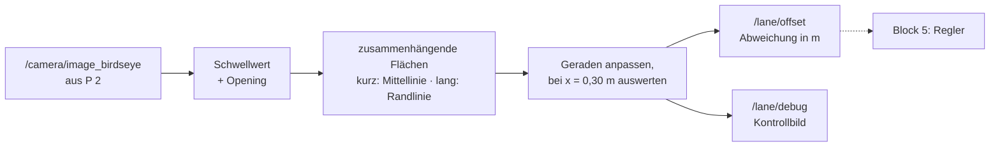

<!--

author:   Sebastian Zug & Claude Code (Opus 5.5) mit LiaScript Teaching-Agent
email:    sebastian.zug@informatik.tu-freiberg.de
version:  0.2.0
language: de
narrator: Deutsch Female

import:   https://raw.githubusercontent.com/TUBAF-IfI-LiaScript/VL_SoftwareprojektRobotik/refs/heads/master/config.md
          https://raw.githubusercontent.com/liaTemplates/mermaid_template/master/README.md

-->

[](https://liascript.github.io/course/?https://raw.githubusercontent.com/TUBAF-IfI-LiaScript/VL_SoftwareprojektRobotik/refs/heads/master/exercises/praktikum_03_spurerkennung/README.md)

# Praktikum 3: Fahrspur erkennen

<!-- data-type="none" -->
| Parameter            | Kursinformationen                                                                                                          |
| -------------------- | -------------------------------------------------------------------------------------------------------------------------- |
| **Veranstaltung:**   | @config.lecture                                                                                                            |
| **Semester**         | @config.semester                                                                                                           |
| **Hochschule:**      | `Technische Universität Freiberg`                                                                                          |
| **Inhalte:**         | `Fahrbahnlinien in der Draufsicht finden, Mittel- und Randlinie unterscheiden, Abweichung von der Spurmitte bestimmen`     |
| **Link auf GitHub:** | https://github.com/TUBAF-IfI-LiaScript/VL_SoftwareprojektRobotik/blob/master/exercises/praktikum_03_spurerkennung/README.md |
| **Autoren**          | @author                                                                                                                    |

--------------------------------------------------------------------------------

**Heute lernt Ihr TurtleBot zu sehen, wo er auf der Straße steht.** Aus der Draufsicht von P 2 bestimmen Sie eine einzige Zahl: wie weit die Mitte Ihrer Fahrspur **30 cm vor dem Roboter** seitlich neben ihm liegt. Diese Zahl ist die Schnittstelle zu Block 5 — dort regelt ein Regler sie auf null, und der Roboter fährt die Spur entlang. Gesteuert wird heute noch nicht; der Roboter wird von Hand geschoben.

Die Verkehrswelt hat nur weiße Linien. Ihre eigene Spur liegt — wie im Straßenverkehr — zwischen der **durchgezogenen Randlinie rechts** und der **gestrichelten Mittellinie**. Weil alle Linien gleich hell sind, unterscheiden Sie sie an ihrer **Form**: Ein Strich der Mittellinie ist kurz, ein Stück Randlinie lang.



**Steckbrief der Schnittstelle** — darauf verlässt sich später Ihr Regler:

<!-- data-type="none" -->
| Eigenschaft     | Festlegung                                                                                          |
| :-------------- | :-------------------------------------------------------------------------------------------------- |
| Topic, Typ      | `/lane/offset`, `std_msgs/msg/Float32`                                                               |
| Wert            | seitliche Abweichung des Roboters von der Spurmitte in **m**                                         |
| Vorzeichen      | **positiv**, wenn der Roboter **links** von der Spurmitte steht ($y$ wächst nach links, VL 4)        |
| Messstelle      | $x = 0{,}30$ m vor `base_footprint` (Parameter `vorausschau`, **fest**)                              |
| Rate            | ein Wert je Kamerabild                                                                               |
| keine Linie     | **keine** Nachricht — besser als ein geratener Wert                                                  |

Warum 30 cm voraus und nicht an der Radachse? Ein Fahrer schaut auch nach vorn, nicht auf die eigenen Räder. Die Abweichung vorn enthält zwei Anteile: wie weit der Roboter seitlich versetzt ist, und wohin er schaut. Steht er mittig, aber um den Winkel $\psi$ verdreht, meldet der Knoten etwa $0{,}30\,\text{m} \cdot \sin\psi$ — so kann der Regler schon einlenken, bevor der Roboter die Spur verlässt.

**Ziele** — am Ende dieses Praktikums können Sie als Gruppe

+ weiße Fahrbahnlinien in der Draufsicht freistellen und Mittel- und Randlinie an ihrer Form unterscheiden,
+ die seitliche Abweichung von der Spurmitte in Metern bestimmen und mit dem Zollstock prüfen,
+ Ihre Erkennung an die echte Strecke anpassen und ihr Verhalten bei wechselndem Licht und verdeckten Linien beurteilen.

**Ablauf (90 min)** — Nachweis 1 und 2 laden Sie vor dem Termin hoch; im Labor zeigen Sie jeden weiteren Nachweis, sobald der Teil fertig ist.

<!-- data-type="none" -->
| Zeit   | Teil                                                      | Wendet an           | Nachweis |
| ------ | --------------------------------------------------------- | ------------------- | -------- |
| vorab  | Vorbereitung zu Hause                                     | VL 3, VL 4, VL 6, Ü 3 | 1, 2   |
| 10 min | Sicherheit, Rollen, Verbinden, Kalibrierung prüfen        | P 1, P 2            | —        |
| 10 min | A: Kette live starten (aus P 2 nachgeholt)                | P 2, Ü 2            | 3        |
| 20 min | B: Erkennung an die Strecke anpassen                      | VL 6, Ü 2           | 4        |
| 20 min | C: Abweichung nachmessen                                  | VL 4                | 5        |
| 20 min | D: Licht und verdeckte Linien                             | VL 6                | 6, 7     |
| 10 min | Verständnisfrage, Roboter zurückgeben, Puffer             | —                   | 8        |

--------------------------------------------------------------------------------

<!-- kurslandkarte:wo-start -->

## Wo stehen wir?

**Ziel im Projekt:** Ihr TurtleBot erkennt die Fahrspur im Kamerabild.

**Block 2 · Sensorgrundlagen** – Termin 15 von 32, heute markiert mit ▶

<!-- data-type="none" -->
| Woche ab | Vorlesung | Übung | Praktikum |
| :-- | :-- | :-- | :-- |
| 30.11.2026 | [VL 5 Sensorik](https://liascript.github.io/course/?https://raw.githubusercontent.com/TUBAF-IfI-LiaScript/VL_SoftwareprojektRobotik/master/01_Sensorik/01_Sensorik.md) |  |  |
| 7.12.2026 | [VL 6 Bildverarbeitung](https://liascript.github.io/course/?https://raw.githubusercontent.com/TUBAF-IfI-LiaScript/VL_SoftwareprojektRobotik/master/05_Bildverarbeitung/05_Bildverarbeitung.md)<br>[VL 7 Kamera + Draufsicht](https://liascript.github.io/course/?https://raw.githubusercontent.com/TUBAF-IfI-LiaScript/VL_SoftwareprojektRobotik/master/06_Kamera_Stereo/06_Kamera_Stereo.md) |  |  |
| 14.12.2026 | VL 8 LiDAR |  |  |
| 4.1.2027 |  | Ü 3 Datenvisualisierung |  |
| 11.1.2027 |  | Ü 4 Kameradaten | [P 2 Bildkorrektur](https://liascript.github.io/course/?https://raw.githubusercontent.com/TUBAF-IfI-LiaScript/VL_SoftwareprojektRobotik/master/exercises/praktikum_02_bildkorrektur/README.md) |
| **18.1.2027** |  |  | **▶ [P 3 Spurerkennung](https://liascript.github.io/course/?https://raw.githubusercontent.com/TUBAF-IfI-LiaScript/VL_SoftwareprojektRobotik/master/exercises/praktikum_03_spurerkennung/README.md)** |

- **Sie brauchen:** [Parameter und Parameterdatei](https://tubaf-ifi-liascript.github.io/VL_SoftwareprojektRobotik/kurslandkarte/#begriff=paramfile) (Ü 2) · [Schwellwertoperation](https://tubaf-ifi-liascript.github.io/VL_SoftwareprojektRobotik/kurslandkarte/#begriff=thresholding) (VL 6) · [Morphologische Operationen](https://tubaf-ifi-liascript.github.io/VL_SoftwareprojektRobotik/kurslandkarte/#begriff=morphologie) (VL 6) · [Draufsicht (Vogelperspektive)](https://tubaf-ifi-liascript.github.io/VL_SoftwareprojektRobotik/kurslandkarte/#begriff=draufsicht) (VL 7) · [Vorausschau](https://tubaf-ifi-liascript.github.io/VL_SoftwareprojektRobotik/kurslandkarte/#begriff=vorausschau) (VL 7)
- **Heute:** anwenden, nichts Neues – Ihre Arbeit hier ist die Prüfungsleistung

> [!TIP]
> **Tipp – Kurslandkarte:** [Ganze Kurslandkarte öffnen](https://tubaf-ifi-liascript.github.io/VL_SoftwareprojektRobotik/kurslandkarte/#termin=p3) – dort finden Sie jeden Begriff mit Erklärung, typischer Stolperfalle, Link auf die passende Folie und die roten Fäden durch die Veranstaltung.

<!-- kurslandkarte:wo-ende -->

## Vorbereitung zu Hause

**Voraussetzung:** Ihr Paket `verkehrswelt` aus P 2 läuft, d.h. `image_corrector` liefert mit den Testdaten von P 2 eine richtige Draufsicht. Ist das nicht der Fall, melden Sie sich **vor** dem Termin bei den Betreuern.

Rechnen Sie mit **2 bis 3 Stunden**. Laden Sie die Ergebnisse von Schritt 4 und 5 **vor dem Termin** in das Git-Repository Ihrer Gruppe hoch (Nachweise 1 und 2). Fehlen sie, arbeitet Ihre Gruppe im Labor zuerst daran.

**1. Dateien ins Paket übernehmen.** Holen Sie den aktuellen Stand des Kurs-Repositorys und kopieren Sie die drei Vorlagen in Ihr Paket:

```bash
cd ~/kurs && git pull
cp ~/kurs/exercises/praktikum_03_spurerkennung/lane_detector.py ~/ros2_ws/src/verkehrswelt/verkehrswelt/
cp ~/kurs/exercises/praktikum_03_spurerkennung/spurerkennung.launch.py ~/ros2_ws/src/verkehrswelt/launch/
cp ~/kurs/exercises/praktikum_03_spurerkennung/spur.yaml ~/ros2_ws/src/verkehrswelt/config/
```

**2. Knoten anmelden.** Tragen Sie den neuen Knoten in `setup.py` unter `console_scripts` ein (VL 3), so wie die beiden aus P 2:

```python
'lane_detector = verkehrswelt.lane_detector:main',
```

Neue Dateien und eine geänderte `setup.py` brauchen einen neuen Build:

```bash
cd ~/ros2_ws
colcon build --symlink-install --packages-select verkehrswelt
source install/setup.bash
```

**3. TODOs ergänzen** in `lane_detector.py`. Den Rest der Datei — Flächen einteilen, Geraden anpassen, Bruchstücke anderer Linien aussortieren, Kontrollbild — gibt die Vorlage vor.

<!-- data-type="none" -->
| TODO | Was                                                                                  | Wo gelernt |
| :--: | :----------------------------------------------------------------------------------- | :--------- |
| 1    | Binärmaske mit Schwellwert (fest oder adaptiv)                                       | VL 6       |
| 2    | Störpixel mit einem Opening entfernen                                                | VL 6       |
| 3    | Flächen nach ihrer Länge einteilen: Strich der Mittellinie oder Stück Randlinie      | VL 6       |
| 4    | $y$ der Spurmitte aus Mittel- und Randlinie; fehlt eine, aus der anderen schätzen    | VL 4       |
| 5    | Abweichung des Roboters mit dem richtigen Vorzeichen                                 | VL 4       |

Zu TODO 4 und 5 ein Beispiel. Alle Werte sind $y$-Koordinaten in `base_footprint` bei $x = 0{,}30$ m; $y$ wächst nach **links**, der Roboter liegt bei $y = 0$, die Spurbreite ist $b = 0{,}22$ m:

<!-- data-type="none" -->
| Was ist zu sehen?                 | Mittellinie | Randlinie rechts | Spurmitte                         | `/lane/offset` |
| :-------------------------------- | ----------: | ---------------: | :-------------------------------- | -------------: |
| beide Linien                      | $+0{,}08$   | $-0{,}14$        | $(0{,}08 - 0{,}14)/2 = -0{,}03$   | $+0{,}03$      |
| nur die Mittellinie               | $+0{,}08$   | —                | $0{,}08 - b/2 = -0{,}03$          | $+0{,}03$      |
| nur die Randlinie                 | —           | $-0{,}14$        | $-0{,}14 + b/2 = -0{,}03$         | $+0{,}03$      |
| keine Linie                       | —           | —                | `None`                            | kein Wert      |

Die Spurmitte liegt hier 3 cm **rechts** vom Roboter — der Roboter steht also 3 cm **links** von ihr, und `/lane/offset` meldet $+0{,}03$.

**4. Mit der Testfahrt prüfen.** Im Ordner `testdaten/` liegt eine berechnete Fahrt von 30 Sekunden: Der Roboter pendelt um die Spurmitte, ein Stück lang fehlt die Mittellinie, ein Stück lang die Randlinie, im letzten Drittel wird es dunkler. Zu jedem Bild ist die richtige Abweichung bekannt (`offset_soll.csv`), und `vergleiche.py` vergleicht Ihre Werte damit.

```bash
# Terminal 1: Bildkorrektur und Spurerkennung mit der Testkamera
ros2 launch verkehrswelt spurerkennung.launch.py \
  kalibrierdatei:=$HOME/kurs/exercises/praktikum_03_spurerkennung/testdaten/ost_test.yaml \
  homographie:=$HOME/kurs/exercises/praktikum_03_spurerkennung/testdaten/homographie_test.yaml

# Terminal 2: Vergleich starten, BEVOR die Fahrt läuft
python3 ~/kurs/exercises/praktikum_03_spurerkennung/testdaten/vergleiche.py \
  ~/kurs/exercises/praktikum_03_spurerkennung/testdaten/offset_soll.csv

# Terminal 3: Testfahrt einmal abspielen, danach Terminal 2 mit Strg+C beenden
ros2 bag play ~/kurs/exercises/praktikum_03_spurerkennung/testdaten/fahrt_test
```

So sieht ein bestandener Selbsttest aus (die genauen Zahlen schwanken leicht; ein paar Bilder gehen beim Start verloren):

```text
ok     Werte erhalten                       269 zu 282 empfangenen Bildern (95 %)
ok     systematischer Fehler |Mittelwert|   0.1 mm
ok     größte Abweichung                    1.9 mm
ok     Vorzeichen richtig (|Soll| > 1 cm)   100.0 %
Selbsttest bestanden.
```

Sehen Sie sich dabei `/lane/debug` in `rqt` an: Striche der Mittellinie sind gelb, Randlinien blau, die dunkelrote senkrechte Linie ist die Mittelachse des Roboters, der rote Punkt die erkannte Spurmitte bei 0,30 m. Ohne erkannte Linie steht oben „keine Linie“.

📝 Speichern Sie die Ausgabe von `vergleiche.py` und ein Bildschirmfoto von `/lane/debug` als `praktikum_03/vorbereitung.txt` und `.png` im Gruppen-Repository (**Nachweis 1**).

<details>
<summary>Fehlerbilder und ihre Ursache</summary>

<!-- data-type="none" -->
| Was Sie sehen                                                             | Wahrscheinliche Ursache                                                                     |
| :------------------------------------------------------------------------ | :------------------------------------------------------------------------------------------ |
| `Keine Werte auf /lane/offset empfangen`, in Terminal 1 ein Traceback mit `cv2.error … Bad argument` oder `UMat` | TODO 1: `cv2.threshold` liefert zwei Werte — `_, maske = …`; die Maske muss `uint8` sein |
| `TypeError` mit `NoneType` in Terminal 1                                  | TODO 4: mit `None` gerechnet — erst prüfen, welche Linien da sind                           |
| Vorzeichen fast immer falsch                                              | TODO 5: Die Abweichung ist das **Negative** der Spurmitte                                   |
| deutlich weniger Werte als Bilder (etwa die Hälfte)                       | TODO 4: Fall „nur eine Linie sichtbar“ fehlt                                                |
| großer Fehler nur in den Abschnitten mit fehlender Linie                  | TODO 4: Vorzeichen von $b/2$ im Ersatzfall, oder ganze statt halbe Spurbreite               |
| systematischer Fehler etwa 6 bis 11 cm                                    | TODO 4: Spurmitte = eine der Linien statt halber Weg                                        |
| im Debug-Bild Striche blau und Randlinie gelb                             | TODO 3: Vergleich mit `strich_max_laenge` vertauscht                                        |
| viele Warnungen „keine Linie“, vor allem im letzten Drittel               | `schwelle` zu hoch für das dunklere Bild — in `spur.yaml` senken                            |

</details>

**5. Mit Ihrer Aufnahme aus P 2** — jetzt mit Ihrer eigenen Kamera, Kalibrierung und Homographie. Holen Sie die Aufnahme vom gemeinsamen Speicher Ihrer Gruppe nach `~/p2_daten/spur_p2`, dann:

```bash
ros2 launch verkehrswelt spurerkennung.launch.py \
  kalibrierdatei:=$HOME/ros2_ws/src/verkehrswelt/kalibrierung/ost.yaml \
  homographie:=$HOME/ros2_ws/src/verkehrswelt/kalibrierung/homographie.yaml
ros2 bag play ~/p2_daten/spur_p2
```

Zeichnen Sie die Abweichung mit `rqt` auf (_Plugins → Visualization → Plot_, Feld `/lane/offset/data`, Ü 3). Erwartet ist: Haben Sie den Roboter nach **links** versetzt geschoben, schlägt die Kurve nach **oben** aus. In einer Kurve schlägt sie aus, obwohl Sie mittig geschoben haben — warum? (Tipp: Steckbrief.)

📝 Bildschirmfoto des Plots mit zwei Sätzen zu diesen beiden Beobachtungen als `praktikum_03/plot_spur_p2.png` im Gruppen-Repository (**Nachweis 2**). Funktioniert die Erkennung auf Ihrer echten Strecke noch nicht, notieren Sie, woran es liegt — genau das passen Sie in Teil B an.

## Sicherheit, Rollen, Verbinden, Kalibrierung prüfen

**Sicherheit**

+ Der Roboter **fährt heute nicht** selbst. Starten Sie keine Teleop- oder anderen Fahrknoten; Sie schieben ihn von Hand.
+ Fassen Sie ihn unten am Gehäuse an, **nicht an Kamera und Kabeln** — eine verstellte Kamera macht die Homographie aus P 2 ungültig, und alle Werte stimmen nicht mehr.
+ Leuchten Sie in Teil D nicht in Augen oder direkt in die Kamera. Achten Sie an der Strecke auf die Nachbargruppen.
+ Akku: Ist die Spannung zu niedrig, melden Sie das den Betreuern.

**Rollen** — je Teil wechseln, jede Person ist mindestens einmal an der Tastatur (bei der Verständnisfrage kann jede gefragt werden):

<!-- data-type="none" -->
| Rolle          | Aufgabe                                                            |
| :------------- | :----------------------------------------------------------------- |
| Roboter        | schiebt und stellt den Roboter, misst mit dem Zollstock            |
| Tastatur       | startet die Befehle, ändert Parameter, prüft die Ausgaben           |
| Protokoll      | hält die 📝-Antworten und Bildschirmfotos fest                     |

In Zweiergruppen übernimmt die Person am Roboter auch das Protokoll. **Protokoll:** `praktikum_03/PROTOKOLL.md`, hochladen nach dem Praktikum, spätestens zu Beginn von P 4.

**Verbinden** wie in P 1 und P 2.

**Kalibrierung prüfen:** Sie arbeiten mit Ihrem Roboter aus P 2 (Nummer im Protokoll von P 2). 📝 Sitzt die Kamera noch genau so? Ist sie sichtbar verstellt oder wurde der Roboter repariert, sagen Sie es **sofort** den Betreuern — Ihre Kalibrierung gehört zu genau dieser Kamerastellung.

## A: Kette live starten

Diesen Test haben Sie aus P 2 hierher verschoben: Hält Ihre Kette mit dem echten Kamerabild Schritt?

```bash
ros2 launch verkehrswelt spurerkennung.launch.py \
  kalibrierdatei:=$HOME/ros2_ws/src/verkehrswelt/kalibrierung/ost.yaml \
  homographie:=$HOME/ros2_ws/src/verkehrswelt/kalibrierung/homographie.yaml
```

Stellen Sie den Roboter mittig in seine Spur. In einem zweiten Terminal (Ü 2):

```bash
ros2 topic hz /camera/image_raw/compressed
```

Beenden Sie es mit `Strg+C`, dann `ros2 topic hz /lane/offset`.

📝 Mit welcher Rate kommen Kamerabilder und Abweichungen an? Liegt `/lane/offset` deutlich darunter, sieht Ihr Knoten nicht jedes Bild — oder er findet in manchen keine Linie (Warnung in Terminal 1).

→ **Nachweis 3** zeigen.

## B: Erkennung an die Strecke anpassen

Die Voreinstellungen in `spur.yaml` passen zur Testfahrt, nicht unbedingt zu Ihrer Strecke. Ändern Sie sie bei laufendem Knoten mit `ros2 param set` (Ü 2) und beobachten Sie `/lane/debug`. Der Knoten liest seine Parameter bei jedem Bild neu, deshalb wirkt eine Änderung sofort.

```bash
ros2 param set /lane_detector schwelle 140
ros2 param set /lane_detector spurbreite 0.23
```

Kommazahlen immer mit **Dezimalpunkt**, auch bei runden Werten (`1.0` statt `1`) — sonst meldet ROS `Wrong parameter type`. Meldet `ros2 param` „Node not found“, warten Sie nach dem Start ein paar Sekunden.

<!-- data-type="none" -->
| Parameter            | Wann ändern?                                                                          |
| :------------------- | :------------------------------------------------------------------------------------ |
| `spurbreite`         | immer: Ihr Zollstockwert aus P 2, C.3 (Linienmitte bis Linienmitte)                   |
| `schwelle`           | Linien zerfallen in Stücke → kleiner; Spiegelungen auf dem Boden werden weiß → größer |
| `min_flaeche`        | kleine Flecken werden als Linie erkannt → größer                                      |
| `strich_max_laenge`  | Striche werden blau oder Randlinien gelb → an die Strichlänge Ihrer Strecke anpassen  |
| `vorausschau`        | **nie** — sie gehört zur Schnittstelle (Steckbrief)                                   |

Reicht eine feste Schwelle nicht, dürfen Sie in TODO 1 auch den adaptiven Schwellwert aus VL 6 verwenden.

📝 Welche Werte haben Sie gewählt, und warum? Bildschirmfoto von `/lane/debug`: Mittellinie gelb, Randlinie blau, roter Punkt zwischen beiden.

→ **Nachweis 4** zeigen.

## C: Abweichung nachmessen

Prüfen Sie Ihre Zahl mit dem Zollstock. Die Spurmitte liegt auf halbem Weg zwischen der Mitte der Randlinie und der Mitte der Mittellinie.

**Anlegehilfe:** Legen Sie den Zollstock parallel zur rechten Randlinie auf den Boden und schieben Sie den Roboter mit seiner rechten Seite daran entlang — so steht er parallel zur Spur. Den Abstand der Radachse zur Randlinie messen Sie quer dazu.

1. Roboter parallel, Radachse über der Spurmitte. 📝 Was meldet `ros2 topic echo /lane/offset`?
2. Parallel um **5 cm nach links**, dann um **5 cm nach rechts** versetzt. 📝 Werte?
3. Auf der Spurmitte um etwa 15° nach links gedreht. 📝 Warum meldet der Knoten jetzt eine Abweichung, obwohl die Radachse genau auf der Spurmitte steht? Passt der Wert zu $0{,}30\,\text{m} \cdot \sin 15°$?

<details>
<summary>Alle Werte sind um denselben Betrag verschoben?</summary>

Dann stimmt die Lage der Draufsicht nicht: Lag das Schachbrett in P 2, C.1 nicht genau mittig, ist die ganze Draufsicht seitlich verschoben. Für die Abnahme zählt deshalb vor allem der **Unterschied** zwischen „links“ und „rechts“. Notieren Sie den Versatz — für den Regler in Block 5 sollten Sie die Homographie neu bestimmen.

</details>

→ **Nachweis 5** zeigen.

## D: Licht und verdeckte Linien

**D.1 Licht.** Prüfen Sie Ihre Erkennung in den **zwei Lichtsituationen, die die Betreuer vorgeben** (z.B. Deckenlicht an und aus), mit dem Roboter mittig in der Spur. 📝 Bleibt der Wert aus C.1 auf ±2 cm stabil, oder kommt eine Warnung statt eines Werts? Beides ist in Ordnung — falsch ist nur ein Wert, der deutlich danebenliegt. Passen Sie die `schwelle` so an, dass beide Situationen funktionieren, und notieren Sie den Kompromiss.

**D.2 Verdeckte Linien.** Legen Sie die matte schwarze Abdeckung der Betreuer (kein weißes Papier — das wäre selbst eine helle Fläche!) nacheinander auf

1. die Mittellinie vor dem Roboter,
2. die Randlinie,
3. beide Linien.

📝 Was meldet `/lane/offset` jeweils, was zeigen Terminal 1 und `/lane/debug`? Bei 1. und 2. soll der Wert aus der verbleibenden Linie und der Spurbreite auf ±2 cm weiter stimmen, bei 3. soll **kein** Wert kommen, sondern eine Warnung. Warum ist „kein Wert“ für den Regler in Block 5 besser als ein geschätzter?

→ **Nachweise 6 und 7** zeigen.

## Abnahme

Die Praktika sind Ihre Prüfungsleistung.

<!-- data-type="none" -->
| Nr. | Nachweis                                                                                                          | Aus Teil     |
| --- | ----------------------------------------------------------------------------------------------------------------- | ------------ |
| 1   | vor dem Termin im Gruppen-Repository: `vergleiche.py` meldet „Selbsttest bestanden“, dazu das Debug-Bild           | Vorbereitung |
| 2   | vor dem Termin im Gruppen-Repository: Plot über `spur_p2` mit den zwei Beobachtungen                              | Vorbereitung |
| 3   | Kette läuft live; `/lane/offset` erreicht mindestens 90 % der Kamerarate                                          | A            |
| 4   | Parameter mit gemessener Spurbreite und begründeter Schwelle; Debug-Bild mit richtig eingefärbten Linien           | B            |
| 5   | Wert „links“ minus Wert „rechts“ ergibt $0{,}10$ m ± 2 cm; der mittige Wert liegt bei 0 ± 3 cm                     | C            |
| 6   | Beide Lichtsituationen: Wert auf ±2 cm stabil oder Warnung statt Wert; Kompromiss für die Schwelle notiert         | D            |
| 7   | Eine Linie verdeckt: Wert auf ±2 cm wie in C.1; beide verdeckt: Warnung, kein Wert                                | D            |
| 8   | **Verständnisfrage** an ein von den Betreuern gewähltes Gruppenmitglied, z.B. „Warum misst Ihr Knoten 30 cm vor dem Roboter statt an der Radachse?“ | alle |

Fällt der Roboter durch einen Defekt aus, den Ihre Gruppe nicht verschuldet hat, holen Sie die fehlenden Punkte zu Beginn von P 4 nach.

**Zum Schluss**

- [ ] Endgültige Parameter sichern — erst jetzt, weil Sie die Schwelle in D vielleicht noch geändert haben: `ros2 param dump /lane_detector > ~/ros2_ws/src/verkehrswelt/config/spur.yaml` (die Kommentare der Vorlage gehen dabei verloren, zusätzliche Einträge wie `use_sim_time` sind normal)
- [ ] Paket und Protokoll in das Git-Repository Ihrer Gruppe übertragen
- [ ] Auf dem eigenen Laptop für zu Hause wieder `ROS_AUTOMATIC_DISCOVERY_RANGE=LOCALHOST` aktivieren
- [ ] Roboter und Abdeckung zurückgeben

> [!NOTE]
> **Hinweis – Ausblick:** In Block 3 kommen Hindernisse dazu — in P 4 erkennen Sie sie mit dem LiDAR. Ihre Abweichung `/lane/offset` bleibt die Eingangsgröße für den Spurfolge-Regler in Block 5.

<!-- kurslandkarte:ausblick-start -->

--------------------------------------------------------------------------------

**🗺️ Nächster Halt:** VL 9 · Objekterkennung (Woche ab 25.1.2027) – Sie erkennen Schilder, Ampeln und Fußgängerfiguren im Kamerabild. [Auf der Kurslandkarte ansehen](https://tubaf-ifi-liascript.github.io/VL_SoftwareprojektRobotik/kurslandkarte/#termin=07)

<!-- kurslandkarte:ausblick-ende -->
