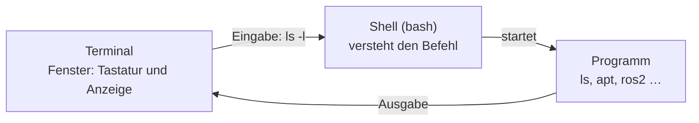

<!--

author:   Sebastian Zug & Georg Jäger & Claude Code (Opus 5.5) mit LiaScript Teaching-Agent
email:    sebastian.zug@informatik.tu-freiberg.de & Georg.Jaeger@informatik.tu-freiberg.de
version:  0.4.1
language: de
narrator: Deutsch Female

import:   https://raw.githubusercontent.com/TUBAF-IfI-LiaScript/VL_SoftwareprojektRobotik/refs/heads/master/config.md
          https://raw.githubusercontent.com/liaTemplates/mermaid_template/master/README.md
          https://github.com/liascript/CodeRunner

@bash:      @LIA.eval(`["main.sh"]`, `none`, `bash main.sh`)
@bashShell: @LIA.eval(`["main.sh"]`, `none`, `bash --rcfile main.sh -i`)
@bashLog:   @LIA.eval(`["main.sh", "ros.log"]`, `none`, `bash main.sh`)

-->

[](https://liascript.github.io/course/?https://raw.githubusercontent.com/TUBAF-IfI-LiaScript/VL_SoftwareprojektRobotik/refs/heads/master/exercises/uebung_01_linux_shell/README.md)

# Übung: OS + Linux Shell

<!-- data-type="none" -->
| Parameter            | Kursinformationen                                                                                                       |
| -------------------- | ----------------------------------------------------------------------------------------------------------------------- |
| **Veranstaltung:**   | @config.lecture                                                                                                         |
| **Semester**         | @config.semester                                                                                                        |
| **Hochschule:**      | `Technische Universität Freiberg`                                                                                       |
| **Inhalte:**         | `Arbeiten im Linux-Terminal: Dateisystem, Rechte, Prozesse, Umgebungsvariablen – und ROS 2 Jazzy installieren`          |
| **Link auf GitHub:** | https://github.com/TUBAF-IfI-LiaScript/VL_SoftwareprojektRobotik/blob/master/exercises/uebung_01_linux_shell/README.md |
| **Autoren**          | @author                                                                                                                 |

--------------------------------------------------------------------------------

**Zielstellung der heutigen Übung** — nach der Übung können Sie

+ ROS 2 Jazzy über die Paketverwaltung installieren und die zentralen Installationsbefehle erklären,
+ sich im Linux-Dateisystem mit absoluten und relativen Pfaden bewegen,
+ Dateien anlegen, durchsuchen und Ausgaben mit Pipes verknüpfen,
+ Dateirechte lesen und eigene Skripte ausführbar machen,
+ Prozesse starten, finden und über Signale gezielt beenden,
+ erklären, warum `source /opt/ros/jazzy/setup.bash` in jedem Terminal nötig ist.

**Bitte mitbringen:** Ihren Laptop mit Ubuntu 24.04 (nativ oder WSL2), Netzteil und mindestens 10 GB freiem Speicher. Führen Sie **vorher zu Hause** einmal `sudo apt update && sudo apt upgrade` aus — dann muss in der Übung nur noch ROS 2 selbst geladen werden (gut 900 MB).

**Ablauf (90 min)**

<!-- data-type="none" -->
| Zeit      | Inhalt                                                         |
| --------- | -------------------------------------------------------------- |
| 15 min    | Terminal und Shell, ROS 2 installieren starten                 |
| 10 min    | Dateisystem + Aufgabe 1 (ab jetzt im Arbeits-Terminal)         |
| 15 min    | Dateien und Pipes + Aufgabe 2                                  |
| 10 min    | Rechte, Prozesse und Signale + Aufgabe 3                       |
| 20 min    | Umgebungsvariablen + Aufgaben 4 und 5                          |
| 5 min     | Aufgabe 6: Die Installation rückwärts lesen                    |
| 10 min    | ROS 2 einrichten und testen, sobald die Installation fertig ist |
| 5 min     | Puffer                                                         |

**Pflichtkern:** alle Aufgaben und die drei Tests am Ende. Mit ⏱ markierte Teile bearbeiten Sie nur, wenn Zeit bleibt. Rechnen Sie damit, dass die Installation erst nach 45 bis 60 Minuten fertig ist — wenn alle gleichzeitig laden, wird das WLAN langsam.

Der Selbsttest eignet sich zur Wiederholung zu Hause. Die Abschnitte „Zum Nachschlagen“ am Ende gehören nicht zum Zeitplan.

--------------------------------------------------------------------------------

<!-- kurslandkarte:wo-start -->

## Wo stehen wir?

**Ziel im Projekt:** Ihr Rechner wird zur Werkbank: Ohne sicheren Umgang mit der Shell können Sie ROS 2 weder installieren noch starten.

**Block 1 · ROS-Grundlagen** – Termin 3 von 32, heute farbig markiert

<!-- data-type="none" -->
| Woche | Vorlesung | Übung | Praktikum |
| :-- | :-- | :-- | :-- |
| KW 43 · 19.–23.10. | [VL 00 Einführung](https://liascript.github.io/course/?https://raw.githubusercontent.com/TUBAF-IfI-LiaScript/VL_SoftwareprojektRobotik/master/00_Einfuehrung/00_Einfuehrung.md) · Mi 21.10. |  |  |
| **KW 44 · 26.–30.10.**<!-- style="background-color: rgba(255, 166, 0, 0.35); padding: 2px 6px; border-radius: 4px;" --> | [VL 01 ROS 2 Grundlagen](https://liascript.github.io/course/?https://raw.githubusercontent.com/TUBAF-IfI-LiaScript/VL_SoftwareprojektRobotik/master/01_ROS_Grundlagen/01_ROS_Grundlagen.md) · Mi 28.10. | **[Ü 1 Linux Shell](https://liascript.github.io/course/?https://raw.githubusercontent.com/TUBAF-IfI-LiaScript/VL_SoftwareprojektRobotik/master/exercises/uebung_01_linux_shell/README.md)**<!-- style="background-color: rgba(255, 166, 0, 0.35); padding: 2px 6px; border-radius: 4px;" --> · Do 29.10. |  |
| KW 45 · 2.–6.11. | [VL 02 ROS 2 Pakete](https://liascript.github.io/course/?https://raw.githubusercontent.com/TUBAF-IfI-LiaScript/VL_SoftwareprojektRobotik/master/02_ROS_Pakete/02_ROS_Pakete.md) · Mi 4.11. |  |  |
| KW 46 · 9.–13.11. | [VL 03 Koordinaten + QoS](https://liascript.github.io/course/?https://raw.githubusercontent.com/TUBAF-IfI-LiaScript/VL_SoftwareprojektRobotik/master/03_Koordinaten_QoS/03_Koordinaten_QoS.md) · Mi 11.11. | [Ü 2 Erster Workspace](https://liascript.github.io/course/?https://raw.githubusercontent.com/TUBAF-IfI-LiaScript/VL_SoftwareprojektRobotik/master/exercises/uebung_02_workspace/README.md) · Do 12.11. |  |
| KW 48 · 23.–27.11. |  |  | [P 1 TurtleBot + Bags](https://liascript.github.io/course/?https://raw.githubusercontent.com/TUBAF-IfI-LiaScript/VL_SoftwareprojektRobotik/master/exercises/praktikum_01_turtlebot/README.md) · Mi 25.11. + Do 26.11. |

- **Heute neu:** [Terminal & Shell](https://tubaf-ifi-liascript.github.io/VL_SoftwareprojektRobotik/kurslandkarte/#begriff=shell) · [Absolute & relative Pfade](https://tubaf-ifi-liascript.github.io/VL_SoftwareprojektRobotik/kurslandkarte/#begriff=pfade) · [Umgebungsvariable](https://tubaf-ifi-liascript.github.io/VL_SoftwareprojektRobotik/kurslandkarte/#begriff=umgebung) · [source](https://tubaf-ifi-liascript.github.io/VL_SoftwareprojektRobotik/kurslandkarte/#begriff=source)

> [!TIP]
> **Tipp – Kurslandkarte:** [Ganze Kurslandkarte öffnen](https://tubaf-ifi-liascript.github.io/VL_SoftwareprojektRobotik/kurslandkarte/#termin=ue1) – dort finden Sie jeden Begriff mit Erklärung, typischer Stolperfalle, Link auf die passende Folie und die roten Fäden durch die Veranstaltung.

<!-- kurslandkarte:wo-ende -->

## Terminal und Shell

Heute bringen Sie ROS 2 auf Ihren Rechner — nicht per Klick, sondern mit ein paar Zeilen im Terminal. So läuft es in der Robotik fast immer: ROS 2 wird über die Kommandozeile installiert, gestartet und untersucht. Und viele Fehler der nächsten Wochen sind in Wahrheit keine ROS-Fehler, sondern Fehler in der Shell-Umgebung: eine vergessene Umgebungsvariable, ein falscher Pfad, fehlende Rechte.

Zwei Begriffe werden dabei gern verwechselt:

+ **Terminal** — das Fenster, in das Sie Text tippen und in dem Ausgaben erscheinen. Es versteht selbst keinen einzigen Befehl, es reicht nur Text weiter. Unter Ubuntu heißt es einfach „Terminal“, unter Windows „Windows Terminal“.
+ **Shell** — das Programm, das im Terminal läuft, Ihre Eingabe liest, versteht und die passenden Programme startet. Bei Ubuntu ist das die `bash`.
+ **Prompt** — die Eingabeaufforderung der Shell, z. B. `student@laptop:~/ros2_ws$` (Benutzer, Rechner, aktuelles Verzeichnis). Steht der Prompt da, wartet die Shell auf Ihren nächsten Befehl.



**Ihre Arbeitsumgebung**

<!-- data-type="none" -->
| Variante                  | Bemerkung                                                                                  |
| ------------------------- | ------------------------------------------------------------------------------------------ |
| Ubuntu 24.04 nativ        | empfohlen — alle Werkzeuge der Veranstaltung laufen direkt                                  |
| WSL2 unter Windows        | gute Alternative: `wsl --install -d Ubuntu-24.04` in der PowerShell als Administrator, danach Neustart — vor der Übung erledigen |
| Rechner in der Lessingstraße | Ubuntu vorinstalliert — Ausweichlösung, solange Ihr eigenes System noch nicht läuft       |

Läuft bei Ihnen noch kein Ubuntu 24.04, setzen Sie sich an einen der Rechner in der Lessingstraße. Dort gehen Sie genauso vor wie Ihre Kommilitonen am eigenen Laptop. Auf Ihrem eigenen Rechner holen Sie die Installation später nach der [Installationsanleitung](https://liascript.github.io/course/?https://raw.githubusercontent.com/TUBAF-IfI-LiaScript/VL_SoftwareprojektRobotik/refs/heads/master/exercises/installation_ros2/README.md) nach.

**Die ersten Handgriffe**

+ **Terminal öffnen:** Ubuntu: `Strg+Alt+T`. Windows: Startmenü → „Ubuntu 24.04“ oder im *Windows Terminal* das Profil „Ubuntu 24.04“.
+ **Befehle kopieren statt abtippen:** mit dem Kopierknopf rechts oben am grauen Kasten. Eingefügt wird im Terminal mit `Strg+Shift+V` oder per Rechtsklick, nicht mit `Strg+V`. Das Windows Terminal fragt beim Einfügen mehrerer Zeilen nach — bestätigen Sie mit „Trotzdem einfügen“.
+ **Passwort:** `sudo` fragt nach Ihrem Passwort; die Eingabe bleibt unsichtbar, das ist normal. Unter WSL2 ist es das Passwort, das Sie beim Einrichten von Ubuntu festgelegt haben.

## ROS 2 installieren

Der Download von ROS 2 dauert lange. Deshalb starten Sie die Installation jetzt in einem eigenen Terminal, lassen sie dort weiterlaufen und lernen währenddessen in einem zweiten Terminal die Shell kennen. Was die einzelnen Befehle bedeuten, können Sie am Ende der Übung selbst erklären — in Aufgabe 6 lesen Sie die Installation rückwärts.

Öffnen Sie ein Terminal. Dieses erste Fenster ist ab jetzt Ihr **Installations-Terminal**.

> [!WARNING]
> **Stolperfalle – beim Einrichten nicht unterbrechen:** Solange `apt` nur herunterlädt, dürfen Sie abbrechen (`Strg+C`) und den Befehl später — auch zu Hause — neu starten; Geladenes bleibt erhalten. Sobald `Entpacken` bzw. `Unpacking` erscheint, schließen Sie das Installations-Terminal nicht mehr und klappen den Laptop nicht zu. Ist es doch passiert: `sudo dpkg --configure -a`, danach den Installationsbefehl wiederholen.

**Schritt 1: Passt das System?**

```bash
lsb_release -a                 # erwartet: Release 24.04, Codename noble
df -h ~                        # Spalte „Avail“: mindestens 10G frei
locale | grep -q UTF-8 && echo "UTF-8 ok" || echo "kein UTF-8: siehe Installationsanleitung"
```

Meldet die letzte Zeile „kein UTF-8“, stellen Sie den Zeichensatz nach der [Installationsanleitung, Abschnitt „Schritt 1: Paketquellen einrichten“](https://liascript.github.io/course/?https://raw.githubusercontent.com/TUBAF-IfI-LiaScript/VL_SoftwareprojektRobotik/refs/heads/master/exercises/installation_ros2/README.md#3) um.

**Schritt 2: Die Paketquelle von ROS 2 eintragen.** Ubuntu kennt ROS 2 nicht von sich aus. Sie sagen der Paketverwaltung, wo die ROS-Pakete liegen und woran sie echte Pakete erkennt:

```bash
sudo apt update && sudo apt install -y software-properties-common curl
sudo add-apt-repository -y universe
export ROS_APT_SOURCE_VERSION=$(curl -Ls -o /dev/null -w '%{url_effective}' https://github.com/ros-infrastructure/ros-apt-source/releases/latest | awk -F/ '{print $NF}')
echo "Version der Paketquelle: $ROS_APT_SOURCE_VERSION"
curl -L -o /tmp/ros2-apt-source.deb "https://github.com/ros-infrastructure/ros-apt-source/releases/download/${ROS_APT_SOURCE_VERSION}/ros2-apt-source_${ROS_APT_SOURCE_VERSION}.$(. /etc/os-release && echo ${UBUNTU_CODENAME:-${VERSION_CODENAME}})_all.deb"
sudo dpkg -i /tmp/ros2-apt-source.deb
```

Zeigt `echo` eine leere Version, hat die Anfrage an GitHub nicht geklappt — prüfen Sie die Internetverbindung und wiederholen Sie die `export`-Zeile. Hilft das nicht, setzen Sie die Version von Hand, die Betreuer nennen sie Ihnen (z. B. `export ROS_APT_SOURCE_VERSION=1.3.0`).

**Schritt 3: ROS 2 installieren.** Erst die Paketlisten mit der neuen Quelle holen und das System aktualisieren, dann ROS 2 samt allen Abhängigkeiten installieren — gut 900 MB und rund 1500 Pakete:

```bash
sudo apt update && sudo apt upgrade -y
sudo apt install -y ros-jazzy-desktop ros-dev-tools
```

`ros-jazzy-desktop` bringt ROS 2 mit allen Werkzeugen der Vorlesung (`rqt`, RViz, `turtlesim`, Beispiele), `ros-dev-tools` das Build-Werkzeug `colcon`. An der Ausgabe erkennen Sie, wie weit die Installation ist:

<!-- data-type="none" -->
| Ausgabe (deutsch / englisch)                     | Phase                                  |
| :----------------------------------------------- | :------------------------------------- |
| `Holen: 812 http://…` / `Get: 812 http://…`      | Download — dauert am längsten          |
| `Entpacken von ros-jazzy-…` / `Unpacking …`      | Pakete werden ausgepackt               |
| `… wird eingerichtet` / `Setting up …`           | Pakete werden eingerichtet             |
| der Prompt `…$` erscheint wieder                 | fertig — ein Fehler stünde in einer Zeile mit `E:` |

**Öffnen Sie jetzt ein zweites Terminal** — Ihr **Arbeits-Terminal** (Ubuntu: `Strg+Alt+T`; Windows Terminal: neuer Tab mit „Ubuntu 24.04“). Darin arbeiten Sie den Rest der Übung. Das Installations-Terminal lassen Sie in Ruhe, bis wieder der Prompt erscheint; erst dann geht es mit „ROS 2 einrichten und testen“ weiter.

## Während die Installation läuft

Erinnern Sie sich an VL 00: Sense, Think und Act sind beim TurtleBot getrennte Programme — Kameratreiber, Spurerkennung, Motorsteuerung. Unter Linux ist jedes davon ein **Prozess**, den Sie aus einem Terminal starten, beobachten und beenden. Und jedes liest seine Einstellungen aus der **Umgebung** dieses Terminals. Genau darum geht es heute.

### Wie funktionieren die Beispiele in diesem Skript?

+ **Codeblock mit Ausführen-Knopf:** Der Code läuft auf einem Server mit Ubuntu und `bash`. Sie können ihn verändern und neu starten.
+ **Interaktive Blöcke:** Nach dem Skript erscheint ein Prompt — tippen Sie weitere Befehle ein, `exit` beendet die Shell.
+ **Browser-Linux:** ein kleines Alpine-Linux (JSLinux), das komplett in Ihrem Browser läuft. Es nutzt die Shell `ash` statt `bash`; die Grundbefehle sind identisch.

> [!NOTE]
> **Hinweis – Server-Beispiele:** Die Server-Beispiele laufen jeweils in einem frischen, temporären Verzeichnis. Arbeiten Sie dort mit **relativen Pfaden** — `~` zeigt auf dem Server nicht auf ein eigenes Home-Verzeichnis.

Probieren Sie es aus: Starten Sie den Block und geben Sie danach `whoami` und `date` ein.

```bash  main.sh
echo "Hallo aus der Shell!"
echo "Ich bin gerade in: $(pwd)"
```
@bashShell

## Dateisystem

Linux kennt keine Laufwerksbuchstaben. Alles hängt in einem einzigen Baum, der bei der Wurzel `/` beginnt. Ihr persönliches Verzeichnis liegt unter `/home/benutzername` und hat die Abkürzung `~`. ROS 2 landet bei der Installation unter `/opt/ros/jazzy`.

```text
/
├── home/
│   └── student/            <- ~  (Ihr Home-Verzeichnis)
│       └── ros2_ws/
│           └── src/
├── opt/
│   └── ros/
│       └── jazzy/          <- ROS 2 Installation
├── etc/                    <- Konfigurationsdateien
├── tmp/                    <- temporäre Dateien
└── usr/bin/                <- Programme
```

<!-- data-type="none" -->
| Befehl         | Bedeutung                                   | Beispiel                       |
| -------------- | ------------------------------------------- | ------------------------------ |
| `pwd`          | aktuelles Verzeichnis anzeigen              | `pwd`                          |
| `ls`           | Inhalt auflisten (`-l` lang, `-a` versteckt)| `ls -la`                       |
| `cd`           | Verzeichnis wechseln                        | `cd ros2_ws`, `cd ..`, `cd ~`  |
| `mkdir`        | Verzeichnis anlegen (`-p` mit Zwischenpfad) | `mkdir -p ros2_ws/src`         |
| `touch`        | leere Datei anlegen                         | `touch notes.txt`              |
| `cp` / `mv`    | kopieren / verschieben bzw. umbenennen      | `cp a.txt b.txt`               |
| `rm`           | löschen (`-r` rekursiv) — **ohne Papierkorb!** | `rm -r build`               |

**Absolute und relative Pfade**

+ **absolut** beginnt bei `/`: `/opt/ros/jazzy/setup.bash`
+ **relativ** geht vom aktuellen Verzeichnis aus: `src/my_package`, `../install`
+ `.` ist das aktuelle, `..` das übergeordnete Verzeichnis

```bash  main.sh
mkdir verkehrswelt
mkdir verkehrswelt/fotos
touch verkehrswelt/fotos/kreuzung.png
cd verkehrswelt/fotos
pwd
ls ..                        # relativ: eine Ebene höher
cd ../..
ls verkehrswelt/fotos
mkdir karten/2026 || echo ">>> geht nicht: karten gibt es noch nicht"
```
@bash

**Variante:** Benennen Sie `kreuzung.png` mit `mv` um und löschen Sie danach das ganze Verzeichnis `verkehrswelt`. Wie bekommen Sie `karten/2026` mit **einem** Befehl angelegt (Tabelle oben)?

### Aufgabe 1: Workspace anlegen

Die Aufgaben lösen Sie im Arbeits-Terminal auf Ihrem eigenen Ubuntu-System, in WSL2 oder am Pool-Rechner — nicht in den Server-Beispielen, denn dort gibt es kein eigenes Home-Verzeichnis.

Legen Sie in Ihrem Home-Verzeichnis folgende Struktur an — mit möglichst wenigen Befehlen:

```text
~/ros2_ws/
├── src/
│   ├── turtle_tools/
│   │   └── README.md
│   └── line_follower/
└── notes.txt
```

Kopieren Sie anschließend `notes.txt` nach `src/line_follower/` und benennen Sie die Kopie in `todo.txt` um.

**Prüfkriterium:** Direkt nach Aufgabe 1 listet `find ~/ros2_ws` genau die Dateien und Verzeichnisse oben plus `src/line_follower/todo.txt`.

Den Übungsordner `~/ros2_ws` räumen Sie am Ende der Übung wieder weg — in Ü 2 legen Sie Ihren echten Workspace an.

**Lösungsvorschlag** — erst aufdecken, wenn Sie es selbst versucht haben:

[[!]]
***
```bash
mkdir -p ~/ros2_ws/src/turtle_tools ~/ros2_ws/src/line_follower
touch ~/ros2_ws/src/turtle_tools/README.md ~/ros2_ws/notes.txt
cp ~/ros2_ws/notes.txt ~/ros2_ws/src/line_follower/todo.txt
find ~/ros2_ws
```
***

## Dateien ansehen, suchen und verknüpfen

Die eigentliche Stärke der Shell liegt im Kombinieren kleiner Werkzeuge. Jedes Programm liest Text und gibt Text aus. Mit dem senkrechten Strich, der Pipe, leiten Sie die Ausgabe eines Programms als Eingabe an das nächste weiter. Mit dem Größerzeichen schreiben Sie eine Ausgabe in eine Datei.

<!-- data-type="none" -->
| Befehl                  | Bedeutung                                         |
| ----------------------- | ------------------------------------------------- |
| `cat datei`             | Datei vollständig ausgeben                        |
| `less datei`            | Datei seitenweise anzeigen (`q` beendet)          |
| `head -n 5` / `tail -n 5` | erste / letzte Zeilen; `tail -f` folgt einer wachsenden Datei |
| `grep muster datei`     | Zeilen mit einem Suchmuster finden (`-i`, `-c`, `-v`) |
| `find . -name "*.py"`   | Dateien im Verzeichnisbaum suchen                 |
| `wc -l`                 | Zeilen zählen                                     |
| `> datei` / `>> datei`  | Ausgabe in Datei schreiben / anhängen             |
| `< datei`               | Datei als Eingabe lesen                           |
| `a && b`                | `b` nur ausführen, wenn `a` erfolgreich war       |
| `$(befehl)`             | Befehl ausführen und seine Ausgabe an dieser Stelle einsetzen |

**Die Pipe:** `a | b` — die Ausgabe von `a` wird zur Eingabe von `b`.

Das folgende Beispiel arbeitet mit einem (gekürzten) Log eines ROS-2-Systems:

```bash  main.sh
echo "--- Die ersten 3 Zeilen:"
head -n 3 ros.log
echo "--- Alle Warnungen:"
grep "WARN" ros.log
echo "--- Anzahl der Fehler:"
grep -c "ERROR" ros.log
echo "--- Welche Knoten melden Fehler?"
grep "ERROR" ros.log | cut -d' ' -f3 | sort | uniq -c
grep "ERROR" ros.log > errors.txt
echo "--- errors.txt hat $(wc -l < errors.txt) Zeilen"
```
```text  ros.log
[1728550001.10] [INFO] [camera_node]: Camera started, 640x480 @ 30 fps
[1728550001.20] [INFO] [lidar_node]: RPLIDAR C1 connected on /dev/ttyUSB0
[1728550001.95] [WARN] [lidar_node]: Scan frequency below 10 Hz
[1728550002.31] [INFO] [line_detector]: Subscribed to /camera/image_raw
[1728550003.02] [ERROR] [line_detector]: No line found in image
[1728550003.40] [WARN] [controller_node]: cmd_vel limited to 0.22 m/s
[1728550004.12] [ERROR] [line_detector]: No line found in image
[1728550004.80] [ERROR] [lidar_node]: Lost connection to /dev/ttyUSB0
[1728550005.01] [INFO] [controller_node]: Emergency stop
```
@bashLog

### Aufgabe 2: Fehlersuche im Log

Laden Sie dasselbe Log in Ihren Übungsordner herunter. `curl -O` speichert die Datei unter dem Namen, mit dem die Adresse endet; `-f` lässt `curl` bei einem Fehler abbrechen, statt eine Fehlerseite zu speichern:

```bash
cd ~/ros2_ws
curl -fO https://raw.githubusercontent.com/TUBAF-IfI-LiaScript/VL_SoftwareprojektRobotik/refs/heads/master/exercises/uebung_01_linux_shell/ros.log
wc -l ros.log                     # 9 ros.log
```

Meldet `curl` einen Fehler oder zeigt `wc -l` nicht 9, fragen Sie die Betreuer.

1. Wie viele Zeilen enthalten `INFO`, `WARN` und `ERROR`?
2. Schreiben Sie alle Meldungen des `lidar_node` in die Datei `lidar.txt`.
3. Welcher Knoten meldet die meisten Fehler?

Wie viele `ERROR`-Zeilen enthält das Log?

[[3]]
[[?]] `grep -c "ERROR" ros.log`
***
`grep -c` zählt die passenden Zeilen.
***

**Prüfkriterium:** `INFO` 4, `WARN` 2, `ERROR` 3 Zeilen; `wc -l lidar.txt` ergibt 3.

**Lösungsvorschlag** — erst aufdecken, wenn Sie es selbst versucht haben:

[[!]]
***
```bash
grep -c "INFO" ros.log            # 4
grep -c "WARN" ros.log            # 2
grep -c "ERROR" ros.log           # 3
grep "lidar_node" ros.log > lidar.txt
wc -l lidar.txt                   # 3 lidar.txt
grep "ERROR" ros.log | cut -d' ' -f3 | sort | uniq -c | sort -rn
```

Die letzte Pipe zählt die Fehler je Knoten und sortiert absteigend: Der `line_detector` meldet zwei Fehler — in der Verkehrswelt hieße das: Die Kamera liefert Bilder, aber die Spurerkennung findet keine Linie.
***

## Rechte und Benutzer

Jede Datei gehört einem Benutzer und einer Gruppe. Für den Besitzer, die Gruppe und alle anderen ist jeweils festgelegt, ob gelesen, geschrieben oder ausgeführt werden darf. Das sehen Sie mit `ls -l`. Ein Skript, das Sie selbst geschrieben haben, dürfen Sie zunächst nicht ausführen — dafür müssen Sie das Ausführungsrecht setzen.

```text
  -rwxr-xr--  1 student student  42 Oct 20 10:00 hello.sh
  |\_/\_/\_/    \_____/ \_____/
  | |  |  |        |       +-- Gruppe
  | |  |  |        +---------- Besitzer
  | |  |  +-- alle anderen:  r--  = 4        lesen
  | |  +----- Gruppe:        r-x  = 4+1 = 5  lesen, ausführen
  | +-------- Besitzer:      rwx  = 4+2+1 = 7
  +---------- Dateityp (- Datei, d Verzeichnis)
```

+ `chmod +x datei` — Ausführungsrecht hinzufügen
+ `chmod 754 datei` — Rechte als Zahl setzen (r = 4, w = 2, x = 1)
+ `sudo befehl` — Befehl mit Administratorrechten ausführen, z. B. `sudo apt install ...`. Warum die Installation das braucht, zeigt `ls -ld /opt /etc/apt/sources.list.d`: Beide Verzeichnisse gehören `root`, nur er darf dort schreiben.

```bash  main.sh
echo 'echo "Hallo, ich bin ein Skript!"' > hello.sh
ls -l hello.sh
./hello.sh || echo ">>> Nicht ausführbar!"
chmod +x hello.sh
ls -l hello.sh
./hello.sh
```
@bash

## Prozesse

Jedes laufende Programm ist ein Prozess mit einer eigenen Nummer, der PID. In ROS 2 ist jeder Knoten ein Prozess — Sie werden also oft mehrere Programme parallel laufen lassen, jedes in seinem eigenen Terminal.

<!-- data-type="none" -->
| Befehl / Taste       | Bedeutung                                              |
| -------------------- | ------------------------------------------------------ |
| `befehl &`           | Programm im Hintergrund starten                        |
| `ps aux`, `pgrep`    | Prozesse anzeigen / suchen (`pgrep -a` mit Befehlszeile) |
| `top`, `htop`        | Prozesse und Auslastung live anzeigen (`q` beendet)    |
| `Strg+C`             | Programm im Vordergrund beenden                        |
| `kill PID`           | einen bestimmten Prozess beenden                       |
| `pkill muster`       | **alle** Prozesse beenden, deren Name `muster` enthält |

`pgrep` und `pkill` suchen im Programmnamen, also z. B. `talker` aus `ros2 run demo_nodes_cpp talker` — nicht im ROS-Knotennamen, der davon abweichen kann.

**Beenden heißt: ein Signal schicken.** Weder `Strg+C` noch `kill` „töten“ ein Programm direkt. Beide schicken dem Prozess ein **Signal**, eine kurze Nachricht des Betriebssystems. Auf die meisten Signale kann das Programm reagieren, etwa Dateien schließen oder einen Roboter noch anhalten:

<!-- data-type="none" -->
| Signal          | ausgelöst durch          | Wirkung                                                                      |
| --------------- | ------------------------ | ---------------------------------------------------------------------------- |
| `SIGINT`        | `Strg+C`                 | „Unterbrechen“ — das Programm darf aufräumen; ROS-Knoten fahren sauber herunter |
| `SIGTERM`       | `kill PID` (Standard)    | „Bitte beenden“ — das Programm darf aufräumen                                |
| `SIGKILL`       | `kill -SIGKILL PID`      | sofortiger Abbruch durch das Betriebssystem, kein Aufräumen — nur als letztes Mittel |

```bash  main.sh
sleep 30 &
PID=$!
echo "Hintergrundprozess gestartet mit PID $PID"
ps -o pid,cmd -p $PID
kill $PID                     # schickt SIGTERM
sleep 0.5
ps -p $PID > /dev/null || echo "Prozess $PID wurde beendet"
```
@bash

> [!WARNING]
> **Stolperfalle – `pkill` trifft alle mit passendem Namen:** `pkill muster` beendet jeden Ihrer Prozesse, dessen Name `muster` **enthält** — auch in anderen Terminals. `pkill node` träfe `camera_node` und `lidar_node` zugleich. Schauen Sie vorher mit `pgrep -a muster` nach, wen es trifft, oder beenden Sie gezielt mit `kill PID`.

### Aufgabe 3: Prozesse im Griff

Im Projekt laufen viele Knoten gleichzeitig — und manchmal bleibt einer hängen.

1. Starten Sie zweimal `sleep 600 &`. Die Shell antwortet jeweils mit z. B. `[1] 4711`: in eckigen Klammern die Jobnummer in diesem Terminal, dahinter die PID.
2. Finden Sie beide Prozessnummern mit `pgrep sleep`.
3. Beenden Sie einen der beiden Prozesse mit `kill`. Welches Signal haben Sie ihm geschickt? (Die Meldung `[1]- Beendet` bzw. `Terminated` beim nächsten Enter ist kein Fehler, sondern die Bestätigung.)
4. ⏱ Lassen Sie sich mit `pgrep -a s` anzeigen, welche Prozesse `pkill s` beenden würde. **Führen Sie `pkill s` nicht aus!** Was wäre passiert?

**Prüfkriterium:** Nach Teil 3 liefert `pgrep sleep` genau eine Nummer. Räumen Sie zum Schluss mit `pkill sleep` auf — vorher kurz mit `pgrep -a sleep` prüfen, dass nur Ihre `sleep`-Prozesse getroffen werden.

**Lösungsvorschlag** — erst aufdecken, wenn Sie es selbst versucht haben:

[[!]]
***
```bash
sleep 600 &
sleep 600 &
pgrep sleep          # z. B. 4711 und 4712
kill 4711            # schickt SIGTERM
pgrep sleep          # nur noch 4712
pgrep -a sleep       # wen träfe pkill sleep?
pkill sleep          # beendet alle Prozesse, deren Name „sleep“ enthält
```

Zu Teil 4: `pgrep -a s` listet alle Ihre Prozesse, in deren Namen irgendwo ein `s` vorkommt — darunter meist auch Teile Ihrer Desktop-Sitzung (z. B. `gnome-shell`, `systemd`). `pkill s` hätte sie alle beendet — auch `gnome-terminal-server`, also alle Terminals samt laufender Installation; im schlimmsten Fall wären Sie abgemeldet worden. Fremde Prozesse und Systemprozesse trifft `pkill` ohne `sudo` nicht.
***

## Umgebungsvariablen

Jetzt kommen wir zum wichtigsten Abschnitt für ROS 2. Jede Shell hat eine Umgebung: eine Sammlung von Variablen wie `PATH`, `HOME` oder später `ROS_DOMAIN_ID`. Programme lesen diese Variablen, um zu wissen, wo sie Dateien finden oder mit wem sie kommunizieren sollen. Entscheidend ist: Die Umgebung gilt nur für die aktuelle Shell und die Programme, die aus ihr heraus gestartet werden. Ein neues Terminal beginnt wieder von vorn.

<!-- data-type="none" -->
| Befehl                       | Bedeutung                                                      |
| ---------------------------- | -------------------------------------------------------------- |
| `env`                        | alle Umgebungsvariablen anzeigen                               |
| `echo $PATH`                 | Wert einer Variable ausgeben                                   |
| `NAME=wert`                  | Shell-Variable setzen — nur in dieser Shell sichtbar           |
| `export NAME=wert`           | Umgebungsvariable setzen — auch für gestartete Programme sichtbar |
| `~/.bashrc`                  | wird beim Öffnen jedes neuen Terminals ausgeführt              |
| `source datei`               | Datei **in der aktuellen Shell** ausführen                     |

### `export` — wer sieht die Variable?

```bash  main.sh
LOKAL="nur hier"
export GLOBAL="auch für Kindprozesse"
echo "In der Shell:   LOKAL=$LOKAL, GLOBAL=$GLOBAL"
bash -c 'echo "Im Kindprozess: LOKAL=$LOKAL, GLOBAL=$GLOBAL"'
```
@bash

Der Kindprozess, hier eine zweite bash, sieht nur die exportierte Variable. Genau so verhält es sich mit einem ROS-Knoten, den Sie aus der Shell starten: Er sieht nur, was exportiert wurde.

### `PATH` — wo findet die Shell Programme?

Wenn Sie einen Befehl wie `ros2` eintippen, durchsucht die Shell der Reihe nach alle Verzeichnisse, die in der Variablen `PATH` stehen. Ist ein Programm dort nicht zu finden, erhalten Sie die Meldung `command not found`. Genau das passiert, wenn Sie vergessen, ROS 2 zu sourcen.

```bash  main.sh
mkdir -p mybin
echo 'echo "Hallo von mytool"' > mybin/mytool
chmod +x mybin/mytool
mytool || echo ">>> mytool liegt nicht im PATH"
export PATH="$PWD/mybin:$PATH"
echo "PATH beginnt jetzt mit: ${PATH%%:*}"
mytool
which mytool
```
@bash

### `source` oder ausführen?

Ein Skript, das Sie mit Punkt-Schrägstrich ausführen, läuft in einer neuen Shell. Alle Variablen, die es setzt, verschwinden mit dieser Shell. Mit `source` dagegen werden die Befehle in Ihrer aktuellen Shell ausgeführt, und die Variablen bleiben erhalten. Deshalb heißt es bei ROS 2 immer `source /opt/ros/jazzy/setup.bash` und nicht einfach ausführen.

```bash  main.sh
echo 'export ROS_DOMAIN_ID=42' > setup.bash
chmod +x setup.bash

./setup.bash
echo "Nach ./setup.bash:     ROS_DOMAIN_ID='$ROS_DOMAIN_ID'"

source setup.bash
echo "Nach source setup.bash: ROS_DOMAIN_ID='$ROS_DOMAIN_ID'"
```
@bash

An Ihrer echten ROS-2-Installation sehen Sie denselben Effekt am Ende der Übung, im Abschnitt „ROS 2 einrichten und testen“.

### Aufgabe 4: Ein eigenes Werkzeug

Ein Skript ist eine Textdatei mit Shell-Befehlen. Mit `bash datei` können Sie jede solche Datei sofort ausführen, ganz ohne Vorbereitung. Damit Sie es aber wie jedes andere Programm einfach mit seinem Namen aufrufen können, braucht es drei Dinge:

+ in der ersten Zeile den **Shebang** `#!/bin/bash` — er legt fest, welches Programm die Datei ausführt,
+ das Ausführungsrecht (`chmod +x`, Abschnitt „Rechte und Benutzer“),
+ ein Verzeichnis im `PATH`.

Legen Sie zuerst das Verzeichnis an (`mkdir -p ~/bin`) und schreiben Sie die Datei dann mit einem Editor, z. B. `nano ~/bin/rosinfo.sh` (speichern mit `Strg+S`, beenden mit `Strg+X`).

1. Schreiben Sie ein Skript `~/bin/rosinfo.sh`, das das aktuelle Datum, den Rechnernamen (`hostname`) und den Wert von `ROS_DOMAIN_ID` ausgibt.
2. Machen Sie es ausführbar.
3. Sorgen Sie dafür, dass Sie es aus jedem Verzeichnis einfach mit `rosinfo.sh` aufrufen können.

**Prüfkriterium:** `cd /tmp && rosinfo.sh` funktioniert — auch in einem neu geöffneten Terminal.

**Lösungsvorschlag** — erst aufdecken, wenn Sie es selbst versucht haben:

[[!]]
***
Inhalt von `~/bin/rosinfo.sh`:

```bash
#!/bin/bash
echo "Datum:         $(date)"
echo "Rechner:       $(hostname)"
echo "ROS_DOMAIN_ID: ${ROS_DOMAIN_ID:-nicht gesetzt}"
```

```bash
chmod +x ~/bin/rosinfo.sh
echo 'export PATH="$HOME/bin:$PATH"' >> ~/.bashrc
source ~/.bashrc
```

Unter Ubuntu wird `~/bin` beim Anmelden automatisch in den `PATH` aufgenommen, sofern das Verzeichnis existiert — der Eintrag in `~/.bashrc` macht das Verhalten aber explizit und sofort wirksam.

Warum der Shebang, wenn die Beispiele oben ohne ihn liefen? Startet die `bash` eine Datei ohne Shebang, springt sie ersatzweise ein und führt sie selbst aus. Startet ein anderes Programm das Skript — später etwa eine Launch-Datei (VL 02) —, fehlt diese Angabe, und der Start scheitert mit `Exec format error`.
***

### Aufgabe 5: Zwei Terminals, zwei Welten

1. Öffnen Sie zwei **neue** Terminals A und B (nicht das Installations-Terminal). Setzen Sie in A `export ROS_DOMAIN_ID=7` und prüfen Sie den Wert in beiden Terminals mit `rosinfo.sh`. Erklären Sie das Ergebnis.
2. Sorgen Sie dafür, dass `ROS_DOMAIN_ID` in **jedem** neuen Terminal automatisch auf `7` gesetzt ist.
3. ⏱ Warum reicht es nicht, die Zeile in eine Datei `setup.sh` zu schreiben und diese mit `./setup.sh` auszuführen?

**Prüfkriterium:** Ein neues Terminal zeigt mit `echo $ROS_DOMAIN_ID` sofort `7`.

**Lösungsvorschlag** — erst aufdecken, wenn Sie es selbst versucht haben:

[[!]]
***
1. Die Variable existiert nur in der Shell von Terminal A und in den daraus gestarteten Programmen. Das zweite Terminal ist eine eigene Shell mit eigener Umgebung.
2. `echo 'export ROS_DOMAIN_ID=7' >> ~/.bashrc` — die `~/.bashrc` wird beim Öffnen jedes neuen Terminals ausgeführt.
3. `./setup.sh` startet eine neue Shell als Kindprozess. Die Variable wird dort gesetzt und verschwindet mit dem Ende des Skripts. Nur `source setup.sh` führt die Befehle in der aktuellen Shell aus.
***

## Die ROS Installation verstehen

Die ROS-2-Installation ist abgeschlossen, sobald das Installations-Terminal wieder den Prompt zeigt. In der Übung haben Sie die Befehle kopiert, ohne sie im Einzelnen zu verstehen. Jetzt kennen Sie die Werkzeuge — und können die Installation rückwärts lesen.

### Aufgabe 6: Was haben Sie da eingetippt?

Für diese Aufgabe muss die Installation noch nicht fertig sein. Erklären Sie in je einem Satz, was diese drei Zeilen tun und welcher Teil der heutigen Übung darin steckt:

1. `sudo apt update && sudo apt upgrade -y`
2. `export ROS_APT_SOURCE_VERSION=$(curl -Ls -o /dev/null -w '%{url_effective}' … | awk -F/ '{print $NF}')`
3. `echo "source /opt/ros/jazzy/setup.bash" >> ~/.bashrc` (diese Zeile führen Sie gleich im nächsten Abschnitt aus)

**Prüfkriterium:** Jede Erklärung nennt den Zweck (was danach anders ist) und mindestens ein Werkzeug von heute (z. B. Rechte, Pipe, Umgebungsvariable, Umleitung).

⏱ Die Pipe aus Zeile 2 können Sie gefahrlos nachstellen — hier mit der Adresse, die GitHub zurückgibt:

```bash  main.sh
ADRESSE="https://github.com/ros-infrastructure/ros-apt-source/releases/tag/1.3.0"
echo "$ADRESSE" | awk -F/ '{print $NF}'
export VERSION=$(echo "$ADRESSE" | awk -F/ '{print $NF}')
echo "Version: $VERSION"
echo "$ADRESSE" | awk -F/ '{print $3}'     # welches Stück ist das?
```
@bash

**Lösungsvorschlag** — erst aufdecken, wenn Sie es selbst versucht haben:

[[!]]
***
1. Holt mit Administratorrechten (`sudo`, Abschnitt Rechte) die aktuellen Paketlisten und aktualisiert danach alle installierten Pakete — `upgrade` läuft nur, wenn `update` geklappt hat (`&&`).
2. Fragt GitHub nach der neuesten Version der Paketquelle: `curl` folgt der Weiterleitung, die Pipe gibt die Adresse an `awk` weiter, das die Versionsnummer abschneidet; `$( … )` setzt das Ergebnis ein, `export` macht es als Umgebungsvariable für die folgenden Befehle verfügbar.
3. Hängt (`>>`, Umleitung) die Zeile `source …` an `~/.bashrc` an — damit lädt jedes neue Terminal die ROS-2-Umgebung (Abschnitt Umgebungsvariablen, `source` statt ausführen).
***

Alle Bestandteile der Installationsbefehle finden Sie zum Nachschlagen am Ende des Skripts.

## ROS 2 einrichten und testen

Weiter geht es, sobald die Installation fertig ist: Im Installations-Terminal steht wieder der Prompt, und keine Zeile am Ende beginnt mit `E:`.

**Zuerst: der Unterschied, den `source` macht.** Probieren Sie in einem neuen Terminal:

```bash
which ros2                               # keine Ausgabe: ros2 liegt nicht im PATH
source /opt/ros/jazzy/setup.bash
which ros2                               # /opt/ros/jazzy/bin/ros2
echo $PATH | tr ':' '\n' | head -n 3     # ROS 2 steht jetzt vorn im PATH
printenv | grep ROS                      # welche Variablen hat setup.bash gesetzt?
```

Öffnen Sie danach noch ein neues Terminal und geben Sie dort wieder `which ros2` ein: keine Ausgabe. Das `source` gilt nur für das Terminal, in dem Sie es ausgeführt haben. Deshalb tragen Sie es jetzt in `~/.bashrc` ein — wie in Aufgabe 5 und mit der dritten Zeile aus Aufgabe 6:

```bash
echo "source /opt/ros/jazzy/setup.bash" >> ~/.bashrc
echo "export ROS_AUTOMATIC_DISCOVERY_RANGE=LOCALHOST" >> ~/.bashrc
source ~/.bashrc
```

Die zweite Zeile hält Ihre Knoten auf Ihrem Rechner. Eigentlich trennt schon die `ROS_DOMAIN_ID` die Systeme verschiedener Personen (VL 01, „Discovery“) — aber in Aufgabe 5 haben alle dieselbe ID `7` eingetragen. Ohne die zweite Zeile würde Ihr `listener` deshalb auch die `talker` Ihrer Kommilitonen im WLAN hören.

**Test 1: Umgebung** — `printenv ROS_DISTRO` gibt `jazzy` aus, `ros2 doctor` meldet `All … checks passed` und keine Zeile mit `failed` (einzelne Warnungen zum Netzwerk sind unkritisch).

**Test 2: Kommunikation** — in zwei Terminals A und B:

```text
# Terminal A
> ros2 run demo_nodes_cpp talker
[INFO] [...] [talker]: Publishing: 'Hello World: 1'
```

```text
# Terminal B
> ros2 run demo_nodes_py listener
[INFO] [...] [listener]: I heard: [Hello World: 1]
```

Zwei Prozesse, zwei Terminals, beide mit derselben Umgebung. Lassen Sie beide laufen und geben Sie in einem dritten Terminal `ros2 node list` und `ros2 topic list` ein: Welche Knoten und welches Topic aus VL 01 erkennen Sie? Beenden Sie danach beide mit `Strg+C`.

**Test 3: Grafik** — `ros2 run turtlesim turtlesim_node` öffnet ein Fenster mit einer Schildkröte. Unter WSL2 braucht das Windows 11; erscheint kein Fenster, hilft meist `wsl --update` in der PowerShell.

**Aufräumen:** `rm -r ~/ros2_ws` löscht den Übungsordner aus Aufgabe 1.

**Nicht fertig geworden?** Starten Sie zu Hause `sudo apt install -y ros-jazzy-desktop ros-dev-tools` neu (die Paketquelle aus Schritt 2 ist schon eingetragen, Geladenes bleibt erhalten), richten Sie ROS 2 wie oben ein und führen Sie die drei Tests aus — **spätestens bis VL 02**, dort arbeiten Sie mit `colcon`. Typische Fehler und ihre Abhilfe stehen in der [Installationsanleitung](https://liascript.github.io/course/?https://raw.githubusercontent.com/TUBAF-IfI-LiaScript/VL_SoftwareprojektRobotik/refs/heads/master/exercises/installation_ros2/README.md#7); mit der genauen Fehlermeldung helfen Ihnen die Betreuer im Forum oder vor Ü 2.

## Selbsttest

Was bewirkt `&&` in `sudo apt update && sudo apt install -y curl`?

[( )] Beide Befehle laufen gleichzeitig.
[(X)] Der zweite Befehl läuft nur, wenn der erste erfolgreich war.
[( )] Die Ausgabe des ersten Befehls wird zur Eingabe des zweiten.
[( )] Der zweite Befehl läuft im Hintergrund.
***
`&&` verknüpft Befehle bedingt: Schlägt `apt update` fehl, wird nicht mit veralteten Paketlisten installiert. Die Weitergabe der Ausgabe ist die Pipe `|`, gleichzeitig im Hintergrund läuft ein Befehl mit `&`.
***

Was gibt `echo "ROS ist in $(echo /opt/ros/jazzy | awk -F/ '{print $NF}')"` aus?

[[ (ROS ist in jazzy) | ROS ist in /opt/ros/jazzy | ROS ist in $(echo /opt/ros/jazzy) ]]
***
`$( … )` führt den Befehl darin aus und setzt seine Ausgabe ein; `awk -F/ '{print $NF}'` liefert das letzte Stück hinter dem letzten `/`.
***

Welche Rechte hat eine Datei nach `chmod 754 datei`?

[( )] `rwxrwxr--`
[(X)] `rwxr-xr--`
[( )] `rwxr--r-x`
[( )] `r-xr-xr--`
***
7 = 4+2+1 = `rwx` (Besitzer), 5 = 4+1 = `r-x` (Gruppe), 4 = `r--` (alle anderen).
***

Sie befinden sich in `/home/student/ros2_ws/src`. Welcher Befehl führt nach `/home/student/ros2_ws/install`?

[[X]] `cd ../install`
[[X]] `cd /home/student/ros2_ws/install`
[[X]] `cd ~/ros2_ws/install`
[[ ]] `cd /install`
[[ ]] `cd ./install`
***
`..` führt eine Ebene nach oben, `~` steht für das Home-Verzeichnis. `/install` sucht direkt unter der Wurzel, `./install` im aktuellen Ordner `src` — beides falsch.
***

In einem neuen Terminal meldet `ros2 topic list` die Fehlermeldung `ros2: command not found`. Was ist die wahrscheinlichste Ursache?

[( )] ROS 2 ist nicht installiert.
[(X)] `/opt/ros/jazzy/setup.bash` wurde in diesem Terminal nicht gesourct.
[( )] Die Datei `ros2` hat keine Leserechte.
[( )] Es läuft kein ROS-Knoten.
***
Nach der Installation liegen die ROS-2-Programme unter `/opt/ros/jazzy`. Dieses Verzeichnis steht erst nach `source /opt/ros/jazzy/setup.bash` im `PATH` — und zwar nur in dem Terminal, in dem Sie das ausgeführt haben, außer Sie tragen es in `~/.bashrc` ein.
***

Ein Skript setzt `export ROS_DOMAIN_ID=5`. Sie starten es mit `./skript.sh` und geben danach `echo $ROS_DOMAIN_ID` ein. Was sehen Sie?

[[ (den vorherigen Wert bzw. eine leere Zeile) | 5 | eine Fehlermeldung ]]
***
`./skript.sh` läuft in einer eigenen Shell (Kindprozess). Deren Variablen verschwinden mit ihr — erst `source skript.sh` setzt den Wert in Ihrer Shell.
***

Welcher Befehl zählt die Warnungen im Log? `grep` [[ (-c "WARN" ros.log) | "WARN" > ros.log | -v "WARN" ros.log ]]
***
`-c` zählt die passenden Zeilen. Vorsicht bei der zweiten Variante: `>` würde `ros.log` mit der leeren Ausgabe überschreiben!
***

Ein ROS-Knoten läuft im Vordergrund und reagiert nicht mehr. Wie beenden Sie ihn?

[[X]] `Strg+C` im Terminal des Knotens
[[X]] in einem anderen Terminal die PID mit `pgrep` suchen und `kill PID` ausführen
[[ ]] das Terminal-Fenster mit `cd ..` verlassen
[[ ]] `rm` auf die Programmdatei anwenden
***
`Strg+C` schickt dem Vordergrundprozess das Signal `SIGINT`, `kill` von außen das Signal `SIGTERM` — beide fordern ihn auf, sich zu beenden. Reagiert er auf keins von beiden, bleibt `kill -SIGKILL PID`. `rm` löscht nur die Datei — der laufende Prozess bleibt davon unberührt.
***

In Terminal A läuft `camera_node`, in Terminal B `lidar_node`. Sie wollen nur den `lidar_node` beenden. Welcher Weg ist sicher?

[[X]] `Strg+C` in Terminal B
[[X]] `pgrep -a lidar_node`, dann `kill PID`
[[ ]] `pkill node`
***
`pkill node` beendet jeden Prozess, dessen Name `node` enthält — also auch den `camera_node` in Terminal A.
***

## Zum Nachschlagen: Installationsbefehle und Paketverwaltung

**Alle Bestandteile der Installationsbefehle**

<!-- data-type="none" -->
| Bestandteil                       | Bedeutung                                                            |
| :-------------------------------- | :------------------------------------------------------------------- |
| `sudo befehl`                     | Befehl mit Administratorrechten ausführen                            |
| `a && b`                          | `b` nur ausführen, wenn `a` erfolgreich war                          |
| `apt update` / `upgrade` / `install` | Paketlisten holen / alles Installierte aktualisieren / Pakete samt Abhängigkeiten installieren |
| `-y`                              | alle Rückfragen von `apt` mit „ja“ beantworten                       |
| `add-apt-repository universe`     | den Bereich „universe“ der Ubuntu-Pakete freischalten                |
| `export NAME=…`                   | Umgebungsvariable setzen, sichtbar für gestartete Programme          |
| `$( … )`                          | Befehl ausführen und seine Ausgabe an dieser Stelle einsetzen        |
| `curl -Ls -o /dev/null -w '%{url_effective}' adresse` | der Weiterleitung von GitHub folgen und nur die Zieladresse ausgeben — sie endet mit der Versionsnummer |
| `awk -F/ '{print $NF}'` (hinter der Pipe) | die Adresse an `/` zerlegen und das letzte Stück ausgeben      |
| `curl -L -o /tmp/datei adresse`   | Datei herunterladen und unter `/tmp` speichern                       |
| `$(. /etc/os-release && echo …)`  | Ubuntu-Codenamen (`noble`) aus einer Systemdatei lesen               |
| `dpkg -i datei.deb`               | ein einzelnes Paket aus einer Datei installieren — hier die Paketquelle selbst |

**Paketverwaltung im Alltag**

```bash
sudo apt update                    # Paketlisten aktualisieren
sudo apt install tree htop tmux    # Pakete installieren
apt search turtlebot3              # Pakete suchen
```

## Zum Nachschlagen: Freies Terminal im Browser

Hier können Sie frei experimentieren. Das Linux läuft vollständig in Ihrem Browser, Sie können nichts kaputt machen. Nach dem Neuladen der Seite ist alles wieder im Ausgangszustand. Es nutzt die Shell `ash` statt `bash`, deshalb wirken Einträge in `~/.bashrc` (Aufgaben 4 und 5) dort nicht.

??[JSLinux: Alpine Linux im Browser](https://bellard.org/jslinux/vm.html?url=alpine-x86.cfg&mem=192 "JSLinux von Fabrice Bellard — Alpine Linux mit der Shell ash")

**Vorschläge zum Ausprobieren**

+ `cd /` und `ls` — wie sieht der Verzeichnisbaum aus?
+ `cat /etc/os-release` — welches System läuft hier?
+ `echo $PATH` und `env`
+ `ls -l /bin | head` — wem gehören die Programme, welche Rechte haben sie?

## Ausblick

Mit diesen Grundlagen und einem laufenden ROS 2 sind Sie für die nächsten Schritte gerüstet. In der Vorlesung geht es um die Konzepte von ROS 2, in der nächsten Übung um Ihren ersten eigenen Workspace.

**Das Wichtigste in 7 Zeilen**

<!-- data-type="none" -->
| Thema               | Merksatz                                                                       |
| ------------------- | ------------------------------------------------------------------------------ |
| Pfade               | absolut beginnt bei `/`, relativ beim aktuellen Ordner; `~` ist Ihr Home       |
| Pipes               | die Pipe (senkrechter Strich) verkettet Werkzeuge, `>` überschreibt, `>>` hängt an |
| Rechte              | `ls -l` zeigt `rwx` für Besitzer, Gruppe, andere; `chmod +x` macht ausführbar, `sudo` gibt Administratorrechte |
| Skripte             | Shebang `#!/bin/bash` + `chmod +x` + Verzeichnis im `PATH` = eigener Befehl |
| Prozesse            | jeder ROS-Knoten ist ein Prozess; `Strg+C` und `kill` schicken Signale, `pkill` trifft alle mit passendem Namen |
| Umgebung            | gilt pro Terminal; `source` lädt in die aktuelle Shell, `~/.bashrc` in jede neue |
| Installation        | `sudo apt update && sudo apt install …` holt Software samt Abhängigkeiten aus eingetragenen Paketquellen |

**Transferfrage:** Ein Kommilitone schreibt ein Skript `start.sh`, das `export ROS_DOMAIN_ID=7` setzt. Er startet es mit `./start.sh`, doch danach meldet `echo $ROS_DOMAIN_ID` in seinem Terminal nichts. Woran liegt es, und was raten Sie ihm? (Tipp: Aufgabe 5.)

**Bis zur nächsten Übung:** Läuft ROS 2 bei Ihnen noch nicht vollständig, schließen Sie die Installation nach der [Installationsanleitung](https://liascript.github.io/course/?https://raw.githubusercontent.com/TUBAF-IfI-LiaScript/VL_SoftwareprojektRobotik/refs/heads/master/exercises/installation_ros2/README.md) ab und führen Sie die drei Tests aus — spätestens bis VL 02.

+ **VL 02** ROS 2 Pakete — eigene Pakete bauen und starten
+ **Ü 2** Ihr erster Workspace — eigene und fremde Pakete bauen, Launch-Datei, Parameter, Daten aufzeichnen

**Weiterführende Ressourcen**

+ [Ubuntu Tutorial: The Linux command line for beginners](https://ubuntu.com/tutorials/command-line-for-beginners)
+ [ROS 2 Jazzy: Configuring environment](https://docs.ros.org/en/jazzy/Tutorials/Beginner-CLI-Tools/Configuring-ROS2-Environment.html)
+ [explainshell.com](https://explainshell.com/) — zerlegt beliebige Shell-Befehle in ihre Bestandteile

!?[Linux Command Line Full Course](https://www.youtube.com/watch?v=2PGnYjbYuUo "Geek's Lesson: Linux Command Line Full course – Beginners to Experts (englisch)")

<!-- kurslandkarte:ausblick-start -->

--------------------------------------------------------------------------------

**🗺️ Nächster Halt:** VL 02 · ROS 2 Pakete (Mi 4.11. · 11:30–13:00) – Sie bauen eigene Knoten und starten sie gemeinsam mit einer Launch-Datei – das Gerüst für jede spätere Projektfunktion. [Auf der Kurslandkarte ansehen](https://tubaf-ifi-liascript.github.io/VL_SoftwareprojektRobotik/kurslandkarte/#termin=04)

<!-- kurslandkarte:ausblick-ende -->
