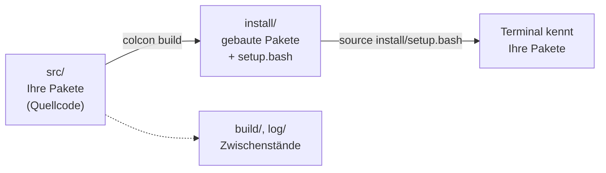
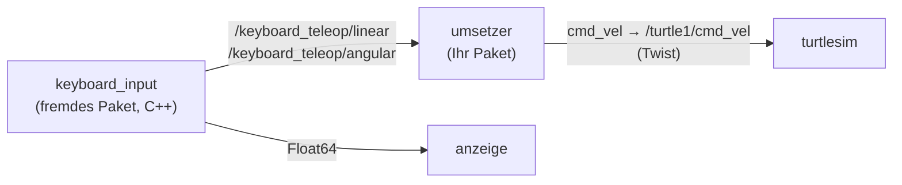

<!--

author:   Sebastian Zug & Claude Code (Opus 5.5) mit LiaScript Teaching-Agent; Konzept: Johannes Kohl
email:    sebastian.zug@informatik.tu-freiberg.de
version:  1.1.0
language: de
narrator: Deutsch Female

import:   https://raw.githubusercontent.com/TUBAF-IfI-LiaScript/VL_SoftwareprojektRobotik/refs/heads/master/config.md
          https://raw.githubusercontent.com/liaTemplates/mermaid_template/master/README.md

-->

[](https://liascript.github.io/course/?https://raw.githubusercontent.com/TUBAF-IfI-LiaScript/VL_SoftwareprojektRobotik/refs/heads/master/exercises/uebung_02_workspace/README.md)

# Übung: Ihr erster Workspace

<!-- data-type="none" -->
| Parameter            | Kursinformationen                                                                                                              |
| -------------------- | ------------------------------------------------------------------------------------------------------------------------------ |
| **Veranstaltung:**   | @config.lecture                                                                                                                |
| **Semester**         | @config.semester                                                                                                               |
| **Hochschule:**      | `Technische Universität Freiberg`                                                                                              |
| **Inhalte:**         | `Eigenes Paket, Pakete anderer Leute, eigener Knoten mit Parametern, Launch-Datei, Daten aufzeichnen mit ros2 bag`             |
| **Link auf GitHub:** | https://github.com/TUBAF-IfI-LiaScript/VL_SoftwareprojektRobotik/blob/master/exercises/uebung_02_workspace/README.md            |
| **Autoren**          | @author                                                                                                                        |

--------------------------------------------------------------------------------

**Voraussetzung:** ROS 2 Jazzy läuft auf Ihrem Rechner — die drei Tests aus Ü 1 (`ros2 doctor`, talker/listener, turtlesim) klappen. Sie haben ein GitHub-Konto (kostenlos unter https://github.com/signup).

**Zielstellung der heutigen Übung** — in VL 02 haben Sie gesehen, wie Pakete aufgebaut sind und gebaut werden. Heute machen Sie es selbst. Nach der Übung können Sie

+ einen Workspace anlegen, darin ein Python-Paket erzeugen, bauen und seinen Knoten starten,
+ ein fremdes Paket in Ihren Workspace holen und an `package.xml` und `CMakeLists.txt` bzw. `setup.py` erkennen, wie es gebaut wird und wovon es abhängt,
+ einen eigenen Knoten schreiben, der Nachrichten anderer Knoten in einen Fahrbefehl `/cmd_vel` übersetzt,
+ Parameter eines Knotens beim Start, aus einer Datei und zur Laufzeit setzen,
+ mehrere Knoten mit einer Launch-Datei starten und Nachrichten mit `ros2 bag` aufzeichnen und abspielen.

Am Ende steuern Sie die Schildkröte von `turtlesim` mit einer Tastatur-Software, die jemand anderes geschrieben hat, über einen Knoten, den Sie selbst geschrieben haben. Im ersten Praktikum tauschen Sie die Schildkröte gegen den TurtleBot.

**Ablauf (90 min)**

<!-- data-type="none" -->
| Zeit   | Inhalt                                                                 |
| ------ | ---------------------------------------------------------------------- |
| 5 min  | Organisation: Gruppen, OPAL, GitHub                                    |
| 5 min  | Läuft alles?                                                           |
| 15 min | A: Ein eigener Workspace                                               |
| 15 min | B: Pakete anderer Leute                                                |
| 30 min | C: Der eigene Umsetzer — Knoten, Parameter, Launch-Datei               |
| 10 min | D: Aufzeichnen und abspielen                                           |
| 5 min  | Selbsttest und Ausblick                                                |
| 5 min  | Puffer                                                                 |

**Pflichtkern:** A1, B1 (Teile 1–2), C1, C2, C3 und D1 (Teile 1 und 3) — genau das wenden Sie im ersten Praktikum an. Mit ⏱ markierte Teile bearbeiten Sie, wenn Zeit bleibt, oder zu Hause. Die Lösungen stehen jeweils aufklappbar unter der Aufgabe — wer bei einem Schritt nicht weiterkommt, übernimmt sie und arbeitet mit dem nächsten Schritt weiter.

**Ihre Terminals.** Sie arbeiten mit bis zu vier Terminals T1 bis T4. In **jedem neuen** Terminal laden Sie zuerst Ihren Workspace: `source ~/ros2_ws/install/setup.bash` (warum, sehen Sie in A1). Bevor Sie einen neuen Abschnitt beginnen, beenden Sie alles, was noch läuft: `Strg+C`, in der Tastatursteuerung `q`.

<!-- data-type="none" -->
| Abschnitt | T1                          | T2                    | T3                          | T4                         |
| :-------- | :-------------------------- | :-------------------- | :-------------------------- | :------------------------- |
| A         | bauen, `hallo` starten      | neues Terminal (A1.2) | —                           | —                          |
| B         | bauen                       | `keyboard_input`      | Anzeige                     | —                          |
| C1, C2    | bauen, dann `turtlesim`     | `keyboard_input`      | Ihr `umsetzer`              | prüfen (`topic`, `param`)  |
| C3, D     | bauen, dann Launch-Datei    | `keyboard_input`      | `ros2 bag`                  | prüfen, `/reset`           |

--------------------------------------------------------------------------------

<!-- kurslandkarte:wo-start -->

## Wo stehen wir?

**Ziel im Projekt:** Sie bauen Ihren ersten Workspace aus eigenen und fremden Paketen und steuern damit die Schildkröte – genau so starten, konfigurieren und belauschen Sie in P 1 den TurtleBot.

**Block 1 · ROS-Grundlagen** – Termin 6 von 32, heute farbig markiert

<!-- data-type="none" -->
| Woche | Vorlesung | Übung | Praktikum |
| :-- | :-- | :-- | :-- |
| KW 43 · 19.–23.10. | [VL 00 Einführung](https://liascript.github.io/course/?https://raw.githubusercontent.com/TUBAF-IfI-LiaScript/VL_SoftwareprojektRobotik/master/00_Einfuehrung/00_Einfuehrung.md) · Mi 21.10. |  |  |
| KW 44 · 26.–30.10. | [VL 01 ROS 2 Grundlagen](https://liascript.github.io/course/?https://raw.githubusercontent.com/TUBAF-IfI-LiaScript/VL_SoftwareprojektRobotik/master/01_ROS_Grundlagen/01_ROS_Grundlagen.md) · Mi 28.10. | [Ü 1 Linux Shell](https://liascript.github.io/course/?https://raw.githubusercontent.com/TUBAF-IfI-LiaScript/VL_SoftwareprojektRobotik/master/exercises/uebung_01_linux_shell/README.md) · Do 29.10. |  |
| KW 45 · 2.–6.11. | [VL 02 ROS 2 Pakete](https://liascript.github.io/course/?https://raw.githubusercontent.com/TUBAF-IfI-LiaScript/VL_SoftwareprojektRobotik/master/02_ROS_Pakete/02_ROS_Pakete.md) · Mi 4.11. |  |  |
| **KW 46 · 9.–13.11.**<!-- style="background-color: rgba(255, 166, 0, 0.35); padding: 2px 6px; border-radius: 4px;" --> | [VL 03 Koordinaten + QoS](https://liascript.github.io/course/?https://raw.githubusercontent.com/TUBAF-IfI-LiaScript/VL_SoftwareprojektRobotik/master/03_Koordinaten_QoS/03_Koordinaten_QoS.md) · Mi 11.11. | **[Ü 2 Erster Workspace](https://liascript.github.io/course/?https://raw.githubusercontent.com/TUBAF-IfI-LiaScript/VL_SoftwareprojektRobotik/master/exercises/uebung_02_workspace/README.md)**<!-- style="background-color: rgba(255, 166, 0, 0.35); padding: 2px 6px; border-radius: 4px;" --> · Do 12.11. |  |
| KW 48 · 23.–27.11. |  |  | [P 1 TurtleBot + Bags](https://liascript.github.io/course/?https://raw.githubusercontent.com/TUBAF-IfI-LiaScript/VL_SoftwareprojektRobotik/master/exercises/praktikum_01_turtlebot/README.md) · Mi 25.11. + Do 26.11. |

- **Sie brauchen:** [Service, Parameter, Action](https://tubaf-ifi-liascript.github.io/VL_SoftwareprojektRobotik/kurslandkarte/#begriff=kommmuster) (VL 01) · [Remapping](https://tubaf-ifi-liascript.github.io/VL_SoftwareprojektRobotik/kurslandkarte/#begriff=remap) (VL 01) · [ROS-2-Paket](https://tubaf-ifi-liascript.github.io/VL_SoftwareprojektRobotik/kurslandkarte/#begriff=paket) (VL 02) · [Launch-Datei](https://tubaf-ifi-liascript.github.io/VL_SoftwareprojektRobotik/kurslandkarte/#begriff=launch) (VL 02) · [ROS\_DOMAIN\_ID](https://tubaf-ifi-liascript.github.io/VL_SoftwareprojektRobotik/kurslandkarte/#begriff=domainid) (VL 02)
- **Heute neu:** [Pakete anderer Leute](https://tubaf-ifi-liascript.github.io/VL_SoftwareprojektRobotik/kurslandkarte/#begriff=fremdpaket) · [Twist / cmd\_vel](https://tubaf-ifi-liascript.github.io/VL_SoftwareprojektRobotik/kurslandkarte/#begriff=twist) · [Parameter und Parameterdatei](https://tubaf-ifi-liascript.github.io/VL_SoftwareprojektRobotik/kurslandkarte/#begriff=paramfile) · [ros2 bag](https://tubaf-ifi-liascript.github.io/VL_SoftwareprojektRobotik/kurslandkarte/#begriff=rosbag)

> [!TIP]
> **Tipp – Kurslandkarte:** [Ganze Kurslandkarte öffnen](https://tubaf-ifi-liascript.github.io/VL_SoftwareprojektRobotik/kurslandkarte/#termin=ue2) – dort finden Sie jeden Begriff mit Erklärung, typischer Stolperfalle, Link auf die passende Folie und die roten Fäden durch die Veranstaltung.

<!-- kurslandkarte:wo-ende -->

## Organisation: Gruppen und GitHub

Ab dem ersten Praktikum arbeiten Sie in festen **Gruppen zu 3–4 Personen** an einem eigenen TurtleBot. Jede Gruppe bekommt ein eigenes Git-Repository in der GitHub-Organisation der Veranstaltung. Dafür brauchen wir drei Dinge von Ihnen — erledigen Sie sie heute gleich zu Beginn oder spätestens bis zum Ende der Übung:

1. **Gruppe bilden** und sich in OPAL gemeinsam in eine freie Gruppe eintragen.
2. **GitHub-Nutzernamen** in die OPAL-Abfrage eintragen (Ihr Name, Ihre OPAL-Gruppe, Ihr GitHub-Name).
3. In den nächsten Tagen kommt eine **Einladung in die Organisation** `IfI-TUBAF-Robotik-2026` per E-Mail — nehmen Sie sie bis zum ersten Praktikum an. Danach sehen Sie dort das Repository Ihrer Gruppe. Die Repositories der anderen Gruppen sehen Sie nicht, die öffentlichen Repositories der Veranstaltung schon.

## Läuft alles?

Öffnen Sie ein Terminal (T1) und prüfen Sie kurz:

```bash
printenv ROS_DISTRO                  # jazzy
ros2 run turtlesim turtlesim_node    # ein Fenster mit einer Schildkröte – danach Strg+C
```

Klappt das nicht, melden Sie sich jetzt bei den Betreuern — und arbeiten Sie die Übung zu zweit an einem Rechner durch, bis Ihr eigener läuft.

## A: Ein eigener Workspace

Ein **Workspace** ist ein Ordner, in dem Sie Pakete sammeln und gemeinsam bauen (VL 02). Der Quellcode liegt in `src/`, `colcon build` legt daneben `build/`, `install/` und `log/` an.



**Ein Paket erzeugen** (T1): `ros2 pkg create` legt das Gerüst eines Pakets an. Mit `--node-name` bekommt es gleich einen ersten Knoten.

```bash
mkdir -p ~/ros2_ws/src
cd ~/ros2_ws/src
ros2 pkg create --build-type ament_python --license BSD-3-Clause --node-name hallo mein_teleop
```

Das erzeugt:

```text
mein_teleop/
├── package.xml            <- Name, Version, Abhängigkeiten, Bauart
├── setup.py               <- wie das Python-Paket installiert wird
├── setup.cfg
├── resource/mein_teleop   <- Marker, damit ROS 2 das Paket findet
├── mein_teleop/
│   ├── __init__.py
│   └── hallo.py           <- Ihr erster Knoten
└── test/                  <- Prüfungen auf Stil und Lizenz
```

Werfen Sie einen Blick in `setup.py`: Unter `entry_points` steht, welcher Befehl hinter `ros2 run mein_teleop hallo` steckt.

```python
    entry_points={
        'console_scripts': [
            'hallo = mein_teleop.hallo:main'
        ],
    },
```

**Bauen und starten** (T1) — immer im Wurzelordner des Workspace, nie in `src/`:

```bash
cd ~/ros2_ws
colcon build --symlink-install
source install/setup.bash
ros2 run mein_teleop hallo
```

`--symlink-install` verlinkt Ihre Python-Dateien, statt sie zu kopieren: Ändern Sie später nur Code, müssen Sie nicht neu bauen — nur den Knoten neu starten. Neue Knoten, Launch- und Parameterdateien brauchen trotzdem ein `colcon build`. Meldet `colcon` am Ende `1 package had stderr output`, ist das bei Python-Paketen meist nur eine Warnung von `setuptools`; entscheidend ist `Summary: … packages finished` ohne `failed`.

### Aufgabe A1: Hallo aus dem eigenen Paket

1. Legen Sie den Workspace und das Paket wie oben an, bauen Sie und starten Sie `hallo`.
2. Öffnen Sie ein **neues** Terminal (T2) und geben Sie dort sofort `ros2 run mein_teleop hallo` ein. Was passiert, und warum?
3. Ändern Sie den Text in `hallo.py` und starten Sie den Knoten erneut — ohne neu zu bauen.

**Prüfkriterium:** In T1 erscheint `Hi from mein_teleop.`, nach Teil 3 Ihr eigener Text.

<details>
<summary>**Lösung zu Teil 2**</summary>

T2 meldet `Package 'mein_teleop' not found`. Es kennt nur das, was in seiner Umgebung steht (Ü 1): `/opt/ros/jazzy` über `~/.bashrc`, aber nicht Ihren Workspace. Abhilfe in jedem neuen Terminal:

```bash
source ~/ros2_ws/install/setup.bash
```

Wer das nicht jedes Mal tippen will, hängt die Zeile an `~/.bashrc` an — **nach** der Zeile für `/opt/ros/jazzy`. Teil 3 klappt ohne Bauen, weil `--symlink-install` auf Ihre Quelldatei verlinkt.

</details>

## B: Pakete anderer Leute

Kaum ein Robotik-Projekt fängt bei null an. Treiber, Werkzeuge und ganze Fähigkeiten holen Sie sich als fertige Pakete. Gibt es ein Paket nicht über `apt`, holen Sie es als Quellcode in Ihren Workspace und bauen es mit.

Für heute haben wir ein kleines **Paketbündel zur Tastatursteuerung** vorbereitet. Es liegt in einem öffentlichen Repository — dafür brauchen Sie weder eine Anmeldung noch die Einladung in die Organisation.

<!-- data-type="none" -->
| Paket                   | Sprache | Inhalt                                                                                           |
| :---------------------- | :------ | :----------------------------------------------------------------------------------------------- |
| `keyboard_teleop_cpp`   | C++     | Knoten `keyboard_input`: liest Tasten, sendet `/keyboard_teleop/linear` und `/keyboard_teleop/angular` (`std_msgs/msg/Float64`) |
| `keyboard_teleop_viz`   | Python  | Knoten `anzeige`: zeigt die aktuelle Vorgabe als Balken an                                      |
| `keyboard_teleop`       | —       | enthält keinen Code, bündelt die beiden anderen und bringt eine Launch-Datei mit                 |

Daneben liegt ein Ordner `vorlagen_ue2/` mit Dateien, die Sie in Teil C in Ihr eigenes Paket kopieren.

```bash
cd ~/ros2_ws/src                                                               # T1
git clone https://github.com/IfI-TUBAF-Robotik-2026/ros2_keyboard_teleop.git
cd ~/ros2_ws
colcon build --symlink-install
source install/setup.bash
ros2 pkg list | grep keyboard
```

**Ausprobieren** — in T2 und T3 (jeweils zuerst `source ~/ros2_ws/install/setup.bash`):

```bash
# T2: die Tastatur. Klicken Sie in dieses Fenster, bevor Sie Tasten drücken.
ros2 run keyboard_teleop_cpp keyboard_input
```

```bash
# T3: die Anzeige
ros2 launch keyboard_teleop anzeige.launch.py
```

Drücken Sie in T2 einige Male `w` und `a`, dann die Leertaste. In T3 wandern die Balken mit. `q` beendet T2, `Strg+C` beendet T3.

> [!WARNING]
> **Stolperfalle – die Tastatur gehört einem Terminal:** `keyboard_input` reagiert nur, wenn sein eigenes Terminalfenster ausgewählt ist — öffnet sich ein anderes Fenster (etwa `turtlesim`), klicken Sie wieder in T2. Deshalb startet man den Knoten mit `ros2 run` und nicht aus einer Launch-Datei: Dort bekäme er keine Tasten.

### Aufgabe B1: Wie wird ein Paket gebaut?

Öffnen Sie die `package.xml` der drei Pakete in `~/ros2_ws/src/ros2_keyboard_teleop/` und die Ihres eigenen Pakets `mein_teleop`, dazu `keyboard_teleop_cpp/CMakeLists.txt`.

1. Welche Bauart (`<build_type>`) hat jedes der vier Pakete?
2. Wovon hängt `keyboard_teleop_cpp` ab, und an welchen zwei Stellen steht das?
3. ⏱ Warum steht beim Bündel `keyboard_teleop` nur `<exec_depend>` und kein `<depend>`?
4. ⏱ Was passiert in `CMakeLists.txt` in den Zeilen mit `add_executable` und `install`? Was übernimmt das bei einem Python-Paket?

**Prüfkriterium:** Sie können für jedes Paket in einem Satz sagen, wie es gebaut wird und wovon es abhängt.

<details>
<summary>**Lösungsvorschlag**</summary>

1. `keyboard_teleop_cpp` und `keyboard_teleop`: `ament_cmake`; `keyboard_teleop_viz` und `mein_teleop`: `ament_python`.
2. Von `rclcpp` und `std_msgs` — in `package.xml` (`<depend>`) und in `CMakeLists.txt` (`find_package`, `ament_target_dependencies`). Die `package.xml` sagt `colcon` und `rosdep`, *was* gebraucht wird; `CMakeLists.txt` sagt dem Compiler, *wo* er es findet.
3. Das Bündel enthält keinen Code, es muss nichts gegen die anderen Pakete übersetzen. Es braucht sie erst, wenn es läuft — zur Laufzeit (`exec`). `<depend>` heißt „zum Bauen und zur Laufzeit“.
4. `add_executable` übersetzt `keyboard_input.cpp` zu einem Programm, `install` legt es nach `install/keyboard_teleop_cpp/lib/keyboard_teleop_cpp/`, wo `ros2 run` es sucht. Bei Python erledigt das der Eintrag `entry_points` in `setup.py`.

</details>

## C: Der eigene Umsetzer

Die Tastatur sendet zwei einzelne Zahlen. Ein Roboter erwartet seinen Fahrbefehl aber als **eine** Nachricht vom Typ `geometry_msgs/msg/Twist` auf `cmd_vel`: Vorwärtsgeschwindigkeit in `linear.x`, Drehgeschwindigkeit in `angular.z`. Das sind die Achsen des Roboters aus VL 03 — `x` zeigt nach vorn, `z` nach oben, gedreht wird also um die Hochachse. Diese Lücke zwischen Tastatur und Roboter schließt Ihr eigener Knoten.



### Aufgabe C1: Der Knoten

**Vorlage kopieren** (T1):

```bash
cp ~/ros2_ws/src/ros2_keyboard_teleop/vorlagen_ue2/umsetzer.py ~/ros2_ws/src/mein_teleop/mein_teleop/
```

Die Vorlage abonniert bisher nur `/keyboard_teleop/linear` und sendet einen leeren Fahrbefehl. Öffnen Sie `~/ros2_ws/src/mein_teleop/mein_teleop/umsetzer.py` und ergänzen Sie die beiden `TODO`:

```python
    def __init__(self):
        super().__init__('umsetzer')
        self.linear = 0.0
        self.angular = 0.0
        self.pub = self.create_publisher(Twist, 'cmd_vel', 10)
        self.create_subscription(Float64, '/keyboard_teleop/linear', self.bei_linear, 10)
        # TODO 1: auch /keyboard_teleop/angular abonnieren (Rückruf: self.bei_angular)
        self.create_timer(0.1, self.senden)  # 10 Hz
```

```python
    def senden(self):
        befehl = Twist()
        # TODO 2: befehl.linear.x und befehl.angular.z füllen
        self.pub.publish(befehl)
```

**Den Knoten bekannt machen.** In `setup.py` kommt eine zweite Zeile unter `console_scripts`. Achten Sie auf das **Komma** hinter der `hallo`-Zeile — fehlt es, klebt Python beide Zeilen zu einer zusammen, und keiner der beiden Knoten wird gefunden:

```python
        'console_scripts': [
            'hallo = mein_teleop.hallo:main',
            'umsetzer = mein_teleop.umsetzer:main',
        ],
```

In `package.xml` tragen Sie die Abhängigkeiten ein — direkt vor die Zeilen mit `<test_depend>`:

```xml
  <license>BSD-3-Clause</license>

  <exec_depend>rclpy</exec_depend>
  <exec_depend>std_msgs</exec_depend>
  <exec_depend>geometry_msgs</exec_depend>

  <test_depend>ament_copyright</test_depend>
```

**Bauen und starten.** Die Schildkröte hört auf `/turtle1/cmd_vel`, Ihr Knoten sendet auf `cmd_vel` — das gleichen Sie beim Start mit **Remapping** aus (VL 01):

```bash
cd ~/ros2_ws && colcon build --symlink-install                                  # T1
ros2 run turtlesim turtlesim_node                                               # T1
ros2 run mein_teleop umsetzer --ros-args -r cmd_vel:=/turtle1/cmd_vel           # T3
ros2 run keyboard_teleop_cpp keyboard_input                                     # T2
```

**Prüfkriterium:** Klicken Sie in T2 (das `turtlesim`-Fenster hat den Fokus übernommen). Mit `w`, `a`, `d` fährt die Schildkröte, mit der Leertaste hält sie an. `ros2 topic echo /turtle1/cmd_vel` in T4 zeigt Ihre Twist-Nachrichten.

<details>
<summary>**Lösung und Fehlersuche**</summary>

```python
        self.create_subscription(Float64, '/keyboard_teleop/angular', self.bei_angular, 10)
```

```python
        befehl.linear.x = self.linear
        befehl.angular.z = self.angular
```

+ `No executable found` — das Komma in `setup.py` fehlt, der Eintrag fehlt, oder nach dem Eintrag wurde nicht gebaut.
+ Die Schildkröte bewegt sich nicht — zeigt `ros2 topic info /turtle1/cmd_vel` (T4) „Publisher count: 1“ *und* „Subscription count: 1“? Fehlt der Publisher, hat das Remapping nicht gegriffen oder der Umsetzer läuft nicht.
+ Die Balken bewegen sich, die Schildkröte nicht — die Tasten landen in einem anderen Fenster.

</details>

### Aufgabe C2: Parameter

Ein TurtleBot 3 Burger fährt höchstens 0,22 m/s und dreht höchstens 2,84 rad/s. Ihr Umsetzer soll schnellere Vorgaben begrenzen — mit **Parametern**, damit man die Grenzen ändern kann, ohne den Code anzufassen.

**Teil 1 – Parameter deklarieren und anwenden.** Ergänzen Sie in `__init__` direkt nach `super().__init__('umsetzer')` die beiden Parameter:

```python
        self.declare_parameter('max_linear', 0.22)    # m/s
        self.declare_parameter('max_angular', 2.84)   # rad/s
```

und ersetzen Sie `senden` durch die Fassung mit Begrenzung:

```python
    def senden(self):
        befehl = Twist()
        max_l = self.get_parameter('max_linear').value
        max_a = self.get_parameter('max_angular').value
        befehl.linear.x = max(-max_l, min(max_l, self.linear))
        befehl.angular.z = max(-max_a, min(max_a, self.angular))
        self.pub.publish(befehl)
```

Starten Sie den Umsetzer in T3 neu (`Strg+C`, dann den Befehl aus C1). Bauen müssen Sie nicht — die Datei ist verlinkt.

**Teil 2 – zur Laufzeit ändern** (T4), während Sie in T2 mehrfach `w` drücken:

```bash
ros2 param list /umsetzer
ros2 param get /umsetzer max_linear
ros2 param set /umsetzer max_linear 0.1
ros2 param set /umsetzer max_linear 1        # was meldet ROS 2 hier?
```

**Teil 3 – beim Start setzen und sichern.** Beenden Sie den Umsetzer, starten Sie ihn mit einem Startwert und sichern Sie dann seine Parameter:

```bash
ros2 run mein_teleop umsetzer --ros-args -r cmd_vel:=/turtle1/cmd_vel -p max_linear:=0.5    # T3
ros2 param dump /umsetzer > ~/umsetzer_dump.yaml                                              # T4
cat ~/umsetzer_dump.yaml
```

**Prüfkriterium:** Nach `ros2 param set … 0.1` zeigt `ros2 topic echo /turtle1/cmd_vel` auch bei vielen `w` höchstens `x: 0.1`. Nach dem Neustart in Teil 3 zeigt `ros2 param get /umsetzer max_linear` den Wert `0.5`.

<details>
<summary>**Lösung und Hinweise**</summary>

+ Der Knoten liest die Parameter bei **jedem** Senden neu — deshalb wirkt `ros2 param set` sofort. Liest ein Knoten seine Parameter nur einmal im Konstruktor, merkt er von späteren Änderungen nichts. Genau so verändern Sie in P 3 die Schwelle Ihrer Spurerkennung bei laufendem Roboter.
+ `ros2 param set /umsetzer max_linear 1` scheitert mit `Wrong parameter type, expected 'Type.DOUBLE' got 'Type.INTEGER'`: Der Parameter wurde mit `0.22` als Kommazahl deklariert, `1` ist eine ganze Zahl. Schreiben Sie `1.0`.
+ `ros2 param list` zeigt keine `max_*`-Einträge? Dann läuft noch der alte Umsetzer — neu starten.
+ Die gesicherte Datei beginnt mit `/umsetzer:` und enthält zusätzlich `use_sim_time` und `start_type_description_service`. So sieht eine Parameterdatei aus; mit `--ros-args --params-file ~/umsetzer_dump.yaml` laden Sie sie beim Start wieder.

</details>

### Aufgabe C3: Alles mit einer Launch-Datei

Drei Terminals für drei Knoten, dazu Remapping und Parameter von Hand — das übernimmt eine **Launch-Datei** (VL 02). Die Parameter legt sie aus einer **Parameterdatei** fest. Beide liegen fertig in den Vorlagen (T1):

```bash
cp -r ~/ros2_ws/src/ros2_keyboard_teleop/vorlagen_ue2/launch ~/ros2_ws/src/mein_teleop/
cp -r ~/ros2_ws/src/ros2_keyboard_teleop/vorlagen_ue2/config ~/ros2_ws/src/mein_teleop/
```

Die Parameterdatei `config/umsetzer.yaml` — derselbe Aufbau wie Ihre gesicherte Datei aus C2, nur auf das Nötige gekürzt; `umsetzer:` und `/umsetzer:` gehen beide:

```yaml
umsetzer:
  ros__parameters:
    max_linear: 0.22
    max_angular: 2.84
```

Die Launch-Datei `launch/teleop.launch.py`:

```python
def generate_launch_description():
    parameter = os.path.join(get_package_share_directory('mein_teleop'), 'config', 'umsetzer.yaml')
    return LaunchDescription([
        Node(package='turtlesim', executable='turtlesim_node', name='turtlesim'),
        Node(package='keyboard_teleop_viz', executable='anzeige', output='screen'),
        Node(package='mein_teleop', executable='umsetzer', name='umsetzer',
             parameters=[parameter],
             remappings=[('cmd_vel', '/turtle1/cmd_vel')]),
    ])
```

`get_package_share_directory('mein_teleop')` findet den Ordner `install/mein_teleop/share/mein_teleop`. Dorthin muss `colcon` die beiden Dateien beim Bauen kopieren — das legen Sie in `setup.py` fest. Ändern Sie dort den Anfang und den Block `data_files` so:

```python
import os
from glob import glob
from setuptools import find_packages, setup

package_name = 'mein_teleop'

setup(
    name=package_name,
    version='0.0.0',
    packages=find_packages(exclude=['test']),
    data_files=[
        ('share/ament_index/resource_index/packages',
            ['resource/' + package_name]),
        ('share/' + package_name, ['package.xml']),
        (os.path.join('share', package_name, 'launch'), glob('launch/*.launch.py')),
        (os.path.join('share', package_name, 'config'), glob('config/*.yaml')),
    ],
```

Und in `package.xml` drei weitere Abhängigkeiten, an dieselbe Stelle wie in C1:

```xml
  <exec_depend>launch_ros</exec_depend>
  <exec_depend>turtlesim</exec_depend>
  <exec_depend>keyboard_teleop_viz</exec_depend>
```

Beenden Sie alles, bauen Sie und starten Sie:

```bash
cd ~/ros2_ws && colcon build --symlink-install     # T1
ros2 launch mein_teleop teleop.launch.py           # T1
ros2 run keyboard_teleop_cpp keyboard_input        # T2 – danach in T2 klicken
```

**Prüfkriterium:** Ein Befehl in T1 startet Schildkröte, Anzeige und Umsetzer; mit T2 fahren Sie wie in C1. `ros2 param get /umsetzer max_linear` (T4) zeigt den Wert aus der YAML-Datei.

<details>
<summary>**Häufige Fehler**</summary>

+ `file 'teleop.launch.py' was not found` — die `data_files`-Zeilen fehlen, `import os`/`from glob import glob` fehlen, oder `colcon build` wurde danach nicht ausgeführt.
+ Der Umsetzer nimmt die Werte aus der YAML-Datei nicht an — der Name in ihrer ersten Zeile (`umsetzer:`) muss zum Knotennamen in der Launch-Datei (`name='umsetzer'`) passen.
+ `package 'keyboard_teleop_viz' not found` — das fremde Paket ist nicht gebaut oder das Terminal nicht gesourct.

</details>

## D: Aufzeichnen und abspielen

Mit `ros2 bag` zeichnen Sie Nachrichten ausgewählter Topics auf und spielen sie später wieder ab. Für das Projekt ist das zentral: Sie nehmen im ersten Praktikum eine Fahrt durch die Verkehrswelt auf und entwickeln Ihre Spurerkennung danach am Schreibtisch — immer mit denselben Daten.

**Schritt 1: Aufzeichnen.** Die Launch-Datei aus C3 läuft weiter. Setzen Sie die Schildkröte zuerst an den Start, starten Sie dann die Aufnahme und fahren Sie in T2 etwa zehn Sekunden lang eine kurze Kurve — nicht bis an die Wand. Halten Sie mit der Leertaste an.

```bash
ros2 service call /reset std_srvs/srv/Empty                                           # T4
ros2 bag record -o fahrt --topics /keyboard_teleop/linear /keyboard_teleop/angular    # T3
```

`/reset` ist ein **Service** des Simulators: eine einmalige Anfrage mit Antwort, kein fortlaufender Datenstrom. Beenden Sie die Aufnahme mit `Strg+C` in T3 und notieren Sie die Endposition der Schildkröte: `ros2 topic echo --once /turtle1/pose` (T4).

> [!WARNING]
> **Stolperfalle – zwei Quellen für ein Topic:** Beenden Sie `keyboard_input` (`q` in T2), bevor Sie die Aufnahme abspielen. Sonst sendet die Tastatur weiter zehnmal pro Sekunde ihre Vorgabe auf dieselben Topics, und die Schildkröte bekommt widersprüchliche Befehle.

**Schritt 2: Untersuchen.** Die Aufnahme ist ein Ordner mit einer Datei im Format MCAP. Ihre Zahlen weichen ab, je nachdem, wie lange Sie gefahren sind:

```text
> ros2 bag info fahrt
Files:             fahrt_0.mcap
Storage id:        mcap
Duration:          10.4s
Messages:          208
Topic information: Topic: /keyboard_teleop/angular | Type: std_msgs/msg/Float64 | Count: 104 | Serialization Format: cdr
                   Topic: /keyboard_teleop/linear | Type: std_msgs/msg/Float64 | Count: 104 | Serialization Format: cdr
```

**Schritt 3: Abspielen.** Schildkröte zurücksetzen, Aufnahme abspielen:

```bash
ros2 service call /reset std_srvs/srv/Empty    # T4
ros2 bag play fahrt                            # T3
```

Die Schildkröte fährt die Strecke ein zweites Mal — ohne dass jemand eine Taste drückt.

### Aufgabe D1: Wiederholt sich die Fahrt?

1. Lesen Sie nach dem Abspielen die Endposition ab und vergleichen Sie sie mit der notierten. Wiederholen Sie `reset` und `play` zwei-, dreimal.
2. ⏱ Wie viele Daten erzeugt das Topic `/turtle1/pose` pro Sekunde? Messen Sie mit `ros2 topic hz /turtle1/pose` und `ros2 topic bw /turtle1/pose`.
3. Spielen Sie die Aufnahme in einer Schleife ab: `ros2 bag play fahrt --loop` — und beenden Sie sie nach zwei Runden mit `Strg+C`.

**Prüfkriterium:** Sie können erklären, warum die Endpositionen voneinander abweichen. In Teil 3 fährt die Schildkröte die Strecke immer wieder, bis Sie abbrechen.

<details>
<summary>**Lösung**</summary>

1. Die Schildkröte landet nahe, aber nicht genau am selben Ort — und jede Wiedergabe weicht etwas anders ab. Die Aufnahme beginnt und endet nicht exakt mit Ihrem Tastendruck, die Nachrichten kommen beim Abspielen nicht auf die Millisekunde genau an, und der Umsetzer sendet im eigenen 10-Hz-Takt. Kleine Zeitunterschiede summieren sich über die Fahrt. **Befehle blind abzuspielen ist eine Steuerung ohne Rückkopplung** — ein Roboter, der einer Spur folgen soll, muss laufend messen und nachregeln (Block 5). Beim echten TurtleBot kämen Schlupf und Untergrund dazu.
2. Etwa 62 Nachrichten pro Sekunde, rund 1,5 KB/s. Die Schildkröte meldet ihre Position fortlaufend, auch im Stillstand — genau wie Sensoren. Eine Kamera erzeugt so leicht einige Megabyte pro Sekunde; mit `ros2 topic bw` schätzen Sie vor einer Aufnahme ab, wie groß sie wird (P 1).
3. `--loop` beginnt nach dem Ende wieder von vorn. Weil die Schildkröte dabei nicht zurückgesetzt wird, fährt sie die Figur jedes Mal von ihrer letzten Position aus weiter. Im Praktikum spielen Sie so eine Sensoraufnahme in Dauerschleife ab, während Sie Ihren Knoten entwickeln.

</details>

Weitere nützliche Optionen: `--rate 2.0` spielt doppelt so schnell ab, und `ros2 bag record -a` nimmt **alle** Topics auf — beim Roboter mit Kamera ist das selten eine gute Idee. Existiert der Ordner `fahrt` schon, bricht `ros2 bag record` ab: neuen Namen wählen (`-o fahrt2`) oder den alten Ordner löschen.

## Selbsttest und Ausblick

Was steht nach `ros2 pkg create --build-type ament_python …` in der Datei, die festlegt, welcher Befehl hinter `ros2 run <paket> <knoten>` steckt?

[( )] `CMakeLists.txt`, Zeile `add_executable`
[(X)] `setup.py`, Eintrag `entry_points`
[( )] `package.xml`, Eintrag `<build_type>`
***
Bei Python-Paketen (`ament_python`) legt `setup.py` die Programme fest, bei C++-Paketen (`ament_cmake`) übernehmen das `add_executable` und `install` in `CMakeLists.txt`.
***

Ein neues Terminal meldet `Package 'mein_teleop' not found`, obwohl `colcon build` fehlerfrei durchlief. Was fehlt?

[[ (source ~/ros2_ws/install/setup.bash) | colcon build --symlink-install | sudo apt install mein_teleop ]]
***
Jedes Terminal kennt nur seine eigene Umgebung (Ü 1). Erst `source` auf die `setup.bash` des Workspace macht Ihre Pakete darin bekannt.
***

Ordnen Sie zu: Welcher Befehl …

[[param set] [param dump] [-p beim Start]]
[    (X)          ( )            ( )      ] ändert die Grenze eines laufenden Knotens sofort?
[    ( )          (X)            ( )      ] schreibt alle aktuellen Werte eines Knotens als YAML heraus?
[    ( )          ( )            (X)      ] legt einen Wert fest, bevor der Knoten überhaupt läuft?
***
`ros2 param set /umsetzer max_linear 0.1`, `ros2 param dump /umsetzer > datei.yaml`, `ros2 run … --ros-args -p max_linear:=0.5`. In einer Launch-Datei übernimmt `parameters=[…]` die Rolle von `-p`.
***

Der Umsetzer startet aus Ihrer Launch-Datei, behält aber seine Standardwerte statt der Werte aus `config/umsetzer.yaml`. Die Datei ist installiert. Was ist die wahrscheinlichste Ursache?

[( )] YAML-Dateien kann ROS 2 erst nach einem Neustart des Rechners lesen.
[(X)] Der Name in der ersten Zeile der YAML-Datei passt nicht zum Knotennamen.
[( )] Parameter lassen sich nur mit `ros2 param set` setzen.
***
Eine Parameterdatei ordnet Werte einem **Knotennamen** zu. Heißt die erste Zeile `teleop:`, der Knoten aber `umsetzer`, gelten die Werte für einen Knoten, den es nicht gibt.
***

Warum beenden Sie `keyboard_input`, bevor Sie `ros2 bag play fahrt` starten?

[( )] `ros2 bag` kann nicht abspielen, solange ein C++-Knoten läuft.
[(X)] Sonst senden Tastatur und Aufnahme gleichzeitig auf dieselben Topics, und der Umsetzer bekommt widersprüchliche Vorgaben.
[( )] Die Tastatur würde die Aufnahme überschreiben.
***
Ein Topic kann mehrere Absender haben — ROS 2 verhindert das nicht. Im Praktikum ist es derselbe Fehler, eine Kameraaufnahme abzuspielen, während die echte Kamera noch sendet.
***

**Spickzettel**

<!-- data-type="none" -->
| Aufgabe                             | Befehl                                                                     |
| :---------------------------------- | :------------------------------------------------------------------------- |
| Paket anlegen                       | `ros2 pkg create --build-type ament_python --node-name <knoten> <paket>`   |
| bauen (im Workspace-Wurzelordner)   | `colcon build --symlink-install`                                           |
| Workspace laden (jedes Terminal)    | `source ~/ros2_ws/install/setup.bash`                                      |
| Knoten mit Remapping und Parameter  | `ros2 run <paket> <knoten> --ros-args -r alt:=neu -p name:=wert`           |
| Parameter                           | `ros2 param list` / `get` / `set` / `dump <knoten>`                        |
| mehrere Knoten starten              | `ros2 launch <paket> <datei>.launch.py`                                    |
| Service aufrufen                    | `ros2 service call <name> <typ> "<daten>"`                                 |
| Aufnahme                            | `ros2 bag record -o <ordner> --topics <topics>` / `ros2 bag info` / `ros2 bag play [--loop]` |
| Datenrate messen                    | `ros2 topic hz <topic>` / `ros2 topic bw <topic>`                          |

**Kür (zu Hause):** Machen Sie den Umsetzer sicherer: Kommt länger als 0,5 s keine Nachricht von der Tastatur — etwa weil `keyboard_input` abgestürzt ist —, soll er einen Stopp senden. Tipp: Merken Sie sich in `bei_linear` den Zeitpunkt mit `self.get_clock().now()` und vergleichen Sie in `senden`. **Prüfkriterium:** Beenden Sie `keyboard_input` während der Fahrt mit `Strg+C` — die Schildkröte hält nach spätestens einer halben Sekunde an.

**Ausblick:** Im ersten Praktikum steuern Sie den echten TurtleBot — mit einer fertigen Tastatursteuerung, der Sie die Geschwindigkeit beim Start als Parameter mitgeben (`--ros-args -p speed:=0.1`). Sie messen mit `ros2 topic bw`, wie viele Daten Kamera und LiDAR erzeugen, und zeichnen eine Fahrt mit `ros2 bag record` auf. Bis dahin nehmen Sie die Einladung in die GitHub-Organisation an; das Repository Ihrer Gruppe ist dann der Ort für Ihren Code.

<!-- kurslandkarte:ausblick-start -->

--------------------------------------------------------------------------------

**🗺️ Nächster Halt:** P 1 · TurtleBot + Bags (Mi 25.11. 11:30–13:00 + Do 26.11. 16:15–17:45) – Ihr TurtleBot ist verbunden, fährt sicher, und Sie haben eine Testfahrt aufgezeichnet – das Rohmaterial für Block 2. [Auf der Kurslandkarte ansehen](https://tubaf-ifi-liascript.github.io/VL_SoftwareprojektRobotik/kurslandkarte/#termin=p1)

<!-- kurslandkarte:ausblick-ende -->
